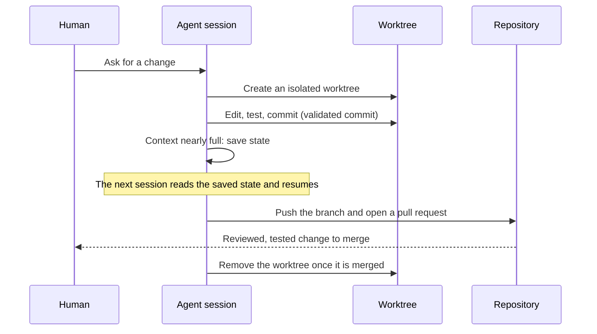

# ai-chassis

[](https://github.com/sergeiwallace/ai-chassis/actions/workflows/ci.yml)
[](https://github.com/sergeiwallace/ai-chassis/releases)
[](LICENSE)
[](pyproject.toml)
[](#status)

ai-chassis is a collection of reusable tools, skills, document templates and Python
modules for working with AI coding agents. It comes from a working setup for running
several coding agents in parallel on one codebase, and it covers the parts that sit
around the model: agent skills, session and context configuration, git and worktree
helpers, review and audit evidence, and the tests for them.

> **Status.** This repository is a generalized extract that grows in small releases.
> It is a source toolkit today. There is no top-level command-line application and no
> package on PyPI yet; both are planned. See [Status](#status) and the
> [changelog](CHANGELOG.md).

## Contents

- [The idea](#the-idea)
- [What is inside](#what-is-inside)
- [How the pieces fit](#how-the-pieces-fit)
- [A session, start to finish](#a-session-start-to-finish)
- [Skills in this release](#skills-in-this-release)
- [Get started](#get-started)
- [Status](#status)
- [Provenance](#provenance)
- [Contribute and report issues](#contribute-and-report-issues)

## The idea

A coding agent is only as reliable as the setup around it. Running several of them at
once on one repository adds problems that a single chat window never has: two agents
edit the same files, a session runs out of context and forgets what it was doing, a
change lands without anyone checking it, and the shared instructions drift from
machine to machine.

ai-chassis collects the parts that answer those problems:

- Work happens in isolated git worktrees, one per agent, so parallel edits do not collide.
- A session writes down its state before its context resets, and the next one resumes from that record.
- Instructions are composed from shared modules and per-machine overlays instead of copied by hand.
- Changes carry evidence: a validated commit, a review, an audit, a passing test run.

## What is inside

| Path | What it holds |
| --- | --- |
| `skills/` | Agent skills. Each skill is a `SKILL.md` plus its helper scripts. The [list below](#skills-in-this-release) names the ones that ship a `SKILL.md` in this release. |
| `projects-wide-session-config/` | Shared modules and rules from which per-machine agent context files are composed, with an example config. |
| `src/ai_harness/` | Python modules that compose and apply that configuration: profiles, schema, settings merge, links and generations. |
| `scripts/` | Helpers for session lifecycle, git and worktree safety, review and audit evidence, and quality checks. |
| `hooks/`, `shell/`, `launchd/` | A Claude Code settings validator, terminal-mode reset helpers, and a macOS launch agent for the job supervisor. |
| `docs/` | Procedures, templates for designs, plans, research and audits, and a [documentation guide](docs/README.md). |
| `codex/` | Example role configurations for delegating work to Codex agents. |
| `packages/fleet-testkit/` | Test-support code the suite relies on. |
| `tests/` | The Python test suite. |

## How the pieces fit


The configuration side turns shared modules and a small per-machine overlay into the
context files an agent reads at startup. The work side keeps every agent in its own
worktree and asks each change to carry evidence before it merges.

## A session, start to finish



The diagram shows the whole workflow the toolkit is built around. Some of its steps,
saving state among them, rely on skills whose `SKILL.md` ships in a later release;
this release has their helper scripts and the surrounding documentation.

## Skills in this release

These skills ship a `SKILL.md` in this release. Other skill directories ship helper
files only, and their `SKILL.md` files arrive in later releases.

| Skill | What it does |
| --- | --- |
| `archify` | Turns requirements or a repository into a validated architecture or workflow diagram. |
| `clean-task-panel` | Clears completed tasks from a task panel. |
| `commit` | Creates a validated commit through one supported procedure. |
| `message-board` | Coordinates a hand-off between machines that cannot message each other directly. |
| `persist` | Writes a lasting rule or convention into the context files. |
| `pr-badge-hygiene` | Removes a Claude Code session's confirmed closed pull request links from its agents panel. |
| `pull-git` | Fast-forwards every repository and worktree from its remote wherever that is provably safe. |
| `quality-check` | Reviews uncommitted changes against project quality standards, read only. |
| `shadow-codex-launch` | Launches one Codex job from a live session and tracks it. |
| `spec` | Presents an implementation plan for review before any change is made. |
| `status-update` | Produces a structured status update from active work, tests and git. |
| `usage-status` | Shows the current context window and quota usage. |

## Get started

Download or clone this repository and open its root directory. Install Python 3.11
or newer, Git and [uv](https://docs.astral.sh/uv/), then install the development
tools and run the Python tests (several tests create temporary Git repositories):

```sh
uv sync --frozen
uv run pytest
```

The project metadata configures this source checkout and its test environment. It
does not install a Python distribution or register a console command. Python modules
are available under `src/`, scripts under `scripts/`, agent skills under `skills/`
and document templates under `docs/`. Individual tools may require additional
dependencies described alongside their source. Read a tool's instructions before you
run it.

## Status

Alpha. Releases are small and frequent: each one adds a subsystem or fixes a defect,
and the [changelog](CHANGELOG.md) says which. The next releases add the installer and
command-line application, then the remaining core modules, skills, hooks and
configuration templates.

Examples and templates are starting points to adapt to your own project. The Python
suite covers the included test modules; it does not establish support for every tool
or operating system.

## Provenance

The public repository begins at a clean root. It is not the original development
history; the pre-launch history is retained privately. Each release is built from a
default-deny allowlist by a release engine, scanned for private material, and tagged
with a signed tag.

## Contribute and report issues

Use the repository's issue tracker for bugs, feature requests and questions. See
[CONTRIBUTING.md](CONTRIBUTING.md) for contribution guidance, [SUPPORT.md](SUPPORT.md)
for where to ask for help, [CODE_OF_CONDUCT.md](CODE_OF_CONDUCT.md) for how we work
together, and [SECURITY.md](SECURITY.md) for private security reporting.

The project is licensed under [Apache-2.0](LICENSE). See [NOTICE](NOTICE) and the
accompanying notices for third-party components.
