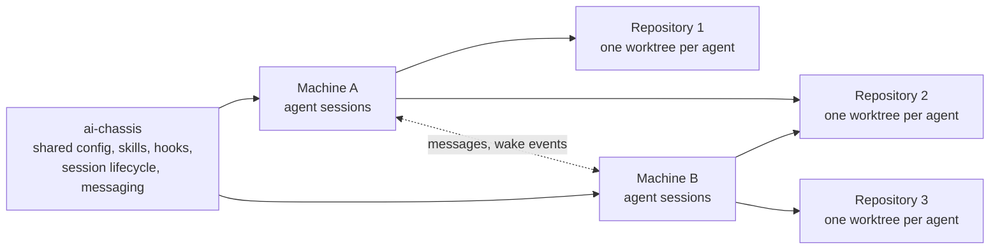
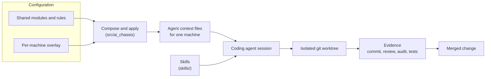
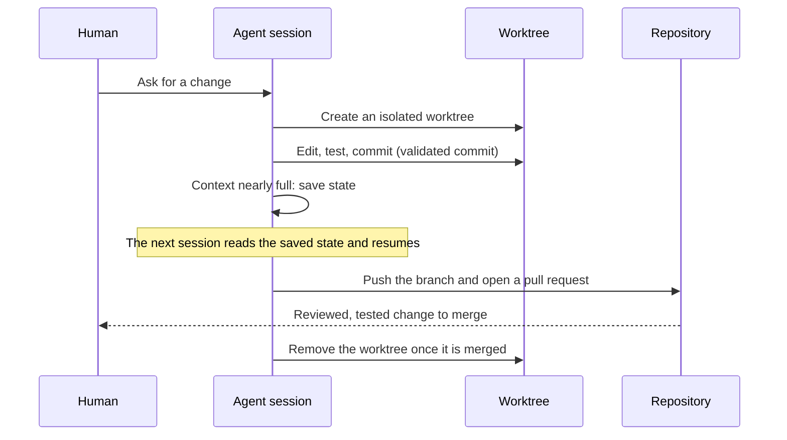
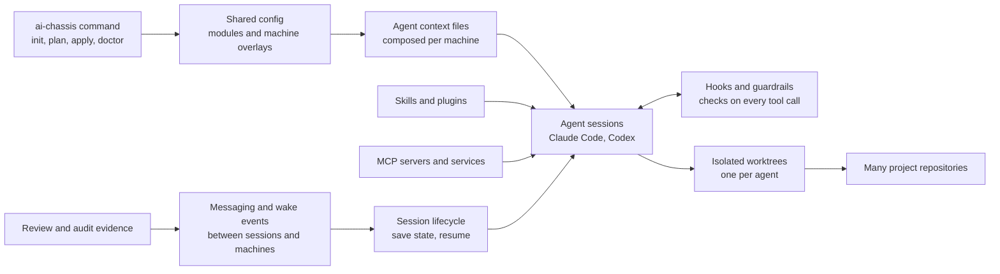
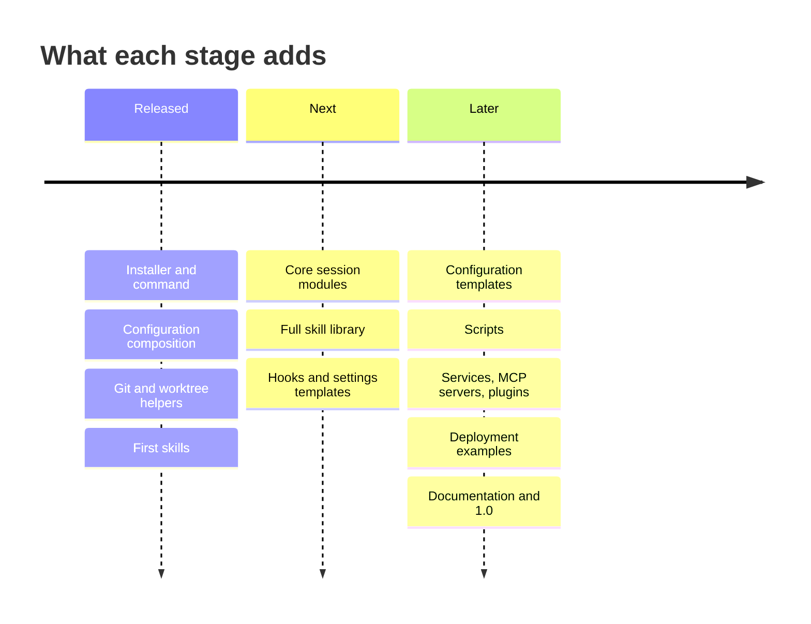

# ai-chassis

[](https://github.com/sergeiwallace/ai-chassis/actions/workflows/ci.yml)
[](https://github.com/sergeiwallace/ai-chassis/releases)
[](LICENSE)
[](pyproject.toml)
[](#status)

ai-chassis is a modular, extensible AI agent harness and toolkit, built primarily around
Claude Code and Codex. It collects reusable skills, plugins, context files, hooks,
scripts, document templates and Python modules for long-running, autonomous,
multi-agent work.

It comes from a working setup that runs a whole fleet of coding-agent sessions across
many repositories and several machines at once, not one agent on one project. That is
why it installs globally and into your projects directory instead of inside a single
repository: one shared harness is composed into per-machine context and serves every
repository the fleet works on. It covers the parts that sit around the model: agent
skills, session and context configuration, git and worktree helpers, messaging between
sessions, review and audit evidence, and the tests for them.

> **Status.** ai-chassis is the open-source edition of a larger private harness. That
> harness is being refactored and cleaned up in stages, and each release publishes more
> of it. Today it installs an `ai-chassis` command and a Python package; it is not on
> PyPI yet. See the [Roadmap](#roadmap) for what is coming, [Get started](#get-started),
> [Status](#status) and the [changelog](CHANGELOG.md).

## Contents

- [The idea](#the-idea)
- [One harness, many repositories](#one-harness-many-repositories)
- [What is inside](#what-is-inside)
- [How the pieces fit](#how-the-pieces-fit)
- [A session, start to finish](#a-session-start-to-finish)
- [Skills in this release](#skills-in-this-release)
- [Roadmap](#roadmap)
- [Get started](#get-started)
- [Status](#status)
- [Provenance](#provenance)
- [Contribute and report issues](#contribute-and-report-issues)

## The idea

A coding agent is only as reliable as the setup around it. Running several of them at
once, across several repositories and machines, adds problems that a single chat window
never has: two agents edit the same files, a session runs out of context and forgets
what it was doing, a change lands without anyone checking it, one session cannot tell
another what it found, and the shared instructions drift from machine to machine.

ai-chassis collects the parts that answer those problems:

- Work happens in isolated git worktrees, one per agent, so parallel edits do not collide.
- A session writes down its state before its context resets, and the next one resumes from that record.
- Instructions are composed from shared modules and per-machine overlays instead of copied by hand.
- Changes carry evidence: a validated commit, a review, an audit, a passing test run.

## One harness, many repositories

ai-chassis is not scoped to one project. You install it once per machine, and it sits
beside your repositories rather than inside any of them. The same skills, rules and
lifecycle tools then apply to every repository you work on, and sessions on different
machines can message each other.



Each machine gets its own context files, composed from the shared modules plus a small
overlay for that machine. Each agent works in its own git worktree of whichever
repository it was given, so parallel work never collides, wherever it runs.

## What is inside

| Path | What it holds |
| --- | --- |
| `skills/` | Agent skills. Each skill is a `SKILL.md` plus its helper scripts. The [list below](#skills-in-this-release) names the ones that ship a `SKILL.md` in this release. |
| `projects-wide-session-config/` | Shared modules and rules from which per-machine agent context files are composed, with an example config. |
| `src/ai_chassis/` | Python modules that compose and apply that configuration: profiles, schema, settings merge, links and generations. |
| `scripts/` | Helpers for session lifecycle, git and worktree safety, review and audit evidence, and quality checks. |
| `hooks/`, `shell/`, `launchd/` | A Claude Code settings validator, terminal-mode reset helpers, and a macOS launch agent for the job supervisor. |
| `docs/` | Procedures, templates for designs, plans, research and audits, and a [documentation guide](docs/README.md). |
| `codex/` | Example role configurations for delegating work to Codex agents. |
| `packages/fleet-testkit/` | Test-support code the suite relies on. |
| `tests/` | The Python test suite. |

## How the pieces fit



The configuration side turns shared modules and a small per-machine overlay into the
context files an agent reads at startup. The work side keeps every agent in its own
worktree and asks each change to carry evidence before it merges.

## A session, start to finish



The diagram shows the whole workflow the toolkit is built around. Some of its steps,
saving state among them, rely on skills whose `SKILL.md` ships in a later release;
this release has their helper scripts and the surrounding documentation.

## Skills in this release

These skills ship a `SKILL.md` in this release. Other skill directories ship helper
files only, and their `SKILL.md` files arrive in later releases.

| Skill | What it does |
| --- | --- |
| `archify` | Turns requirements or a repository into a validated architecture or workflow diagram. |
| `clean-task-panel` | Clears completed tasks from a task panel. |
| `commit` | Creates a validated commit through one supported procedure. |
| `message-board` | Coordinates a hand-off between machines that cannot message each other directly. |
| `persist` | Writes a lasting rule or convention into the context files. |
| `pr-badge-hygiene` | Removes a Claude Code session's confirmed closed pull request links from its agents panel. |
| `pull-git` | Fast-forwards every repository and worktree from its remote wherever that is provably safe. |
| `quality-check` | Reviews uncommitted changes against project quality standards, read only. |
| `shadow-codex-launch` | Launches one Codex job from a live session and tracks it. |
| `spec` | Presents an implementation plan for review before any change is made. |
| `status-update` | Produces a structured status update from active work, tests and git. |
| `usage-status` | Shows the current context window and quota usage. |

## Roadmap

ai-chassis is the open-source edition of a larger private harness. That harness was
built for the maintainers' own fleet of agent sessions, so before a part of it can be
published it is refactored and cleaned up: machine-specific settings become
configuration, private names are replaced with neutral examples, and its tests are
rewritten to use synthetic fixtures. Every stage then passes the release checks (build
from an allowlist, scan for private material, independent audit, signed tag) before it
is published.

This roadmap is the plan, not a promise. Order and timing change as the clean-up goes,
and the [changelog](CHANGELOG.md) records what each release actually contains.

### The end state



### Stages



| Stage | Sub-system | What it is | State |
| --- | --- | --- | --- |
| 1 | Installer and command line | `install.sh`, `install.ps1` and the `ai-chassis` command (`init`, `plan`, `apply`, `doctor`, `explain`), with the modules the command needs. | Released |
| 1 | Configuration composition | Shared modules and per-machine overlays composed into the context files an agent reads. | Released |
| 1 | Git and worktree helpers | Safe fast-forwards, worktree creation and removal, and validated commits. | Released, more to come |
| 1 | First skills | A dozen skills that ship a `SKILL.md`, listed [above](#skills-in-this-release). | Released |
| 2 | Core session modules | Context supervision, session state saving and resuming, messaging and hand-offs between sessions, documents held for human review, wake-ups, session liveness, and usage and quota tracking. | Next |
| 3 | Full skill library | Planning, delegation, review and audit, task tracking and document authoring skills. | Next |
| 4 | Hooks and settings | Claude Code hooks, settings templates and the status line that wire the skills and session modules into a live session. | Planned |
| 5 | Configuration templates | Shared context modules and per-machine overlays as examples you adapt to your own machines. | Planned |
| 6 | Scripts | Worktree and git safety, review and audit evidence, and quality checks, released in subsystem batches. | Planned |
| 7 | Services, MCP and plugins | A message board between machines, a provider broker, extensions for other agent runtimes, MCP servers and Claude Code plugins. | Planned |
| 8 | Deployment examples | Service units for systemd, launchd and Windows as examples. | Planned |
| 9 | Documentation | Procedures, design, plan, research and audit templates, and the guides for everything above. | Planned, with the first 1.0 |

Tests ship with the sub-system they test.

### Alongside the stages

- **Distribution.** A PyPI release of the package and installer, Claude Code plugin
  marketplaces for the skills, and checks of the installer against fresh macOS and Linux
  machines.
- **Repository design.** A reorganization of the layout for best practice:
  organization, scalability, installability, configurability and distribution.
- **Plugins and MCP.** Consolidating the harness into MCP servers, MCP tools, plugin
  modules and Claude Code mods, so you can take one piece without the rest.
- **Companion projects.** Other tooling the harness relies on follows once ai-chassis
  settles.
- **Dogfooding.** The maintainers' private harness is being rebuilt as a downstream of
  this repository, so what ships here is what they run.

## Get started

You need Git, Python 3.11 or newer and [uv](https://docs.astral.sh/uv/).

Install the command with the bootstrap installer. It picks the newest release, clones it,
installs the `ai-chassis` command with uv, and creates an initial configuration file:

```sh
git clone https://github.com/sergeiwallace/ai-chassis.git
bash ai-chassis/install.sh
```

On Windows, run `install.ps1` from PowerShell instead. It follows the same steps but has
not been run on Windows yet.

The installer keeps its checkout in `~/.local/share/ai-chassis` and installs the command
from it, because several commands read the scripts and configuration that sit beside the
package. Run it again to move to a newer release. Every choice has a flag and an
environment variable: `--ref`, `--dir`, `--bin-dir`, `--config-dir`, `--repo`,
`--templates`, `--install-uv`, `--no-init` and `--dry-run`. Run `bash install.sh --help`
for the list. `--templates DIR` copies the files in `DIR` into the checkout's `config`
directory when they are not there yet, so a team can start from its own defaults.

To work on the code instead, clone the repository, then install the development tools
and run the tests (several tests create temporary Git repositories):

```sh
uv sync --frozen
uv run pytest
```

Python modules are under `src/`, scripts under `scripts/`, agent skills under `skills/`
and document templates under `docs/`. Individual tools may require additional
dependencies described alongside their source. Read a tool's instructions before you
run it.

## Status

Alpha. The private harness this repository comes from is much larger than what is
published here. It is being refactored and cleaned up so that more and more of it can
be released as open source, and each release publishes the next piece that has been
generalized and checked. The [changelog](CHANGELOG.md) says what each release added.
The command line application and the installer are in; a PyPI release is planned, and
the rest of the core modules, skills, hooks and configuration templates follow, as laid
out in the [Roadmap](#roadmap).

Examples and templates are starting points to adapt to your own project. The Python
suite covers the included test modules; it does not establish support for every tool
or operating system.

## Provenance

The public repository begins at a clean root. It is not the original development
history; the pre-launch history is retained privately. Each release is built from a
default-deny allowlist by a release engine, scanned for private material, and tagged
with a signed tag.

## Contribute and report issues

Use the repository's issue tracker for bugs, feature requests and questions. See
[CONTRIBUTING.md](CONTRIBUTING.md) for contribution guidance, [SUPPORT.md](SUPPORT.md)
for where to ask for help, [CODE_OF_CONDUCT.md](CODE_OF_CONDUCT.md) for how we work
together, and [SECURITY.md](SECURITY.md) for private security reporting.

The project is licensed under [Apache-2.0](LICENSE). See [NOTICE](NOTICE) and the
accompanying notices for third-party components.
