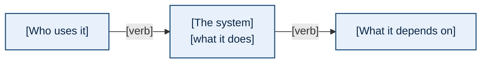
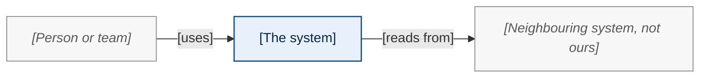
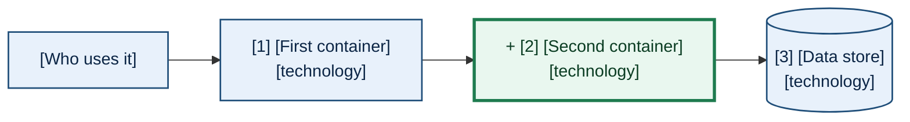
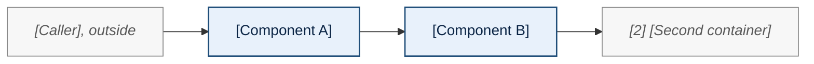
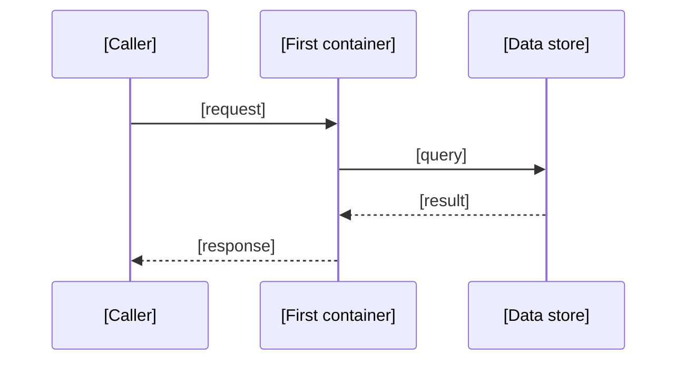
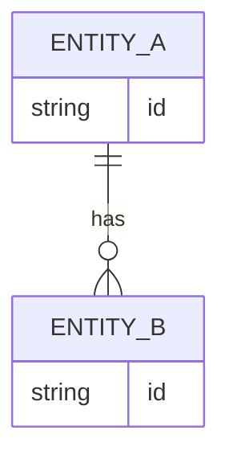

<!-- DOC-LINK CONVENTION (so references open in the VS Code Markdown preview and on GitHub):
     link other docs as PLAIN RELATIVE Markdown links  [<repo>/<relpath>](<relative-path>)
     with plain link text, NO backticks (a code span hides the hyperlink styling).
     The target is an ordinary relative path from THIS doc's directory. Cross-repo targets carry
     BOTH a local relative link AND an explicit GitHub URL side by side, because GitHub has no
     cross-repo relative-link syntax. NEVER use the vscode://file scheme.
     Links to rendered artifacts (.html, .png, .pdf) must open from VS Code (local and Remote SSH)
     and on GitHub; the exact form is set by rubric criterion R-14 in
     ai-harness docs/procedures/visual-doc-quality-rubric.md.
     Full rule: ai-harness projects-wide-session-config/rules/doc-authoring.md. -->

<!-- LEVELS ARE THE SPINE OF THIS DOCUMENT. Every diagram belongs to exactly one level, says which,
     and (below level 0) names the parent diagram it zooms from; the parent carries the child's
     numbered callout "[N]". A node that appears at two levels has the same label at both. This is
     what keeps the levels consistent (rubric R-9, R-10):
         level 0  Context     the system as one box among its people and neighbouring systems
         level 1  Containers  the deployable or runnable units and the stores, numbered: the map
         level 2  Components  one container opened up, its interfaces and data stores named
     Runtime views, the data model and deployment are views ACROSS the levels; each names the level
     its boxes come from. The level names follow the C4 model (c4model.com); you do not need C4
     notation, only its discipline. -->

<!-- DIAGRAM CONVENTIONS (the reviewer rubric checks every one of these):
     1. Mermaid is the single source of every diagram; an archify view is optional for the master
        views, linked under its fence as "Interactive version", with identical node labels.
     2. The first line inside every fence is `%% id: <slug>`.
     3. Before every fence, one bold lead line `**Diagram X: <what it shows>.**` and one or two
        sentences saying what to take from it, including the level and, below level 0, the parent.
     4. One obvious main path per diagram (R-2); at most twelve primary nodes (R-6); labels are the
        names engineers use for the parts, with the technology in a second line, never a file path
        (R-3). Node labels break lines with  ; edge labels stay on one line.
     5. An architecture document describes what is deployed. Where a change is in flight, mark it
        with the same delta classes the roadmap kind uses, copied exactly:
            classDef today fill:#e8f1fb,stroke:#1f4e79,stroke-width:1.5px,color:#0b2545
            classDef change fill:#e9f7ef,stroke:#1e7b4f,stroke-width:3px,color:#0b3d23
            classDef target fill:#fff4e5,stroke:#b35c00,stroke-width:1.5px,stroke-dasharray:6 4,color:#4a2600
            classDef retiring fill:#f3f3f3,stroke:#767676,stroke-width:1.5px,stroke-dasharray:3 3,color:#4d4d4d
            classDef ctx fill:#f7f7f7,stroke:#888888,stroke-width:1px,color:#595959,font-style:italic
        `ctx` greys the neighbours in a level-2 panel ("you are here", italic label), and a
        `change` node's label starts with "+ ". Line style, weight, the "+" badge or italics
        always duplicate the colour (R-16); a legend sentence names the encoding (R-5, R-7).
        Every stroke is at least 3:1 against white and its fill, every label at least 4.5:1 on its
        fill (the measured ratios are in the roadmap template's convention 5).
     6. A doc:pair (two fences between an opening `doc:pair` comment with title and legend
        attributes and a closing `/doc:pair` comment, as in the roadmap template) only where the
        target has a different shape from today.
     7. Render and look: run the doc-render generator and open its screenshots before you call a
        section done. -->

<!-- WRITING RULES: answer first (R-19); numbered lists ordered by importance with the ordering
     stated; every requested decision carries a recommendation and a named drawback (R-20); no em
     dashes or filler; public tracker keys only in a teammate-visible repository. Evidence: every
     number carries its measurement date and source (the commit, the account, the command); every
     claim is measured, read or asserted. -->

# [System Name]: Architecture

> **Using this template.** Scaffold a new architecture document with
> `/doc --kind architecture --title "<title>" <path>`; the scaffold is [STUB.md.jinja](STUB.md.jinja)
> and the authoring prompt a delegated author receives is [prompts/TEMPLATE.md](prompts/TEMPLATE.md).
> Review it against [the visual doc quality rubric](../procedures/visual-doc-quality-rubric.md). A
> roadmap of the same system carries versions of this document's level-0 and level-1 diagrams and
> links here for detail ([roadmap template](../roadmap/TEMPLATE.md)), so keep the names on the
> Context and Containers diagrams stable. Delete this blockquote in a real document.

**Status:** DRAFT

**Created:** YYYY-MM-DD

**Measured:** [FILL: the commit, accounts and environments the facts come from, each with its date.]

<!-- doc:region name="overview" kind="replaceable" -->

## Table of Contents

<!-- List EVERY `## ` and EVERY `### ` heading with GitHub-style anchors; update it in the same
     edit that changes a heading. Verify with `scripts/check_doc_toc.py <doc>`. -->

- [Executive Summary](#executive-summary)
- [Context](#context)
- [Containers](#containers)
- [Components](#components)
  - [1. First container](#1-first-container)
- [Runtime views](#runtime-views)
  - [First flow](#first-flow)
- [Data model](#data-model)
- [Deployment](#deployment)
- [Cross-cutting concerns](#cross-cutting-concerns)
  - [Security model](#security-model)
  - [Identity](#identity)
  - [Observability](#observability)
- [Quality and constraints](#quality-and-constraints)
- [Decisions index](#decisions-index)
- [Glossary](#glossary)
- [Revision Log](#revision-log)

## Executive Summary

<!-- ONE diagram, then about five sentences. The diagram comes first. It is either the level-0
     Context diagram or a simplified level-1 map; say which. The sentences say what the system is
     for, who uses it, its main parts, where it runs, and the one thing a newcomer most often gets
     wrong. -->

**Diagram S1: [the system in one picture].** [FILL: the level, and what to take from it.]

[FILL: about five sentences.]

<!-- /doc:region name="overview" -->

<!-- doc:region name="context" kind="replaceable" -->

## Context

<!-- Level 0. The system as one box; its people (left) and neighbouring systems (right); each edge
     labelled with what passes along it. Say which neighbours the team owns and which it does not. -->

**Diagram C0: [the system in its context]. Level 0.** [FILL: what to take from it.]

[FILL: the people and systems, one line each, with who owns each neighbour.]

<!-- /doc:region name="context" -->

<!-- doc:region name="containers" kind="replaceable" -->

## Containers

<!-- Level 1: the map. Parent: Diagram C0. Every runnable or deployable unit and every data store,
     numbered "[N]" to match its Components panel. Technology on the second line of each label.
     A roadmap of this system carries a version of this diagram, so keep the names stable. -->

**Diagram L1: [the containers and how they connect]. Level 1; zooms from Diagram C0.** [FILL: what to
take from it; each numbered box is a panel under Components.]

| # | Container | What it is for | Technology | Owner |
|---|---|---|---|---|
| 1 | [FILL] | [FILL] | [FILL] | [FILL] |

<!-- /doc:region name="containers" -->

<!-- doc:region name="components" kind="replaceable" -->

## Components

<!-- Level 2: one `### ` panel per container that has internal structure worth showing, numbered as
     on Diagram L1. Every panel has the same shape: (1) the zoom diagram, the container's components
     in the delta classes and its neighbours in `ctx`, naming Diagram L1 as its parent; (2) two
     sentences on what it does and who depends on it; (3) its interfaces (protocol, authentication,
     who calls it) and its data stores, named; (4) where a change is in flight, today against
     target. A container with no internal structure worth drawing gets a row in the L1 table, not a
     panel. -->

Each panel opens one container from [Containers](#containers), with its neighbours greyed.

### 1. First container

**Diagram K1: [the first container's components]. Level 2; zooms from Diagram L1, box [1].** [FILL:
what to take from it.]

**What it does and who depends on it.** [FILL: two sentences.]

**Interfaces and data stores.** [FILL: each interface with its protocol, authentication and callers;
each store with its engine and what it holds.]

<!-- /doc:region name="components" -->

<!-- doc:region name="runtime" kind="replaceable" -->

## Runtime views

<!-- The two or three flows that matter most (a request, an ingest, a failure and recovery), each a
     `### ` with a `sequenceDiagram` or a data-flow `flowchart`. Participants use the container and
     component names from the diagrams above; state which level they come from. Ordered by how often
     a newcomer needs the flow, stated in one line. -->

Ordered by how often a newcomer needs each flow.

### First flow

**Diagram R1: [what happens when ...].** [FILL: the level its participants come from, and what to take
from it.]

<!-- /doc:region name="runtime" -->

<!-- doc:region name="data_model" kind="replaceable" -->

## Data model

<!-- An `erDiagram` or a schema diagram of the entities that matter, at most twelve; where a store is
     a graph, the node and edge types. Name the store each entity lives in. Counts carry their
     measurement date. -->

**Diagram D1: [the entities and their relations].** [FILL: which stores, and what to take from it.]

<!-- /doc:region name="data_model" -->

<!-- doc:region name="deployment" kind="replaceable" -->

## Deployment

<!-- Environments, accounts, stacks or modules, and the path a change takes to production. A diagram
     of environments and what runs in each; a table of stacks with their dependencies and the
     pipeline that deploys each. Name what deploys automatically and what is a manual step. -->

**Diagram P1: [environments and what runs where].** [FILL: what to take from it.]

[FILL: the deployment diagram and the stacks table.]

<!-- /doc:region name="deployment" -->

<!-- doc:region name="cross_cutting" kind="replaceable" -->

## Cross-cutting concerns

<!-- The concerns that cut across containers. Each `### ` says how the concern is handled, where it
     is enforced (which container, which component) and how to verify it. -->

### Security model

[FILL: trust boundaries, authentication per hop, authorization, secrets.]

### Identity

[FILL: who the system knows a caller to be, at each plane, and from which source of truth.]

### Observability

[FILL: logs, metrics, traces, alarms, and where an engineer looks first when something breaks.]

## Quality and constraints

<!-- The quality attributes the architecture is shaped by (latency, cost, durability, availability,
     compliance) and the hard constraints it lives under (platform policy, account boundaries,
     approved services), numbered, ordered by how much each shapes the design. -->

Ordered by how much each shapes the design.

1. [FILL]

<!-- /doc:region name="cross_cutting" -->

<!-- doc:region name="decisions_index" kind="replaceable" -->

## Decisions index

<!-- One row per architectural decision that explains a shape in the diagrams above, linking the
     decision record or design document that made it. This document indexes decisions; it does not
     re-argue them. -->

| Decision | Where it shows | Record |
|---|---|---|
| [FILL] | [FILL: diagram or section] | [FILL: link] |

<!-- /doc:region name="decisions_index" -->

<!-- doc:region name="glossary" kind="replaceable" -->

## Glossary

<!-- The terms a newcomer confuses, each defined once, alphabetical. Where another document is the
     binding definition, link it instead of restating it. -->

| Term | Meaning |
|---|---|
| [FILL] | [FILL] |

<!-- /doc:region name="glossary" -->

<!-- doc:region name="revision_log" kind="append_only" -->

## Revision Log

| Date | Change | Notes |
|------|--------|-------|

<!-- /doc:region name="revision_log" -->
