<!-- doc:region name="context" kind="immutable" -->

## Context

(none — context not recorded in original doc)

<!-- /doc:region name="context" -->

<!-- doc:region name="body" kind="replaceable" -->


# Agent Heartbeat Observability & Persistent Cross-Session Memory — Open-Source and Academic Landscape Survey

## Table of Contents

- [Executive Summary](#executive-summary)
- [PART 1 — Heartbeat Observability for Long-Running Agentic Jobs](#part-1--heartbeat-observability-for-long-running-agentic-jobs)
  - [1.1 Patterns and prior art](#11-patterns-and-prior-art)
  - [1.2 Notification routing](#12-notification-routing)
  - [1.3 Academic foundations](#13-academic-foundations)
- [PART 2 — Persistent Cross-Session Memory for LLM Agents](#part-2--persistent-cross-session-memory-for-llm-agents)
  - [2.1 Open-source memory layer landscape](#21-open-source-memory-layer-landscape)
  - [2.2 Academic foundations](#22-academic-foundations)
  - [2.3 MCP as memory integration layer](#23-mcp-as-memory-integration-layer)
- [PART 3 — Integration Patterns and Architecture Recommendations](#part-3--integration-patterns-and-architecture-recommendations)
  - [3.1 Combined heartbeat + memory](#31-combined-heartbeat--memory)
  - [3.2 Production considerations](#32-production-considerations)
- [Technology Decision Matrix](#technology-decision-matrix)
- [Recommended Architecture](#recommended-architecture)
- [References](#references)

## Executive Summary

Ten findings that matter for any long-running agentic assistant that needs progress
visibility and durable cross-session memory:

1. **LangGraph already has first-class primitives for both gaps.** Native
   `stream_mode="custom"` via `get_stream_writer()` provides application-level heartbeat
   without new infrastructure; `PostgresStore` / `AsyncPostgresStore` provides
   cross-thread, user-scoped persistent memory out of the box. A greenfield dedicated
   heartbeat bus or a third-party memory layer is not required to reach an MVP.
   [VERIFIABLE FACT — see §1.1, §2.1] ([LangGraph streaming concepts][lg-stream],
   [LangGraph persistence][lg-persist]).
2. **SSE is the consensus transport for agent progress events in 2025–2026**, used
   natively by OpenAI and Anthropic for token streaming. WebSockets only justify their
   operational cost when bidirectional control (cancel, steer, approve) becomes a
   first-class UX requirement. Redis Pub/Sub is the recommended fan-out layer between
   workers and API servers for horizontally scaled deployments. [SYNTHESIZED INFERENCE
   from multiple production reports — see §1.1].
3. **Mem0 v1.1 (paper arXiv 2504.19413, April 2025) and Zep/Graphiti (paper arXiv
   2501.13956, January 2025) are the two best-documented production-grade memory layers**
   with peer-reviewable benchmarks on LOCOMO and DMR respectively. Mem0 reports 91% lower
   p95 latency vs. full-context with ~90% token cost reduction; Zep reports 94.8% DMR
   accuracy (vs. MemGPT 93.4%) and up to 18.5% LongMemEval improvement with 90% latency
   reduction over baselines. Both are Apache-2.0. [VERIFIABLE FACT — see §2.1].
4. **MemGPT is no longer a separate project — it is now the Letta framework**
   (letta-ai/letta, Apache-2.0). The MemGPT name now refers to the original
   memory-hierarchy pattern from the 2023 paper; the maintained codebase is Letta. Letta
   v0.16.7 is current as of March 2026. [VERIFIABLE FACT — see §2.1].
5. **mnemostroma implements a biologically-inspired dissolution model that is
   architecturally distinct** from every other memory layer surveyed: a passive Observer
   component writes memory; agent tools only read via MCP; SQLite-WAL storage with ~20ms
   retrieval; five-layer hierarchy (Ledger / Experience / Subconscious / Anchor / Content
   Versioning). It explicitly rejects calendar-based TTL in favor of usage-driven decay.
   No independent citations, benchmarks, or known production deployments found outside the
   repository itself. [VERIFIABLE FACT for architecture; NO SOURCE FOUND for production
   adoption — see §2.1].
6. **get-shit-done (GSD) does not implement heartbeat observability**. It is a
   spec-driven development / meta-prompting system with retrospective state tracking
   (`.planning/STATE.md`, per-task atomic commits, session handoffs). No webhooks,
   streaming, or notification routing. For Gap 1 it provides handoff patterns worth
   adopting but no push-based progress plumbing. [VERIFIABLE FACT — README analysis in
   §2.1].
7. **MCP has a reference Knowledge Graph Memory server** (JSONL file, 10 tools, MIT
   license) that is a simple reference implementation, not a production persistence layer.
   For production memory, MCP is best used as the *integration protocol* in front of Mem0
   / Zep / Letta / LangMem rather than as the storage itself. [VERIFIABLE FACT — see
   §2.3].
8. **Temporal's activity heartbeat model (Go/TypeScript/Python SDK) is the canonical
   pattern in distributed systems** and maps cleanly onto agentic jobs: short
   HeartbeatTimeout + periodic `Activity.Heartbeat(payload)` calls, with last-received
   payload available on restart. The core design principle — workers emit heartbeats so an
   external service reschedules on silence — is directly reusable even if you do not adopt
   Temporal itself. [VERIFIABLE FACT — see §1.1].
9. **OpenTelemetry GenAI semantic conventions are now an emerging industry standard**
   (Langfuse, Datadog native support as of March 2026, Phoenix/OpenInference compatible).
   Platform observability should standardize on these conventions from day one to avoid
   rework. Status is still "experimental" for most attributes in early 2026. [VERIFIABLE
   FACT — see §1.1].
10. **Memory in regulated environments (healthcare, finance, life sciences) is the
    least-solved part of the stack.** Every mature memory layer (Mem0, Zep, Letta,
    LangMem) is designed for consumer / generic enterprise use. Compliance-grade audit
    trail, immutable-versioned memory events, and multi-tenant isolation at the *memory
    layer* (not only the platform) are gaps; the pragmatic path is to build a thin
    compliance wrapper (immutable audit log + human-in-the-loop gate) around a chosen
    memory layer rather than expect any single project to ship it. [SYNTHESIZED INFERENCE
    — see §3.2].

---

## PART 1 — Heartbeat Observability for Long-Running Agentic Jobs

### 1.1 Patterns and prior art

#### (Q1) ISSUE-REF framework streaming support

**LangGraph** has the most complete first-class streaming model for agent progress in
2026. It exposes five distinct modes: `values` (full state after each node), `updates`
(deltas per node), `messages` (per-token LLM output with metadata), `custom` (arbitrary
application events via `get_stream_writer()`), and `debug` (detailed traces). Multiple
modes can be requested concurrently and interleave in a single stream. The `custom` mode
is the exact primitive needed for heartbeat-style progress events — a node or tool calls
`get_stream_writer()` and emits `{progress: 0.42, message: "batch 3/7"}` payloads.
[VERIFIABLE FACT]: [LangGraph streaming concepts][lg-stream] and [LangGraph streaming
docs][lc-stream-docs].

Known limitation: `get_stream_writer()` is documented to behave reliably for sync tools;
async tools have [known issues][lg-stream-async-issue] where emitted messages may not be
captured. For a Python-async LangGraph workspace this is a real design consideration —
wrap async tool bodies to emit via a sync channel, or use callback-based emission.
[VERIFIABLE FACT — GitHub issue #6447].

**AutoGen (v0.4+)** uses an asynchronous event-driven actor model for agent-to-agent
messaging; progress is surfaced as messages on the event bus rather than a dedicated
streaming primitive. [VERIFIABLE FACT — see [AutoGen architecture
comparison][autogen-architecture]].

**CrewAI** has "limited streaming support" and "limited observability" (quote from
[comparative analysis][crewai-obs]); teams typically reach for AgentOps, Langfuse, or
Phoenix for runtime visibility. [VERIFIABLE FACT].

**OpenAI Agents SDK, Claude Agent SDK, Mastra, Vercel AI SDK** are all supported by
Phoenix/OpenInference out-of-the-box with AGENT and TOOL span instrumentation. Claude
Agent SDK has a dedicated TypeScript instrumentation package
(`@arizeai/openinference-instrumentation-claude-agent-sdk`). [VERIFIABLE FACT — [Phoenix
Claude Agent SDK docs][phoenix-cas]].

**LangSmith Deployment** (formerly LangGraph Platform, renamed October 2025) provides
managed streaming runs with background worker → checkpointer → Redis Pub/Sub → SSE
delivery. The data plane is optionally fully self-hosted. [VERIFIABLE FACT — [LangSmith
Deployment docs][lsd-docs], [LangGraph Platform GA][lg-platform-ga]].

#### (Q2) Distributed workflow heartbeat patterns

**Temporal** is the reference architecture for long-running activity heartbeats. The
pattern is: every long-running activity periodically calls `Activity.Heartbeat(payload)`;
if the worker fails to heartbeat within `HeartbeatTimeout`, Temporal reschedules the
activity on another worker, and the last received payload is provided on restart for
resumption. Official Temporal guidance: "Long running activities (more than a few
minutes) should always Heartbeat" and "if setting heartbeat timeout, it is critical to
also heartbeat from the activity, otherwise timeout is ignored." [VERIFIABLE FACT —
[Temporal heartbeat docs][temporal-heartbeat], [Temporal activity
timeouts][temporal-timeouts]].

Directly-applicable design principles from Temporal for agentic systems:

- **Short HeartbeatTimeout, frequent heartbeat** (example given:
  `StartToCloseTimeout=120s`, `HeartbeatTimeout=30s`).
- **Heartbeat payload carries resumable checkpoint state** — critical for a
  long-horizon task loop where a crashed worker should not restart expensive LLM calls.
- **Heartbeats are liveness + progress**, not just liveness.

**Airflow 3.0** (released April 2025) adds event-driven scheduling with Data Assets, DAG
versioning, and multi-language Task SDKs. 30% of users report MLOps workloads, 10% GenAI.
Airflow's heartbeat model is scheduler-driven and coarser than Temporal's activity model.
[VERIFIABLE FACT — [Airflow vs Prefect 2025][airflow-prefect-2025]].

**Prefect 3.x** uses a task-level engine with automations and metrics-based triggers;
`Incidents` is the new primitive for managing workflow disruptions. [VERIFIABLE FACT —
same source].

**Inngest, Trigger.dev, Modal:** [NO SOURCE FOUND] in the time available for this review;
these are well-known developer-facing async-job platforms (Inngest and Trigger.dev are
event-driven; Modal is serverless GPU/CPU function runtime) but explicit heartbeat-pattern
comparisons specifically for agentic workloads were not retrieved.

#### (Q3) SSE vs. WebSocket vs. Redis Pub/Sub

Production deployments in 2025–2026 consistently favor **SSE for LLM/agent token and event
streaming**. SSE is the transport used natively by OpenAI and Anthropic for API streaming.
[VERIFIABLE FACT — cross-confirmed in multiple 2025–2026 production reports:
[Hivenet][hivenet-sse], [Procedure Blog][procedure-sse], [portalZINE][portalzine-sse]].

Documented reasons for SSE preference:
- Works over standard HTTP — no sticky sessions, no socket broker, no custom reconnection
  logic.
- `EventSource` auto-reconnects with `Last-Event-ID` semantics.
- Stateless API servers can be horizontally scaled behind a standard load balancer.
- Simpler to debug with curl.

Published production regression: "When one team swapped SSE for WebSockets, load balancers
choked, reconnect logic snowballed, and observability vanished — they rolled back to SSE
in 3 days flat." [VERIFIABLE FACT — [DEV.to / Polliog report][dev-sse]]. This is anecdotal
but is a well-circulated data point consistent with the broader consensus.

**WebSockets are justified when bidirectionality is a first-class UX requirement**: cancel
a running agent mid-tool-call, approve a tool invocation (HITL), steer the agent, or
multi-device multiplexing. As agentic UX matures beyond chat, WebSocket adoption is
increasing but SSE remains the default for one-way progress push. [INDUSTRY HEURISTIC —
consistent across sources].

**Redis Pub/Sub / Redis Streams as the fan-out bus behind the API** is the recommended
production pattern. The canonical shape:

```text
┌──────────┐   checkpoints   ┌────────────┐
│ Worker   │ ──────────────▶ │ Postgres   │
│ (Graph)  │                 │ (state)    │
│          │   events        └────────────┘
│          │ ──────────────▶ ┌────────────┐    SSE    ┌────────┐
└──────────┘                 │ Redis      │ ────────▶ │ Client │
                             │ Pub/Sub    │           └────────┘
                             └────────────┘
```

This is documented as the LangSmith Deployment architecture and as a reusable pattern for
self-hosted LangGraph deployments. [VERIFIABLE FACT — [Redis + LangGraph integration
blog][redis-langgraph]].

**Redis Streams** (vs. Pub/Sub) is preferred when you need persistence of events across
subscriber reconnects or consumer groups — i.e. if the workspace requires a user to resume
a job after a full browser-session loss and replay events they missed. Pub/Sub is
fire-and-forget; Streams is a durable log. [INDUSTRY HEURISTIC — confirmed in [messaging
comparisons][messaging-compare]].

#### (Q4) Open-source agent observability projects

| Project | What it is | License | OTel-native | 2026 notes |
| --- | --- | --- | --- | --- |
| **Langfuse** | OSS LLM observability; tracing, evals, prompts, datasets | MIT (core) | Yes — OTLP endpoint; maps to Langfuse schema | Production self-hosted (Docker / Helm); preferred for data-residency / compliance teams. Built on Postgres + ClickHouse. [VERIFIABLE FACT for OSS + self-hosted — [Langfuse docs][langfuse-docs]]. |
| **Arize Phoenix** | OSS AI observability built on OpenTelemetry + OpenInference | Apache-2.0 | Yes, native | OOB support for Claude Agent SDK, LangGraph, OpenAI Agents SDK, Vercel AI SDK, Mastra, CrewAI. |
| **W&B Weave** | LLM app toolkit; traces, scorers, guardrails, registry | Apache-2.0 | Yes | MCP auto-tracing; AWS Marketplace listing 2025. |
| **AgentOps** | Multi-framework monitoring SDK | Open source (check repo) | Yes | Covers CrewAI, AutoGen, OpenAI Agents SDK, AG2, CamelAI, etc. |
| **OpenInference** | OpenTelemetry instrumentation library for AI frameworks | Apache-2.0 | Yes | Vendor-neutral; ships span specs. |

Sources: [Langfuse docs][langfuse-docs], [Arize Phoenix GitHub][arize-phoenix], [W&B Weave
site][wandb-weave], [AgentOps GitHub][agentops-gh], [OpenInference
GitHub][openinference-gh].

**OpenTelemetry GenAI semantic conventions** are the emerging standard. Datadog shipped
native support (v1.37+) in 2026; Langfuse maps incoming OTel traces; most attributes remain
`experimental` status as of early 2026. For a platform building today, instrumenting to
OTel GenAI conventions is the low-regret choice — any future backend swap is a
configuration change. [VERIFIABLE FACT — [OTel GenAI agent spans][otel-genai-spans], [OTel
GenAI events][otel-genai-events], [Datadog GenAI OTel post][datadog-otel]].

#### (Q5) Stall detection

Published production heuristics (from multiple 2025–2026 engineering blogs, synthesized):

- **Wall-clock hard stop per run** (e.g., 30-minute global ceiling that kills the agent
  loop regardless of internal state). Every agent run should have a hard stop based on
  turn count *or* total execution time as an absolute fail-safe. [INDUSTRY HEURISTIC —
  [DEV.to production failure post][dev-stall]].
- **Per-external-call timeout, default 60s**: "Every external call should have a
  timeout... tasks needing longer durations must explicitly opt-in." [INDUSTRY HEURISTIC —
  same source].
- **Heartbeat silence detection**: if no heartbeat within N minutes (common: 5–10 min for
  non-GPU LLM work), consider stalled. This is the Temporal pattern applied to agentic
  jobs.
- **Turn-count ceiling** (e.g., max 50 turns) as a cheap loop detector — specifically to
  catch "infinite wait" (tool hangs) and "infinite loop" (agent cycles without progress)
  failure modes. [INDUSTRY HEURISTIC — [LLM tool-calling production][medium-tool-calling]].
- **Output-verification gate**: a task is not "complete" until verification confirms
  expected output exists at the expected location. Prevents false-positive completion
  notifications. [INDUSTRY HEURISTIC].

No single peer-reviewed academic threshold found; the topic lives in engineering practice.
[NO SOURCE FOUND for formal stall-detection thresholds specific to LLM agents].

### 1.2 Notification routing

#### (Q6) Job completion notification routing

There is no single dominant OSS project for "job-done → Slack/Teams/email" routing for
agents specifically. The pragmatic patterns observed in 2025–2026:

- **Webhooks at the orchestration layer.** Temporal/Prefect/Airflow all support webhooks
  on workflow completion; route to an internal notification dispatcher (Slack webhook,
  email via SMTP, ntfy, PagerDuty).
- **Event-bus → rules engine.** Emit a structured `job.completed` event on Redis Streams /
  NATS / Kafka; a small rules service (user preferences, quiet hours, channel selection)
  converts to channel-specific payloads. A self-hosted notification stack (ntfy + an alert
  bridge + notification rules) is a lightweight way to implement this.
- **Platform-native integrations.** LangSmith, Langfuse, and Phoenix have alert rules on
  traces (e.g., alert on slow trace, failed eval); they are *monitoring* alerts, not
  user-completion notifications. Do not conflate the two.

**Retry semantics**: industry practice is at-least-once delivery with idempotency keys on
the notification event. [INDUSTRY HEURISTIC].

**Structured completion payloads**: the CHI-2025-informed "Return Recap" / "Resumption
Summary" UX pattern (see Q7) argues the notification should carry: original request
summary, key decisions made, terminal status, and a one-line "why this matters." This is a
product design recommendation more than a protocol specification. [VERIFIABLE FACT —
concept described in [Tools for Thought at CHI 2025][ms-chi25]].

#### (Q7) HCI research on async notification UX for agentic AI

CHI 2025 (Microsoft Research report) identified "cognitive discontinuity" — users who
context-switch during long-running AI tasks "may have forgotten exactly what they asked for
or why" on return. Recommended mitigations: resumption summaries and return recaps that
reconstruct the user's mental model with original intent, key decisions, and current
status. [VERIFIABLE FACT — [MS Research CHI 2025 blog][ms-chi25]].

Broader CHI 2025 direction: "Future systems for knowledge workers should provide support
for workers to oversee and modify LLM outputs in ways that minimize effort while ensuring
the necessary quality of work." This is an argument for HITL gates and structured oversight
affordances at notification time, not just a "done" ping. [VERIFIABLE FACT — same source].

**[NO SOURCE FOUND]** for a specific 2025–2026 peer-reviewed paper on *notification timing
and channel selection* for agentic assistants. The topic is implicitly addressed in the
"tools for thought" literature but a dedicated paper could not be verified.

### 1.3 Academic foundations

#### (Q8) Event sourcing, CQRS, and agentic observability

Event sourcing (append-only log of state-changing events, replayable to derive state) and
CQRS (separate read and write paths) have a natural affinity with agent systems:

- An agent's tool calls, LLM turns, and state transitions are **already a sequence of
  events**; persisting them as an append-only log provides free time-travel debugging,
  replay, and audit trail — directly relevant to regulated-domain compliance requirements.
  [SYNTHESIZED INFERENCE from [Microservices.io event sourcing][ms-es] and [Microsoft CQRS
  pattern][ms-cqrs]].
- LangGraph's checkpointer model *is* event sourcing for agent state: every node execution
  snapshots graph state, and resumption is replay from checkpoint. [VERIFIABLE FACT — see
  [LangGraph persistence][lg-persist]].
- **Choreography vs. orchestration**: orchestration (central planner node invokes
  sub-agents) is the dominant pattern in LangGraph and CrewAI; choreography (agents react
  to events on a bus) is what AutoGen's actor model leans toward. For observability,
  orchestration is easier (single source of truth for the run) but less scalable;
  choreography is more scalable but requires strong event-bus tracing. [INDUSTRY
  HEURISTIC].

**"Agentic observability" as a first-class academic subfield**: [NO SOURCE FOUND] for a
canonical 2025–2026 paper specifically named "agentic observability." The topic is emerging
in industry (OTel GenAI SIG, Arize/Langfuse research) rather than academia. The closest
academic work is the `Enhancing Model Context Protocol with Context-Aware Server
Collaboration` paper (arXiv 2601.11595), which introduces a shared-context coordination
model that is observability-adjacent. [VERIFIABLE FACT — paper exists; [arXiv
entry][arxiv-camcp]].

---

## PART 2 — Persistent Cross-Session Memory for LLM Agents

### 2.1 Open-source memory layer landscape

#### (Q9) Letta / MemGPT

**Current state (early 2026):** `letta-ai/letta` is the active successor to MemGPT. The
MemGPT name now denotes the *memory hierarchy design pattern* from the original paper; the
maintained code is Letta. Apache-2.0. [VERIFIABLE FACT — [Letta MemGPT naming
blog][letta-memgpt-blog]].

Key verified facts:
- 22.3k GitHub stars, 176 releases, v0.16.7 current (March 2026).
- Python SDK (`letta-client`) and TypeScript SDK (`@letta-ai/letta-client`).
- Model-agnostic.
- **Conversations API** released 2026-01-21 — agents can maintain shared memory across
  parallel user experiences.
- **Letta Code** released 2025-12-16 — coding agent ranking #1 on Terminal-Bench among
  model-agnostic OSS agents (per Letta's own claim).
- Production-ready REST API + SDKs.
- Storage backends: [NO SOURCE FOUND] — README does not explicitly enumerate storage
  backends; documentation describes "Memory Hierarchy" abstractly. Would require
  source-code inspection to confirm.

[VERIFIABLE FACT — [Letta README][letta-gh], [Letta memgpt blog][letta-memgpt-blog], [Letta
Code blog][letta-code-blog], [Next phase blog][letta-next-phase]].

#### (Q10) Zep / Graphiti

**Zep** is the managed service; **Graphiti** is the open-source temporal knowledge-graph
engine underneath. Apache-2.0. 20k+ Graphiti GitHub stars as of 2026. [VERIFIABLE FACT —
[Graphiti GitHub][graphiti-gh]].

**Architecture:**
- Temporal knowledge graph — every fact has a validity window (`valid_from`,
  `valid_until`). Supersession is modeled, not overwritten.
- Nodes = entities, edges = facts, episodes = raw ingested data (provenance).
- Hybrid retrieval: semantic embeddings + BM25 keyword + graph traversal.
- Incremental graph construction — no batch recomputation on new data.

**Storage backends (verified in Graphiti README):**
- Neo4j (5.26+)
- FalkorDB (Redis-based graph, 1.1.2+)
- KuzuDB (embedded, 0.11.2+)
- Amazon Neptune + Amazon OpenSearch Serverless

**Benchmarks (from arXiv 2501.13956):**
- Deep Memory Retrieval (DMR): 94.8% with gpt-4-turbo (vs. MemGPT 93.4%); 98.2% with
  gpt-4o-mini.
- LongMemEval: up to 18.5% accuracy improvement and 90% latency reduction vs. baseline.

**Latency:** Managed Zep service claims "sub-200ms performance at scale" with SLAs.
Self-hosted Graphiti has no published latency guarantee — "performance depends on your
setup." [VERIFIABLE FACT — Graphiti README].

**vs. mnemostroma:** Zep uses an explicit temporal KG with validity windows; mnemostroma
uses a multi-layer store with biological decay. Zep is empirically benchmarked; mnemostroma
has no published benchmarks. Zep has a managed+OSS track; mnemostroma is OSS-only.
[VERIFIABLE FACT — architectural comparison from [Graphiti GitHub][graphiti-gh] and
[mnemostroma GitHub][mnemostroma-gh]].

Sources: [Zep arXiv 2501.13956][zep-arxiv], [Graphiti GitHub][graphiti-gh], [Zep DMR
MarkTechPost][zep-marktech].

#### (Q11) Mem0

**Architecture:** extraction / consolidation / retrieval over salient info from ongoing
conversations; v3 algorithm (April 2026) uses single-pass ADD-only extraction, entity
linking, and multi-signal retrieval (semantic + BM25 + entity). Apache-2.0. [VERIFIABLE
FACT — [Mem0 GitHub][mem0-gh]].

**Storage backends:** pluggable. Default embedding: `text-embedding-3-small`.
Multi-tenancy via `user_id` filter; self-hosted server has auth-on-by-default. [VERIFIABLE
FACT — [Mem0 README][mem0-gh]].

**Benchmarks (from arXiv 2504.19413 and State of AI Agent Memory 2026):**

| System | LOCOMO LLM-Score | p95 Latency | Tokens/conversation |
| --- | --- | --- | --- |
| Full-context (baseline) | 72.9% | 17.12s | ~26,000 |
| Mem0g (graph) | 68.4% | 2.59s | ~1,800 |
| Mem0 (vector) | 66.9% | 1.44s | ~1,800 |
| RAG | 61.0% | 0.70s | — |
| OpenAI Memory | 52.9% | — | — |

[VERIFIABLE FACT — [Mem0 State of Memory 2026][mem0-state-2026]].

Mem0 explicitly positions itself as trading ~6 percentage points of accuracy for 91% p95
latency reduction and 90% token-cost reduction vs. full-context — the "production-grade"
operating point. [VERIFIABLE FACT — [Mem0 arXiv 2504.19413][mem0-arxiv]].

**Self-hosted vs cloud**: self-host via Docker; cloud at `app.mem0.ai`; dashboard + API
keys; YC S24 backing (53.9k stars per README snapshot). [VERIFIABLE FACT].

**AWS integration** (Mem0 Open Source + ElastiCache for Valkey + Neptune Analytics) is
documented as a reference architecture. [VERIFIABLE FACT — [AWS Mem0 blog][aws-mem0]].

#### (Q12) LangGraph native memory

LangGraph ships persistence out of the box via the **checkpointer** (thread-scoped state
persistence) and the **store** (cross-thread, user-scoped long-term memory). [VERIFIABLE
FACT — [LangGraph persistence docs][lg-persist]].

Concrete implementations:
- `MemorySaver` / `InMemoryStore` — in-memory, experiments only.
- `SqliteSaver` — local/dev.
- `PostgresSaver` / `AsyncPostgresSaver` — production; used by LangSmith itself.
- `PostgresStore` — long-term facts across sessions, namespaced by `user_id`, supports
  semantic search.
- `RedisSaver` via `langgraph-checkpoint-redis` — sub-millisecond checkpoint access.
- `MongoDB Store` — announced 2025.

**Capabilities unlocked**: HITL, conversational memory, time-travel debugging,
fault-tolerant resumption. [VERIFIABLE FACT].

**Gaps vs. dedicated memory layers:**
- No native hierarchical compression (Mem0 / Letta do this).
- No temporal-KG modeling (Zep / Graphiti do this).
- Semantic search exists but is basic vs. hybrid retrieval in Mem0 v3 or Zep.
- No built-in memory-relevance scoring or decay.

**Implication:** `AsyncPostgresSaver` + `PostgresStore` (both on managed Postgres) covers
the MVP; a dedicated memory layer only becomes necessary when (a) episodic summarization is
needed, (b) temporal relationships between facts must be queryable, or (c) scale makes
naive `user_id`-filter queries slow. [SYNTHESIZED INFERENCE from LangGraph docs + Mem0/Zep
capability comparison].

**LangMem SDK**: LangChain's own higher-level memory toolkit, sits on top of LangGraph's
storage layer. Supports procedural, episodic, and semantic memory types. [VERIFIABLE FACT —
[LangMem blog][langmem-blog]]. **Known performance caveat**: p95 search latency on LOCOMO
reported at **59.82s** (vs. Mem0's 0.200s p95 per [Atlan comparison][atlan-langmem]) — use
cautiously for real-time recall. [VERIFIABLE FACT — secondary source; primary benchmark not
independently verified — [Atlan LangMem comparison][atlan-langmem]].

#### (Q13) Microsoft Kernel Memory / Semantic Kernel

**Semantic Kernel** announced GA of memory packages for .NET, Java, Python (within the
2024–2025 window). New **Vector Store abstractions** replace legacy Memory Store
abstractions. Agent memory support is built in — messages added to a thread are extracted
into memories and provided back to the agent on demand. [VERIFIABLE FACT — [MS Semantic
Kernel blog][msk-blog]].

**Kernel Memory** is a separate Microsoft "research project" service for file ingestion,
text extraction, and user-data security. Status in early 2026: README says "Research
project" — check before considering production-critical. [VERIFIABLE FACT — [Kernel Memory
GitHub][km-gh]].

**Notable:** Semantic Kernel now has a `Microsoft.SemanticKernel.Memory.Mem0Provider` —
Microsoft integrates with Mem0 rather than positioning Kernel Memory as a competing memory
layer. [VERIFIABLE FACT — [MS Agent Memory docs][msk-agent-mem]]. For a Python/LangGraph
stack, Semantic Kernel is not the right fit regardless of the memory story.

#### (Q14) Other notable projects

| Project | Architecture | License | Notes |
| --- | --- | --- | --- |
| **Motorhead** (`getmetal/motorhead`) | Session memory server; Redisearch VSS for long-term | MIT | Lightweight; window summarization at `MAX_WINDOW_SIZE/2`. Less active than Mem0/Zep. [VERIFIABLE FACT — [Motorhead README][motorhead-gh]]. |
| **Memary** (`kingjulio8238/Memary`) | Neo4j knowledge graph + LlamaIndex; human-memory-inspired | (check repo) | Positioned for autonomous agents. [VERIFIABLE FACT — [Memary GitHub][memary-gh]]. |
| **Cognee** (`topoteretes/cognee`) | ECL (Extract, Cognify, Load) → knowledge graph; 7k+ stars | Apache-2.0 | Multi-backend (Neo4j/FalkorDB/KuzuDB/NetworkX for graph; Redis/Qdrant/Weaviate for vector; SQLite/Postgres for metadata). GitHub Secure Open Source Program graduate. [VERIFIABLE FACT — [Cognee GitHub][cognee-gh]]. |
| **MemMachine** (arXiv 2604.04853) | Personalized AI agent memory with "ground-truth preservation"; ~80% token reduction claim | (check paper) | Academic; production adoption not verified. [VERIFIABLE FACT — [MemMachine arXiv 2604.04853][memmachine-arxiv]]. |
| **Memori** (arXiv 2603.19935) | Agent-native persistent memory layer for efficient, context-aware LLM agents | Apache-2.0 (per paper) | Academic paper published March 2026; production adoption not verified. [VERIFIABLE FACT — [Memori arXiv 2603.19935][memori-arxiv]]. |

#### (Q15) mnemostroma — depth beyond the README

Beyond what the README states, no independent technical write-ups, benchmarks, citations,
or production deployments for mnemostroma could be found. [NO SOURCE FOUND] for:
- Independent performance benchmarks.
- Peer-reviewed or blog citations outside the repo itself.
- Case studies or known production deployments.

**What the README itself verifies:**
- **Dual-stream async pipeline**: passive Observer extracts/embeds/scores/indexes; agent
  tools query-only via MCP.
- **Five memory layers**: Ledger (immutable facts), Experience (mid-term context),
  Subconscious (eternal embeddings / core rules), Anchor (decisions / emotional patterns),
  Content Versioning (artifact diffs).
- **Biological dissolution model** — explicitly *not* TTL-based: "Day 1: Full detail...
  Week: Detail fades... Month: Brief + tags remain... Year: Brief + embedding only...
  Decade: Embedding only."
- **Performance claims from README**: SQLite + WAL; ~420–650 MB RAM; ~20 ms
  semantic-search retrieval; ~300 MB disk model footprint; ONNX Runtime (no
  PyTorch/Transformers).
- **Agent-never-writes invariant**: "Agent never writes memory — Observer does it
  silently."

[VERIFIABLE FACT — [mnemostroma GitHub][mnemostroma-gh]].

**Honest assessment**: mnemostroma's design is architecturally novel (biological decay +
passive Observer + agent-read-only invariant via MCP) and the latency/memory claims are
plausible for the stated scale. However, **it is an unvalidated single-maintainer project**
with no independent evaluation. For any platform with compliance implications, treating it
as inspiration for your own Observer pattern is safer than adopting it as a production
dependency. [SYNTHESIZED INFERENCE].

### 2.2 Academic foundations

#### (Q16) Literature on memory architectures

**CoALA — Cognitive Architectures for Language Agents** (Sumers, Yao, Narasimhan,
Griffiths; arXiv 2309.02427). Originally submitted September 2023; **most recent version is
March 2024; published in TMLR 2024**. [VERIFIABLE FACT — [arXiv entry][coala-arxiv]].
Dimensions: information storage (working + long-term), action space (internal + external),
decision-making (interactive loop: planning + execution). This remains the canonical
taxonomy cited by Mem0, Zep, Letta, and MemMachine papers.

**2025–2026 follow-ups specifically to CoALA**: [NO SOURCE FOUND] for a named direct
"CoALA 2.0" paper. The field has instead forked into concrete system papers (Mem0 2025, Zep
2025, LoCoMo-Plus 2026, Active Context Compression 2026, Acon 2025, MemMachine 2026) that
cite CoALA as taxonomy.

**Working/episodic/semantic/procedural memory** — LangMem explicitly implements the
four-type taxonomy drawn from cognitive science. This mapping is now standard industry
vocabulary (appears in Mem0 blog, Letta docs, LangChain docs). [VERIFIABLE FACT].

**RAG vs. parametric memory tradeoffs** — the 2026 industry consensus (from [Mem0 State of
Memory 2026][mem0-state-2026]) is that **neither pure RAG nor pure full-context wins**:
pure RAG loses multi-hop and temporal reasoning (LOCOMO: 61.0% LLM-Score vs. Mem0's 66.9%
with 0.7s vs. 1.44s latency); full-context wins accuracy (72.9%) but is "categorically
unusable in real-time production settings" at 17s p95. The production sweet spot is a
**memory layer that does selective extraction + structured retrieval**, not RAG alone.
[VERIFIABLE FACT — benchmark comparison from [Mem0 State of Memory 2026][mem0-state-2026]
and [Mem0 arXiv 2504.19413][mem0-arxiv]].

#### (Q17) Multi-session memory

LOCOMO (Maharana et al., arXiv 2402.17753) is the reference benchmark: 300 turns × 9K
tokens avg per conversation, across up to 35 sessions. Five QA reasoning types (single-hop,
multi-hop, temporal, commonsense, adversarial), event-graph summarization, multi-modal
dialog generation. **LOCOMO-Plus (arXiv 2602.10715, 2026)** extends this to test cognitive
memory under "cue–trigger semantic disconnect" — whether models retain and apply *latent
constraints* across long conversational contexts. Directly relevant to any long-horizon
loop: constraints established in an early phase must persist when later results arrive weeks
or months later. [VERIFIABLE FACT — [LOCOMO project][locomo-snap], [LOCOMO-Plus
arXiv][locomo-plus]].

#### (Q18) Memory decay and relevance scoring

**TTL-based expiration** is the industry baseline (Motorhead, naive LangGraph store
patterns). Simple, predictable, but crude — fires on calendar time regardless of
importance.

**Usage-weighted decay** (mnemostroma's biological model; conceptually similar to
spacing-effect / forgetting-curve approaches) is an interesting design point but is **not
empirically validated in the academic literature retrievable for 2025–2026**. [NO SOURCE
FOUND] for a peer-reviewed comparison of biological-decay vs. TTL vs. Mem0-style
selective-consolidation on a shared benchmark.

**Memory compression as the de facto modern approach:**
- Mem0: 80–90% token cost reduction via selective extraction. [VERIFIABLE FACT — [Mem0
  arXiv 2504.19413][mem0-arxiv]].
- MemMachine: ~80% token reduction; LLM calls reserved for summarization + high-level
  abstraction, not per-message extraction. [VERIFIABLE FACT — [MemMachine arXiv
  2604.04853][memmachine-arxiv]].
- Focus Agent (arXiv 2601.07190, Active Context Compression): 22.7% net token savings by
  consolidating learnings into a "Knowledge" block and pruning raw history. [VERIFIABLE
  FACT — [arXiv 2601.07190][focus-agent-arxiv]].
- Acon (arXiv 2510.00615): 26–54% peak-token reduction with 95% of teacher accuracy
  preserved. [VERIFIABLE FACT — [arXiv 2510.00615][acon-arxiv]].

**Emerging pattern across all four**: the agent itself decides what to consolidate
(active), rather than a background TTL or scoring system (passive). mnemostroma's
passive-Observer model is actually the *minority* design pattern in 2026. [SYNTHESIZED
INFERENCE].

### 2.3 MCP as memory integration layer

#### (Q19) MCP memory tools and servers

The official MCP registry launched in preview on September 8, 2025 at
`registry.modelcontextprotocol.io`. [VERIFIABLE FACT — [MCP Registry][mcp-registry]].

**Reference memory server** (`modelcontextprotocol/servers/src/memory`, MIT license):
- Simple knowledge-graph model: entities + relations + observations.
- JSONL file storage (configurable path via `MEMORY_FILE_PATH`).
- 10 tools exposed: entity/relation/observation CRUD + graph search + read-full-graph.
- Reference implementation — **not a production persistence layer.**

[VERIFIABLE FACT — [MCP servers repo][mcp-servers]].

**MCP vs. direct API for memory retrieval:**

MCP wins when:
- You want the memory layer to be swappable without agent-code changes.
- You have multiple agents sharing one memory layer.
- You want to leverage the MCP tool-registration UX — the model discovers memory tools
  like any other tool.

Direct API wins when:
- Latency is critical — MCP adds a hop.
- You want tight typing / compile-time safety in the agent runtime.
- The memory layer exposes complex query primitives that don't map naturally to MCP tools.

[SYNTHESIZED INFERENCE from MCP design].

**Governance**: Anthropic donated MCP to the Agentic AI Foundation (Linux Foundation
directed fund, co-founded by Anthropic, Block, OpenAI) in December 2025. [VERIFIABLE FACT —
multiple 2026 sources]. This is relevant for platform-longevity risk assessment: MCP is now
vendor-neutral.

**Security caveat**: April 2026 security disclosure — MCP has documented design-level
vulnerabilities (prompt injection, tool permissions enabling exfiltration, lookalike
tools). [VERIFIABLE FACT — [Hacker News MCP RCE][thn-mcp-rce]]. For a platform handling
sensitive data, this argues for: (a) MCP server allow-lists, (b) tool-namespace scoping,
(c) no untrusted third-party MCP servers in production.

#### (Q20) Claude Code / Anthropic stance on persistent memory

Claude Code has **native, first-party persistent memory** (as of v2.1.59+):

- **CLAUDE.md files**: human-authored persistent instructions at project, user, or
  managed-policy scope. Loaded in full at every session start. Target under 200 lines.
- **Auto memory** (`MEMORY.md` + topic files at
  `~/.claude/projects/<project>/memory/`): Claude-authored accumulated learnings. First
  200 lines / 25 KB of `MEMORY.md` loaded every session. Topic files loaded on demand.
  On-by-default; toggle with `autoMemoryEnabled` or `CLAUDE_CODE_DISABLE_AUTO_MEMORY=1`.
- **Scope**: per working tree; shared across worktrees of the same git repo; **not shared
  across machines or cloud environments.**
- Survives `/compact` (re-read from disk).
- Subagents can maintain their own auto memory.
- Hook support: `InstructionsLoaded` hook for debugging what's loaded.

[VERIFIABLE FACT — [Claude Code memory docs][cc-memory]].

**Memory-tool (separate Claude API feature)**: [VERIFIABLE FACT — [Claude API memory
tool][anthropic-memory-tool]] — this is an agent-facing tool for use via the Anthropic API,
distinct from Claude Code's file-based memory.

**Official recommendation implicit in the docs**: CLAUDE.md = rules, auto memory =
learnings. For an operator, CLAUDE.md + project rules + managed-policy CLAUDE.md is the
recommended local UX; it does not replace the application's own persistent memory for end
users (who won't be running Claude Code directly).

---

## PART 3 — Integration Patterns and Architecture Recommendations

### 3.1 Combined heartbeat + memory

#### (Q21) Systems combining both

No single "heartbeat + persistent memory" reference architecture is widely published in
2025–2026. The two concerns are usually addressed by separate layers:

- **Observability layer**: LangSmith / Langfuse / Phoenix traces runs and emits progress
  events.
- **Memory layer**: LangGraph PostgresStore / Mem0 / Zep stores facts across sessions.

The closest published combined pattern is **LangSmith Deployment + LangGraph native store +
Langfuse OpenTelemetry export** — all from the LangChain ecosystem — but this is a stack,
not a single project.

**Design principle**: treat heartbeat and memory as orthogonal. Heartbeat is a *stream*
concern (transient, high-volume, tied to a single run). Memory is a *state* concern
(durable, lower-volume, cross-run). Conflating them — for example, writing every heartbeat
to the memory store — creates a write-amplification anti-pattern. [SYNTHESIZED INFERENCE].

#### (Q22) LangGraph + memory + observability without node bottlenecks

Recommended pattern (synthesized from LangGraph docs, Redis + LangGraph blog, and LangSmith
Deployment docs):

```mermaid
flowchart TB
    subgraph Client[Workspace UI]
        UI[React App]
    end

    subgraph API[API Layer - Node.js]
        SSE[SSE endpoint<br/>/runs/:id/stream]
        SUB[Redis Pub/Sub subscriber]
        SSE --> SUB
    end

    subgraph Worker[LangGraph Worker - Python]
        GRAPH[LangGraph StateGraph]
        NODE1[Node: Plan<br/>get_stream_writer&#40;&#41;]
        NODE2[Node: Execute<br/>get_stream_writer&#40;&#41;]
        TOOL[Tool: Retrieval / RAG<br/>Temporal-style heartbeat]
        GRAPH --> NODE1
        GRAPH --> NODE2
        NODE2 --> TOOL
    end

    subgraph State[Persistence]
        CKPT[(AsyncPostgresSaver<br/>per-thread state)]
        STORE[(PostgresStore<br/>per-user long-term<br/>+ pgvector semantic)]
        MEM[Mem0 / Graphiti<br/>optional deep memory]
    end

    subgraph Bus[Event Bus]
        REDIS[(Redis Streams<br/>progress events)]
    end

    subgraph Obs[Observability]
        OTEL[OpenTelemetry<br/>GenAI semconv]
        LF[Langfuse self-hosted<br/>Postgres + ClickHouse]
    end

    subgraph Notify[Notification]
        NR[Notification rules]
        SLACK[Slack / Email / Teams]
        NR --> SLACK
    end

    UI -- subscribes --> SSE
    NODE1 -- checkpoints --> CKPT
    NODE2 -- checkpoints --> CKPT
    NODE1 -- facts --> STORE
    NODE2 -- facts --> STORE
    NODE1 -- progress event --> REDIS
    NODE2 -- progress event --> REDIS
    TOOL -- heartbeat --> REDIS
    SUB -- consumes --> REDIS
    NODE1 -- optional deep memory --> MEM
    GRAPH -- spans --> OTEL
    OTEL --> LF
    REDIS -- job.completed --> NR
```



**Key design decisions:**

1. **Heartbeat lives in the custom stream path, not on the memory layer.** Nodes/tools
   call `get_stream_writer()` (or a thin wrapper) that publishes to Redis Streams. The
   memory store is never on the hot path.
2. **Checkpoints are the durable per-run state.** If a worker dies, the next worker
   resumes from the last checkpoint with the last heartbeat payload.
3. **Memory store is long-term cross-session facts**, not run progress. Scope is `user_id`
   + optional `session_id`.
4. **OTel as the observability bus.** Every node emits OTel spans following GenAI semantic
   conventions; Langfuse is the backend. Swap backend later by changing OTLP exporter
   config.
5. **Notification rules live outside the agent.** Job-complete event → rules engine →
   Slack/email. Agent code never knows about Slack tokens.
6. **Optional deep memory (Mem0 / Graphiti) is a post-MVP decision.** Start with LangGraph
   PostgresStore + pgvector; promote to Mem0 or Graphiti when one of these signals
   triggers: (a) episodic summarization is required, (b) temporal fact-validity queries are
   required, (c) PostgresStore query latency exceeds UX budget at user count N.

**Avoiding node bottlenecks:**
- Emit progress events asynchronously (fire-and-forget to Redis Streams).
- Never block a node on memory-store writes; buffer and flush async.
- Do OTel span export via batch processor, not synchronous export.

[SYNTHESIZED INFERENCE from LangGraph + Redis + Langfuse documentation].

### 3.2 Production considerations

#### (Q23) Regulated-domain memory compliance

**Audit trail requirements (HIPAA + GDPR + regulated-domain standards synthesized):**
- Operation performed, data accessed, agent identity, human authorizer, timestamp — not
  just "a session occurred." [VERIFIABLE FACT — [Agentic Control Plane audit
  trails][acp-audit]].
- Logging must be at the governance layer, not inside individual apps or the model
  provider. [VERIFIABLE FACT — same source].
- Life-sciences quality standards (e.g. FDA CSA, GAMP 5) specifically require a risk-based
  assessment of agentic system behavior: severity of harm × probability × detectability.
  [VERIFIABLE FACT — [AWS guide to AI agents in regulated environments][aws-gxp-agents]].

**2025 HIPAA Security Rule updates**: previously "addressable" safeguards including
encryption are now **mandatory**. [VERIFIABLE FACT — [Requesty compliance
checklist][requesty-compliance]].

**Multi-tenant isolation:**
- Never mix tenant data in the same vector index for regulated healthcare/life-sciences
  workloads. [VERIFIABLE FACT — [Requesty compliance checklist][requesty-compliance]].
- Per-query log for every search against the vector DB. [VERIFIABLE FACT — same source].
- Mem0 supports `user_id` filtering but does not enforce row-level security; the
  surrounding application must. [VERIFIABLE FACT — Mem0 docs + SYNTHESIZED INFERENCE].

**Zero-data-retention** is emerging as an essential capability for GDPR/HIPAA/SOC2
compliance ([arXiv 2510.11558, Zero Data Retention in ISSUE-REF Enterprise AI
Assistants][zdr-arxiv]). For an assistant with persistent memory this is a tension: you
*want* retention (that's the whole point), so the compliance story must be "retention with
per-user deletion (GDPR Article 17) + audit immutability of deletion events." [SYNTHESIZED
INFERENCE].

**Practical recommendation for a regulated-domain platform:**
- Keep an audit log as an append-only immutable store (e.g. CloudTrail + a separate
  Postgres table with cryptographic integrity).
- Put HITL gates on any memory that will enter a compliance-controlled record.
- Memory-layer tenancy: one memory namespace per user + project; never share across
  entities.
- Do not let any memory layer (Mem0/Zep/Letta/LangMem) write directly to a
  compliance-controlled record without the gate.

#### (Q24) Scaling benchmarks

**Published concrete numbers** (few are specific to "concurrent users" for memory layers):

- **pgvector 0.8.0 on Aurora**: up to 9x faster queries vs. prior. [VERIFIABLE FACT — [AWS
  pgvector 0.8][aws-pgvector]].
- **pgvector + pgvectorscale at 50M vectors × 768 dim**: 28x lower p95 latency and 16x
  higher QPS than Pinecone s1. At 50M × 1536 dim with 99% recall: 471 QPS, p95 28ms (vs.
  Pinecone s1 784ms). [VERIFIABLE FACT — [pgvectorscale benchmarks][pgvectorscale-gh]].
- **Practical pgvector scale guidance**: under ~10M vectors, query latency <100ms is
  achievable with stock pgvector. Above that, use pgvectorscale (DiskANN index) or a
  dedicated vector DB. [VERIFIABLE FACT — same source].
- **Mem0 p95 latency**: 1.44s (vector) / 2.59s (graph) on LOCOMO-scale conversations.
  [VERIFIABLE FACT].
- **LangMem p95 search latency on LOCOMO**: 59.82s per Atlan secondary source. [VERIFIABLE
  FACT — secondary source; primary benchmark not independently verified — [Atlan LangMem
  comparison][atlan-langmem]].
- **Zep managed**: sub-200ms at "scale" — no exact numbers, vendor claim. [MARKETING CLAIM
  — Zep docs].

**[NO SOURCE FOUND]** for published 10/100/1000 concurrent-user benchmarks specifically on
Mem0/Zep/Letta/LangMem. The pattern in the field is LOCOMO-per-conversation latency
numbers, not concurrent-user scaling curves. This is a real gap.

#### (Q25) Open problems (2026)

**Most important open problems** (ranked by relevance to a long-horizon assistant
platform):

1. **Memory retrieval under cue–trigger semantic disconnect** (LOCOMO-Plus, 2026). Users
   will *not* phrase a later query in the same vocabulary as the earlier context that
   generated it. Every memory layer surveyed is reasonably good at lexical / semantic
   match; none is specifically benchmarked on latent-constraint retention. [VERIFIABLE FACT
   — problem is open per [LOCOMO-Plus arXiv 2602.10715][locomo-plus]].
2. **Active vs. passive memory consolidation**. Biological decay (mnemostroma) vs.
   agent-active consolidation (Mem0, MemMachine, Focus Agent) — no head-to-head benchmark.
   [NO SOURCE FOUND].
3. **Compliance-grade immutable memory event log** with retention + deletion + audit
   coexistence — not a solved design pattern in 2026. [SYNTHESIZED INFERENCE].
4. **Multi-agent shared memory** with consistency semantics. Letta Conversations API
   (2026-01-21) is the first named production capability; academic treatment is thin.
   [VERIFIABLE FACT — [Letta "Next Phase" blog][letta-next-phase]].
5. **MCP security for memory servers**. April 2026 disclosures make clear this is not
   solved. [VERIFIABLE FACT].

**Practical improvements achievable within 12 months** on a typical platform:
- Adopt OTel GenAI semantic conventions from day one (low cost, high future-proof value).
- Ship `get_stream_writer()`-based progress events behind SSE now; defer WebSockets until a
  specific bidirectional use case materializes.
- Use LangGraph PostgresStore + pgvector as the starting memory layer. Measure retrieval
  latency and token costs. Only introduce Mem0 or Graphiti when a measured gap justifies
  it.
- Build the HITL gate as infrastructure (not per-agent code) so that
  compliance-controlled writes are enforced consistently.
- Build an immutable audit log *before* shipping the first memory feature to end users.

---

## Technology Decision Matrix

### Heartbeat transport options

| Option | Latency | Scalability | Bidirectional | Dev effort | Best for |
| --- | --- | --- | --- | --- | --- |
| **SSE** (native browser) | ~ms | High (stateless HTTP) | No | Low | Default choice 2026. Progress, token streaming, notifications. |
| **WebSocket** | ~ms (slightly lower) | Medium (sticky sessions, socket broker) | Yes | High | Cancel / approve / steer UX — only when bidirectionality is real. |
| **Redis Pub/Sub** (internal bus) | sub-ms | High | N/A (backend) | Low | Worker→API fan-out behind SSE. Fire-and-forget. |
| **Redis Streams** | sub-ms | High | N/A (backend) | Medium | Same as Pub/Sub but durable; supports consumer groups and replay on reconnect. |
| **gRPC streams** | ~ms | Medium (HTTP/2) | Yes | Medium | Backend-to-backend; overkill for browser UX. |
| **Long polling** | seconds | Low | No | Low | Legacy fallback; no reason to pick in 2026. |

### Memory layer options

| Option | Architecture | Storage backend | Retrieval | License | Prod readiness | Strengths | Weaknesses |
| --- | --- | --- | --- | --- | --- | --- | --- |
| **LangGraph PostgresStore + pgvector** | KV store + vector search, namespaced by user_id | Postgres | Semantic | MIT (LangGraph) | High for single-tenant | Native to stack; no new moving part; LangSmith-tested | No temporal KG, no episodic compression, no hybrid retrieval |
| **Mem0** | Extraction / consolidation / hybrid retrieval (semantic + BM25 + entity) | Pluggable (vector DB + optional graph) | Hybrid | Apache-2.0 | High — benchmarked on LOCOMO, AWS reference arch | Best published production numbers; 90% cost reduction; LangGraph integration | Adds infra + cost; `user_id` is the only isolation primitive |
| **Zep / Graphiti** | Temporal knowledge graph with validity windows | Neo4j / FalkorDB / KuzuDB / Neptune | Semantic + BM25 + graph traversal | Apache-2.0 | High (Graphiti OSS) / Very High (managed Zep) | Best for temporal fact supersession | Heavier infra; graph-DB operational skill required |
| **Letta (ex-MemGPT)** | OS-style memory hierarchy; self-editing memory tools | Not publicly documented in README | Tool-based retrieval | Apache-2.0 | Active — v0.16.7 March 2026 | Standalone agents; Conversations API; Letta Code leader | Heaviest commitment — replaces more of your agent runtime than pure memory |
| **LangMem SDK** | Extraction / procedural-episodic-semantic memory types | LangGraph store | Semantic | MIT | Low-Medium — p95 search latency 59.82s on LOCOMO reported | Native LangChain integration | Latency caveat for real-time recall |
| **Cognee** | ECL pipeline → knowledge graph | Multi-backend (Neo4j, Qdrant, Redis, Postgres) | Vector + graph | Apache-2.0 | Medium — 7k stars, GH Secure OSS graduate | Flexible backends | Less production-validated than Mem0/Zep |
| **Motorhead** | Session memory + Redisearch VSS | Redis | Vector | MIT | Medium | Lightweight | Less active; no published benchmarks |
| **MCP Knowledge Graph Memory** | Reference MCP server | JSONL file | Graph search | MIT | Reference only | Zero-dependency starting point | Not production persistence |
| **mnemostroma** | Passive Observer + 5-layer bio-decay | SQLite-WAL | Semantic | (check repo) | Low — no independent validation | Unique decay model; MCP-native read path | Single-maintainer; no benchmarks; no known production use |

---

## Recommended Architecture

For a long-running agentic assistant that needs both progress observability and durable
cross-session memory, a low-regret reference architecture is:

```mermaid
flowchart LR
    subgraph Browser[Web Workspace]
        Chat[Chat UI]
        Progress[Progress panel]
    end

    subgraph Edge[Edge / API]
        GQL[GraphQL/tRPC]
        SSE[/SSE &#47;runs&#47;:id&#47;stream/]
    end

    subgraph Worker[LangGraph Worker on Kubernetes]
        SG[StateGraph]
        HB[Heartbeat emitter<br/>get_stream_writer&#40;&#41;]
        TR[Tool runners]
    end

    subgraph LLM[LLM API]
        MODEL[Model provider<br/>via a managed gateway]
    end

    subgraph Memory[Memory Layer]
        PS[(AsyncPostgresSaver<br/>thread checkpoints)]
        PST[(PostgresStore<br/>user facts + pgvector)]
        RAG[Managed RAG / vector store]
    end

    subgraph Bus[Managed Redis]
        RS[Redis Streams<br/>progress + completion]
    end

    subgraph Obs[Observability]
        OT[OpenTelemetry SDK]
        LF[Langfuse<br/>self-hosted]
    end

    subgraph Gate[Compliance Gate]
        HITL[HITL approver]
        AUDIT[(Immutable audit log<br/>Postgres append-only<br/>+ CloudTrail)]
    end

    subgraph Routing[Notification]
        NR[Rules engine<br/>Slack &#47; Email &#47; Teams]
    end

    Chat <--> GQL
    Progress -- subscribes --> SSE
    GQL -- run --> SG
    SG -- reason --> MODEL
    SG -- checkpoint --> PS
    SG -- write fact --> PST
    SG -- retrieve --> PST
    SG -- retrieve --> RAG
    SG -- span --> OT
    OT --> LF
    HB -- event --> RS
    TR -- heartbeat --> RS
    RS -- fan-out --> SSE
    RS -- job.completed --> NR
    SG -- controlled write --> HITL
    HITL -- approve --> AUDIT
    HITL -- approve --> PST
```



**Rollout sequence:**

1. **Phase 1 (MVP):** LangGraph with `AsyncPostgresSaver` + `PostgresStore` + pgvector;
   `get_stream_writer()` → Redis Streams → SSE; Langfuse self-hosted for traces using OTel
   GenAI conventions.
2. **Phase 2:** notification rules engine; immutable audit log; HITL gate as middleware
   around any store write with a controlled-record namespace flag.
3. **Phase 3:** evaluate whether PostgresStore + pgvector meets retrieval needs. If
   temporal fact-supersession queries are required, introduce Graphiti (Neo4j) as a
   parallel memory tier. If cost/latency tradeoffs drive the decision, introduce Mem0
   instead.
4. **Deferred until real need:** WebSocket upgrade (only when cancel/steer UX is a product
   requirement), Letta (only if you want to outsource more of the agent runtime than the
   memory layer).

---

## References

[lg-stream]: https://github.com/langchain-ai/langgraph/blob/main/docs/docs/concepts/streaming.md
[lc-stream-docs]: https://docs.langchain.com/oss/python/langgraph/overview
[lg-stream-async-issue]: https://github.com/langchain-ai/langgraph/issues/6447
[lg-persist]: https://docs.langchain.com/oss/javascript/langgraph/persistence
[autogen-architecture]: https://medium.com/@a.posoldova/comparing-4-agentic-frameworks-langgraph-crewai-autogen-and-strands-agents-b2d482691311
[crewai-obs]: https://dev.to/hemangjoshi37a/crewai-vs-langgraph-vs-autogen-which-framework-for-production-ai-agents-1ggl
[phoenix-cas]: https://arize.com/docs/phoenix/integrations/typescript/claude-agent-sdk
[lsd-docs]: https://docs.langchain.com/langsmith/agent-server
[lg-platform-ga]: https://blog.langchain.com/langgraph-platform-ga/
[temporal-heartbeat]: https://docs.temporal.io/encyclopedia/detecting-activity-failures
[temporal-timeouts]: https://temporal.io/blog/activity-timeouts
[airflow-prefect-2025]: https://www.sql-datatools.com/2025/10/apache-airflow-vs-prefect-2025.html
[hivenet-sse]: https://www.hivenet.com/post/llm-streaming-sse-websockets
[procedure-sse]: https://procedure.tech/blogs/the-streaming-backbone-of-llms-why-server-sent-events-(sse)-still-wins-in-2025
[portalzine-sse]: https://portalzine.de/sses-glorious-comeback-why-2025-is-the-year-of-server-sent-events/
[dev-sse]: https://dev.to/polliog/server-sent-events-beat-websockets-for-95-of-real-time-apps-heres-why-a4l
[redis-langgraph]: https://redis.io/blog/langgraph-redis-build-smarter-ai-agents-with-memory-persistence/
[messaging-compare]: https://dev.to/lovestaco/choosing-the-right-messaging-tool-redis-streams-redis-pubsub-kafka-and-more-577a
[langfuse-docs]: https://langfuse.com/docs
[arize-phoenix]: https://github.com/arize-ai/phoenix
[wandb-weave]: https://docs.wandb.ai/weave
[agentops-gh]: https://github.com/AgentOps-AI/agentops
[openinference-gh]: https://github.com/Arize-ai/openinference
[otel-genai-spans]: https://opentelemetry.io/docs/specs/semconv/gen-ai/gen-ai-agent-spans/
[otel-genai-events]: https://opentelemetry.io/docs/specs/semconv/gen-ai/gen-ai-events/
[datadog-otel]: https://www.datadoghq.com/blog/llm-otel-semantic-convention/
[dev-stall]: https://dev.to/bobrenze/how-ai-agents-handle-stalled-tasks-and-timeouts-lessons-from-my-production-failure-1jj9
[medium-tool-calling]: https://medium.com/@komalbaparmar007/llm-tool-calling-in-production-rate-limits-retries-and-the-infinite-loop-failure-mode-you-must-2a1e2a1e84c8
[ms-chi25]: https://www.microsoft.com/en-us/research/blog/the-future-of-ai-in-knowledge-work-tools-for-thought-at-chi-2025/
[ms-es]: https://microservices.io/patterns/data/event-sourcing.html
[ms-cqrs]: https://learn.microsoft.com/en-us/azure/architecture/patterns/cqrs
[arxiv-camcp]: https://arxiv.org/html/2601.11595v2
[letta-gh]: https://github.com/letta-ai/letta
[letta-memgpt-blog]: https://www.letta.com/blog/memgpt-and-letta
[letta-code-blog]: https://www.letta.com/blog/letta-code
[letta-next-phase]: https://www.letta.com/blog/our-next-phase
[graphiti-gh]: https://github.com/getzep/graphiti
[zep-arxiv]: https://arxiv.org/abs/2501.13956
[zep-marktech]: https://www.marktechpost.com/2025/02/04/zep-ai-introduces-a-smarter-memory-layer-for-ai-agents-outperforming-the-memgpt-in-the-deep-memory-retrieval-dmr-benchmark/
[mem0-gh]: https://github.com/mem0ai/mem0
[mem0-arxiv]: https://arxiv.org/abs/2504.19413
[mem0-state-2026]: https://mem0.ai/blog/state-of-ai-agent-memory-2026
[aws-mem0]: https://aws.amazon.com/blogs/database/build-persistent-memory-for-agentic-ai-applications-with-mem0-open-source-amazon-elasticache-for-valkey-and-amazon-neptune-analytics/
[langmem-blog]: https://blog.langchain.com/langmem-sdk-launch/
[atlan-langmem]: https://atlan.com/know/long-term-memory-langchain-agents/
[msk-blog]: https://devblogs.microsoft.com/semantic-kernel/unlocking-the-power-of-memory-announcing-general-availability-of-semantic-kernels-memory-packages/
[km-gh]: https://github.com/microsoft/kernel-memory
[msk-agent-mem]: https://learn.microsoft.com/en-us/semantic-kernel/frameworks/agent/agent-memory
[motorhead-gh]: https://github.com/getmetal/motorhead
[memary-gh]: https://github.com/kingjulio8238/Memary
[cognee-gh]: https://github.com/topoteretes/cognee
[mnemostroma-gh]: https://github.com/GG-QandV/mnemostroma
[coala-arxiv]: https://arxiv.org/abs/2309.02427
[locomo-snap]: https://snap-research.github.io/locomo/
[locomo-plus]: https://arxiv.org/abs/2602.10715v1
[mcp-registry]: https://registry.modelcontextprotocol.io/
[mcp-servers]: https://github.com/modelcontextprotocol/servers/tree/main/src/memory
[thn-mcp-rce]: https://thehackernews.com/2026/04/anthropic-mcp-design-vulnerability.html
[cc-memory]: https://code.claude.com/docs/en/memory
[anthropic-memory-tool]: https://platform.claude.com/docs/en/agents-and-tools/tool-use/memory-tool
[acp-audit]: https://agenticcontrolplane.com/blog/ai-agent-audit-trails
[aws-gxp-agents]: https://aws.amazon.com/blogs/machine-learning/a-guide-to-building-ai-agents-in-gxp-environments/
[requesty-compliance]: https://www.requesty.ai/blog/security-compliance-checklist-soc-2-hipaa-gdpr-for-llm-gateways-1751655071
[zdr-arxiv]: https://arxiv.org/pdf/2510.11558
[aws-pgvector]: https://aws.amazon.com/blogs/database/supercharging-vector-search-performance-and-relevance-with-pgvector-0-8-0-on-amazon-aurora-postgresql/
[pgvectorscale-gh]: https://github.com/timescale/pgvectorscale
[memmachine-arxiv]: https://arxiv.org/abs/2604.04853
[memori-arxiv]: https://arxiv.org/abs/2603.19935
[focus-agent-arxiv]: https://arxiv.org/abs/2601.07190
[acon-arxiv]: https://arxiv.org/abs/2510.00615

<!-- /doc:region name="body" -->

<!-- doc:region name="ambiguous_items" kind="replaceable" -->

## Ambiguous Items from Auto-Remediation (Post-Run Review)

(none yet — auto-populated by verify_and_remediate node)

<!-- /doc:region name="ambiguous_items" -->

<!-- doc:region name="appendix_research_prompt" kind="immutable" -->

## Appendix: Research Prompt

[Original prompt not recorded in this doc]

<!-- /doc:region name="appendix_research_prompt" -->

<!-- doc:region name="appendix_provenance" kind="replaceable" -->

## Appendix: Provenance Ledger

(none yet — auto-populated at commit from the validated provenance ledger)

<!-- /doc:region name="appendix_provenance" -->

<!-- doc:region name="run_history" kind="append_only" -->

## Run History

<!-- /doc:region name="run_history" -->
