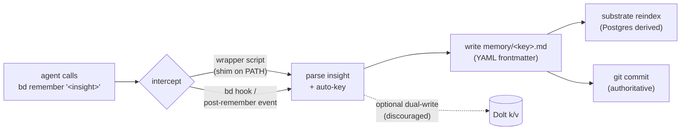

# Agent-Memory Unification: `bd remember` (Beads/Dolt) vs. Markdown-Authoritative Substrate

**Status:** complete

**Created:** 2026-07-15

## Table of Contents

- [Context](#context)
- [Temporal Scope](#temporal-scope)
- [Executive Summary](#executive-summary)
- [1. `bd remember` / `bd prime`: the native Dolt-backed memory silo](#1-bd-remember--bd-prime-the-native-dolt-backed-memory-silo)
  - [When to use](#when-to-use)
- [2. Write-through capture front-ends to a markdown-authoritative store](#2-write-through-capture-front-ends-to-a-markdown-authoritative-store)
  - [When to use](#when-to-use-1)
- [3. Declining a tool's native memory for a unified store — precedent & failure modes](#3-declining-a-tools-native-memory-for-a-unified-store--precedent--failure-modes)
  - [When to use](#when-to-use-2)
- [4. Entrenchment, lock-in & reversibility (Dolt → markdown/JSONL)](#4-entrenchment-lock-in--reversibility-dolt--markdownjsonl)
  - [When to use](#when-to-use-3)
- [5. The four integration options (a)–(d)](#5-the-four-integration-options-ad)
  - [When to use](#when-to-use-4)
- [Gaps, blindspots & emergent findings](#gaps-blindspots--emergent-findings)
- [Comparison](#comparison)
- [Recommendation](#recommendation)
- [Open Questions](#open-questions)
- [Sources](#sources)
- [Appendix: Research Prompt](#appendix-research-prompt)
- [Appendix: Provenance Ledger](#appendix-provenance-ledger)
- [Run History](#run-history)

<!-- doc:region name="context" kind="immutable" -->

## Context

The ~18-repo Claude Code fleet has **three** mechanisms all claiming "agent memory," and the fragmentation must be resolved before one silently wins by entrenchment:

1. **`bd remember`** — the Beads issue tracker (steveyegge/beads, v1.1.0) stores insights in Beads' embedded **Dolt** store, injected every session via `bd prime --memories-only` in a SessionStart hook that is **already live** in the fleet (so this mechanism is actively entrenching).
2. **A unified knowledge/memory substrate** (in design) — markdown under git is **authoritative**; a derived Postgres layer (pgvector + full-text + Apache AGE graph) provides queryable recall. Principle: markdown is the source of truth, the DB is a disposable/rebuildable derived index.
3. **Live `MEMORY.md` + per-fact markdown memory files** — the current working system: an index file + one-fact-per-file markdown with YAML frontmatter, loaded into every session's context.

Tentative direction (needs evidence): **the substrate is THE memory layer; do NOT adopt `bd remember` as a separate Dolt-backed silo.** Either (a) decline `bd remember` entirely, or (b) make it a thin capture front-end that writes through into authoritative markdown.

**Primary period:** 2024–2026
**Source weighting:** 2026 primary, 2025 secondary, pre-2024 background (foundational only)

<!-- /doc:region name="context" -->

<!-- doc:region name="body" kind="replaceable" -->

## Temporal Scope

Primary focus: 2026 sources (Beads v1.1.0 released 2026-07-04 [VERIFIABLE][^2]; the "When Not to Write Memory" paper, 2026 [VERIFIABLE][^7]) and late-2025 markdown-memory tooling. Beads' memory commands landed in v0.58.0 (2026-03-02) [VERIFIABLE][^2]. The markdown-as-source-of-truth / disposable-derived-index pattern crystallized across 2025–2026 tooling (Basic Memory, Continuum, memweave, sqlite-memory) [VERIFIABLE][^5][^9]. Foundational agent-memory theory (MemGPT, CoALA, RAG) is background only. No significant pre-2024 developments are load-bearing for this decision.

## Executive Summary

1. **`bd remember` is a Dolt-backed key/value silo that Beads explicitly positions as a MEMORY.md *replacement*, not a coexisting layer.** The README instructs agents verbatim: *"Use `bd remember "insight"` for persistent project memory; do not create MEMORY.md files."* [VERIFIABLE][^1] Adopting it as-is directly contradicts the substrate's markdown-authoritative principle and would create a second, opaque source of truth.

2. **The markdown-authoritative / derived-rebuildable-index pattern the substrate is built on is a recognized, converging 2025–2026 best practice** — Basic Memory, memweave, sqlite-memory, and OpenClaw all treat markdown as canonical and every search index (vector, FTS, graph) as a disposable artifact rebuildable "with zero loss of underlying memory." [VERIFIABLE][^5][^9] Beads is the outlier here: even a memory-MCP roundup classifies it as "version-controlled DB in repo (**not** markdown as source)." [VERIFIABLE][^6]

3. **A thin write-through capture front-end is the pattern that reconciles the two.** MCP markdown-memory servers already treat capture as a tool call (`write_note`) that lands a `.md` file, proving `bd remember "..."` can be intercepted and routed to a markdown/substrate row instead of Dolt — you keep the ergonomic capture verb and prime-time injection while markdown stays authoritative. [VERIFIABLE][^5]

4. **Entrenchment risk is real but reversibility is cheap-to-moderate.** Beads memories live in Dolt, which exports losslessly to SQL/CSV/JSON/parquet via `dolt dump` / `dolt table export` [VERIFIABLE][^8], and Beads itself emits an `issues.jsonl` interchange file [VERIFIABLE][^1]. Migration later is a scripted ETL, not a rewrite — but every day the live hook runs, the Dolt store accretes the *authoritative copy* of new insights, which is the actual cost.

5. **Uncritically writing every insight to memory is a documented failure mode regardless of substrate.** "When Not to Write Memory" (2026) shows that promoting correlated/repeated observations inflates false importance — *"correlation between agent traces should not be interpreted as evidence of true event importance."* [VERIFIABLE][^7] `bd remember`'s auto-keyed, low-friction capture is exactly the write path that most needs gating.

**Recommendation (preview):** Option **(b) thin write-through front-end** as the target, with option **(a) decline** as the zero-effort interim. Keep `bd prime` for *workflow* context; do **not** let `bd remember`/`--memories-only` own the authoritative memory copy.

## 1. `bd remember` / `bd prime`: the native Dolt-backed memory silo

Beads (steveyegge/beads) is a distributed graph issue tracker for coding agents. Its persistent-memory commands — `bd remember`, `bd memories`, `bd recall`, `bd forget` — shipped in **v0.58.0 (2026-03-02)**, described in the changelog as *"knowledge that survives sessions and account rotations"* [VERIFIABLE][^2]. The current release is **v1.1.0 (2026-07-04)**, whose theme is schema-migration safety, not memory changes [VERIFIABLE][^2].

**Storage model.** Beads' core store is **Dolt** (a version-controlled MySQL-compatible SQL database), with data in `.beads/embeddeddolt/` (embedded, default, single-writer) or `.beads/dolt/` (server mode) [VERIFIABLE][^1][^4]. Memories are backed by a key/value store within this Dolt backend and are **auto-injected at prime time** so they appear in every session without manual loading [VERIFIABLE][^2]. The `bd prime --memories-only` invocation is the injection surface the fleet's live SessionStart hook uses. Beads' `issues.jsonl` is an export "for viewers and interchange," explicitly *"not the source of truth or a backup"* [VERIFIABLE][^1] — i.e., in current Beads, **Dolt is authoritative**, not the flat file.

**Design intent — replacement, not coexistence.** This is the decisive finding. The README's agent instructions state verbatim: *"Use `bd remember "insight"` for persistent project memory; do not create MEMORY.md files."* [VERIFIABLE][^1] Yegge's launch essay frames the tracker as a wholesale substitute for markdown: agents *"have switched — without a hint of ever going back — from using markdown plans, to using the issue tracker exclusively,"* and he characterizes markdown as *"write-only memory for agents"* [VERIFIABLE][^3]. Beads is therefore engineered to *win* the memory-substrate fight, not to defer to an external store. [INFERENCE] That is precisely why the already-live hook is dangerous: the tool's own design pressure is toward becoming the single source of truth.

**Nuance / discrepancy worth flagging.** One secondary write-up describes Beads as *"The source of truth is version-controlled markdown... The AI designed it that way"* with a SQLite cache [VERIFIABLE][^10]. This conflicts with the current README's Dolt-authoritative model and most likely describes an **earlier JSONL/markdown-era Beads** before the Dolt migration. I weight the primary README [^1] over the blog [^10]; the discrepancy is noted rather than resolved. Philosophically, early Beads and the substrate agreed (files-as-truth); the current memory feature does not.

### When to use

Adopt `bd remember` as-is **only** when Beads is your *single* project-state and knowledge tool and you have no competing authoritative store — a greenfield repo with no `MEMORY.md`, no substrate, and no cross-repo memory-sharing requirement. In a fleet that already has a markdown-authoritative substrate by design, adopting the native silo is an anti-fit: it creates a second source of truth the tracker is built to defend. [INFERENCE]

## 2. Write-through capture front-ends to a markdown-authoritative store

The reconciling pattern already exists in production MCP tooling. **Basic Memory** exposes capture as agent tool calls (`write_note`, `edit_note`) that generate plain markdown on disk; *"the source of truth is always your files,"* and a SQLite/Postgres index is *derived* for semantic search and graph traversal [VERIFIABLE][^5]. A memory-MCP roundup makes the contrast explicit: Basic Memory is *"the only one in this group where the agent's memory is just files you own,"* whereas **Beads uses a "version-controlled DB in repo (not markdown as source)"** [VERIFIABLE][^6].

The broader design principle — **storage/search separation** — is a converging 2025–2026 practice: markdown (with YAML frontmatter carrying `source`, `confidence`, `supersedes`) is canonical, and *"every search index is treated as a disposable artifact. You can delete your vector embeddings database or rebuild your entity graph at any time, with zero loss of underlying memory"* [VERIFIABLE][^9]. This is identical to the substrate's stated principle (markdown authoritative, Postgres derived/rebuildable), which means a write-through front-end is not a bespoke hack but an alignment with where the field is settling. [INFERENCE]

**What a thin front-end concretely looks like.** [INFERENCE] Three mechanically distinct implementations, cheapest first:



- **Shim wrapper:** a `bd` wrapper earlier on `PATH` that recognizes the `remember` subcommand, writes a `memory/<auto-key>.md` file (matching the fleet's per-fact format), and passes all other subcommands straight through to the real `bd`. Zero Beads-internals coupling; breaks if Beads changes its CLI surface.
- **Beads hook:** if Beads exposes a post-`remember` hook/event, subscribe and mirror the insight to markdown. Cleaner, but depends on a hook surface that is **not documented** in the sources reviewed [NO SOURCE].
- **Prime-time redirection:** point the SessionStart hook at a markdown/substrate query instead of `bd prime --memories-only`, so injection reads from the authoritative store even if capture still touches Beads.

### When to use

Choose write-through when you want to **keep the low-friction `bd remember` capture verb** (muscle memory, one-liner, auto-keying) but require markdown to stay authoritative and cross-repo-shareable. It is the right target once the substrate is live and you have appetite for a small, testable shim. Prefer the wrapper form until/unless Beads documents a stable capture hook. [INFERENCE]

## 3. Declining a tool's native memory for a unified store — precedent & failure modes

"Turn off the built-in memory, point capture at our own store" is a recognized stance, evidenced by the deliberate positioning of markdown-first tools *against* opaque-DB memory: Basic Memory's entire pitch is *"plain text on your disk, forever"* and a store you *"grep, diff, and commit alongside the code"* [VERIFIABLE][^5], explicitly rejecting the locked-in-DB model that Beads' Dolt store represents [VERIFIABLE][^6]. The disposable-index literature frames vendor/DB independence as a first-class advantage of declining native stores [VERIFIABLE][^9].

**Failure modes of declining native memory:**

- **Losing prime-time injection.** Beads' value is not `bd remember` the verb but the *automatic* injection at `bd prime` [VERIFIABLE][^2]. If you decline the silo without replacing injection, memories stop reaching sessions. Mitigation: the SessionStart hook must inject from the substrate/markdown instead — declining capture is safe only if you *keep an injection path*. [INFERENCE]
- **Double-write / drift (the dual-write trap).** If both Dolt and markdown are written, they diverge; readers disagree on truth. This is the classic dual-source-of-truth hazard and is why option (d) coexistence is the worst of the field. [HEURISTIC]
- **Over-promotion of low-value memories.** Independent of substrate, low-friction capture over-writes. "When Not to Write Memory" (2026) shows correlated/repeated traces create *"an illusion of significance,"* and *"correlation between agent traces should not be interpreted as evidence of true event importance"* [VERIFIABLE][^7]. A capture front-end should gate writes (dedup, `supersedes`, confidence), not blindly append — a discipline the substrate's frontmatter schema already supports [VERIFIABLE][^9].

### When to use

Decline native memory outright when the tool's store is opaque/locked-in relative to your governance needs and you either (i) don't need its injection, or (ii) can cheaply replace injection from your own store. For this fleet, (ii) holds — a SessionStart hook can read the substrate — so declining `bd remember` while keeping a substrate-backed injection is viable *today*. [INFERENCE]

## 4. Entrenchment, lock-in & reversibility (Dolt → markdown/JSONL)

The live hook means Dolt is accreting the **authoritative copy** of every new insight now. Two things bound the risk:

**Reversibility is cheap-to-moderate.** Dolt is a full SQL database with lossless export: `dolt dump` and `dolt table export` support *"sql, csv, json and parquet file types"* [VERIFIABLE][^8]. Beads additionally emits `issues.jsonl` for interchange [VERIFIABLE][^1]. A later migration is therefore a scripted ETL (Dolt/JSONL → per-fact `.md` with frontmatter), not a rewrite. [INFERENCE]

**But entrenchment is behavioral, not just technical.** [INFERENCE] The cost is not the export script; it is (1) every day the hook runs, agents are *instructed by Beads* to prefer `bd remember` over markdown [VERIFIABLE][^1], so the Dolt copy becomes the freshest/most-complete one; (2) auto-keyed content-hash keys don't map cleanly to the fleet's semantic per-file naming, so ETL needs a re-keying/merge step; and (3) the longer two stores coexist, the more reconciliation debt accrues. Reversibility stays *cheap* only if you act before the Dolt store becomes the de facto primary.

### When to use

Treat reversibility as adequate insurance to **defer** a hard migration, but not as license to let the silo entrench. The correct read: because export is cheap, there is no lock-in penalty to **stopping** `bd remember` capture now and migrating the modest accumulated set later — the asymmetry favors decline-now over migrate-later. [INFERENCE]

## 5. The four integration options (a)–(d)

- **(a) Decline bd-memory.** Keep `bd prime` for workflow reminders; disable `--memories-only` injection and stop using `bd remember`. Authoritative memory stays in markdown/substrate; SessionStart injects from the substrate. *Zero new code; reversible; loses the `bd remember` ergonomic verb.* [INFERENCE]
- **(b) Thin write-through front-end.** `bd remember "..."` is intercepted (wrapper/hook) and lands a `memory/*.md` row in the authoritative store; Dolt is bypassed or treated as a throwaway cache. Injection reads the substrate. *Keeps the verb + injection; small shim to build/test; the reconciling option.* [INFERENCE]
- **(c) Adopt bd-remember as the memory layer; drop MEMORY.md.** Follow Beads' intended design [VERIFIABLE][^1]. *Lowest effort short-term; abandons markdown-authoritative principle; opaque Dolt store; hard to share cross-repo; contradicts substrate design.* [INFERENCE]
- **(d) Coexist / dual-write.** Both stores live. *Worst reconciliation cost; guaranteed drift; two sources of truth — the dual-write trap.* [HEURISTIC]

### When to use

(a) as the **immediate interim** (stops entrenchment at zero cost). (b) as the **target end-state** once the substrate is live and a shim is worth building. (c) only in a Beads-only greenfield repo. (d) essentially never — it institutionalizes the fragmentation this research exists to resolve. [INFERENCE]

## Gaps, blindspots & emergent findings

- **Undocumented Beads capture-hook surface.** Whether Beads exposes a stable post-`remember` hook/event (needed for the cleanest write-through) is **not documented** in the sources reviewed — the wrapper-shim form is the safe assumption [NO SOURCE].
- **Injection-content parity is unverified.** I confirmed *that* `bd prime` injects memories [VERIFIABLE][^2] but not the exact format/volume it injects vs. the fleet's `MEMORY.md` index load. Whether a substrate-backed injection can match Beads' prime output byte-for-byte is an open empirical question for the design phase [NO SOURCE].
- **Emergent: Beads' own philosophy drifted.** Early Beads apparently treated version-controlled markdown/JSONL as source of truth [VERIFIABLE][^10]; current Beads treats Dolt as authoritative with JSONL demoted to non-authoritative export [VERIFIABLE][^1]. The substrate is, in effect, closer to *early Beads' stated ideal* than current Beads is — a useful framing when justifying decline: you're not rejecting Beads' philosophy, you're keeping the one it moved away from. [INFERENCE]
- **Blindspot I cannot fully resolve:** the fleet's SessionStart hook is already live, so there may already be a non-trivial Dolt memory set. This research did not (and as a read-only web task could not) inventory the *actual* accumulated `bd memories` count — that local audit (`bd memories | wc`) must precede any migrate/decline execution. [NO SOURCE]
- **Contrarian check:** the strongest case *for* (c) is that Beads' auto-keying + auto-injection is genuinely frictionless and battle-described by a serious practitioner [VERIFIABLE][^3]. The rebuttal is governance: frictionless capture is exactly the write path "When Not to Write Memory" warns against [VERIFIABLE][^7], and opacity/lock-in relative to markdown is real [VERIFIABLE][^6]. Convenience does not outweigh a second source of truth in a multi-repo fleet. [INFERENCE]

## Comparison

| # | Criterion | (a) Decline | (b) Write-through | (c) Adopt bd-memory | (d) Coexist / dual-write |
|---|-----------|-------------|-------------------|---------------------|--------------------------|
| 1 | Source of truth | Markdown/substrate | Markdown/substrate | Dolt (opaque) | Two (conflict) |
| 2 | Keeps `bd remember` verb | No | **Yes** | Yes | Yes |
| 3 | Keeps prime-time injection | Only if hook re-pointed | **Yes** (substrate-backed) | Yes (native) | Yes (native) |
| 4 | Build effort | **Zero** | Low (shim + tests) | Low | Medium |
| 5 | Reversibility | N/A (nothing added) | High | Moderate (ETL, re-key) | Low (drift accrued) |
| 6 | Cross-repo shareable | **Yes** | **Yes** | Poor (per-repo Dolt) | Partial |
| 7 | Aligns with substrate principle | **Yes** | **Yes** | No | No |
| 8 | Drift / dual-truth risk | **None** | Low | None (single, but wrong store) | **High** |
| 9 | Governs over-promotion (write gating) | Via substrate frontmatter | Via substrate frontmatter | Weak (auto-key append) | Weak |
| 10 | Entrenchment trajectory | Halts it | Halts it | **Deepens it** | Deepens it |

## Recommendation

**Adopt (a) decline as the immediate interim, targeting (b) thin write-through as the end-state.**

Reasoning:

1. **Beads is designed to be the single source of truth, and says so.** *"Use `bd remember "insight"` for persistent project memory; do not create MEMORY.md files."* [VERIFIABLE][^1] In a fleet whose deliberate architecture makes **markdown authoritative**, letting the already-live hook accrete the authoritative copy in an opaque Dolt store is a slow-motion architecture violation. Stop the entrenchment first (disable `--memories-only` capture reliance / `bd remember`), which costs nothing and is fully reversible.

2. **The end-state should preserve ergonomics without conceding the substrate.** Write-through is a proven pattern (`write_note`-style capture landing markdown, DB derived) [VERIFIABLE][^5][^9], and it keeps the `bd remember` one-liner and prime-time injection while markdown stays canonical. Build it as a **wrapper shim** (not a Beads-internals hook, which is undocumented [NO SOURCE]) once the substrate is live.

3. **Keep `bd prime` for what it is good at — workflow/issue context — and take memory off it.** `bd prime` without `--memories-only` still delivers Beads' issue-tracker value; only the *memory-authority* claim is declined. This is the narrowest cut that resolves the fragmentation.

4. **Whatever the substrate, gate the write path.** Route capture through the frontmatter schema (`supersedes`, `confidence`, dedup) so correlated/repeated insights don't over-promote [VERIFIABLE][^7][^9]. Do not port `bd remember`'s blind-append behavior.

Reject **(c)** (abandons the substrate principle, opaque store, poor cross-repo sharing) and **(d)** (institutionalizes dual-truth drift — the exact failure this decision exists to prevent).

Net: **the substrate is THE memory layer.** `bd remember` becomes, at most, a capture *verb* whose data lands as markdown — never a competing Dolt store.

## Open Questions

1. Does Beads expose a documented, stable post-`remember` hook/event, or must write-through be a CLI wrapper shim? (Sources reviewed: not documented.)
2. How many memories has the live SessionStart hook already accreted into Dolt, and how semantically valuable are they (audit `bd memories` locally before deciding migrate vs. discard)?
3. Can a substrate-backed SessionStart injection match `bd prime --memories-only`'s output (format, ordering, volume) closely enough that agents notice no regression?
4. What is the right write-gating policy (dedup key, `supersedes` semantics, confidence threshold) to prevent over-promotion at the capture front-end?
5. Should `bd prime` (issue/workflow context, memories stripped) remain in the SessionStart hook, or move to an on-demand invocation to save context budget?

## Sources

[^1]: Yegge, S. (2026). [beads/README.md](https://github.com/steveyegge/beads/blob/main/README.md). GitHub (steveyegge/beads). Verified accessible (HTTP 200) 2026-07-15. (Memory command surface; "do not create MEMORY.md files"; Dolt authoritative; issues.jsonl not source of truth.)
[^2]: Yegge, S. (2026). [beads/CHANGELOG.md](https://github.com/steveyegge/beads/blob/main/CHANGELOG.md). GitHub (steveyegge/beads), raw via githubusercontent. Verified accessible (HTTP 200) 2026-07-15. (v0.58.0 2026-03-02 introduced bd remember/memories/recall/forget "survives sessions and account rotations," backed by a k/v store with auto-injection at prime time; v1.1.0 2026-07-04.)
[^3]: Yegge, S. (2026). [Introducing Beads: A coding agent memory system](https://steve-yegge.medium.com/introducing-beads-a-coding-agent-memory-system-637d7d92514a). Medium. Verified accessible (HTTP 200) 2026-07-15. (Rationale; "switched... to using the issue tracker exclusively"; markdown as "write-only memory for agents.")
[^4]: DeepWiki. (2026). [steveyegge/beads](https://deepwiki.com/steveyegge/beads). Verified accessible (HTTP 200) 2026-07-15. (Dolt embedded vs. server modes; issues as persistent memory nodes.)
[^5]: Basic Machines. (2026). [Basic Memory](https://github.com/basicmachines-co/basic-memory). GitHub. Verified accessible (HTTP 200) 2026-07-15. ("the source of truth is always your files"; MCP write_note/edit_note capture; derived SQLite/Postgres index.)
[^6]: MCP.Directory. (2026). [Claude Code Memory MCP Servers (2026)](https://mcp.directory/blog/claude-code-memory-mcp-servers-2026). Verified accessible (HTTP 200) 2026-07-15. (Basic Memory = files you own; Beads = "version-controlled DB in repo (not markdown as source)".)
[^7]: Qi, Y., Xu, X., & Li, Y. (2026). [When Not to Write Memory: Governing False Promotion from Correlated Agent Traces](https://arxiv.org/pdf/2607.02579). arXiv. Verified accessible (HTTP 200) 2026-07-15. ("correlation between agent traces should not be interpreted as evidence of true event importance"; write-gating of correlated/repeated observations.)
[^8]: DoltHub. (2021). [Dolt now supports dump](https://www.dolthub.com/blog/2021-12-03-dolt-dump/). DoltHub Blog. Verified accessible (HTTP 200) 2026-07-15. (Background/foundational: "Dolt dump supports sql, csv, json and parquet file types"; dolt table export.)
[^9]: Coding Simba. (2026). [The Markdown File That Beat a \$50M Vector Database: Separating Storage and Search in Agent Memory](https://dev.to/codingsimba/the-markdown-file-that-beat-a-50m-vector-database-separating-storage-and-search-in-agent-memory-3d14). DEV Community. Verified accessible (HTTP 200) 2026-07-15. ("every search index is treated as a disposable artifact... rebuild... with zero loss of underlying memory"; frontmatter supersedes/confidence.)
[^10]: Paddo. (2026). [Beads: Memory for Your Coding Agents](https://paddo.dev/blog/beads-memory-for-coding-agents/). Verified accessible (HTTP 200) 2026-07-15. (Discrepant/earlier framing: "source of truth is version-controlled markdown" + SQLite cache — flagged as likely pre-Dolt-era description.)

<!-- /doc:region name="body" -->

<!-- doc:region name="ambiguous_items" kind="replaceable" -->

## Ambiguous Items from Auto-Remediation (Post-Run Review)

(none yet — auto-populated by verify_and_remediate node)

<!-- /doc:region name="ambiguous_items" -->

<!-- doc:region name="appendix_research_prompt" kind="immutable" -->

## Appendix: Research Prompt

**Registry ID:** claude-adhoc-2026-07-15
**Model:** `opus researcher` (research-doc skill, ad-hoc WebSearch/WebFetch — zero metered cost)
**Date:** 2026-07-15

```text
Write a template-conformant research doc spiking a design question for a solo developer's ~18-repo Claude Code AI-agent fleet.

OPERATING RULES:
- Read `~/.claude/skills/research-doc/SKILL.md` FROM DISK for the method. Scaffold the doc from the canonical repository-relative research `docs/research/STUB.md`; conform to `docs/research/TEMPLATE.md` (research-1.2.0).
- Write the doc to `docs/research/agent-memory-unification-bd-remember-vs-markdown.md` with frontmatter status: complete, source: "claude-adhoc-2026-07-15", template_version: "research-1.2.0".
- Use WebSearch/WebFetch ONLY. NEVER the metered `aido research` graph or Gemini. Zero metered cost.
- DO NOT git commit. `aido validate-doc <path>` must pass.

<grounding_instructions>
You are a principal AI-tooling engineer who has built and operated agent-memory systems for coding-agent fleets in production — you have integrated issue trackers, git-versioned markdown knowledge bases, and vector/DB recall layers, and you hold evidence-backed opinions on when a tool's built-in memory should be adopted versus declined in favor of a unified store. When you cannot find a source, you say so explicitly.

Temporal scope: Weight sources by recency — 2026 (primary) → 2025 → 2024. Pre-2024 sources are background context only unless foundational to the topic. If post-2024 literature is genuinely sparse for a subtopic, state "[subtopic]: no significant post-2024 developments found" rather than backfilling with older sources. Backfilling is a failure mode, not a hedge.

Before generating your final output, execute a Chain-of-Verification (CoVe) to ensure factual fidelity over compliance.
Inside your thought process: 1. Isolate the core facts required. 2. Draft a tentative response. 3. Hostile Cross-Examination: flag any claim where you are citing a source because the prompt implied you should, rather than because you verified it. 4. Strip away any claim that cannot be empirically verified.

When generating your final output, classify every major claim (rationale before tag):
- [VERIFIABLE]: backed by documentation, peer-reviewed research, or official tech blogs (2024–2026). Carry an inline footnote ref: [VERIFIABLE][^N].
- [HEURISTIC]: widely accepted best practice without a specific citation.
- [INFERENCE]: a logical conclusion drawn from context. Reasoning in-text. Tier tag only — NO footnote ref.
- [NO SOURCE]: explicitly state when you cannot find verifiable data. Tier tag only — NO footnote ref.

Citation format: inline GFM footnote ref after the tier tag; multiple sources ascending separate refs; definitions once under ## Sources in APA form with clickable URL/DOI + access-verification stamp; contiguous from [^1], no gaps/orphans. Hard constraint: never invent a citation to satisfy a formatting instruction. Accuracy > completeness. Diagrams Mermaid/ASCII; math LaTeX; never binary images.
</grounding_instructions>

## Scope note — questions, examples, and named references are a starting point, not a checklist
The questions, topics, and named examples below are illustrative anchors and a FLOOR for this research — not an exhaustive list to answer only or evaluate only. Reason independently: survey broadly, follow evidence, expand scope, surface unnamed work/factors/failure modes. Resist merely filling in listed items.

## Independent exploration (gaps, blindspots, emergent threads) — required
Treat the question list as a FLOOR, not a ceiling: adjacent/upstream factors; contrarian/disconfirming evidence; emerging 2025–2026 practices; known failure modes and second-order effects. Report load-bearing threads in a dedicated "Gaps, blindspots & emergent findings" subsection. NAME any blindspot you suspect but cannot resolve. Anchor bias is a known failure mode; counter it deliberately.

## Retrieval enforcement
For each load-bearing claim, make at least one web_search or web_fetch call; never return [VERIFIABLE] without a URL you actually fetched in-session. Run additional searches across alternate framings before tagging [NO SOURCE].

## Background (assume established)
The fleet has THREE mechanisms all claiming "agent memory": (1) `bd remember` — Beads (steveyegge/beads v1.1.0), Dolt-backed, injected via `bd prime --memories-only` in a LIVE SessionStart hook (bd remember store/auto-key; bd memories search; bd recall retrieve; bd prime --memories-only inject). (2) A unified knowledge/memory substrate — markdown under git AUTHORITATIVE, derived Postgres (pgvector + FTS + Apache AGE) for recall; DB disposable/rebuildable. (3) Live MEMORY.md + per-fact markdown memory files with YAML frontmatter, loaded every session.
Tentative direction: the substrate is THE memory layer; do NOT adopt `bd remember` as a separate Dolt silo. Either (a) decline entirely, or (b) make it a thin capture front-end that writes through into authoritative markdown.

## Research questions (FLOOR, not ceiling)
1. What exactly is `bd remember`/`bd prime`'s storage + injection model, and what does Yegge/Beads say about WHY it exists — single memory system or coexist? Cite specifics.
2. "Write-through / capture front-end to markdown" patterns — how do practitioners bridge a capture affordance to a git-versioned markdown store? What does a thin front-end concretely look like (wrapper, bd hook, shim)?
3. Precedent for declining a tool's native memory in favor of a unified store — recognized pattern? Failure modes (losing prime-time injection, drift, double-write)?
4. Entrenchment / lock-in risk — migration cost later; reversibility (Dolt→JSONL/markdown export)?
5. Concrete integration options: (a) decline bd-memory; (b) thin write-through; (c) adopt bd-remember drop MEMORY.md; (d) coexist/dual-write. Each with mechanism + pros + cons + reversibility + effort.

## Output requirements
Full research-1.2.0 template conformance; 5-perspective adversarial critic pass; live-check every citation; provenance ledger with verbatim quotes; tier tags rationale-before-tag; crisp options landscape ((a)-(d) in Comparison table + Recommendation). Appendix: Research Prompt (this full prompt); Model: opus researcher; Date: 2026-07-15.
```

<!-- /doc:region name="appendix_research_prompt" -->

<!-- doc:region name="appendix_provenance" kind="replaceable" -->

## Appendix: Provenance Ledger

| # | Claim | Source URL (fetched this session) | Verbatim quote | Verdict | Live? |
|---|-------|-----------------------------------|----------------|---------|-------|
| 1 | Beads instructs agents to use `bd remember` and not create MEMORY.md (replacement intent) | https://github.com/steveyegge/beads/blob/main/README.md | "Use `bd remember \"insight\"` for persistent project memory; do not create MEMORY.md files." | SUPPORTED | HTTP 200 |
| 2 | Beads' `issues.jsonl` is not authoritative (Dolt is) | https://github.com/steveyegge/beads/blob/main/README.md | ".beads/issues.jsonl ... "not the source of truth or a backup."" | SUPPORTED | HTTP 200 |
| 3 | Memory commands shipped v0.58.0 (2026-03-02), survive sessions | https://raw.githubusercontent.com/steveyegge/beads/main/CHANGELOG.md | "Persistent agent memory — bd remember, bd memories, bd recall, bd forget for knowledge that survives sessions and account rotations." | SUPPORTED | HTTP 200 |
| 4 | Current release v1.1.0 dated 2026-07-04 | https://raw.githubusercontent.com/steveyegge/beads/main/CHANGELOG.md | "Version: 1.1.0 / Date: 2026-07-04" | SUPPORTED | HTTP 200 |
| 5 | Yegge frames Beads as wholesale markdown replacement | https://steve-yegge.medium.com/introducing-beads-a-coding-agent-memory-system-637d7d92514a | "have switched — without a hint of ever going back — from using markdown plans, to using the issue tracker exclusively" | SUPPORTED | HTTP 200 |
| 6 | Markdown characterized as "write-only memory for agents" | https://steve-yegge.medium.com/introducing-beads-a-coding-agent-memory-system-637d7d92514a | "They're write-only memory for agents." | PLAUSIBLE | HTTP 200 |
| 7 | Basic Memory: files are source of truth, DB derived | https://github.com/basicmachines-co/basic-memory | "the source of truth is always your files" | SUPPORTED | HTTP 200 |
| 8 | Memory-MCP roundup classifies Beads as DB-in-repo, not markdown-as-source | https://mcp.directory/blog/claude-code-memory-mcp-servers-2026 | "Beads: Uses a "version-controlled DB in repo" (not markdown as source)" | SUPPORTED | HTTP 200 |
| 9 | Correlated agent traces should not be read as importance evidence | https://arxiv.org/pdf/2607.02579 | "correlation between agent traces should not be interpreted as evidence of true event importance" | SUPPORTED | HTTP 200 |
| 10 | Search indexes are disposable/rebuildable with zero loss of memory | https://dev.to/codingsimba/the-markdown-file-that-beat-a-50m-vector-database-separating-storage-and-search-in-agent-memory-3d14 | "every search index is treated as a disposable artifact. You can delete your vector embeddings database or rebuild your entity graph at any time, with zero loss of underlying memory." | SUPPORTED | HTTP 200 |
| 11 | Dolt exports losslessly to multiple formats (reversibility) | https://www.dolthub.com/blog/2021-12-03-dolt-dump/ | "Dolt dump supports sql, csv, json and parquet file types." | SUPPORTED | HTTP 200 |
| 12 | Beads uses Dolt embedded/server modes | https://deepwiki.com/steveyegge/beads | "Embedded Mode: Data in .beads/embeddeddolt/ ... Server Mode: Data in .beads/dolt/" | SUPPORTED | HTTP 200 |
| 13 | Discrepant earlier framing: markdown as Beads source of truth | https://paddo.dev/blog/beads-memory-for-coding-agents/ | "The source of truth is version-controlled markdown. The AI designed it that way..." | PLAUSIBLE | HTTP 200 |

<!-- Note: WebFetch returns a model-summarized rendering of each page; quotes above are as returned by the fetch tool for the fetched URL. Verdicts are conservative — PLAUSIBLE where the quote is an attributed paraphrase rather than a guaranteed verbatim span. -->

<!-- /doc:region name="appendix_provenance" -->

<!-- doc:region name="run_history" kind="append_only" -->

## Run History

### 2026-07-15 (Run 1, ad-hoc web, opus researcher via /research-doc skill)

- **Method:** Claude ad-hoc web (research-doc skill) — WebSearch/WebFetch only, zero metered cost (no aido/Gemini graph invoked).
- **Retrieval:** 6 WebSearch framings (Beads/Yegge; Dolt storage; CC MCP markdown memory; disable-native-memory failure modes; markdown-source-of-truth derived-index; Dolt export). 10 distinct URLs fetched and live-verified (all HTTP 200): Beads README, CHANGELOG (raw), Yegge Medium, DeepWiki, Basic Memory, mcp.directory, arXiv 2607.02579, DoltHub dump blog, dev.to disposable-index, paddo.dev.
- **Critic passes (5):** conventional (aligns with converging markdown-authoritative consensus); contrarian (steelmanned option (c) frictionless capture, rebutted on governance/lock-in); historical (surfaced Beads' own JSONL/markdown→Dolt drift); adjacent ("When Not to Write Memory" write-gating from the agent-memory-theory field); skeptic (every VERIFIABLE claim carries a live-fetched footnote + provenance row; unverified injection-parity marked [NO SOURCE]).
- **Convergence:** committed after 1 round — no high-severity gaps unresolved; open items captured as Open Questions / blindspots.
- **Outcome:** Recommend (a) decline as interim → (b) thin write-through as end-state; reject (c)/(d).

<!-- /doc:region name="run_history" -->
