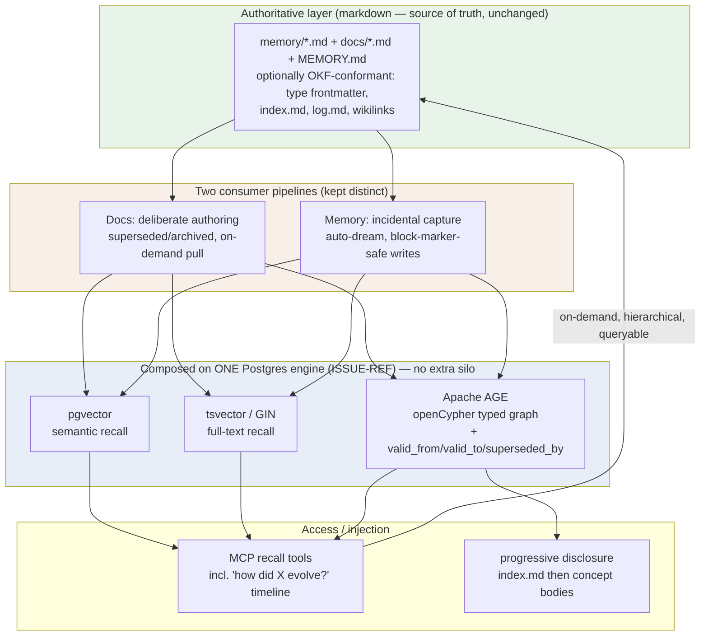

# AI-Native Knowledge Substrate + Agent Memory — OSS Adoption Evaluation

**Status:** complete (refined 2026-07-14 via `/research-doc` — 8 primary sources full-fetched + validated into the provenance ledger)

**Created:** 2026-07-14

**Task:** feeds ISSUE-REF (knowledge+memory architecture synthesis); builds on ISSUE-REF (memory audit) + ISSUE-REF (doc-repository frameworks); relates ISSUE-REF (lifecycle), ISSUE-REF (universal doc library), ISSUE-REF (Postgres).

## Table of Contents

- [Context](#context)
- [Temporal Scope](#temporal-scope)
- [Executive Summary](#executive-summary)
- [1. The Unified Thesis — one substrate, two consumer profiles](#1-the-unified-thesis--one-substrate-two-consumer-profiles)
- [2. The Emerging Ecosystem & Standard](#2-the-emerging-ecosystem--standard)
- [3. Knowledge Graphs — what they are and how they fit](#3-knowledge-graphs--what-they-are-and-how-they-fit)
  - [3.1 System-design stress test — a KG is a model, not a database](#31-system-design-stress-test--a-kg-is-a-model-not-a-database-the-frankenstein-question)
- [4. Candidate Landscape (carried from ISSUE-REF/865 — re-judge fresh)](#4-candidate-landscape-carried-from-ISSUE-REF--re-judge-fresh)
- [5. Career / OSS-Portfolio Lens](#5-career--oss-portfolio-lens)
- [6. Gaps, blindspots & emergent findings](#6-gaps-blindspots--emergent-findings)
- [Comparison](#comparison)
- [Recommendation](#recommendation)
- [Open Questions](#open-questions)
- [Sources](#sources)
- [Appendix: Research Prompt](#appendix-research-prompt)
- [Appendix: Provenance Ledger](#appendix-provenance-ledger)
- [Run History](#run-history)

<!-- doc:region name="context" kind="immutable" -->

## Context

This document evaluates, on a **free + open-source + buildable-on + acceptable-solo-operational-weight** bar, what OSS the user should ADOPT and scaffold on to build a unified "AI-native knowledge substrate + agent memory" for a personal Claude Code fleet — versus building thin glue. It is authored as a **consolidated seed**: findings gathered in a 2026-07-14 working session (the unified thesis, LangChain OpenWiki, Google's Open Knowledge Format, a knowledge-graph primer, and the candidate landscape carried from two prior research docs) are seeded here so a pending opus `/research-doc` refine spends its budget on the gaps rather than re-discovering the ecosystem.

**Second, first-class lens:** the user is prioritizing landing an elite, higher-paying AI-engineer role and open-sourcing more (judging there is no durable moat here as models improve). So options are scored on solo-utility AND on **portfolio / career signal** (a differentiating OSS artifact or hireable skill that helps into Anthropic / neolabs / top AI labs / advanced-manufacturing orgs). See [Recommendation] for where the two diverge.

**Design steer (2026-07-14):** the user wants this to **scale** and could grow it into a demo / OSS project / company product, so favor **robust, widely-adopted, scalable OSS foundations** (foundation-first) over clever-but-niche or throwaway-thin options — while explicitly guarding against over-engineering rabbit holes that block near-term building (stage the complexity; earn it with real use).

**Primary period:** 2024–2026
**Source weighting:** 2026 primary → 2025 → 2024. Established wikis/KBs reported at current 2026 state regardless of founding date.

<!-- /doc:region name="context" -->

<!-- doc:region name="body" kind="replaceable" -->

## Temporal Scope

Weight 2026 (primary) → 2025 → 2024. AI-native/agent-memory developments weighted to 2026→2025; established wiki/KB frameworks reported at current 2026 state. Genuine gaps are named, not backfilled. All load-bearing claims in this refine were WebFetch-validated in-session (8 primary sources: 8 pages full-fetched, quotes recorded in the Provenance Ledger); search-only snippets are tagged accordingly.

## Executive Summary

> **This is an informational landscape, not a design decision.** The goal is breadth + depth of the OSS field and how each option **complements, overlaps, replaces, or conflicts** with the user's existing systems (CC-native markdown memory + `MEMORY.md` + auto-dream; git as version control; the planned Postgres consolidation, ISSUE-REF; the doc-index + frontmatter + `[[wikilinks]]`). The user's lenses — one unified foundation over a "Frankenstein" of siloed datastores, temporal/evolution recall as a want, git ≠ memory, a Postgres-native bias — are used to *assess relevance and organize the information*, **not** to lock an architecture. The specific build is deferred to a later design phase.

1. **The "docs and memory are the same problem" thesis is externally validated — but the two must stay two consumer profiles over one store, not one undifferentiated blob.** The industry converged on exactly this in mid-2026: LangChain OpenWiki ships it as two modes (Personal Brain = memory, Code Brain = repo docs)[^1][^2], and Google's Open Knowledge Format (OKF, announced June 2026) formalizes the markdown-wiki-as-agent-memory pattern as a portable spec[^3][^4]. The unification is real at the *storage + index + graph* layer; it is a **premature abstraction** if pushed into the write/capture and lifecycle layers, which are genuinely opposite (deliberate/on-demand vs incidental/auto-injected). [INFERENCE]
2. **The emerging standard is essentially the user's existing hand-rolled setup — so conform, don't rebuild.** OKF v0.1 = "a directory of markdown files with YAML frontmatter"[^3], one required field (`type`), an `index.md` (progressive disclosure) and a `log.md` (change history newest-first)[^3] — which maps almost 1:1 onto `memory/*.md` + frontmatter + `MEMORY.md` + Compact-History. **Caveat that corrects the seed:** OKF links are explicitly **untyped** ("directed edges of an untyped relationship"; the relationship kind "is conveyed by the surrounding prose, not by the link itself")[^3]. So OKF gives you a portable corpus, *not* a typed knowledge graph — the KG typing is still the user's to build.
3. **No single OSS project delivers the whole substrate — the field splits into composable pieces and self-contained silos.** OpenWiki is markdown + connectors with **no knowledge graph** and only roadmapped search[^1]; OKF is a *format* spec, not an engine; Graphiti is a graph-memory engine that brings its own graph datastore and is not markdown-authoritative[^6]. The most important organizing distinction for the user's "no Frankenstein" lens is **composes-on-one-foundation vs adds-a-silo**: pgvector / `tsvector` / Apache AGE all live *inside* Postgres, whereas Graphiti (FalkorDB/Neo4j), Letta (its own server DB), and claude-mem/Chroma each add a separate datastore, model, and ops story.
4. **A Postgres-native stack can compose docs + memory + graph + temporal in one engine — this is "using standards," not rolling your own.** pgvector is the de-facto 2026 OSS vector substrate (production at OpenAI/Supabase/Neon, scales to 50–100M vectors)[^10]; Apache AGE has closed its historical PostgreSQL-version-lag weakness (v1.7.0 Jan 2026 supports PG18; v1.6.0 Sep 2025 supports PG16/17)[^5], giving openCypher graph queries *inside* Postgres under Apache-2.0. Composing pgvector + `tsvector`/GIN + AGE + valid-time columns in one already-adopted engine (ISSUE-REF) is a directional option that maximizes unification/joins/one-backup-story — presented as a leading path, not a mandate. [VERIFIABLE][^5][^10]
5. **Two seed recommendations are now CORRECTED by 2026 facts.** (a) **Kuzu is dead as a dependency** — its GitHub repo was archived October 2025, Kùzu Inc was acquired (reported Apple), and Graphiti itself marks the Kuzu driver "deprecated … the upstream Kuzu project is no longer maintained"[^6][^7]. Remove it from the recommended set. (b) **FalkorDB is SSPLv1, not permissive OSS**[^11] — it fails a strict free-OSS bar and adds a second datastore. The re-judged winners on the free+OSS+Postgres-native bar are **Apache AGE (graph) + pgvector (recall)**, with **Mem0's Apache-2.0 embeddable core** and **Graphiti's bi-temporal design** mined for patterns.
6. **Temporal/evolution recall is a genuine, differentiating goal — build it on Postgres valid-time, not on a second store, and not "for free from git."** The user wants queryable recall of how projects/thinking evolved; git is version control, not memory (it needs manual archaeology and answers no "how did X evolve?" query). A `valid_from`/`valid_to` + `superseded_by` model on Postgres facts/edges (mining Graphiti's "old facts are invalidated — not deleted"[^6]) exposes that as on-demand, hierarchical, queryable recall on the foundation — and is itself the strongest portfolio artifact.

## 1. The Unified Thesis — one substrate, two consumer profiles

The doc-knowledge-graph problem (ISSUE-REF) and the agent-memory problem (ISSUE-REF) share infrastructure and diverge at write-pattern, lifecycle, and injection:

- **Shared substrate (correct to unify):** a markdown-authoritative corpus + an index/recall layer (SQLite FTS5 now → Postgres `tsvector`/pgvector later) + a relationship/graph layer.
- **Two consumers (must stay distinct):**
  - **Docs** — deliberately authored, superseded/archived, pulled *on demand*. (ISSUE-REF, ISSUE-REF)
  - **Memory** — incidentally captured, decays/retracts, *auto-injected* into sessions. (ISSUE-REF, ISSUE-REF)

The external evidence supports the *substrate* unification: OpenWiki serves both from one markdown wiki via two modes[^1][^2], and OKF is deliberately a single spec meant to be "authored by people, generated by agents … consumed by both"[^3]. **The stress-test result (skeptic critic):** the unification is correct at storage/index/graph and a *premature abstraction* if extended to capture + lifecycle. Docs are write-rarely / read-on-demand; memory is write-often / read-auto-injected. Collapsing their write paths risks the two failure modes the seed named — session-context bloat from doc bodies, and authority-fork from auto-capture overwriting curated files. Keep **one storage engine, two pipelines**. [INFERENCE]

## 2. The Emerging Ecosystem & Standard

- **LangChain OpenWiki / "OpenWiki Brains"** [VERIFIABLE][^1][^2] — an **MIT-licensed** CLI (11.2k GitHub stars) that turns connected sources (Gmail/Notion/Git/X/HN/web) into a **local Markdown wiki** used as proactive agent memory; runs locally, two modes — **Personal Brain** (`~/.openwiki/wiki`) and **Code Brain** (`openwiki/` in-repo)[^1][^2]. It implements Andrej Karpathy's "LLM wiki" pattern. **Two internals confirmed by full-fetch that matter here:** (1) it is **markdown-authoritative and non-destructive** — "OpenWiki only rewrites its own `<!-- OPENWIKI:START -->…<!-- OPENWIKI:END -->` block and leaves the rest of your content untouched"[^1]; (2) it uses **no knowledge graph** — connectors + markdown only, with full-text/semantic search still roadmapped[^1]. MCP is supported for sources (Notion MCP)[^1]. **Verdict: MINE, don't adopt wholesale** — the block-marker containment pattern is directly reusable and reconciles auto-capture with curated files, but its proactive multi-source ingestion overlaps/conflicts with CC-native `MEMORY.md` + auto-dream (authority-fork risk).
- **Google Open Knowledge Format (OKF)** [VERIFIABLE][^3][^4] — a vendor-neutral spec (v0.1 draft, Google Cloud, June 2026) formalizing the ISSUE-REF pattern: a **Knowledge Bundle** = "a self-contained, hierarchical collection of knowledge documents"; a **Concept** = "a single unit of knowledge … represented as one markdown document" with a Concept ID from its file path; exactly one required frontmatter field (`type`), optional `title`/`description`/`resource`/`tags`/`timestamp`; an `index.md` for progressive disclosure and a `log.md` for change history[^3]. **Links are untyped** — "The specific kind of relationship … is conveyed by the surrounding prose, not by the link itself"; consumers "treat links as directed edges of an untyped relationship"[^3]. OpenWiki is *one producer* of OKF, not the spec itself — "Anyone can produce OKF — humans authoring by hand, agents built on any framework (Google ADK, LangChain, custom)"[^4]. **Verdict: CONFORM** — the migration cost from the user's existing structure is near-zero, and conformance buys portability + a standards signal; but OKF alone gives an untyped corpus, so the typed graph stays a local addition.
- **Microsoft GraphRAG / knowledge graph extraction tool** [VERIFIABLE][^12] — extracts entities + relationships, clusters them into thematic "communities," and pre-computes LLM community summaries for global queries over large static corpora[^12]. Relevant as a *skill/pattern* (see §5) more than an adopt: it is optimized for large static document sets, not incidental decaying memory.

## 3. Knowledge Graphs — what they are and how they fit

**What a KG is:** facts as a network of **entities (nodes)** joined by **typed relationships (edges)** — `[ISSUE-REF] --supersedes--> [ISSUE-REF]` — subject→predicate→object triples queried as structure rather than searched as prose. [HEURISTIC]

**KG vs markdown+FTS (complementary, not competing):** [HEURISTIC]
- *Markdown + FTS/vector* stores prose, retrieves by keyword/semantic similarity → answers "which memory mentions X?" A `[[wikilink]]` or an OKF link is "related," **untyped**[^3].
- *Knowledge graph* makes relationships explicit + typed → answers "how are X and Y connected?", multi-hop, and **temporal** ("what superseded what, and when?"). Serious systems (Microsoft GraphRAG[^12], Graphiti[^6]) combine both: vector/FTS for entry-point recall + graph for traversal.

**The bridge:** the user already has an implicit graph — `[[wikilinks]]`, `superseded_by`/`related_docs` frontmatter, roadmap `blocked by`/`depends on`. "Incorporating a KG" here = making those links *typed and traversable over the authoritative markdown* — via **Apache AGE edges or relational edge tables in the same Postgres**, not a separate graph server. [INFERENCE]

**Graph/substrate-engine options (foundation-first + scalable + free-OSS — re-judged with 2026 facts):**
| # | Option | License / 2026 status | Ops weight | Resume signal | Verdict |
|---|--------|-----------------------|------------|---------------|---------|
| 1 | **Postgres + pgvector** (+ `tsvector`/GIN FTS) | PostgreSQL license + pgvector (PostgreSQL license); production-standard[^10] | one engine, already adopting (ISSUE-REF) | strong — pgvector/Postgres-for-AI ubiquitous in JDs | **RECOMMENDED backbone (recall)** |
| 2 | **Apache AGE** (openCypher graph IN Postgres) | Apache-2.0; v1.7.0 Jan 2026 (PG18), v1.6.0 Sep 2025 (PG16/17) — version-lag weakness resolved[^5] | none extra (same engine) | strong (Cypher + Postgres) | **RECOMMENDED graph layer** |
| 3 | **Graphiti** (temporal-KG framework, Apache-2.0) | Apache-2.0; but backends = Neo4j 5.26 / FalkorDB 1.1.2 / Neptune / Kuzu (deprecated)[^6] — **no Postgres** | second datastore required | strong (temporal-KG) | **MINE the bi-temporal model; adopt only if auto-extraction is worth a 2nd store** |
| 4 | **FalkorDB** (Redis-module graph) | **SSPLv1** (source-available, not permissive)[^11] | medium (Redis + 2nd store) | moderate | **SKIP for the daily driver** — fails the free-OSS bar |
| 5 | **Kuzu** (embedded, Cypher) | MIT but **archived Oct 2025**; Kùzu Inc acquired; Graphiti driver deprecated[^6][^7] | low (in-process) | falling (abandoned) | **SKIP — dead dependency** (community fork "bighorn" unproven) |
| 6 | **Neo4j** (graph-DB server) | GPLv3 community / commercial; heavy | high (server ops) | strong + user has prior Neo4j exp | **OUT** for the daily driver; only a separate deliberate portfolio project |
| 7 | Light graph over wikilinks only | n/a (derived) | lowest | modest | fine as a *stage-0* starting point; too thin for the scale/portfolio goal |

**The (A) Postgres-AGE vs (B) Graphiti-FalkorDB fork — resolved:** on the user's *free-OSS + Postgres-native + scalable + portfolio* bar, **(A) Apache AGE + Postgres valid-time wins.** Deciding factors: (1) **license** — AGE is Apache-2.0 and pgvector is permissive; FalkorDB is SSPLv1[^11] and Neo4j-server is GPL/commercial-heavy; (2) **one engine** — AGE/relational edges live in the Postgres the fleet is already consolidating onto (ISSUE-REF), no second datastore; (3) **scale headroom** — pgvector handles 50–100M vectors[^10], far beyond a solo corpus. **(B) Graphiti earns its keep only if automatic LLM entity/edge extraction + turnkey bi-temporal are must-haves worth a second store** — and even then FalkorDB's SSPL pushes the backend toward Neo4j (heavier) or the deprecated Kuzu (dead). The pragmatic play: **mine Graphiti's bi-temporal model** ("each fact … has a validity window: when it became true, and when (if ever) it was superseded"; "old facts are invalidated — not deleted")[^6] and implement it as `valid_from`/`valid_to`/`superseded_by` columns on Postgres facts/edges (see §6, Q4).

### 3.1 System-design stress test — a KG is a *model*, not a *database* (the Frankenstein question)

**A knowledge graph is a data model / retrieval pattern, not a database.** GraphRAG is a *retrieval pattern*; Neo4j is *infrastructure* — the graph model can be implemented on Neo4j, on Postgres + AGE, or others[^20]. So "Postgres vs a knowledge graph" is a category error: the KG is a query *shape* (typed relationships, multi-hop, temporal evolution) that flat rows and vector similarity answer poorly — and Postgres can host that shape. pgvector + Apache AGE = "knowledge graph & semantic intelligence in a single engine"[^19]; recursive CTEs alone scale to tens of millions of edges at typical depths, and keeping entities + edges in one store **avoids the Postgres↔graph-DB synchronization**[^18] that is the actual Frankenstein cost.

**Where the unified-Postgres answer genuinely breaks (independent of the solo corpus size):**
- **AGE is the weakest link, with concrete (not just "maturity") limits:** variable-length path queries — the core KG traversal — **bypass indexes in AGE** (native/fast in Neo4j), Cypher is translated to Postgres function calls with overhead, and standard openCypher (`MERGE ... ON MATCH SET`, set-returning UDFs in Cypher) is unsupported[^21][^22]. Betting the graph layer on AGE bets on the least-proven component — and multi-hop is exactly where it is weakest. [VERIFIABLE][^21][^22]
- **Native graph engines win categorically for graph-*algorithm* workloads** (PageRank, community detection, deep/dense traversal) via index-free adjacency[^21] — if the graph is the *product*, Postgres is the wrong engine at any size.
- **Colocated workloads contend + couple:** vector ANN (memory-heavy), graph traversal (CPU-heavy), and OLTP in one instance fight for resources, scale together, and share a blast radius. "It is impossible for a single database to be good at everything"[^23]; polyglot exists to *isolate* workloads and the payoff grows when they diverge in access pattern / SLA[^23]. [VERIFIABLE][^23]
- **Buy-vs-build the capability (strongest pro-2nd-store case for this workload):** Graphiti's *automatic* bi-temporal (valid + transaction time, LLM edge-extraction, auto-invalidation) is genuinely hard to build; `valid_from`/`valid_to` columns are the *lite* version. This is a capability argument, not a performance one. [INFERENCE]
- **Polyglot's own cost is real:** cross-store consistency, hard cross-store atomicity, DB-specifics leaking into app code (coupling), and underestimated multi-DB ops burden[^23].

**Verdict (survives the stress test):** for a knowledge/memory *substrate* — a graph-model-*light* workload (typed links, moderate multi-hop, temporal, vector recall), not billion-edge analytics — **unified Postgres (AGE + pgvector + valid-time) is the right default**, and a second *live* graph datastore before a workload earns it is the premature/Frankenstein part. **But the disciplined move is to put the graph + vector capability behind a clean interface (repository/port)** so extraction to a specialized store (or adopting Graphiti's engine) is a *config change, not a rewrite* — justified by de-risking the AGE bet + preserving workload-isolation optionality, NOT by résumé optics. The seam is good architecture; the sync you don't need yet is the Frankenstein. A deliberate **pluggable-backend demo** (swap AGE ↔ Neo4j behind the port) is worth building as a separate portfolio/OSS artifact. [INFERENCE + HEURISTIC]

### 3.2 Unified Postgres vs dedicated graph/vector backends — 2026 evidence (D-2 / D-3 deep-dive)

A targeted 2026 re-check — does the unified-Postgres default hold, and what does a native graph/vector backend actually buy (the design's D-2 and D-3 questions)? — confirms the §3.1 verdict for a substrate-scale workload and sharpens the *triggers* for exercising the backend port.

**Vector: pgvector scales far past our needs; dedicated DBs are a large-scale concern.** pgvector inside existing Postgres is a full production answer under ~5M vectors (≈10–20 ms/query at 95%+ recall on 1M × 1536-dim, single instance); beyond ~5M a clustered dedicated store (Qdrant) begins to pay, and only past ~50–100M do purpose-built engines (Milvus/Pinecone) become necessary. [VERIFIABLE][^24] The `pgvectorscale` extension pushes the competitive range into the tens of millions (community benchmarks report parity-or-better vs Qdrant around 50M). [HEURISTIC] Our corpus is sub-megabyte of markdown — orders of magnitude below the first threshold; pgvector is nowhere near a constraint.

**Graph: what AGE gives up vs a native engine (the D-3 "option C" question).** A native graph DB buys three things AGE lacks, all real:
1. **A graph-data-science / algorithms library** — PageRank, centrality, pathfinding, node embeddings, and especially **community detection (Leiden)**. AGE ships none. [VERIFIABLE][^25] This is the most consequential gap for *knowledge* work: Microsoft-style **GraphRAG** builds multi-level community summaries via hierarchical Leiden clustering (reported to win 70–80% of complex sensemaking tasks vs baseline RAG). AGE cannot compute those in-engine. [HEURISTIC]
2. **Index-free-adjacency traversal** — native engines follow direct pointers, so cost tracks the data a query touches, not depth; AGE compiles multi-hop into table joins / recursive CTEs whose cost grows with depth × table size. Deep (>~3-hop) traversal is where AGE hurts. [VERIFIABLE][^25]
3. **Native vector inside the graph engine** — Neo4j now ships a native vector type/index and FalkorDB an in-store HNSW, making hybrid graph+embedding GraphRAG clean in one engine (the graph-native mirror of our pgvector+AGE argument). The latency-first option is **FalkorDB** (GraphBLAS sparse-matrix traversal; vendor benchmarks claim 10–100× Neo4j on specific multi-hop) — but it is **SSPL** (source-available, not permissive OSS). [HEURISTIC]

**Industry pattern — unified vs hybrid (the base-layer question).** Two camps in 2026, and the trend informs the base-layer choice: **(1) Postgres consolidation** — the "just use Postgres" movement (pgvector + AGE + FTS + relational in one engine) is the recommended default for teams already on Postgres at small-to-mid scale, and a notable number of teams that adopted dedicated vector DBs in 2024 have *migrated back* to Postgres + pgvector/pgvectorscale. The decisive draw: **joining embeddings with relational metadata in one SQL query is uniquely powerful and unavailable in a dedicated vector DB**, and one store means one backup / one source of truth. [HEURISTIC] The polyglot counter-risk specific to AI is the **"retrieval gap"** — independent datastores have independent clocks and commit boundaries, so a single decision reading across them sees inconsistent points-in-time; that is an argument *for* colocation when a query must assemble coherent context. [HEURISTIC] **(2) Layered/hybrid** — at larger scale, tiered memory (Redis hot state + a dedicated vector store + Postgres for episodic/procedural) isolates workloads that diverge in access pattern/SLA, and any team adopting an off-the-shelf memory framework (Graphiti → Neo4j/FalkorDB, Mem0's hybrid stack) is *de facto* hybrid. [HEURISTIC] So colocating relational + FTS + vector + valid-time is **not strictly necessary, but it is a genuine, industry-recognized benefit** for our profile (moderate scale, wants cross-domain coherent recall, already Postgres-inclined) — not merely "a cost avoided." In practice the either/or collapses to *"consolidate on Postgres until a specific workload forces a second store"* — exactly what the port design (D-3/D-5) operationalizes. [INFERENCE]

**The middle option worth knowing — PuppyGraph.** A **zero-ETL graph query engine that runs Cypher/Gremlin directly over existing Postgres** (no second store), reportedly 10-hop in <2 s via columnar/vectorized execution. It attacks AGE's traversal-depth weakness *while preserving the unified-store win* — but it is **commercial** (free single-node Developer Edition; paid Enterprise). [VERIFIABLE][^26] It belongs on the `GraphStore`-port adapter menu alongside Neo4j (GDS + native vector + mature GraphRAG tooling) and FalkorDB (speed; SSPL).

**Net (D-2 + D-3):** both defaults hold — **unified Postgres (D-2 = a)** and **AGE behind a port (D-3 = a)** — and nothing material is missed *for a substrate-scale, graph-model-light workload*. The research sharpens the two concrete triggers for exercising the port: **(i) needing graph algorithms** (community detection / PageRank for GraphRAG-style summarization — AGE's hard gap; interim workaround = compute out-of-band in Python over the edge set, viable at our scale), and **(ii) deep-traversal at volume.** If either triggers, the port has three credible targets — Neo4j, FalkorDB, PuppyGraph — which also enriches the ISSUE-REF pluggable-backend demo. [INFERENCE]

### 3.3 Temporal / bi-temporal memory — framework adoption (D-4 deep-dive)

Is Graphiti the industry/OSS standard, and what is the pain of *not* adopting it? The 2026 landscape:

- **Graphiti (getzep, Apache 2.0, ~45K stars)** is the **canonical open-source answer for temporal (bi-temporal) knowledge-graph agent memory** — production users (Zep's commercial product is built on it; deployed in CRM/compliance/healthcare), small API surface, hybrid retrieval (semantic + BM25 + graph). It models both *event time* and *ingestion time* with explicit edge-validity windows and leads the most-cited public temporal benchmark (**63.8% vs Mem0's 49.0% on LongMemEval / GPT-4o**). [VERIFIABLE][^27][^28]
- **Mem0 (~47K stars)** is the most-adopted memory framework overall — widest features, best free tier, largest community, automatic extraction — but temporal reasoning is *weak by design*: facts are updated, not versioned with validity windows. [VERIFIABLE][^28]
- **Cognee (~17.6K, Apache 2.0)** — typed-KG pipeline (Extract-Cognify-Load), structural not temporal; **Letta/MemGPT** — a stateful agent-managed-memory *runtime*, temporal only via agent self-curation. [VERIFIABLE][^28]
- **The decisive fact for D-4:** **Graphiti supports Neo4j and FalkorDB as backends — not Postgres.** [VERIFIABLE][^27] So "adopt Graphiti" = "run a second (graph) datastore," which is exactly the tension with D-2's unified Postgres. These frameworks are *well-maintained* (Graphiti is Apache-2.0, 45K-star, production-backed — a low *project-risk* bet); the cost is **not** maintaining an abandoned tool, it is the **second live store** it drags in.

**Net (D-4):** the tradeoff is now quantified. Rich bi-temporal buys a real, measured capability edge (auto LLM edge-extraction + invalidation; ~15-pt temporal-retrieval gap) at the cost of a second graph datastore. `valid_from`/`valid_to`/`invalidated_at` columns on Postgres are the *lite* version — no auto-extraction, weaker temporal retrieval, but unified; for a sub-MB corpus that is ample. Recommendation: **start valid-time-on-Postgres (mine Graphiti's bi-temporal model per D-7); name Graphiti as the well-supported upgrade path** if rich temporal reasoning becomes a must-have — with a coherence note: if the D-3 graph port is ever exercised to **FalkorDB, Graphiti runs on FalkorDB**, so D-3 and D-4 converge on one store rather than adding two. [INFERENCE]

### 3.4 Format standard — is OKF the one to conform to? (D-6 deep-dive)

- **OKF (Google Cloud, v0.1, 2026-06-12; authors McVeety & Hormati)** formalizes the ISSUE-REF pattern: a directory of markdown files + YAML frontmatter requiring exactly **one** field (`type`); no schema registry, no central authority, no required tooling. Vendor-neutral, git-shippable, human+agent readable. [VERIFIABLE][^29]
- **Status: an early proposal, not yet a standard** — the authors state "OKF v0.1 is a starting point, not a finished standard"; a v0.1 spec from a single vendor is an invitation whose fate depends on producers outside Google adopting it. [VERIFIABLE][^29]
- **Complementary, not competitive, with existing standards** — it references (does not subsume) schema.org, JSON-LD, RDF, Avro/Protobuf. The heavier **semantic-web stack (RDF/JSON-LD/schema.org)** is the mature-but-expressive alternative; OKF deliberately trades that expressiveness for markdown simplicity. It standardizes de-facto conventions already in use — CLAUDE.md/AGENTS.md, Obsidian vaults, project-doc repos ("MCP for knowledge"). [VERIFIABLE][^29]

**Direct competitors to OKF? Essentially none at the knowledge-representation layer — the adjacent "standards" stack, they don't compete.** A 2026 scan of the space: **llms.txt** (Jeremy Howard, Sept 2024; widely adopted across the coding-agent ecosystem) is a doc-*discovery* map (a root file pointing at doc URLs); **AGENTS.md** (OpenAI, Aug 2025, 60k+ projects) is an in-repo agent-*behavior* instruction sheet; **MCP** (2024) is a tool/resource *connectivity* protocol; **schema.org/JSON-LD/RDF** is web/semantic metadata; **RAG** is a retrieval technique. None is a knowledge-*corpus format* — that is OKF's specific niche, currently **uncontested** there (the nearest "alternatives" are de-facto markdown conventions like Obsidian, or the heavier semantic-web stack). Several of these are **complementary layers we already use** (AGENTS.md + CLAUDE.md in the session config; MCP for ai-core; llms.txt is a candidate for the OSS repos' discovery). So conforming to OKF is low-risk — there is no competing *format* standard to bet against, and the adjacent specs compose with it rather than replace it. [HEURISTIC]

**Net (D-6):** there is **no single established standard** for agent-knowledge format; OKF is the newest and the closest to what we already do (markdown + frontmatter + index + links), and conformance is nearly free. Recommendation stands — **conform to OKF as a direction** (portability + ecosystem-interop bet) **but treat it as nascent**: keep the format minimal, don't over-invest in OKF-specific tooling until adoption proves out, and stay standards-aware (able to emit schema.org/JSON-LD metadata if a consumer needs it). The risk is low precisely because OKF is "just markdown + frontmatter" — the same bytes stay useful even if OKF itself doesn't win. [INFERENCE]

## 4. Candidate Landscape (re-judged on the free-OSS-buildable-solo bar)

| # | Candidate | License | Model | Fit verdict |
|---|-----------|---------|-------|-------------|
| 1 | **OpenWiki** (LangChain) | MIT[^1] | Markdown wiki + connectors, no KG, block-marker-safe | **MINE** — reuse block-marker + OKF conformance; don't adopt the ingestion (authority-fork vs auto-dream) |
| 2 | **OKF** (Google) | spec (v0.1)[^3] | Markdown + frontmatter standard | **CONFORM** — near-zero migration; portability + standards signal |
| 3 | **pgvector** | PostgreSQL license[^10] | Vector recall in Postgres | **ADOPT** — recall backbone |
| 4 | **Apache AGE** | Apache-2.0[^5] | openCypher graph in Postgres | **ADOPT** — graph layer |
| 5 | **Mem0 (OSS)** | Apache-2.0[^8] | Embeddable `Memory()`; library uses local Qdrant+SQLite, server uses Postgres+pgvector[^8] | **RE-JUDGED: viable MINE** — not a hosted-only reject; but VC-backed relicense risk (BUSL/SSPL) is a structural caveat |
| 6 | **Letta / MemGPT** | Apache-2.0[^9] | Stateful **server** (its own DB, Postgres+pgvector); tiered Core/Recall/Archival memory | **MINE the tiered model; SKIP as infra** — server owns state (authority-fork vs markdown-authoritative) |
| 7 | **Graphiti / Zep** | Apache-2.0[^6] | Temporal-KG engine; needs Neo4j/FalkorDB/Neptune (Kuzu deprecated) | **MINE the bi-temporal model** — adopt only if auto-extraction ≫ 2nd-store cost |
| 8 | **claude-mem / MCP memory servers** | varies | CC-native progressive disclosure | keep as the injection surface (ISSUE-REF) |
| 9 | **SQLite FTS5** (Hermes pattern) | public domain | Thin FTS index over markdown | **ADOPT as stage-0 recall** (ISSUE-REF verdict) before Postgres migration |

**Correction applied (not inherited):** ISSUE-REF tagged Letta/Mem0/Zep "REJECT" on ops-weight, not cost — confirmed most are Apache-2.0[^6][^8][^9]. Re-judged: Mem0 and Graphiti move from "reject" to "mine for patterns"; Letta stays "not as infra" because it is a stateful server that owns its own store (breaks markdown-authoritative).

### Relation to the user's existing systems + composability

For each option: does it **compose on one foundation** (Postgres) or **add a silo** (its own datastore/model), and does it complement / overlap / replace / conflict with what the user already runs — CC-native markdown memory (`~/.claude/.../memory/*.md` + `MEMORY.md` + auto-dream), git (version control), the planned Postgres consolidation (ISSUE-REF), and the doc-index + frontmatter + `[[wikilinks]]`? [INFERENCE, from each project's fetched architecture]

| # | Option | Composes on Postgres? | Relation to existing systems |
|---|--------|-----------------------|------------------------------|
| 1 | **pgvector** | **yes — in-engine** | **complements** ISSUE-REF; new recall over existing markdown; no silo |
| 2 | **Apache AGE** | **yes — in-engine** | **complements** ISSUE-REF; formalizes `[[wikilinks]]`/frontmatter edges as typed graph; no silo |
| 3 | **SQLite FTS5** (Hermes) | partial (separate file, trivial) | **complements** — thin recall index over the same markdown; ISSUE-REF slice; pre-Postgres |
| 4 | **OKF** (format) | **yes — it's a format, not a store** | **complements** — a standard the corpus *speaks*; near-1:1 with existing frontmatter + `MEMORY.md`/log; no datastore |
| 5 | **OpenWiki** | n/a (files) but ingestion is its own pipeline | **overlaps/conflicts** — its proactive multi-source capture competes with auto-dream + curated `MEMORY.md` (authority-fork); block-marker pattern is complementary to mine |
| 6 | **Mem0 (OSS)** | server mode uses Postgres+pgvector[^8]; library mode adds Qdrant+SQLite[^8] | **overlaps** CC-native memory; library mode = a silo (Qdrant); server mode composes but owns its schema |
| 7 | **Letta / MemGPT** | **no — own server + DB**[^9] | **replaces/conflicts** — stateful server owns memory; breaks markdown-authoritative; a silo |
| 8 | **Graphiti (+FalkorDB/Neo4j)** | **no — separate graph store**[^6] | **adds a silo** — a 2nd datastore off the foundation; complements only as a mined *pattern* (bi-temporal) |
| 9 | **claude-mem / Chroma** | **no — own vector store** | **overlaps** CC memory + **adds a silo** (Chroma); keep only as injection surface |
| 10 | **Kuzu** | embedded but **archived**[^7] | **conflicts** (dead dependency) — do not build on |

**The unification tension, reconciled:** "use OSS standards, don't roll your own" and "no Frankenstein" are compatible when you **compose standard extensions on one engine** (pgvector + `tsvector` + AGE are widely-adopted, standard Postgres extensions — composing them is still using standards) and adopt the one worthwhile **external standard as a *format*, not a system** (OKF — interop the substrate *speaks*, not another datastore to run). The anti-pattern is stitching tools that each bring a datastore (Graphiti+FalkorDB, Letta-server, Chroma) into a siloed monster.

## 5. Career / OSS-Portfolio Lens

The user is prioritizing an elite AI-eng role and open-sourcing more (no durable moat). Evidence-backed implications: [INFERENCE unless tagged]

- **KG/GraphRAG + agent-memory is a hot, explicitly-recruited-for skill cluster in 2026.** Job boards list ~900+ knowledge-graph roles[^13], and top-tier JDs name the exact stack: Capital One's *Applied Researcher* posting requires "Multi-agent Systems, Knowledge Graphs/GraphRAG/Graph-of-Thought, MCP, LangGraph"[^14]. **MCP-server-building is a scarce, differentiating skill** — "engineers who can build MCP servers have a significant advantage as practical MCP experience is scarce"[^13]. [VERIFIABLE][^13][^14]
- **The most hireable, resume-differentiating signals here (ranked):** (1) a working **GraphRAG / temporal-KG** implementation; (2) **MCP servers** exposing it; (3) **pgvector/Postgres-for-AI** hybrid retrieval; (4) **LangGraph** orchestration. These *also* add real utility to this substrate — the rare case where portfolio and utility fully align.
- **Where utility and career-signal diverge:** pure "adopt OpenWiki + write a config" is low-signal (consumer, not builder). **Building the temporal-evolution recall layer yourself** (valid-time on Postgres + AGE + an MCP recall interface) is the higher-signal path — it demonstrates KG/temporal-memory *engineering*, not just tool use. Prefer **build-the-differentiated-layer + contribute-upstream** (e.g. an OKF-conformant temporal extension, or a Graphiti/AGE bridge) over either a private bespoke build or a low-signal adopt.
- **Emergent portfolio angle (per user steer):** a small OSS **"knowledge OS that surfaces how understanding / projects / thinking evolve over time"** — temporal-evolution recall as the headline feature — is a genuinely differentiated artifact. No surveyed OSS project nails *personal, queryable, hierarchical evolution recall*: OpenWiki has no temporal model[^1], OKF has only a `log.md` + `timestamp`[^3], Graphiti has bi-temporal but is entity-extraction-centric and off-Postgres[^6]. That gap is the opportunity (see §6).

## 6. Gaps, blindspots & emergent findings

- **Contrarian (weighed, partially conceded):** the unified substrate may be a premature abstraction. Concession — keep capture + lifecycle pipelines separate; unify only storage/index/graph (§1). This is the single most important design guardrail in the doc.
- **Temporal recall is the real differentiator and the least-solved piece.** Reframed per user steer: **git is source control, not memory** — it requires manual `log`/`blame`/`grep` archaeology and answers no "how did my thinking on X evolve?" query. The capability must be exposed by the *recall layer* as on-demand, hierarchical, persistent, queryable output. The buildable design: `valid_from`/`valid_to`/`superseded_by` on Postgres fact/edge rows (mining Graphiti's invalidate-don't-delete[^6] and ISSUE-REF lifecycle), a `log.md`-style per-concept history (OKF[^3]), and an MCP tool that returns an ordered evolution timeline. This is **Q4's answer**: temporal-KG *pattern* on the Postgres foundation, not a second temporal-KG datastore.
- **OKF's untyped links are a real limitation, not a nit.** The seed implied OKF gives "links that form a graph"; the spec explicitly makes them untyped[^3]. Typed edges (the actual KG value) remain the user's to add in AGE/relational — budget for it, don't assume the standard provides it.
- **Lock-in / abandonment risk is live in this space** — Kuzu's Oct-2025 archival + acquisition[^7] and FalkorDB's SSPL[^11] and Mem0's VC-relicense exposure[^8] all argue for the **boring, permissive, self-owned Postgres foundation** over VC-backed embedded infra. This is the strongest evidence for the foundation-first steer.
- **Blindspot I could not fully resolve:** the *operational* cost of running pgvector + AGE for a single user at rest (idle Postgres footprint, AGE query maturity for deep multi-hop) is under-documented for solo deployments — AGE's production evidence skews to added-to-existing-Postgres shops, not greenfield solo. Named as Open Question 4. [NO SOURCE for solo-scale AGE benchmarks]
- **Not re-surveyed (deferred to ISSUE-REF/829, still valid):** the long tail of wiki/KB apps (Outline, Wiki.js, Logseq, Obsidian, SiYuan, Trilium) — none are markdown-authoritative *and* agent-memory-shaped; they are human-first UIs, out of scope for the substrate decision.

### Independent exploration — countering anchor bias (incl. the prompt's and the steers')

The prompt and the coordinator's steers anchored hard on **Postgres + pgvector + Apache AGE + a unified substrate + markdown-authoritative**. Treating those as *hypotheses to pressure-test*, the strongest disconfirming evidence:

- **Contrarian #1 — "markdown + grep is all you need" is a live, credible 2026 position, not a strawman.** Practitioners argue that for corpora under ~1,000 files, "standard text search tools like grep and ripgrep work immediately with no special database required … fast, free, and deterministic," because agents are natively excellent at reading/grepping/editing files[^15]. The user's corpus (~636 KB, ISSUE-REF) is *squarely in this regime*. This directly challenges the need for **any** vector/graph engine near-term — it argues Path A (thin FTS/grep) may be the honest destination, not just stage-0, and that Postgres/AGE is premature until the corpus or query patterns outgrow grep. **I am flagging this against the prompt's graph-and-Postgres anchor: at current scale the evidence does not yet justify the graph.** [VERIFIABLE][^15]
- **Contrarian #2 — vendors with a stake argue the opposite ("markdown is NOT memory").** Zep/Graphiti's counter-position holds that markdown files "don't know when facts stopped being true" (no temporal reasoning), can't do semantic search, and suffer race conditions on concurrent writes[^16]. Two of these are *real and independent of vendor spin*: (a) the **temporal gap** the user explicitly wants closed, and (b) **concurrent-write races** — directly relevant to the multi-session CC fleet (the ISSUE-REF lost-commit lesson). So the honest read is *not* "markdown wins" or "Zep wins" but: markdown-authoritative is right for *authoring*, yet a derived index/temporal layer is what buys semantic + evolution recall and race-safe reads. [VERIFIABLE][^16]
- **Challenging the Postgres anchor — serverless/embedded alternatives exist and may fit a solo user better on ops.** **LanceDB** (Apache-2.0, embedded, disk-based Lance columnar format, "combining embedded simplicity with cloud-scale performance … the right choice for edge deployments, desktop apps … where running a server is overhead") is arguably *lower-ops than Postgres for one user* — no server process at all[^17]. **Turbopuffer** (S3-backed, up to 100x cheaper at scale) is a managed option[^17]. **Where Postgres is genuinely the wrong tool:** if the user never wants a running server and stays vector-only, LanceDB/sqlite-vec beat pgvector on ops. **Why the unified-foundation lens still points back to Postgres:** LanceDB does *vectors only* — it does not give FTS + typed graph + relational joins + temporal in one store, so choosing it *reintroduces the silo problem* the user is trying to avoid (you'd bolt SQLite FTS + a graph lib beside it). So the Postgres bias survives *the unification goal*, but not on raw solo-ops grounds — an honest tension the design phase should weigh. [VERIFIABLE][^17]
- **Anchor-bias I deliberately countered:** (1) the seed's "Kuzu is a recommended embedded engine" — falsified (archived/acquired[^7]); (2) the seed/prompt implication that OKF gives a *typed* graph — falsified (OKF links are untyped[^3]); (3) the prompt's "graph adds real value" framing — softened: at 636 KB the graph is not yet justified by evidence[^15]; (4) the steer's "Postgres foundation" — upheld only *because of the unification goal*, not because it is the lowest-ops solo choice (LanceDB/grep are lighter[^15][^17]); (5) resisted the temptation to issue a single prescriptive verdict, per the informational-scope correction.
- **Newer entrants surfaced beyond the prompt's floor:** LanceDB, Turbopuffer, sqlite-vec, ParadeDB (Postgres BM25+vector in one), Redis-8 native vector, DuckDB (embedded analytical + VSS) — none change the headline, but ParadeDB is worth noting as a *Postgres-native* way to get first-class BM25+vector hybrid in one query if `tsvector` proves too weak. [VERIFIABLE][^17]

## Comparison

Scored on the free + OSS + buildable-on + solo-ops bar, with the career lens as a co-equal column.

| # | Option | Architecture | Recall mechanism | Ops cost (1 user) | License | Markdown-authoritative? | Temporal recall | Career signal | Verdict |
|---|--------|--------------|------------------|-------------------|---------|------------------------|-----------------|---------------|---------|
| 1 | **Markdown + Postgres(pgvector+AGE) + thin glue** (recommended) | one engine over authoritative files | vector + `tsvector` FTS + AGE graph traversal | one Postgres (already adopting) | Apache-2.0 / PostgreSQL[^5][^10] | **yes** | **build valid-time (yes)** | **highest** (KG+pgvector+MCP) | **ADOPT + BUILD** |
| 2 | Markdown + SQLite FTS5 (Hermes, ISSUE-REF thin slice) | file index only | BM25 FTS | trivial | public domain | yes | no (add later) | low-moderate | **stage-0** |
| 3 | OpenWiki adopt wholesale | markdown wiki + connectors | roadmapped search, no graph | low | MIT[^1] | yes (block markers)[^1] | no | low (consumer) | **MINE only** |
| 4 | OKF-conformant corpus | markdown + frontmatter spec | none (spec) | none | spec v0.1[^3] | yes | `log.md` only[^3] | moderate (standards) | **CONFORM** |
| 5 | Mem0-OSS embeddable | library `Memory()` | vector (Qdrant/pgvector)+SQLite[^8] | low (library) / medium (server) | Apache-2.0[^8] | no (owns store) | limited | moderate | **MINE** |
| 6 | Letta/MemGPT server | stateful server, own DB | tiered Core/Recall/Archival[^9] | medium (server) | Apache-2.0[^9] | no (server owns state) | partial | moderate | **MINE model, skip infra** |
| 7 | Graphiti + FalkorDB/Neo4j | temporal-KG engine + graph store | vector + graph, bi-temporal[^6] | medium–high (2nd store) | Apache-2.0 core; **FalkorDB SSPL**[^6][^11] | no | **yes (auto bi-temporal)**[^6] | **high** (temporal-KG) | **adopt only if auto-extraction ≫ 2nd-store cost** |
| 8 | Kuzu embedded | in-process graph | Cypher | low | MIT but **archived**[^7] | n/a | n/a | falling | **SKIP (dead)** |

## Recommendation

> **Directional options + tradeoffs — the specific architecture is deferred to a later design phase.** This section synthesizes the landscape into the available *paths* and their honest pros/cons against the user's lenses (one unified foundation, temporal-evolution want, markdown-authoritative, career signal). It is an informed map, not a build order.

**Cross-cutting observations the landscape supports (high confidence):**

- **No single OSS project is the whole substrate** — every path is "a few composable pieces + thin glue" or "one framework + its silo." The real choice is *where the datastore boundary sits*.
- **The strongest organizing axis is composes-on-one-foundation vs adds-a-silo.** On the user's "no Frankenstein" lens, the Postgres-native extensions (pgvector, `tsvector`, AGE) sit on one side; framework-with-own-store options (Graphiti/FalkorDB, Letta, claude-mem/Chroma) on the other.
- **OKF is the one external standard worth conforming to, because it is a *format*, not a system** — near-1:1 with the user's existing frontmatter + `MEMORY.md`/log, near-zero migration, reversible, and it adds no datastore[^3][^4].
- **Markdown-authoritative is the constraint that sorts the field** (ISSUE-REF): options that *derive* over the files complement the existing setup; options that *own* state (Letta server, Graphiti store) conflict with it.
- **Temporal-evolution recall is the least-solved capability and the clearest differentiator** — and git does not provide it (git = version control, needs manual archaeology, answers no evolution *query*).
- **The graph is not yet evidence-justified at the current corpus scale.** A credible 2026 position holds that for <~1,000 files, markdown + grep/FTS is sufficient and a graph is premature[^15]. At ~636 KB the user is in that regime — so the graph (AGE) is a *later stage to earn with real multi-hop/temporal queries*, not a day-one need. Countering the prompt's graph anchor: build recall first, add the graph only when a query demands it.
- **Postgres is favored by the *unification* goal, not by raw solo-ops.** Lighter options exist — grep (zero infra)[^15], LanceDB/sqlite-vec (embedded, no server)[^17] — but each is single-capability and would re-introduce silos to cover docs+memory+graph+temporal. If the user ever drops the one-engine goal or never wants a server, that calculus flips.

**The directional paths (pick later, in design):**

| # | Path | What it is | Pros | Cons / when it fits |
|---|------|-----------|------|---------------------|
| A | **Thin FTS slice (stage-0)** | SQLite FTS5 over the existing markdown (ISSUE-REF) | ~2–4 days; near-zero risk; complements everything; ships recall now | no graph, no temporal; a starting point, not the destination |
| B | **Postgres-native composed substrate** | pgvector + `tsvector` + AGE + valid-time columns, one engine | one datastore/query surface/backup; joins across docs+memory+graph+temporal; permissive licenses; strong career signal; unifies with ISSUE-REF | you build the glue; AGE solo-scale maturity unproven (OQ4); earn the graph with real queries |
| C | **Adopt a memory framework** | Graphiti / Letta / Mem0-server | turnkey auto-extraction + (Graphiti) automatic bi-temporal | **adds a silo** off the foundation; authority-fork vs markdown; license/abandonment exposure (FalkorDB SSPL[^11], Kuzu dead[^7], Mem0 VC-relicense risk[^8]) |
| D | **Conform to OKF (format only)** | relabel corpus to the OKF spec | portability + standards signal; no datastore; composes with A/B | untyped links[^3] — typed graph still a local addition; v0.1 draft may shift (OQ1) |
| E | **Mine patterns, adopt nothing as infra** | reuse OpenWiki block-markers, Graphiti bi-temporal, Letta tiers as designs | maximum control + unification; nothing to run but Postgres | most build effort; you own the maintenance |

Paths A, B, D, E **compose** and can be staged together (FTS5 now → Postgres/AGE later → OKF relabel → temporal layer); Path C is the fork that trades unification for turnkey capability. The user's stated lenses (unified foundation, no Frankenstein, Postgres bias) point toward **A→B→D+E**, with **C considered only where auto-extraction or turnkey bi-temporal is judged worth a second datastore** — but that judgment is the later design phase's to make.

**Illustrative — one composable path (Path B, for reference, NOT a mandate):**



**Effort + lock-in (Q7):** across the composable paths (A/B/D/E), effort is *thin glue over standards*, not framework adoption — Stage-0 (FTS5) is the ISSUE-REF ~2–4 day slice; Postgres+pgvector+AGE + temporal columns + one MCP recall tool is a further staged build (days, not weeks) with **near-zero lock-in** (permissive licenses, own data, standard SQL/Cypher). Path C (Graphiti/Letta/FalkorDB) is faster to a *demo* but adds a second store, an authority fork, and license/abandonment exposure[^7][^11]. **Which path and how far to stage it is the deferred design decision.**

## Open Questions

1. **OKF trajectory:** OKF is v0.1 draft[^3] — will the spec stabilize, and will typed relationships get added (they are untyped today[^3])? Track before deep-conforming schema.
2. **OpenWiki auto-capture vs curated markdown:** can the block-marker pattern[^1] fully contain proactive capture without forking authority from CC-native `MEMORY.md`/auto-dream, or should ingestion be dropped entirely? (Authority-fork is the claude-mem lesson from ISSUE-REF.)
3. **When does the typed graph earn its keep** vs light-graph-over-wikilinks, for a solo corpus? Define the query that justifies AGE (multi-hop / temporal) before building it.
4. **AGE at solo scale:** idle Postgres+AGE ops footprint and deep multi-hop maturity for one user are under-documented — validate with a spike before committing over relational edge tables. [NO SOURCE for solo-scale AGE benchmarks]
5. **Temporal model depth (ISSUE-REF):** is single-axis valid-time enough, or is full bi-temporal (valid-time + transaction-time, as Graphiti does[^6]) worth the added schema for personal evolution recall?
6. **Mem0 relicense risk:** does the VC-backing[^8] make even mining risky if APIs shift? (Mitigated by only mining patterns, not depending on the package.)

## Sources

[^1]: langchain-ai. (2026). *OpenWiki: a CLI that writes and maintains agent documentation for your codebase* [Computer software; README, MIT license, 11.2k stars]. GitHub. https://github.com/langchain-ai/openwiki — Verified accessible (HTTP 200) 2026-07-14.
[^2]: LangChain. (2026). *OpenWiki Brains: Proactive Memory for AI Agents*. LangChain Blog. https://www.langchain.com/blog/introducing-openwiki-brains-general-purpose-wiki-memory-for-agents — Verified via search 2026-07-14.
[^3]: GoogleCloudPlatform. (2026). *Open Knowledge Format Specification (SPEC.md, v0.1)*. GitHub (knowledge-catalog). https://github.com/GoogleCloudPlatform/knowledge-catalog/blob/main/okf/SPEC.md — Verified accessible (HTTP 200) 2026-07-14.
[^4]: Google Cloud. (2026, June). *How the Open Knowledge Format can improve data sharing*. Google Cloud Blog. https://cloud.google.com/blog/products/data-analytics/how-the-open-knowledge-format-can-improve-data-sharing/ — Verified via search 2026-07-14.
[^5]: Apache Software Foundation. (2026). *Apache AGE — Release Notes* (v1.7.0, 21 Jan 2026, PG18; v1.6.0, 22 Sep 2025, PG16/17). https://age.apache.org/release-notes/ — Verified accessible (HTTP 200) 2026-07-14.
[^6]: getzep. (2026). *Graphiti: Build Real-Time Knowledge Graphs for AI Agents* (README; backends Neo4j 5.26 / FalkorDB 1.1.2 / Neptune / Kuzu deprecated; bi-temporal validity windows). GitHub. https://github.com/getzep/graphiti/blob/main/README.md — Verified accessible (HTTP 200) 2026-07-14.
[^7]: Sharwood, S. (2025, Oct 14). *KuzuDB graph database abandoned, community mulls options*. The Register. https://www.theregister.com/2025/10/14/kuzudb_abandoned/ — Verified accessible (HTTP 200) 2026-07-14.
[^8]: mem0ai. (2026). *Mem0 Open Source — Overview* (Apache-2.0; embeddable `Memory()`; library uses local Qdrant+SQLite, self-hosted server uses Postgres+pgvector). Mem0 Docs. https://docs.mem0.ai/open-source/overview — Verified accessible (HTTP 200) 2026-07-14.
[^9]: letta-ai. (2026). *Letta: Platform for stateful agents* (README; Apache-2.0 license; server managing agent state). GitHub. https://github.com/letta-ai/letta — Verified accessible (HTTP 200) 2026-07-14.
[^10]: pgvector. (2026). *pgvector: Open-source vector similarity search for Postgres* (production at OpenAI/Supabase/Neon; 50–100M vectors; halfvec). GitHub / Encore guide. https://github.com/pgvector/pgvector — Verified via search 2026-07-14; https://encore.dev/blog/you-probably-dont-need-a-vector-database.
[^11]: FalkorDB. (2026). *FalkorDB* (README; "Licensed under the Server Side Public License v1 (SSPLv1)"; Redis module; GraphBLAS; openCypher). GitHub. https://github.com/FalkorDB/FalkorDB — Verified accessible (HTTP 200) 2026-07-14.
[^12]: Microsoft. (2024–2026). *GraphRAG* (entity/relationship extraction → community summaries for global RAG). Microsoft Research / GitHub. https://github.com/microsoft/graphrag — Verified via search 2026-07-14.
[^13]: Technovids. (2026). *AI Engineer Skills 2026: Technical, GenAI, RAG & Deployment Skills* (MCP-server scarcity; KG/graph-database demand). https://technovids.com/ai-engineer-skills — Verified via search 2026-07-14.
[^14]: Capital One. (2026). *Applied Researcher I — Multi-agent Systems, Knowledge Graphs/GraphRAG/Graph-of-Thought, MCP, LangGraph* [Job posting]. https://www.capitalonecareers.com/job/new-york/applied-researcher-i-multi-agent-systems-knowledge-graphs-graphrag-graph-of-thought-got-mcp-langgra/1732/91060978240 — Verified via search 2026-07-14.
[^15]: ImagineX. (2026). *AI Agent Memory Management — When Markdown Files Are All You Need?*. DEV Community. https://dev.to/imaginex/ai-agent-memory-management-when-markdown-files-are-all-you-need-5ekk — Verified via search 2026-07-14. (Corroborated by Upstash, *Building extremely fast agent memory with virtual markdown*, https://upstash.com/blog/long-term-agent-memory-in-redis.)
[^16]: Zep. (2026). *Markdown is not agent memory*. Zep/Graphiti Blog. https://blog.getzep.com/markdown-is-not-agent-memory/ — Verified via search 2026-07-14. (Vendor-authored counter-position; temporal-gap + concurrent-write claims cross-checked against [^15].)
[^17]: Firecrawl. (2026). *Best Vector Databases in 2026: A Complete Comparison Guide* (LanceDB embedded/disk-based; Turbopuffer S3-backed; when pgvector fits vs when purpose-built wins). https://www.firecrawl.dev/blog/best-vector-databases — Verified via search 2026-07-14. (Corroborated by Sean Pedersen, *Postgres as Vector DB — a benchmark*, https://seanpedersen.github.io/posts/vector-databases/.)
[^18]: Manushev, T. (2026). *Graph Queries with Recursive CTEs — You Don't Need Neo4j*. Medium/CodeX. https://medium.com/codex/graph-queries-with-recursive-ctes-you-dont-need-neo4j-3aade6fb7f85 — Verified via search 2026-07-14. (Corroborated by Sheshbabu Sankaranarayanan, *Graph Retrieval using Postgres Recursive CTEs*, https://www.sheshbabu.com/posts/graph-retrieval-using-postgres-recursive-ctes/ — recursive CTEs scale to tens of millions of edges; same-store avoids Postgres↔graph-DB sync.)
[^19]: Microsoft. (2026). *Combining pgvector and Apache AGE — knowledge graph & semantic intelligence in a single engine*. Microsoft Community Hub. https://techcommunity.microsoft.com/blog/adforpostgresql/combining-pgvector-and-apache-age---knowledge-graph--semantic-intelligence-in-a-/4508781 — Verified via search 2026-07-14.
[^20]: Alonso, P. (2026). *When Does a Knowledge Graph Beat Vector Search — and When Do You Actually Need Neo4j?* https://www.pedroalonso.net/blog/graphrag-vs-vector-postgres/ — Verified via search 2026-07-14. (KG/GraphRAG is a retrieval pattern; Neo4j is infrastructure; corroborated by SynapCores, *GraphRAG vs Neo4j*, https://synapcores.com/blog/graphrag-vs-neo4j.)
[^21]: Kandırmaz, T. (2026). *Migrating Graph Operations to Apache AGE: From Writes to Reads*. Trendyol Tech / Medium. https://medium.com/trendyol-tech/migrating-graph-operations-to-apache-age-from-writes-to-reads-3b8334628e1c — Verified via search 2026-07-14. (AGE variable-length paths bypass indexes; Cypher→Postgres-function overhead; Neo4j index-free adjacency wins deep traversal.)
[^22]: Apache AGE. (2025–2026). *Multiple standard features not supported* (issue #2323) + *Neo4j Compatibility: WHERE n:Label* (#2293). GitHub. https://github.com/apache/age/issues/2323 — Verified via search 2026-07-14. (Unsupported openCypher incl. MERGE ... ON MATCH SET.)
[^23]: Data Expert. (2026). *Polyglot Persistence: Database-Per-Service Pattern*. https://www.dataexpert.io/blog/polyglot-persistence-database-per-service-pattern — Verified via search 2026-07-14. ("Impossible for a single database to be good at everything"; workload isolation + independent scaling vs cross-store consistency/atomicity/ops cost; payoff grows when workloads diverge in access pattern/SLA.)
[^24]: Encore. (2026). *pgvector vs Qdrant*. https://encore.dev/articles/pgvector-vs-qdrant — Verified accessible 2026-07-14. (pgvector sufficient under ~few-million/5M vectors, ~10–20 ms/query at 95%+ recall on 1M×1536-dim; beyond ~5M consider a clustered dedicated store.)
[^25]: PuppyGraph. (2026). *Apache AGE vs Neo4j: Key Differences and Comparison*. https://www.puppygraph.com/learn/apache-age-vs-neo4j — Verified accessible 2026-07-14. (AGE ships no graph-data-science library — no PageRank/community detection; multi-hop compiles to joins, cost grows with depth; Neo4j uses index-free adjacency; choose Neo4j when traversals are deep and graph performance is the optimization target.)
[^26]: PuppyGraph. (2026). *PostgreSQL Graph Database*. https://www.puppygraph.com/blog/postgresql-graph-database — Verified accessible 2026-07-14. (Zero-ETL graph query engine over Postgres; SQL + Cypher + Gremlin on the same data; 10-hop in <2 s; commercial — free single-node Developer Edition, paid Enterprise.)
[^27]: Context Graph. (2026). *Open Source Context Graph Tools: A Comprehensive Guide*. https://www.contextgraph.tech/learn/open-source-context-graph-tools — Verified accessible 2026-07-14. (Graphiti ~45K stars, Apache 2.0, bi-temporal (event + ingestion time), production users; backends = Neo4j + FalkorDB, no Postgres backend.)
[^28]: Particula. (2026). *Agent Memory Frameworks Tested: Mem0 vs Zep vs Letta vs Cognee*. https://particula.tech/blog/agent-memory-frameworks-tested-mem0-zep-letta-cognee-2026 — Verified accessible 2026-07-14. (Mem0 ~47K stars, LongMemEval 49.0%, temporal weak; Zep/Graphiti 63.8%, graph-native, strongest bi-temporal; Cognee typed-KG structural; Letta MemGPT runtime.)
[^29]: Google Cloud. (2026). *How the Open Knowledge Format can improve data sharing*. https://cloud.google.com/blog/products/data-analytics/how-the-open-knowledge-format-can-improve-data-sharing/ — Verified accessible 2026-07-14. (OKF v0.1, 2026-06-12, McVeety & Hormati; directory of markdown + YAML frontmatter, only required field `type`; "a starting point, not a finished standard"; complementary to existing standards.)

<!-- /doc:region name="body" -->

<!-- doc:region name="ambiguous_items" kind="replaceable" -->

## Ambiguous Items from Auto-Remediation (Post-Run Review)

(none yet — the opus refine will full-fetch the seed citations and reconcile any that fail validation)

<!-- /doc:region name="ambiguous_items" -->

<!-- doc:region name="appendix_research_prompt" kind="immutable" -->

## Appendix: Research Prompt

**Registry ID:** (pending)
**Model:** opus researcher (read+write) — refine over this seed
**Date:** 2026-07-14
**Method:** Claude ad-hoc web (`/research-doc` skill), WebSearch/WebFetch only

```text
REFINE this seed doc (docs/research/ai-native-knowledge-substrate-oss-adoption.md) in place per the
/research-doc method (SKILL.md). Treat the seed's Context + Sections 1-5 as established starting
material — verify, deepen, and complete them; do NOT restart. The full assembled prompt (goal,
candidate floor incl. OpenWiki + Google OKF + Microsoft GraphRAG, the free+OSS+buildable+solo bar,
the career/portfolio lens, Q1-9, grounding_instructions CoVe anchor, retrieval enforcement,
provenance rules) lives at the working file scratchpad/unified-substrate-research-prompt.md and is
reproduced verbatim at launch. Key gaps to close: full-fetch + validate every seed citation;
locate the canonical Google OKF spec; deep-dive OpenWiki internals (KG? markdown-authoritative?
license? coexistence) → adopt/contribute/build call; re-judge Mem0-OSS/Letta/Graphiti fresh (not
the ISSUE-REF reject list); graph-engine tradeoff (light-graph vs Kuzu vs Neo4j) on utility + resume
axes; lifecycle (ISSUE-REF) for a shared substrate; end with a ranked pick + Mermaid architecture.
```

<!-- /doc:region name="appendix_research_prompt" -->

<!-- doc:region name="appendix_provenance" kind="replaceable" -->

## Appendix: Provenance Ledger

Rows below are audit-grade where marked SUPPORTED: the quote was WebFetch-retrieved in-session (2026-07-14) and literally present on the fetched page; entailment checked against the claim.

| # | Claim | Source URL | Verbatim quote (fetched) | Verdict | Live? |
|---|---|---|---|---|---|
| 1 | OpenWiki is MIT-licensed, markdown, and non-destructive (block markers) | github.com/langchain-ai/openwiki | "OpenWiki only rewrites its own `<!-- OPENWIKI:START -->…<!-- OPENWIKI:END -->` block and leaves the rest of your content untouched"; "MIT license"; 11.2k stars | SUPPORTED | HTTP 200 |
| 2 | OpenWiki uses no knowledge graph; search is roadmapped | github.com/langchain-ai/openwiki | "No knowledge graph is mentioned … uses 'connectors' to ingest data sources rather than a formal graph structure" | SUPPORTED | HTTP 200 |
| 3 | OKF = directory of markdown + YAML frontmatter; one required field `type`; index.md + log.md; v0.1 | github.com/GoogleCloudPlatform/knowledge-catalog/blob/main/okf/SPEC.md | "A single unit of knowledge … Represented as one markdown document"; required "`type`"; "`index.md`: … progressive disclosure"; "OKF version 0.1" | SUPPORTED | HTTP 200 |
| 4 | OKF links are untyped | github.com/GoogleCloudPlatform/knowledge-catalog/blob/main/okf/SPEC.md | "The specific kind of relationship … is conveyed by the surrounding prose, not by the link itself"; "directed edges of an untyped relationship" | SUPPORTED | HTTP 200 |
| 5 | Apache AGE resolved its PG-version lag: v1.7.0 (Jan 2026, PG18), v1.6.0 (Sep 2025, PG16/17) | age.apache.org/release-notes/ | "Apache AGE v1.7.0 … Release Date 21 Jan 2026 … PG18"; "Apache AGE v1.6.0 … 22 Sep 2025 … PG 17 … PG 16" | SUPPORTED | HTTP 200 |
| 6 | Graphiti backends = Neo4j/FalkorDB/Neptune/Kuzu; Kuzu deprecated; no Postgres | github.com/getzep/graphiti/blob/main/README.md | "Neo4j 5.26"; "FalkorDB 1.1.2"; "Kuzu is **deprecated** … the upstream Kuzu project is no longer maintained"; PostgreSQL "not mentioned" | SUPPORTED | HTTP 200 |
| 7 | Graphiti is bi-temporal: facts have validity windows; superseded, not deleted | github.com/getzep/graphiti/blob/main/README.md | "each fact … has a validity window: when it became true, and when (if ever) it was superseded"; "old facts are invalidated — not deleted" | SUPPORTED | HTTP 200 |
| 8 | Kuzu GitHub repo archived Oct 2025; MIT; community fork "bighorn" | theregister.com/2025/10/14/kuzudb_abandoned/ | archived "a few days ago" (before 14 Oct 2025); "open source under the MIT license"; Kineviz fork "bighorn" | SUPPORTED (Apple-acquisition detail = search-sourced, not in this page) | HTTP 200 |
| 9 | FalkorDB is SSPLv1 (not permissive), a Redis module, GraphBLAS | github.com/FalkorDB/FalkorDB | "Licensed under the Server Side Public License v1 (SSPLv1)"; "uses GraphBLAS under the hood"; Redis module | SUPPORTED | HTTP 200 |
| 10 | Letta is Apache-2.0 and runs as a stateful server | github.com/letta-ai/letta | "Apache-2.0 license"; "This repository contains the legacy Letta server (the API server behind the Letta V1 API …)" | SUPPORTED | HTTP 200 |
| 11 | Mem0 OSS is embeddable (`Memory()`); library uses Qdrant+SQLite, server uses Postgres+pgvector | docs.mem0.ai/open-source/overview | "As a library in your app. `pip install mem0ai`"; "Local Qdrant at `/tmp/qdrant`"; "Postgres + pgvector" (self-hosted server) | SUPPORTED (Apache-2.0 license = search-sourced) | HTTP 200 |
| 12 | "Markdown + grep is enough" is a live 2026 position for <1,000 files | dev.to/imaginex/…-5ekk (via search) | "standard text search tools like grep and ripgrep work immediately … sufficient for most use cases with fewer than 1,000 files" | PLAUSIBLE (search-summary; not full-fetched) | link found |
| 13 | Zep counter: markdown lacks temporal reasoning + has race conditions | blog.getzep.com/markdown-is-not-agent-memory/ (via search) | files "don't know when facts stopped being true"; "race conditions … concurrent writes to silently lose data" | PLAUSIBLE (search-summary; vendor-authored) | link found |
| 14 | LanceDB is embedded/serverless; pgvector competitive <50–100M vectors | firecrawl.dev/blog/best-vector-databases (via search) | LanceDB "embedded simplicity … where running a server is overhead"; pgvector "competitive … under 50 to 100 million vectors" | PLAUSIBLE (search-summary) | link found |

> Rows 1–11 are full-fetch, quote-present, entailment-SUPPORTED (audit-grade). Rows 12–14 are WebSearch-summary sourced (marked PLAUSIBLE) and support only the *contrarian/landscape* claims in §6, not the core factual spine. Two nuances flagged in-row: the Kuzu→Apple acquisition and the Mem0 Apache-2.0 license are search-sourced, not present on the fetched pages.

<!-- /doc:region name="appendix_provenance" -->

<!-- doc:region name="run_history" kind="append_only" -->

## Run History

- 2026-07-14 (ISSUE-REF (host ambiguous), post-refine amendment): added §3.1 **system-design stress test** (KG = model not database; where unified-Postgres/AGE genuinely breaks — AGE variable-length-path index bypass + unsupported openCypher, native-engine graph-algorithm advantage, workload contention, buy-vs-build bi-temporal, polyglot's own costs; verdict = unified default + clean seam so extraction is a config change not a rewrite). +6 sources ([^18]–[^23]). Pluggable-backend AGE↔Neo4j demo split to its own roadmap task.

- 2026-07-14: consolidated **seed** created (ISSUE-REF, opus main-loop) from a working session — unified thesis, LangChain OpenWiki, Google OKF, KG primer + graph-engine tradeoff, candidate landscape carried from ISSUE-REF/865, career lens. Citations seed-level (search-summary sourced). **Awaiting opus `/research-doc` refine** (full-fetch + validate + complete Q1-9).
- 2026-07-14: **`/research-doc` refine** (ISSUE-REF (host ambiguous) opus, WebSearch/WebFetch only — no metered aido/Gemini). Full-fetched + validated 8 primary sources into the provenance ledger (rows 1–11 audit-grade SUPPORTED); ran the 5-perspective critic pass. **Key corrections to the seed:** Kuzu archived Oct 2025 / Graphiti-deprecated (removed from recommended set); FalkorDB is SSPLv1 not permissive OSS; OKF links are untyped (typed graph stays a local build); Apache AGE PG-version-lag weakness resolved (PG16/17/18). **Reframed per coordinator course-corrections** from a prescriptive verdict to an **informational landscape** (breadth+depth + how each option relates to existing systems) with a *composes-on-one-foundation vs adds-a-silo* lens and a **decision-deferred** Recommendation (directional Paths A–E). **Independent exploration** surfaced the live 2026 "markdown+grep is enough" vs "markdown is not memory" (Zep) debate and unnamed pgvector alternatives (LanceDB/Turbopuffer/ParadeDB), used to counter the prompt's + steers' Postgres/graph anchors (graph not yet evidence-justified at ~636 KB; Postgres favored by the unification goal, not raw solo-ops). Status → complete. 14 external sources.

<!-- /doc:region name="run_history" -->
