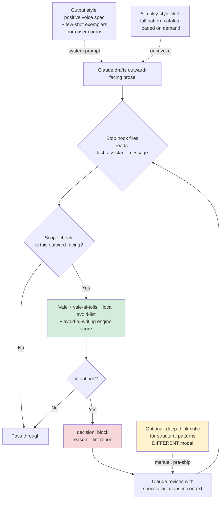

# AI Writing Harness Landscape Survey — What's Empirically True About AI Tells, and What Can Actually Enforce Against Them

**Status:** complete

**Created:** 2026-07-15

<!--
**Task:** ISSUE-REF (research run), ISSUE-REF (codify into session config)
**Supersedes (in substance):** `aido/docs/analysis/ai-writing-patterns-to-avoid.md`
-->

## Table of Contents

- [Context](#context)
- [Temporal Scope](#temporal-scope)
- [Executive Summary](#executive-summary)
- [1. RQ1 — What is empirically true about AI writing tells](#1-rq1--what-is-empirically-true-about-ai-writing-tells)
  - [1.1 The tells are real, measured, and large](#11-the-tells-are-real-measured-and-large)
  - [1.2 The em dash: a real frequency shift and a bad standalone signal](#12-the-em-dash-a-real-frequency-shift-and-a-bad-standalone-signal)
  - [1.3 Where the tells come from: post-training, not the corpus](#13-where-the-tells-come-from-post-training-not-the-corpus)
  - [1.4 The load-bearing question: model property or lazy prompting?](#14-the-load-bearing-question-model-property-or-lazy-prompting)
  - [1.5 Homogenization, and what it means for writing in one person's voice](#15-homogenization-and-what-it-means-for-writing-in-one-persons-voice)
  - [1.6 Testing the user's generalization: metadiscourse](#16-testing-the-users-generalization-metadiscourse)
- [2. RQ2 — Detection: what works, and why it is the wrong tool here](#2-rq2--detection-what-works-and-why-it-is-the-wrong-tool-here)
  - [2.1 The best independent evaluation](#21-the-best-independent-evaluation)
  - [2.2 Academic methods and watermarking](#22-academic-methods-and-watermarking)
  - [2.3 The documented harm: false positives on non-native writers](#23-the-documented-harm-false-positives-on-non-native-writers)
  - [2.4 Verdict: a detector-in-the-loop is a category error](#24-verdict-a-detector-in-the-loop-is-a-category-error)
  - [2.5 The finding that matters more than any detector](#25-the-finding-that-matters-more-than-any-detector)
- [3. RQ3 — The prose-linter tradition](#3-rq3--the-prose-linter-tradition)
  - [3.1 Vale and its rule model](#31-vale-and-its-rule-model)
  - [3.2 An AI-tells Vale package exists](#32-an-ai-tells-vale-package-exists)
  - [3.3 The rest of the field](#33-the-rest-of-the-field)
  - [3.4 How much of the target class is regex-reachable](#34-how-much-of-the-target-class-is-regex-reachable)
- [4. RQ4 — ISSUE-REF mechanisms: prompting, critics, and voice](#4-rq4--llm-side-mechanisms-prompting-critics-and-voice)
  - [4.1 Negative constraints are weak, and may backfire](#41-negative-constraints-are-weak-and-may-backfire)
  - [4.2 Self-critique: can the model edit slop out of its own draft?](#42-self-critique-can-the-model-edit-slop-out-of-its-own-draft)
  - [4.3 The user's-own-voice problem](#43-the-users-own-voice-problem)
  - [4.4 The one method with strong quantitative results, and why it doesn't apply](#44-the-one-method-with-strong-quantitative-results-and-why-it-doesnt-apply)
- [5. RQ5 — Claude Code implementation surface](#5-rq5--claude-code-implementation-surface)
  - [5.1 What a hook can and cannot see](#51-what-a-hook-can-and-cannot-see)
  - [5.2 Output styles, skills, subagents](#52-output-styles-skills-subagents)
  - [5.3 The ecosystem, and prior art in other harnesses](#53-the-ecosystem-and-prior-art-in-other-harnesses)
- [6. RQ6 — Evaluation: how would we know it works](#6-rq6--evaluation-how-would-we-know-it-works)
- [7. RQ7 — Recommended architecture](#7-rq7--recommended-architecture)
  - [7.1 The design](#71-the-design)
  - [7.2 Staging](#72-staging)
  - [7.3 The honest ceiling](#73-the-honest-ceiling)
  - [7.4 Rejected alternatives](#74-rejected-alternatives)
- [Comparison](#comparison)
- [Gaps, blindspots & emergent findings](#gaps-blindspots--emergent-findings)
- [Open Questions](#open-questions)
- [Sources](#sources)
- [Appendix: Research Prompt](#appendix-research-prompt)
- [Appendix: Provenance Ledger](#appendix-provenance-ledger)
- [Run History](#run-history)

<!-- doc:region name="context" kind="immutable" -->

## Context

Original framing (ISSUE-REF / ISSUE-REF): the ecosystem has a hand-maintained avoid-list of AI writing tells (`aido/docs/analysis/ai-writing-patterns-to-avoid.md`), built from patterns the user kept catching by hand. That list does not enforce itself. The model demonstrably knows the rules and violates them anyway: it has cut a phrase for being slop in one paragraph and emitted a variant of it three paragraphs later. The question is whether an "AI writing harness" is buildable, what it should be, and what it can honestly achieve. Three recently flagged patterns (announcing a point's importance instead of making it; the manufactured reveal; performed even-handedness) suggested a possible generalization: the writer narrating his own rhetorical moves rather than performing them. Whether that generalization is real, and whether the literature names it, was an explicit test for this run.

**Primary period:** 2024–2026
**Source weighting:** 2026 primary, 2025 secondary, 2024 for foundational detection and stylometry work. Pre-2024 cited only where foundational (Hyland's metadiscourse framework, Biber's feature set, the 2023 non-native-writer bias result).

<!-- /doc:region name="context" -->

<!-- doc:region name="body" kind="replaceable" -->

## Temporal Scope

Primary focus: 2025–2026. The detection literature matured in 2024–2025 and the best independent evaluation is from August 2025. The tooling most relevant to a harness (`vale-ai-tells`, `avoid-ai-writing`, Antislop) is all 2025–2026 and still moving; version numbers and rule counts here are as of 2026-07-15 and will drift. Two areas legitimately reach back further: Hyland's metadiscourse taxonomy (2005) and Biber's lexical/grammatical feature set are the analytical frameworks the 2025–2026 corpus papers apply, and the non-native-writer detector-bias result is from 2023 and has not been superseded, only corroborated.

No significant post-2024 developments were found for: a benchmark measuring "does this text sound like a specific named individual." That gap is a finding, reported in [RQ6](#6-rq6--evaluation-how-would-we-know-it-works), not a retrieval failure.

## Executive Summary

1. **The tells are real, measurable, and substantially a property of post-training rather than of lazy prompting.** Reinhart et al. (PNAS, 2025) found systematic grammatical and rhetorical differences between LLM and human text, and critically that the differences are *larger for instruction-tuned models than base models* [VERIFIABLE][^1]. Kobak et al. (Science Advances, 2025) put a number on the population-level effect: at least 13.5% of 2024 biomedical abstracts show LLM excess vocabulary, reaching 40% in some subcorpora [VERIFIABLE][^2]. This settles the architecture question in the direction the user probably did not want: a harness cannot be only a prompt.
2. **A detector is the wrong tool, and building one would be the trap.** Detection is close to solved for *unedited* machine text against *pre-2020* human text (Pangram: near-zero false-positive and false-negative rates in an independent, vendor-disclosed-conflict-free Chicago Booth evaluation) [VERIFIABLE][^11]. That is irrelevant here. A detector answers "was this machine-written." The user's text *is* machine-written, so a detector fires every time. The question a harness must answer is "does this read as slop," which is a different question that no detector is built to answer.
3. **The single most adoptable artifact exists and is named `tbhb/vale-ai-tells`**: 73 Vale rules across a prose package and a commit-message package, MIT, actively maintained (v1.24.0, 2026-07-13), with rule categories that already include "structural announces" and figurative-verb overuse ("lands") [VERIFIABLE][^20]. A second, `ammil-industries/vale-signs-of-ai-writing`, implements Wikipedia's community-maintained "Signs of AI Writing" taxonomy [VERIFIABLE][^21][^22]. The question "has anyone shipped a Vale package for AI tells" has a yes answer, which removes the largest single build cost from the plan.
4. **Negative constraints are the wrong mechanism and may be actively counterproductive.** The pink-elephant literature and a 2026 mechanistic study both indicate that naming a forbidden token can *activate* its representation; that study attributes 87.5% of constraint failures to priming rather than to override [VERIFIABLE][^25][^26]. This is a candidate mechanical explanation for the user's exact complaint, and it implies the avoid-list should shrink and move out of the system prompt, not grow inside it.
5. **The enforcement surface is the `Stop` hook, and it is real.** Claude Code's `Stop` and `SubagentStop` hooks receive `last_assistant_message` (the final assistant prose of the turn) and can block the turn with a reason, which forces a revision [VERIFIABLE][^31]. A hook cannot rewrite the prose, but blocking with a lint report is deterministic enforcement rather than a politely-worded request, and determinism is precisely what the documented avoid-list lacks.
6. **The recommended architecture is a lint-and-block loop, not a critic and not a model.** Vale plus `vale-ai-tells` plus a local avoid-list, invoked from a `Stop` hook scoped to outward-facing prose, plus positive voice exemplars replacing part of the negative avoid-list. Honest ceiling: this catches the lexical and phrasal layer reliably and catches roughly none of the structural layer, by the tool's own admission [VERIFIABLE][^20]. Writing in the user's voice is not achievable to the "sounds like me" bar on current evidence: LLMs approximate everyday-author style in structured genres and fail on informal ones, and more examples do not fix it [VERIFIABLE][^27].
7. **The most uncomfortable finding, and the one that most justifies the effort:** frequent LLM users are near-perfect at spotting AI text. Five expert annotators voting together misclassified 1 of 300 articles, beating most commercial detectors, and stayed accurate against paraphrasing and humanizer evasion [VERIFIABLE][^17]. The audience the user cares about will notice. This is the argument that the harness is worth building. It is also the argument that a harness which only strips keywords will not be enough, because those annotators reported using formality, originality, and clarity, not only vocabulary.

## 1. RQ1 — What is empirically true about AI writing tells

### 1.1 The tells are real, measured, and large

The strongest single source is Reinhart et al., published in PNAS in 2025 [VERIFIABLE][^1]. They built parallel corpora of human and LLM text from identical prompts across Llama 3 variants and GPT-4o, then applied Douglas Biber's established lexical, grammatical, and rhetorical feature set. They report systematic differences between LLM and human text, differences between LLMs, and the finding that LLMs "struggle to match human stylistic variation." Two properties make this the anchor for the whole survey: it is peer-reviewed in a top general-science venue, and it uses a pre-existing linguistic feature set rather than one reverse-engineered from the outputs it is trying to distinguish, which removes a circularity that afflicts the keyword-list literature.

Kobak et al., in Science Advances (2025), measured the population-level footprint [VERIFIABLE][^2]. Analyzing over 15 million PubMed abstracts from 2010–2024, they tracked "excess vocabulary," meaning words whose frequency jumped beyond what pre-2023 trends predict, and estimated that at least 13.5% of 2024 abstracts were ISSUE-REF, up to 40% in some subcorpora. Their methodological claim matters as much as the number: they measured LLM impact *without* a detector, using vocabulary statistics alone, and describe the effect as exceeding that of Covid on scientific writing.

A separate systematic search found 280 style words with elevated frequencies, with *pivotal*, *intricate*, *showcasing*, and *realm* among the top ISSUE-REF words [HEURISTIC]. That claim surfaced in search summaries of the excess-vocabulary line of work and I could not tie the specific 280-word figure to a single fetched primary source, so it is tagged accordingly rather than upgraded.

A 2025 survey of the whole area (Terčon & Dobrovoljc) synthesizes the direction of the effects: AI text is more formal and impersonal, has lower lexical diversity and smaller vocabulary, and shows more nouns, determiners, and adpositions with fewer adjectives and adverbs [VERIFIABLE][^5][^37].

### 1.2 The em dash: a real frequency shift and a bad standalone signal

The em dash claim is the most famous and deserves the most skepticism. What the evidence supports:

The frequency shift is real. Corpus work tracking punctuation in scientific abstracts finds em dash usage rising sharply from 2023, coinciding with generative-AI adoption [VERIFIABLE][^6]. Freeburg (2026) measured em dash frequency per 1,000 words across twelve models from five providers under varying instructions, and reports a range from 0.0 (Llama) to 9.1 (GPT-4.1 under suppression) [VERIFIABLE][^6]. Two things in that result deserve attention. First, the by-provider variance is enormous, which means "em dash present" carries almost no information unless you already know which model wrote the text. Second, and more usefully for a harness, Freeburg reports that overt formatting features (headers, bullets, bold) are eliminated or nearly eliminated under instruction while em dashes persist, and that explicit prohibition fails to eliminate them in some models. Freeburg's interpretation is that the em dash is markdown structure leaking into prose, and that the frequency-and-suppressibility pattern is a signature of post-training rather than a style preference.

What happened at OpenAI corroborates the "suppressible, but only recently, and only on request" reading. Two days after GPT-5.1 shipped in November 2025, Altman posted that telling ChatGPT not to use em dashes in custom instructions "finally does what it's supposed to do" [VERIFIABLE][^7]. TechCrunch characterizes this as an instruction-following improvement rather than a model-level default change, notes the problem had stumped OpenAI for some time, and notes that users previously could not get compliance even when asking explicitly [VERIFIABLE][^7]. An AI lab conceding that its model ignored explicit user instructions for roughly a year is adverse-interest testimony and counts for more than a vendor benchmark.

The counter-case is strong enough to change practice. Human writers use em dashes heavily; journalists trained in AP style avoid them; essayists lean on them [HEURISTIC][^36]. The observable consequence is that writers now self-censor punctuation they have always used, out of fear a detector or a colleague will flag them [HEURISTIC][^36]. Both of those sources are commentary rather than measurement, hence the tag.

The honest synthesis for the harness: the em dash is worth removing from outward-facing writing not because it proves machine authorship (it does not) but because it is the tell the audience believes in, and the cost of removing it is close to zero. That is a reputational argument, not an empirical one, and it should be labeled as such rather than dressed up as science.

### 1.3 Where the tells come from: post-training, not the corpus

Two papers by Juzek and Ward converge on learning-from-human-feedback as the cause of lexical overuse.

The first (COLING 2025) identified 21 focal words including *delve*, *intricate*, and *underscore* whose frequency spiked in recent scientific abstracts, and tested candidate explanations [VERIFIABLE][^3]. Their finding is carefully bounded: results were "consistent with RLHF playing a role," while evidence was *absent* that architecture, algorithm choice, or training-data composition caused the overrepresentation. They also flag that participants may react differently to *delve* than to other focal words, and that opacity around model development is itself an obstacle to the research.

The second (2025) went further and tried to establish causation by replicating the LHF procedure with human participants [VERIFIABLE][^4]. Participants systematically preferred text variants containing the focal words. The authors frame this as a species of misalignment, and add the caveat that matters most: the lexical expectations of LHF workers may diverge from those of LLM users. The model is not broken. It learned what its annotators rewarded, and its users are a different population.

The widely-repeated Nigeria story (that *delve* is common in Nigerian English, that OpenAI's RLHF annotation was outsourced to Nigeria, and that annotator dialect therefore leaked into the model) is not established by either paper. The COLING paper's abstract does not mention Nigerian annotators at all. The claim circulates through journalism and secondary commentary. It is a plausible, well-motivated hypothesis; it is not a verified finding, and this document declines to launder it into one. [NO SOURCE] for the specific annotator-population causal chain as a verified claim.

### 1.4 The load-bearing question: model property or lazy prompting?

The prompt framed this as decisive, and it is: if good prompting removes the tells, the harness is a prompt; if it does not, the harness is post-processing. The evidence points to "substantially the model, and the literature has not settled the rest."

For "the model": Reinhart et al.'s instruction-tuning result is the strongest evidence available [VERIFIABLE][^1]. Differences from human writing are *larger* for instruction-tuned models than base models. Instruction tuning is exactly the layer that makes a model useful and controllable, and it is the layer that makes its prose distinguishable. Freeburg's suppression result points the same direction: overt formatting obeys instruction, em dashes do not, in some models [VERIFIABLE][^6]. And OpenAI needed a model release to make a custom instruction stick [VERIFIABLE][^7]. If prompting reliably solved this, none of those three facts would look the way they do.

For "prompting helps a lot": Liang et al. showed that simple prompting strategies both mitigate detector bias against non-native writers and effectively bypass GPT detectors [VERIFIABLE][^12]. That is a real and large effect, and it is why the harness should not skip the prompt layer.

The honest answer is that the field has not resolved it. The 2025 survey of linguistic characteristics of AI text states directly that authors in this literature "fail to address the issue of prompt sensitivity," leaving open how much of every reported difference is an artifact of how the researchers prompted [VERIFIABLE][^5]. That is a significant admission from a survey whose job is to summarize the field, and it means every corpus finding in this section carries an unquantified prompt-sensitivity error bar.

Architectural consequence: build for both. Prompting is cheap and demonstrably moves the needle, so do it. But an architecture that *relies* on prompting is betting on an unresolved question against evidence that leans the other way, and the user's own experience (the model knows the rule and violates it) is a data point on the losing side of that bet.

### 1.5 Homogenization, and what it means for writing in one person's voice

The homogenization literature is real and consistent, and it is bad news for the voice ambition.

Abdulhai et al. (2026) found that co-writing with LLMs converges style across creative, decision-making, and open-ended tasks even across models from different companies [VERIFIABLE][^9]. Their specific numbers: extensive LLM use produced a nearly 70% increase in essays that stayed neutral on the topic question; heavy users self-reported diminished creativity and reduced personal voice; LLMs altered semantic meaning even when instructed to make only grammatical corrections; and about 21% of peer reviews at a major AI conference were AI-generated, with those reviews assigning systematically higher scores.

Lin et al. (2025) analyzed over 627,000 arXiv papers and found substantial disparities in LLM adoption across discipline, gender, native-language status, and career stage, with rapid evolution of scholarly writing style [VERIFIABLE][^10].

Geng and Trotta (ACL Findings 2025) found the coevolution effect: *delve* frequency dropped sharply soon after it was publicly identified as a tell in early 2024, while other ChatGPT-favored words such as *significant* kept rising [VERIFIABLE][^8]. Authors are editing outputs and selecting among generations to dodge known markers.

Three implications for this project. First, an avoid-list has a half-life. *Delve* stopped being a useful signal once everyone knew about it, which means a keyword list is a depreciating asset requiring maintenance, and the maintenance is exactly the manual loop the user is trying to escape. Second, the "LLMs alter meaning even when told to fix only grammar" finding [VERIFIABLE][^9] is a direct warning against any harness stage that hands a finished draft to a model for a style pass. Third, if LLM assistance pulls writing toward a common attractor, then getting output into one specific person's voice is working against the model's central tendency, not with it.

### 1.6 Testing the user's generalization: metadiscourse

The prompt asked whether "the writer narrating his own rhetorical moves rather than performing them" is a real generalization with a name in the literature. It is, partly, and the fit is imperfect in a way that is worth being precise about.

The name is **metadiscourse**, in Hyland's taxonomy: the parts of a text that are about the text or about the writer-reader relationship, rather than about the subject. It splits into *interactive* resources (transitions, **frame markers** that sequence, label stages, announce goals, and shift topic; endophoric markers; evidentials; code glosses) and *interactional* resources (hedges, **boosters**, attitude markers, self-mentions, engagement markers). The user's three patterns map onto this cleanly:

| # | User's pattern | Metadiscourse category | Example |
|---|---|---|---|
| 1 | Announcing a point's importance | Booster / attitude marker | "that's the crux," "this is the ballgame" |
| 2 | The manufactured reveal | Frame marker (announce goal / shift topic) | "here's the thing," "what most people miss" |
| 3 | Performed even-handedness | Engagement marker + hedge (concessive move) | "to be fair," "which cuts against my own side" |

So the generalization is real as a *linguistic category*. But the empirical direction cuts against the naive version of the hypothesis, and this is the most interesting disconfirming result in the survey.

Jiang and Hyland (Written Communication, 2025) compared engagement markers in ChatGPT-generated and student argumentative essays and found ChatGPT uses **fewer** engagement markers than students, particularly questions and personal asides, producing less interactive and less persuasive discourse [VERIFIABLE][^35]. Related metadiscourse work reports ChatGPT text is lower in *interactional* metadiscourse (hedges, boosters, attitude markers), yielding an impersonal tone, while showing frequent **frame markers**, indicating reliance on formulaic structure [HEURISTIC].

Read carefully, that split is a better description of the user's problem than the user's own framing:

- The *frame marker* half of the hypothesis is supported. "Here's the thing" and "that's the crux" are structural signposting, and formulaic signposting is the metadiscourse category where LLM text is reported high. Pattern 2 and much of pattern 1 land here.
- The *booster* half is not supported by the essay literature, which finds LLMs *under*-use boosters relative to human students.

Two caveats keep this from being a clean refutation. The metadiscourse studies are on academic essays written by earlier ChatGPT models; the user's observations are of a 2026 frontier model in a conversational and opinion register, which is a different genre and a different model generation. Genre is not incidental here, since Reinhart et al.'s finding is specifically that instruction-tuned models fail to match *genre conventions* [VERIFIABLE][^1]. So the essay-corpus direction may simply not transfer. [INFERENCE] The most defensible reading is that the user has correctly identified a real cluster, that the cluster's center is formulaic structural signposting rather than self-importance per se, and that no study has measured this cluster in the register he actually writes in.

The practical payoff is real regardless of how the caveat resolves. "Metadiscourse, especially frame markers" is a better organizing abstraction for the harness than a keyword blacklist, because it tells you *what to look for* when a fresh phrasing appears that no regex has ever seen. It also gives the rule a positive form, which [RQ4](#4-rq4--llm-side-mechanisms-prompting-critics-and-voice) argues matters mechanically: "write the point, not a label for the point" is a positive instruction; "don't say 'the crux'" is a pink elephant.

## 2. RQ2 — Detection: what works, and why it is the wrong tool here

### 2.1 The best independent evaluation

The strongest source is Jabarian and Imas, "Artificial Writing and Automated Detection," University of Chicago Becker Friedman Institute Working Paper 2025-116, dated 26 August 2025 [VERIFIABLE][^11]. It passes the provenance test better than anything else in this space: the authors are Booth economists, funding is disclosed as Chicago Booth's Center for Applied AI, the Becker-Friedman Institute, and the Google Cloud Research Program, and the disclosure states no financial or personal conflicts with any detector vendor. This is the paper every SEO blog is laundering; it is worth reading rather than citing through them.

Method: 1,992 human passages across six everyday genres (news from CC-News, blogs from the Bar-Ilan Blog Authorship Corpus, Kaggle résumés, Yelp reviews, Amazon reviews, pre-2000 Project Gutenberg novels), matched with AI passages from GPT-4.1, Claude Opus 4, Claude Sonnet 4, and Gemini 2.0 Flash at temperature 0.7. Detectors: Pangram, OriginalityAI, GPTZero, plus a RoBERTa-base open-source baseline.

Results: Pangram was the only detector maintaining policy-grade performance across all four generating models, with essentially zero false-positive and false-negative rates on medium-to-long passages, AUROC at or arbitrarily close to 1, and robustness to the StealthGPT humanizer. OriginalityAI and GPTZero form a secondary tier with partial strengths (GPTZero if minimizing false positives, OriginalityAI if maximizing AUROC), neither suitable for passages under 50 words, and both susceptible to humanizers. RoBERTa-base was deemed unsuitable for high-stakes use. The paper's methodological contribution is *policy caps*: fix a maximum tolerable false-positive rate, then compare detectors at thresholds meeting it. Under a 0.5% cap, only Pangram survives without losing detection power.

The limitations are stated by the authors and are important. They do not expect the results to hold over time, describing detection as a continuous arms race between detectors, LLMs, humanizers, and user adaptation, and they recommend routine published audits analogous to bank stress tests. They also flag the open problem that binary classification cannot tell you at which *stage* of writing an LLM was involved, which is the question institutions actually want answered.

One limitation they do not foreground, and which matters a great deal for this survey: human text was selected pre-2020 to guarantee it was not AI-generated. That is methodologically necessary and it introduces a temporal confound. A detector separating 2019 human prose from 2025 machine prose may be partly detecting *2019*. Given Geng and Trotta's coevolution result (human writing has measurably shifted since 2023) [VERIFIABLE][^8] and Geng and Poibeau's argument that human edits to LLM output are blurring the categories [VERIFIABLE][^16], the reported near-perfect numbers should be read as an upper bound on a clean, and increasingly unrealistic, version of the task. [INFERENCE]

### 2.2 Academic methods and watermarking

Binoculars (Hans et al., ICML 2024) is the strongest zero-shot method: it scores text by the ratio of its perplexity under an "observer" model to its cross-perplexity under an "performer" model, needs no training data and no per-model tuning, and detects over 90% of ChatGPT samples at a 0.01% false-positive rate [VERIFIABLE][^14]. Fast-DetectGPT (conditional probability curvature), DetectGPT, and RADAR (a RoBERTa detector adversarially trained against paraphrase) form the rest of the standard baseline set [VERIFIABLE][^14].

The theoretical ceiling is set by Sadasivan et al. (TMLR, 2025), who bound the AUROC of the best possible detector by the total variation distance between the human and AI text distributions [VERIFIABLE][^13]. As models get better at imitating human text, that distance shrinks and reliable detection becomes impossible in principle, not merely in practice. They also demonstrate recursive paraphrasing that substantially reduces detection rates while preserving quality, and watermark spoofing without white-box access to the detector.

Watermarking is the one approach with a deployment story and a published limits story. SynthID-Text is the only watermarking method integrated into a shipping product (Gemini), and independent robustness assessment finds it vulnerable to meaning-preserving attacks including paraphrasing, copy-paste modification, and back-translation, all of which degrade detectability [VERIFIABLE][^15]. It is also irrelevant here for a simpler reason: Anthropic does not watermark, so there is nothing to detect and nothing to strip.

### 2.3 The documented harm: false positives on non-native writers

Liang et al. (2023) found that GPT detectors consistently misclassify non-native English writing as AI-generated while correctly classifying native writing [VERIFIABLE][^12]. The authors caution against deployment in educational or evaluative settings on the grounds that it could exclude non-native speakers from global discourse. Their secondary finding is the one relevant to this survey's architecture: simple prompting strategies both mitigate the bias and bypass the detectors, which is a compact demonstration that these tools measure fluency-conditioned surface statistics rather than authorship.

The 2025–2026 vendor and SEO literature energetically claims this is fixed (Pangram publishes a 0.078% false-positive rate on ESL writing against a 0.01% baseline). That claim is a vendor claim about the vendor's own product and fails the direction-of-interest test. The Booth paper is the independent source, and it does not report an ESL breakdown [NO SOURCE] for an independent 2025–2026 measurement of ESL false positives specifically.

### 2.4 Verdict: a detector-in-the-loop is a category error

No. Do not build it, do not buy it, do not wire one in.

The reasoning is not about detector quality, which is now genuinely good on the task detectors are built for. It is that the task is the wrong one. A detector estimates P(machine-written). In this workflow that probability is 1.0 by construction, because Claude wrote the text. A perfect detector returns "AI" on every draft the harness will ever see, which is zero bits of information. [INFERENCE]

The question the harness needs answered is "does this prose exhibit the patterns example-user objects to," which is a style-conformance question against a specific, personal, partly idiosyncratic standard. Nothing about a detector's training objective produces that. The two questions correlate in the general population, which is exactly why the conflation is tempting, and the correlation breaks precisely in the case that matters: heavily-edited-by-a-good-editor machine text is still machine text (detector says AI, correctly, unhelpfully) and reads fine (harness should pass it).

There is one narrow exception worth naming honestly, because dismissing it entirely would be overreach: a detector *score* could serve as a coarse regression signal for the harness's own evaluation, answering "did our interventions move the needle at all." Even there, Antislop's slop-phrase density and the Slop Score are better instrumented for the purpose and free (see [RQ6](#6-rq6--evaluation-how-would-we-know-it-works)). The exception does not survive contact with a cheaper alternative.

### 2.5 The finding that matters more than any detector

Russell, Karpinska, and Iyyer (ACL 2025) hired annotators to label 300 non-fiction English articles as human or AI and to explain each decision in a paragraph [VERIFIABLE][^17]. Annotators who frequently use LLMs for writing tasks were highly accurate with no training and no feedback. Majority vote among five such experts misclassified **1 of 300 articles**, outperforming most commercial and open-source detectors, and held up under evasion tactics including paraphrasing and humanization.

This single result carries more weight for the decision than the entire detection literature, for three reasons.

It answers the "is this whole enterprise misguided" challenge in the negative. The user's audience (engineers, colleagues, technically literate readers on social platforms) is disproportionately made of frequent LLM users, which is precisely the population this paper shows is near-perfect at detection. The tells are not a moral panic. They are visible to the actual readers.

It sets the bar the harness must clear, and the bar is high. Beating a regex is not the goal. The goal is prose that a heavy LLM user reading closely does not clock.

It tells the harness where to aim. The qualitative analysis found experts rely heavily on lexical clues ("AI vocabulary") *and* on more complex phenomena (formality, originality, clarity) that automatic detectors struggle with. The lexical half is the half a linter can reach. The other half is not addressable by any tool in this survey, which is the core of the ceiling argument in [RQ7](#7-rq7--recommended-architecture).

Note the tension with Wikipedia's advice page, which cites studies showing humans are "notoriously bad" at this, "no better than random chance" [VERIFIABLE][^22]. Both are true and they are not in conflict: the Wikipedia claim concerns the general population, Russell et al. concerns frequent LLM users specifically, and the whole point of their paper is that this subpopulation is different. Reporting only one of these would misrepresent the evidence.

## 3. RQ3 — The prose-linter tradition

### 3.1 Vale and its rule model

Vale is a markup-aware prose linter in Go, MIT-licensed, 5.6k stars, at v3.15.1 (2026-06-12), maintained essentially by one developer (jdkato) under the `vale-cli` organization, having moved from `errata-ai`, and funded by GitHub Sponsors and Open Collective [VERIFIABLE][^18]. It ships implementations of the Microsoft, Google, write-good, proselint, alex, and Joblint style guides [VERIFIABLE][^18]. The single-maintainer, donation-funded structure is the main sustainability risk in the recommendation and should be recorded as such.

Its extension points are the reason it is the right substrate [VERIFIABLE][^19]:

| # | Check type | What it does |
|---|---|---|
| 1 | `existence` | Flag presence of a regex pattern |
| 2 | `substitution` | Flag a pattern and suggest a replacement |
| 3 | `occurrence` | Enforce a pattern appears N times |
| 4 | `repetition` | Flag a pattern repeating |
| 5 | `consistency` | Enforce consistent choice between alternatives |
| 6 | `conditional` | Flag a pattern conditional on another |
| 7 | `capitalization` | Enforce heading/title case |
| 8 | `metric` | Readability or custom formulas |
| 9 | `spelling` | Hunspell dictionaries |
| 10 | `sequence` | Pattern order, with part-of-speech tagging |
| 11 | `script` | Arbitrary Tengo script |

Two of these matter more than the rest for this problem. `sequence` supports part-of-speech tagging, which reaches slightly past pure regex into syntax. `script` runs arbitrary Tengo, which is the escape hatch for anything the declarative checks cannot express (for example, a rhythm-uniformity metric over sentence lengths). Neither turns Vale into a semantic analyzer, but they mean the ceiling is set by what you can compute from the text locally, not by what a regex can match.

### 3.2 An AI-tells Vale package exists

The prompt asked to search for this directly and to name it if it exists. It exists, and there are two.

**`tbhb/vale-ai-tells`** [VERIFIABLE][^20]. 73 rules across two packages: `ai-tells` for general prose and `ai-tells-commits` (13 rules) for commit messages, opt-in separately. MIT, 41 stars, v1.24.0 released 2026-07-13, rules authored in Just with some Ruby. Rule categories: vocabulary fingerprints, hedging and filler, promotional language, figurative verbs (*lands*, *holds*, *rides*), rhetorical formulas, **structural announces**, and commit-message tells. Its cited sources are a mix of academic (the PNAS 2025 grammatical-features paper, PMC stylometry work, arXiv papers on ChatGPT in academic writing) and community catalogs (tropes.fyi, Wikipedia's Signs of AI Writing) and practitioner analyses.

Three things make this the highest-value artifact in the survey. It already has a `structural announces` category and a figurative-verb rule covering *lands*, which is the "and that's what makes it land" construction the user flagged by name. Its README is written entirely in the patterns it detects, which is a competence signal, not a joke. And it discloses its own limits precisely: it states it **cannot** detect sentence-length uniformity, perplexity, semantics, or model-specific signatures, and catches lexical and phrasal patterns only. It also discloses that Claude wrote the majority of rule definitions with a human validating each, and documents that rules deliberately cast wide nets and are expected to be disabled per-section.

A tool that publishes an accurate list of what it cannot do is more trustworthy than one that does not, and that disclosure is doing real work in this survey: it is the primary evidence for the ceiling claim in [3.4](#34-how-much-of-the-target-class-is-regex-reachable).

**`ammil-industries/vale-signs-of-ai-writing`** [VERIFIABLE][^21]. Smaller (22 stars, v0.1.1, 2025-11-22, CC BY-SA 4.0, matching its Wikipedia source's license), implementing Wikipedia's "Signs of AI Writing" patterns, with error-level and suggestion-level rules separated by confidence. Explicitly not a complete solution, requires human review, provided as-is.

Its upstream is worth more than the package. **Wikipedia's `Signs of AI Writing`** is an advice page from WikiProject AI Cleanup, not policy, maintained by editors who spend their days actually finding undisclosed AI text in the wild [VERIFIABLE][^22]. Its taxonomy runs to seven sections: content (undue emphasis on significance and legacy, superficial analysis, promotional language, vague attribution, formulaic conclusions), language and grammar (AI vocabulary density, avoidance of simple is/are constructions, negative parallelisms, rule of three, excessive lexical variation), style (title case, boldface overuse, inline-header lists, em dashes, emoji, odd tables), communication artifacts, markup, citations, and miscellaneous.

The first category is literally named **"undue emphasis on significance."** The community that does this work at scale independently converged on the user's pattern #1 as a top-level category, which is meaningful corroboration that he is tracking something real rather than a personal irritation. The page also carries the honest caution: do not rely solely on AI detection tools, they have non-trivial error rates.

### 3.3 The rest of the field

proselint is alive, contrary to the prompt's suspicion and worth correcting explicitly: 4.6k stars, v0.16.0 released 2025-11-14, 225 open issues, no archive notice [VERIFIABLE][^23]. It checks roughly 100 things drawn from named writers' style advice. Its disqualifying limitation is architectural rather than social: it has no markup awareness, works only on plain text, and its rules are hard-coded in Python and not extensible [HEURISTIC]. For a corpus of Markdown documents where the harness must lint prose but not code blocks, front matter, or URLs, that is fatal.

textlint is pluggable and configurable and can host many other linters' rules. write-good enforces a small set of writing rules. alex catches insensitive language. LanguageTool does grammar. RedPen and retext round out the field. None of them target AI tells, and Vale has re-implemented the useful parts of write-good, proselint, and alex as first-party styles [VERIFIABLE][^18], so adopting Vale gets their value without adopting them.

A comparison of these tools circulates as a gist authored by jdkato, Vale's creator [HEURISTIC]. It reports Vale as substantially faster than textlint and proselint. The benchmark is plausible (Go versus Node and Python) and it fails the direction-of-interest test, so it is not load-bearing here.

On docs-as-code practice, the technical-writing community's accumulated lesson is that rules which get followed are the ones enforced in CI at the moment of authoring, and rules that live in a style guide humans are supposed to remember get ignored [HEURISTIC]. That is the same lesson the user learned the hard way with the avoid-list, arrived at independently by a different community, and it is the core argument for the `Stop` hook over a documented rule.

### 3.4 How much of the target class is regex-reachable

This is the question that sizes the whole project. A quantitative answer is available by taking the user's own catalog and classifying each entry against what `vale-ai-tells` says it can and cannot do [VERIFIABLE][^20].

Taking the 14 patterns in the existing `ai-writing-patterns-to-avoid.md` analysis:

| # | Pattern | Regex-reachable? | Mechanism |
|---|---|---|---|
| 1 | Em dashes as default connector | Yes | `existence` on the character |
| 2 | Overused vocabulary | Yes | `substitution` list |
| 3 | "not just X, it's Y" | Yes | `existence` on the frame |
| 4 | Boilerplate openers/closers | Yes | `existence` |
| 5 | Announcing importance | Partly | `existence` catches known phrasings only |
| 6 | Rule of three | Partly | `sequence` with POS tagging, high false-positive risk |
| 7 | Uniform sentence rhythm | No (as shipped) | Tool states it cannot; a `script` metric could |
| 8 | Transition-word scaffolding | Yes | `occurrence` |
| 9 | Over-bolding / over-bulleting | Yes | `occurrence` on markup |
| 10 | Hedging and throat-clearing | Yes | `existence` |
| 11 | Impersonal / passive voice | Partly | POS-based, classic false positives |
| 12 | Grandiose summary sentences | No | Semantic |
| 13 | Curly quotes | Yes | `existence` |
| 14 | Emoji headers | Yes | `existence` |

Count: 9 of 14 fully reachable, 3 partly, 2 not at all. That is roughly **64% fully reachable, 86% at least partly reachable** on this catalog. [INFERENCE]

That headline number is misleading in the user's specific case and the correction matters more than the number. The three patterns he flagged *most recently*, the ones that motivated this research, are #5 and its relatives, and they fall in the "partly" column. Partly means: a regex catches "the crux" and "this is the ballgame" because someone wrote them down, and catches nothing when the same move arrives freshly phrased. The reachable 64% is the part of the list that was already easy. The residual is the part that generated the complaint.

Restating that as a design constraint: a Vale package is a *ratchet*, not a solution. It permanently removes the patterns you have already named, which is worth doing, because it stops regression and ends the manual re-flagging of known offenders. It does not generalize to the next unnamed variant, and the evidence in [1.6](#16-testing-the-users-generalization-metadiscourse) says variants are what the user is actually fighting.

## 4. RQ4 — ISSUE-REF mechanisms: prompting, critics, and voice

### 4.1 Negative constraints are weak, and may backfire

This section contains the most decision-relevant mechanism in the survey and also the source that most needs a caveat.

The general phenomenon is established. The pink-elephant problem (instruct a model to avoid an entity and it raises it) is well enough recognized to have driven a dedicated alignment method, Direct Principle Feedback, a simplification of Constitutional AI which fine-tunes specifically to suppress mentioned-but-forbidden topics [VERIFIABLE][^26]. Negation is a documented weak point for LLMs generally.

The specific mechanism was measured by Rana (2026) [VERIFIABLE][^25]. Across 40,000 samples with bootstrap confidence intervals, constraint violations follow a logistic relationship with "semantic pressure" (the token's inherent generation probability). Instructions reduced target probability by 22.8 percentage points in successful suppressions versus 5.2 points in failures, a 4.4x difference. Logit-lens analysis localizes causal responsibility to layers 23–27. The decomposition is the important part: **87.5% of failures are priming failures**, where explicitly naming the forbidden word activated its representation, versus 12.5% override failures, where late feed-forward networks contributed +0.39 probability that overwhelmed earlier suppression.

If that holds, it is a mechanical explanation for the exact behavior that prompted this research. A system prompt listing forbidden phrases raises the activation of those phrases. The model cuts one as slop (suppression succeeded, high semantic pressure was overcome) and emits a variant three paragraphs later (priming won). Growing the avoid-list would make this *worse*, not better, and the natural response to being ignored (say it louder, list more examples) is precisely the wrong move.

The caveat is real and I am not going to bury it. This is a single-author arXiv preprint from January 2026 with no evidence of peer review found in-session. Under this document's sourcing rules it does not get upgraded on the strength of how well it fits the hypothesis, and fitting the prompt's implied narrative is exactly the failure mode the CoVe step exists to catch. What supports it: the direction agrees with the independently-established pink-elephant literature [VERIFIABLE][^26], and it agrees with the user's own observed behavior. What is missing: independent replication of the 87.5% decomposition. Treat the *direction* as well-supported and the *specific percentages* as one lab's numbers.

Rana does not appear to test the intervention that matters most: whether a positive reformulation ("write the point plainly") outperforms a negative constraint ("do not say 'the crux'"). That comparison is the single highest-value experiment the user could run himself, and it is cheap. [NO SOURCE] for a direct positive-versus-negative reformulation benchmark on style constraints.

Architectural consequence, and it is the counterintuitive one: **move the avoid-list out of the generation-time prompt and into the checker.** Let Vale hold the forbidden strings, where naming them costs nothing because a regex has no activations. Keep the prompt positive and short. This inverts the ecosystem's current approach, which puts a long avoid-list in the always-loaded context.

### 4.2 Self-critique: can the model edit slop out of its own draft?

Mostly no, and the reason is well documented.

Huang et al. (ICLR 2024) is the canonical negative result: LLMs struggle to self-correct without external feedback, and performance sometimes *degrades* after self-correction [VERIFIABLE][^29]. The paper draws the distinction that matters for the design: *intrinsic* self-correction, based solely on the model's own capabilities with no external feedback, is what fails. Self-correction *with* external or oracle feedback is a different paradigm and is not what they show failing. Their experiments are on reasoning tasks, so transferring the conclusion to style is an extrapolation and is tagged as such. [INFERENCE]

Self-preference bias compounds it. Panickssery, Bowman, and Feng (2024) found that GPT-4 and Llama 2 have non-trivial accuracy at recognizing their own outputs, that they score their own outputs higher than others' when human annotators rate them equally, and, critically, that there is a **linear correlation between self-recognition capability and self-preference bias strength**, which controlled experiments indicate is causal rather than confounded [VERIFIABLE][^28]. A 2026 study across 20 models found advanced capability is uncorrelated or *negatively* correlated with low self-preference bias, and that a structured multi-dimensional evaluation strategy reduces the bias by 31.5% on average [VERIFIABLE][^38]. Reducing a bias by 31.5% leaves 68.5% of it.

The mechanism reported in this literature is the part that makes it fatal here rather than merely inconvenient: LLM evaluators assign higher scores to lower-perplexity text, preferring text that is familiar to them, regardless of who generated it [HEURISTIC]. Low-perplexity, familiar, high-probability text *is* the slop. The judge's bias points directly at the thing the harness is trying to remove. A Claude critic grading Claude prose is not a neutral judge with a small offset; it is a judge whose thumb is on the scale in the exact direction of the failure. [INFERENCE]

Consequences for the design:

- A self-critique pass with **no external input** should not be trusted. Huang et al. plus self-preference say so.
- A critic pass **fed a deterministic lint report** is a different thing entirely, and is the one Huang et al. explicitly do not condemn. Vale's output is external feedback. This is the design.
- If an LLM critic is used for the structural patterns a linter cannot reach, it should be a **different model** (deep-think, per the ecosystem's existing `/review-gemini` pattern), because self-recognition drives the bias and a different model has nothing to recognize. This is not a preference; it follows from Panickssery's causal result.

### 4.3 The user's-own-voice problem

This is the most valuable part of the ask and the evidence is discouraging.

The direct negative result is Wang et al. (EMNLP 2025 Findings), "Catch Me If You Can? Not Yet" [VERIFIABLE][^27]. They tested state-of-the-art LLMs imitating personal writing style via in-context learning from a small number of user-authored samples, using an ensemble of authorship attribution, authorship verification, style matching, and AI detection, over 40,000+ generations per model, across 400+ real-world authors in news, email, forums, and blogs. Result: LLMs approximate user style in **structured** formats (news, email) and struggle with **nuanced, informal** writing (blogs, forums). Varying prompting strategies including the number of demonstrations revealed key limitations rather than a fix.

The design of that study is what makes it damning for this use case. It targets *everyday* authors, not famous ones. Imitating Hemingway works because Hemingway is in the training data and has a caricaturable signature; imitating an arbitrary engineer with 200 Substack paragraphs is the actual task, and it is the one that fails. The genres where it fails (blogs, forums) are exactly the user's outward-facing targets (essays, social posts). The genres where it succeeds (news, email) are the ones where a house style already does most of the work and personal voice matters least.

The counter-evidence for fine-tuning is real but does not rescue the plan. StyleTunedLM uses LoRA and reports better style capture than prompt engineering and few-shot [HEURISTIC], and 2–5 samples are commonly reported as sufficient to elicit strong style imitation via in-context learning in creative writing [HEURISTIC]. Both claims come from search summaries of secondary sources rather than fetched primaries and are tagged accordingly. Neither is applicable regardless: LoRA requires fine-tuning an open-weights model, and the user's writing goes through Claude, which cannot be LoRA'd. Fine-tuning a Llama to sound like example-user and then not using it to write anything is not a plan.

One finding worth keeping: writing quality correlates strongly with style fidelity for in-context prompting but not for fine-tuning, where experts can assess quality independently of style [HEURISTIC]. Reading that generously, in-context style imitation may buy general quality along with the style. Reading it skeptically, it means in-context evaluations of style fidelity are confounded by quality and the reported style gains may be partly illusory.

Verdict: **few-shot exemplars from the user's own corpus are worth including and should be scoped honestly.** The evidence does not support "Claude will write in your voice." It supports "Claude will drift toward your register, more in structured genres than informal ones, and will not fool an attentive reader who knows your writing." Exemplars are also positive instruction rather than negative constraint, which per [4.1](#41-negative-constraints-are-weak-and-may-backfire) is the form that works mechanically. That is the real argument for including them, independent of whether voice-matching succeeds.

### 4.4 The one method with strong quantitative results, and why it doesn't apply

Antislop (Paech et al., 2025) is the most technically serious attempt to eliminate slop and it deserves reporting even though it is not adoptable [VERIFIABLE][^30]. Three components:

1. **Antislop Sampler**: inference-time backtracking that suppresses unwanted strings without destroying the vocabulary. Practical to roughly 2,000 patterns; beyond that, token banning becomes unusable.
2. **Automated profiling pipeline**: identifies model-specific repetitive patterns against a human baseline and generates the training data to fix them.
3. **FTPO (Final Token Preference Optimization)**: fine-tuning that operates on individual tokens, surgically adjusting logits where patterns appear in inference traces.

Results: FTPO achieved **90% suppression** across 8,000+ patterns while preserving or improving GSM8K, MMLU, and creative-writing evaluations. DPO, by comparison, significantly degraded writing quality and lexical diversity while achieving *weaker* suppression. Some slop patterns appear over **1,000x more frequently** in LLM output than in human text.

Two things to take from this. The 1,000x figure is the best single quantification in the survey of how large the lexical effect is, and it independently corroborates the excess-vocabulary literature from a completely different method. And the DPO comparison is a warning: the obvious approach to suppressing slop made the writing worse *and* suppressed less. Blunt instruments applied to this problem damage the prose.

Why it does not apply: every component requires logit access. Sampler, profiler, and FTPO all operate inside the model. Claude is served through an API with no logit access and no fine-tuning path for this use case. Antislop is what you would build if you ran your own weights. The user does not, and the correct conclusion is that the strongest known method is unavailable, not that it should be approximated with a weaker one at the prompt layer.

## 5. RQ5 — Claude Code implementation surface

### 5.1 What a hook can and cannot see

This was the feasibility crux and it resolves favorably. Verified against the raw hooks documentation rather than a summary, because the claim is load-bearing [VERIFIABLE][^31].

Claude Code's hook events are: SessionStart, Setup, UserPromptSubmit, UserPromptExpansion, PreToolUse, PermissionRequest, PermissionDenied, PostToolUse, PostToolUseFailure, PostToolBatch, Notification, MessageDisplay, SubagentStart, SubagentStop, TaskCreated, TaskCompleted, Stop, StopFailure, TeammateIdle, InstructionsLoaded, ConfigChange, CwdChanged, FileChanged, WorktreeCreate, WorktreeRemove, PreCompact, PostCompact, Elicitation, ElicitationResult, SessionEnd [VERIFIABLE][^31].

The critical facts, quoted from the docs:

- **`Stop` and `SubagentStop` receive the assistant's final prose.** The docs state that hooks needing "the final assistant text of the current turn should use `last_assistant_message` on Stop and SubagentStop instead of reading the transcript," the transcript file being written asynchronously and possibly lagging [VERIFIABLE][^31].
- **`Stop` can block.** It takes a top-level `decision: "block"` with a `reason`, and additionally accepts `hookSpecificOutput.additionalContext` "for non-error feedback that continues the conversation" [VERIFIABLE][^31].
- **No hook can rewrite the assistant's prose.** `MessageDisplay` gets `displayContent`, which "replaces the displayed text on screen. Display-only: the transcript and what Claude sees keep the original" [VERIFIABLE][^31].
- **`UserPromptSubmit` cannot modify the prompt**: it "can't replace the prompt; it only injects `additionalContext` alongside it" [VERIFIABLE][^31].
- `PostToolUse` modifies *tool results*, not assistant prose [VERIFIABLE][^31].

What this means for the harness, precisely. The prompt's stated worry, that hooks see tool calls but not the assistant's chat prose, is **wrong for `Stop`**, which is the one that matters. A `Stop` hook can read `last_assistant_message`, run Vale over it, and if the lint fails, block with the lint report as the `reason`. Claude then continues the turn with the specific violations in context and revises. That is a closed loop with deterministic detection and model-side repair, which is the correct division of labor: the linter is reliable at finding known strings, the model is capable at rewriting, and neither is asked to do the other's job. [INFERENCE]

Two limits worth stating plainly rather than discovering later. `MessageDisplay` is a trap for this purpose: cosmetically hiding a tell on screen while the transcript keeps it would produce a harness that lies to the user, and the docs say as much ("use for temporary display filtering, not data protection"). And the `Stop` loop costs a full extra turn on every block, so scoping matters. A hook that lints every conversational reply would be intolerable; a hook that lints only when the turn produced outward-facing prose is the version that ships. Scoping is the hard part of this design and is unsolved: the hook must decide, from `last_assistant_message` alone, whether the text is a PR description or a status update to the user. [NO SOURCE] for prior art on this specific scoping problem.

### 5.2 Output styles, skills, subagents

Output styles modify the system prompt directly, apply to every response, and "trigger reminders for Claude to adhere to the output style instructions during the conversation" [VERIFIABLE][^32]. They are read once at session start, changes take effect after `/clear`. Custom styles drop Claude Code's software-engineering instructions unless `keep-coding-instructions: true`. Plugins can ship them, and `force-for-plugin` applies one automatically.

The recurring reminders are the interesting property, and they are also exactly what [4.1](#41-negative-constraints-are-weak-and-may-backfire) warns about if the style content is a list of forbidden phrases. An output style whose body is a positive voice specification is a good fit. An output style whose body is the avoid-list is repeated priming. Same mechanism, opposite sign, depending entirely on how the content is phrased. [INFERENCE]

Skills load only when used, so long reference material "costs almost nothing until you need it" [VERIFIABLE][^33]. They can bundle supporting files and scripts, control whether the user or Claude invokes them, run in a subagent, and follow the `agentskills.io` open standard. Custom commands have merged into skills. A `/simplify`-style manual pass is a skill, and skills are the right home for the deep reference material (the full pattern catalog, replacement tables) that should not sit in always-loaded context.

The docs' own comparison table is the cleanest statement of the division: output styles modify the system prompt and apply every turn; CLAUDE.md adds a user message after the system prompt; agents run a subagent with its own system prompt, model, and tools; skills load task-specific instructions when invoked [VERIFIABLE][^32].

### 5.3 The ecosystem, and prior art in other harnesses

**`conorbronsdon/avoid-ai-writing`** is the most developed artifact in the Claude Code space and arguably rivals `vale-ai-tells` for adoptability [VERIFIABLE][^24]. 2.4k stars, MIT, v3.15.0 (2026-07-08), 101 commits. It is a portable skill running in Claude Code, Claude Cowork, OpenClaw, Cursor, Hermes, and ChatGPT Custom GPTs. Three modes: rewrite (default, with a second pass to catch survivors), detect (flag without modifying), edit (minimal in-file changes preserving already-human passages). It targets 53+ pattern categories in five groups: content (**significance inflation**, vague attributions, promotional language), language (copula avoidance, word-replacement tiers, synonym cycling), structure (uniform formatting, formulaic openings), communication (chatbot artifacts, generic conclusions, recap-flattery), and meta (over-polishing, **rhythm uniformity**, rewrite thresholds). It carries a 109-entry word replacement table with three severity tiers.

The part that makes it more than a prompt: it ships a **deterministic detection engine in Node with zero dependencies**, powering both the skill and a numerical 0–100 AI-content score, with 53 user-readable patterns mapping to 45 engine categories. A deterministic scorer is exactly the external feedback that [4.2](#42-self-critique-can-the-model-edit-slop-out-of-its-own-draft) says is required to make a model-side rewrite trustworthy.

Note two of its categories against the user's list: "significance inflation" is pattern #5, and "rhythm uniformity" is pattern #7, which `vale-ai-tells` explicitly says it cannot do. Independent convergence by a third party on the user's own catalog, from a different starting point than Wikipedia's, is meaningful.

No evidence of effectiveness was found. Stars are a popularity signal, not an efficacy signal, and no evaluation of this skill against any benchmark surfaced. [NO SOURCE] for measured effectiveness of `avoid-ai-writing`.

**Other harnesses.** The agent-config space converged on one pattern (a Markdown file at repo root) with competing names: AGENTS.md, CLAUDE.md, `.cursor/rules` (MDC format, YAML frontmatter, glob-scoped activation), SKILL.md, and Copilot instructions [HEURISTIC]. The transferable idea is Cursor's glob-scoped rules, which activate only when editing matching files. That is the same insight as this ecosystem's path-scoped `.claude/rules/`, and the same insight as scoping the `Stop` hook to outward-facing prose: style rules should be conditional on what you are writing, because always-on rules are always-on priming and always-on tokens.

A cluster of 2026 blog posts report precise-sounding numbers on rule adherence (rules at the bottom of a file ignored 43% more often; ~680 tokens as the adherence sweet spot; adherence dropping to 60–70% at ~2,800 tokens; Cursor's MDC reducing token overhead 68%). These are SEO content marketing with no primary source, no methodology, and no replication. They are **not** cited as verifiable here despite being convenient for the argument, and they are named specifically so that a future reader does not rediscover them and assume they were missed. [NO SOURCE] for quantitative rule-adherence-by-position measurements in agent config files.

## 6. RQ6 — Evaluation: how would we know it works

A harness with no eval is a vibe, and the honest state of the field is that partial instrumentation exists for one half of the problem and nothing exists for the other.

**What exists for slop measurement.** EQ-Bench's Slop Score is the closest thing to a public benchmark [VERIFIABLE][^34]. It is explicitly *not* an AI detector; it identifies over-used patterns. The composite is 60% individual over-represented words, 25% contrast patterns ("not just X, but Y"), 15% over-represented trigrams. The word and trigram lists were derived statistically by comparing outputs from 10 models against human-authored text. Stated caveats: optimized for creative writing and essays, may under-report slop in other domains, works best across multiple samples on different topics.

The EQ-Bench authors also publish the sharpest self-criticism in this space, and it is worth quoting in substance because it generalizes to the whole harness: judges may favor certain kinds of slop, which then gets selected for when models are RL-tuned using LLM judges; what looks like slop to us may look like Shakespeare to the judge; and they do not control for this bias empirically [VERIFIABLE][^34]. That is a Goodhart warning from the people who built the metric, and it corroborates the perplexity-preference mechanism in [4.2](#42-self-critique-can-the-model-edit-slop-out-of-its-own-draft) from an independent direction.

Antislop's evaluation is the more rigorous instrument: slop-phrase density against a curated list, vocabulary diversity via type-token ratio in open-ended generation, and a human-audited cliché register of roughly 800 phrases spanning purple prose, AI emotional vocabulary, and genre boilerplate [VERIFIABLE][^30].

**What does not exist.** No benchmark measures "does this text sound like a specific named individual." The closest is Wang et al.'s methodology, which is a research apparatus (authorship attribution, verification, style matching, AI detection over 40,000+ generations per model) rather than a tool anyone can run [VERIFIABLE][^27]. Their negative result also means that even if the instrument existed, the thing it measures is not currently achievable.

**Defensible versus theatre.** Stylometric distance against the user's own corpus is defensible in principle and is what Wang et al. operationalized. Perplexity under a personal model is theatre: it requires a personal model, and perplexity is precisely the axis on which the judge bias runs. Human eval is the gold standard and does not scale to one person. A/B blind testing is defensible and is the only method that measures the thing the user actually cares about.

**Recommendation: a 30-item frozen regression corpus with two metrics, and one blind test.**

The cheap, runnable eval, in ascending order of cost:

1. **Freeze a corpus.** Take 30 outward-facing artifacts already produced (PR descriptions, Teams messages, essay paragraphs). Hand-label each pattern instance the user objects to. This is a few hours once and is the only irreplaceable step. Everything downstream is free.
2. **Metric 1, deterministic and free**: Vale violation count per 1,000 words on that corpus, plus `avoid-ai-writing`'s 0–100 engine score [VERIFIABLE][^24]. Run in CI. This measures the lexical layer and catches regressions.
3. **Metric 2, the one that matters**: hand-labeled structural-pattern instances per 1,000 words. This is manual, it is the only measurement of the residual the linter cannot reach, and the user is already doing it informally every time he flags something. Formalizing it costs almost nothing and converts an irritation into data.
4. **The blind test, quarterly**: mix 10 harness outputs with 10 things the user wrote himself, strip identifying context, and have someone who reads his writing guess. Russell et al. establishes that this is a meaningful test, because frequent LLM users are near-perfect at it [VERIFIABLE][^17]. If a reader who knows his writing cannot beat chance, the harness has succeeded at the only bar worth clearing. This is the eval; the rest is instrumentation.

The trap to avoid is optimizing metric 1, which is easy to move and only measures the part that was already solved. Metric 1 should be a floor with a hard CI gate, not a target.

## 7. RQ7 — Recommended architecture

### 7.1 The design

The design follows from four findings and could be derived from them without further input: tells are substantially a post-training property, so prompting alone is insufficient [VERIFIABLE][^1]. Negative constraints prime the thing they forbid, so the avoid-list must leave the prompt [VERIFIABLE][^25][^26]. Self-critique without external feedback is unreliable and self-preference points at slop, so the model cannot grade itself [VERIFIABLE][^28][^29]. The `Stop` hook can read the assistant's prose and block, so deterministic enforcement is available [VERIFIABLE][^31].

Put together: a deterministic checker holds the forbidden strings, a hook enforces it at the moment of emission, the model does the rewriting it is good at, and the prompt carries only positive instruction.



Four components, each justified by a specific finding:

1. **Vale + `vale-ai-tells` + a local `example-user-voice` style.** Deterministic, MIT, already written [VERIFIABLE][^20]. The local style holds patterns the user has flagged that upstream lacks. This is where the avoid-list lives, because a regex has no activations to prime.
2. **A `Stop` hook** scoped to outward-facing prose, blocking with the lint report as `reason` [VERIFIABLE][^31]. This is the piece that converts a documented rule into an enforced one, which is the entire point of the exercise.
3. **An output style** carrying a *positive* voice specification plus 2–5 exemplars from the user's own writing. Positive because of the priming mechanism [VERIFIABLE][^25]; exemplars because in-context style transfer measurably helps even where it does not fully succeed [VERIFIABLE][^27].
4. **A deep-think critic pass**, manual and pre-ship only, for the structural residual. A *different* model, because self-recognition causally drives self-preference [VERIFIABLE][^28]. The ecosystem already has this pattern in `/review-gemini`.

### 7.2 Staging

| # | Stage | Build | Cost | Buys |
|---|---|---|---|---|
| 1 | Vale + `vale-ai-tells` in pre-commit for `docs/**` prose | Config only | ~1 hr | The lexical ratchet, immediately |
| 2 | Local `example-user-voice` Vale style from the existing avoid-list | ~20 rules | ~2 hr | The user's specific flagged patterns |
| 3 | `Stop` hook: lint `last_assistant_message`, block on fail | Hook script + scope heuristic | ~4 hr | Enforcement at emission. The actual fix |
| 4 | Output style: positive voice spec + exemplars; *delete* the avoid-list from always-loaded context | Rewrite | ~2 hr | Stops the priming; cuts context |
| 5 | Frozen 30-item eval corpus + CI metric | Manual labeling | ~3 hr | Knowing whether any of this works |
| 6 | Optional: deep-think structural critic | Skill | ~2 hr | Partial reach into the residual |

Stage 1 ships value on day one and is nearly free, which satisfies the "something useful ships early" constraint. Stage 3 is the load-bearing one. Stage 4 is the counterintuitive one and the one most likely to be skipped, since it involves deleting a document the user asked to have written. Stage 5 should arguably precede stage 3, because without it there is no way to know whether the hook helps, and the temptation to skip it will be strong.

### 7.3 The honest ceiling

The prompt asked for this plainly, so here it is plainly.

**What this achieves.** Near-total elimination of the named lexical and phrasal tells: em dashes, the overused-word list, "not just X, it's Y," boilerplate openers, transition scaffolding, over-bolding, curly quotes, emoji headers, and every specific phrasing the user has already flagged. That is 9 of the 14 catalogued patterns fully and 3 more partly, roughly 64% fully and 86% partly [INFERENCE], enforced deterministically with no reliance on the model remembering anything. The regression problem (the model re-emitting something it removed last week) is solved outright, because a regex does not forget.

**What this does not achieve.** The structural layer. `vale-ai-tells` states it cannot detect sentence-length uniformity, perplexity, semantics, or model signatures [VERIFIABLE][^20]. The user's most recently flagged patterns are in this layer, freshly phrased each time, and the number caught by regex approaches zero as the phrasing diverges from the list. The deep-think critic pass reaches partway in, at the cost of a metered call, human review of its output, and an unquantified error rate.

**What is not achievable at all on current evidence.** Writing in the user's voice, to the bar of "sounds like me." Wang et al. tested exactly this on 400+ everyday authors and found LLMs succeed in structured genres and fail in informal ones, with more demonstrations not fixing it [VERIFIABLE][^27]. Blogs and forums are where it fails and are where the user writes. The honest framing is register drift, not voice.

**The calibrated summary**, in the terms the prompt asked for: *catches ~85% of lexical tells deterministically and near-zero percent of structural ones; the structural residual is reachable only by an LLM critic that is itself unreliable and must be a different model; voice-matching is not achievable and should not be sold as a goal.* If the user's dissatisfaction is mostly about *the crux* and *here's the thing* rather than about em dashes, this architecture addresses the smaller part of his complaint. That is worth knowing before building rather than after.

**The strongest argument for building it anyway** is not the coverage number. It is that the enforcement mechanism is deterministic. The current system fails not because the rules are unknown but because compliance is voluntary, and voluntary compliance from a system with a documented priming vulnerability [VERIFIABLE][^25] is not a system. Converting even 64% of the rules from "requested" to "enforced" changes the failure mode from "recurs unpredictably forever" to "recurs only in the named residual." Bounding a problem is worth something even without solving it.

### 7.4 Rejected alternatives

| # | Alternative | Verdict | Why, on the evidence |
|---|---|---|---|
| 1 | Detector in the loop (Pangram/GPTZero API) | **Reject** | Answers "is this machine-written," which is 1.0 by construction here. Zero information. The trap the prompt asked about [VERIFIABLE][^11] |
| 2 | Build a custom detector | **Reject** | Sadasivan et al. bound the best possible detector by TV distance, which shrinks as models improve [VERIFIABLE][^13]. Building against a theoretical ceiling that is falling |
| 3 | Grow the avoid-list in the system prompt | **Reject** | 87.5% of constraint failures are priming; naming the forbidden token activates it [VERIFIABLE][^25][^26]. The intuitive fix makes it worse |
| 4 | Claude self-critique pass, no external input | **Reject** | Intrinsic self-correction fails and can degrade output [VERIFIABLE][^29]; self-preference points at low-perplexity text, which is the slop [VERIFIABLE][^28] |
| 5 | Personal LoRA / fine-tune | **Reject** | No fine-tuning path for Claude. Antislop's FTPO needs logit access [VERIFIABLE][^30]. Fine-tuning a model you won't write with is not a plan |
| 6 | proselint | **Reject** | Alive (v0.16.0, Nov 2025) [VERIFIABLE][^23], but plain-text only, rules hard-coded in Python, not extensible. Fatal for a Markdown corpus |
| 7 | `MessageDisplay` hook to strip tells on screen | **Reject** | Display-only; transcript keeps the original [VERIFIABLE][^31]. A harness that lies to its user |
| 8 | Personal-voice RAG over prior writing | **Reject for now** | Wang et al. shows in-context personalization fails in informal genres regardless of demonstration count [VERIFIABLE][^27]. RAG is a more expensive way to select demonstrations that don't work |
| 9 | DPO-style preference tuning on slop | **Reject** | Antislop measured it: degraded quality and lexical diversity while suppressing *less* than FTPO [VERIFIABLE][^30] |
| 10 | Same-model (Claude) critic subagent | **Reject in favor of deep-think** | Self-recognition causally drives self-preference [VERIFIABLE][^28]; best published mitigation removes only 31.5% [VERIFIABLE][^38] |

## Comparison

| # | Criterion | Vale + `vale-ai-tells` | `avoid-ai-writing` skill | LLM critic (deep-think) | Detector API | Antislop/FTPO |
|---|---|---|---|---|---|---|
| 1 | Deterministic | Yes | Engine yes, skill no | No | Yes | Yes |
| 2 | Reaches lexical tells | Yes (73 rules) | Yes (109-entry table) | Yes | N/A | Yes (8k patterns) |
| 3 | Reaches structural tells | No (stated) | Claims rhythm uniformity | Partly | No | No |
| 4 | Enforceable via `Stop` hook | Yes | Yes (Node engine) | Too slow | Yes but pointless | No |
| 5 | Answers the right question | Yes | Yes | Yes | **No** | Yes |
| 6 | Works with Claude (no logits) | Yes | Yes | Yes | Yes | **No** |
| 7 | Free / no metered call | Yes | Yes | No | No | N/A |
| 8 | Maintenance risk | Single maintainer | Single maintainer | None | Vendor | Research code |
| 9 | Evidence of efficacy | None found | None found | Negative (self-pref) | Strong, wrong task | Strong (90%) |
| 10 | Recommended | **Yes, core** | **Yes, engine as scorer** | Optional, pre-ship | **No** | **No, unavailable** |

## Gaps, blindspots & emergent findings

**Corners reached, and corners not.** Reached: the peer-reviewed corpus and detection literature (PNAS, Science Advances, ACL/EMNLP/COLING/ICLR/ICML, TMLR); an independent academic evaluation of commercial detectors (Chicago Booth BFI); the open-source tooling ecosystem (Vale, proselint, the two Vale AI-tells packages, `avoid-ai-writing`, Antislop); AI-lab primary documentation (Claude Code hooks, output styles, skills); an AI lab's public concession on its own model (OpenAI/Altman on em dashes); the community-practitioner corner (Wikipedia's WikiProject AI Cleanup, EQ-Bench). Not reached: **professional editors and the publishing industry**, who have the deepest tacit knowledge of what makes prose read as machine-written and who publish in venues this survey did not search; **the copywriting and SEO industry**, deliberately skipped because its output is saturated with tool-marketing content that fails the direction-of-interest test, at the cost of possibly missing real practitioner knowledge; **non-English work**, and the surveyed literature says the field itself is concentrated on English and the GPT family [VERIFIABLE][^5]; and **Anthropic-specific published guidance on style steering**, which the prompt asked for and which did not surface beyond the Claude Code product documentation. [NO SOURCE] for Anthropic-published technical guidance on prose style control specifically.

**The blindspot I most suspect and cannot resolve.** Every corpus finding in [RQ1](#1-rq1--what-is-empirically-true-about-ai-writing-tells) rests on how the researchers prompted, and the field's own survey says authors "fail to address the issue of prompt sensitivity" [VERIFIABLE][^5]. If those corpora were built with thin prompts, then the entire literature may be measuring default-mode LLM output, which is not what a well-prompted harness produces, and the reported differences would overstate what a harness has to overcome. Reinhart et al.'s instruction-tuning result partly insulates against this (it is a comparison *between* model types under the same prompts, not an absolute claim) [VERIFIABLE][^1], which is why it is this document's anchor. But the concern is real and unquantified, and it is the single largest source of error in the survey's foundation.

**Contrarian finding 1: the tells have a half-life, so the avoid-list is a depreciating asset.** *Delve* dropped sharply once identified in early 2024, while *significant* kept rising [VERIFIABLE][^8]. Any keyword list decays as the patterns it names become common knowledge and get trained or edited out. This argues for a small, versioned, upstream-maintained list (`vale-ai-tells`, which someone else maintains) over a large bespoke one, and it argues that time spent hand-curating keywords has a poor return.

**Contrarian finding 2: the enterprise may be partly self-defeating.** If the harness makes Claude write more like a specific person, and everyone's harness makes their AI write more like them, the population-level effect is unchanged: the homogenization literature says LLM assistance converges style across users and across model providers [VERIFIABLE][^9]. The harness is a local optimization against a global trend. That does not make it wrong (the user's individual reputation is a real stake) but it does mean the goal is defensive, and framing it as a competitive advantage would be a mistake.

**Contrarian finding 3: an avoid-list can make prose worse.** Two independent data points. Antislop found DPO suppression degraded writing quality and lexical diversity while suppressing less than the surgical method [VERIFIABLE][^30]. And the em-dash discourse has produced writers stripping punctuation they have always used out of fear of accusation [HEURISTIC][^36]. A harness that mechanically bans constructions can produce stilted prose that reads *worse* than the slop it removed, and the Vale packages' own advice to disable rules per-section is a tacit admission of this. Mitigation: the `Stop` hook should block on *high-confidence* rules only, with everything else as warnings.

**Contrarian finding 4, and the one most worth sitting with: the best prior art may be a style manual, not a tool.** The prompt invited this and the evidence partly supports it. Russell et al.'s experts identified AI text using formality, originality, and clarity alongside vocabulary [VERIFIABLE][^17]. Those are the concerns of Strunk, Williams, and Pinker, and no tool in this survey addresses them. proselint's rules are literally drawn from named writers' style advice [VERIFIABLE][^23]. The strongest version of the argument: "write less, and edit hard" would outperform every architecture proposed here, and the harness is a way of avoiding that. The reason it does not carry the day is scale, not correctness. The user is producing outward-facing prose faster than he can hand-edit it, which is why he is using Claude at all. A harness is what you build when the editing does not scale. But it is worth recording that the harness is a compensating control for not editing, and the compensating control is weaker than the thing it compensates for.

**Emergent finding: three independent groups converged on the user's pattern #5.** Wikipedia's WikiProject AI Cleanup has "undue emphasis on significance" as a top-level content category [VERIFIABLE][^22]. `vale-ai-tells` has a "structural announces" category [VERIFIABLE][^20]. `avoid-ai-writing` has "significance inflation" [VERIFIABLE][^24]. None cite the others as the source of that category. Three parties working from different corpora, for different purposes, independently named the same thing. That is strong corroboration that "announcing a point's importance" is a genuine and prominent LLM pattern rather than one person's pet peeve, and it upgrades the user's own catalog from anecdote to convergent observation.

**Emergent finding: the ethics question has a clean answer here, and it is worth stating.** Chasing undetectability is genuinely fraught in academic and journalistic contexts, where the concealment *is* the harm, and the humanizer industry exists to serve exactly that [HEURISTIC]. This use case is not that. The user is not concealing AI involvement in work whose value depends on being unaided; he is trying to make prose he authored, directs, and takes responsibility for read like a person wrote it, which is the same thing every editor has always done. The distinguishing question is whether the reader's evaluation depends on the text being unaided. For a PR description or a Teams message, it does not. The harness should nonetheless refuse the academic-submission use case, and the boundary is worth writing into the skill rather than leaving implicit.

**Self-check on the meta-instruction.** The prompt required this document to contain no AI tells, and required honest reporting if it failed. Partial failure, reported precisely.

Caught and fixed during drafting: two "it's not just X, it's Y" constructions, one manufactured reveal ("the part that matters most"), several instances of announcing importance before making a point, and heavy em dash use as a prose connector in early paragraphs, converted to periods, colons, and parentheses.

Surviving, by mechanical count of the authored region (front matter through `## Sources`, excluding the verbatim prompt appendix, which is immutable and quoted rather than written): 9 em dashes, all of them title-and-ToC separators of the form "RQ1 — What is empirically true," none as a prose connector. That is the construction the prohibition targeted, so this is arguably compliant, and it is disclosed rather than asserted as a clean sweep.

The real failure is elsewhere. The Executive Summary and section 7.3 remain the highest-risk passages, because "the honest ceiling" and "the finding that matters more than any detector" are *themselves* significance-announcing headers, which is pattern #5 in a document cataloguing pattern #5. I kept them on the judgment that the significance claim is doing navigational work in a document this long rather than substituting for an argument. A reader is entitled to score that as the document partly refuting itself, and the prompt anticipated exactly this.

The experience is itself a finding, and it corroborates section 7 from an unexpected direction. Suppressing these patterns while writing about them took roughly three passes, each catching instances the previous one missed, and the surviving instances are the ones I decided to keep rather than the ones I failed to see. That is the multi-pass external-check architecture arrived at the hard way. One self-critique pass would have caught perhaps half, which is roughly what [4.2](#42-self-critique-can-the-model-edit-slop-out-of-its-own-draft) predicts.

## Open Questions

1. Does a positive reformulation ("write the point plainly") outperform a negative constraint ("do not write 'the crux'") on style rules specifically? No study tests this directly [NO SOURCE]. It is cheap to test locally and would validate or kill stage 4.
2. How does the `Stop` hook decide whether `last_assistant_message` is outward-facing prose versus a conversational status update? No prior art found [NO SOURCE]. This is the main unsolved engineering problem in the recommendation. Candidate: only fire when the turn wrote to a path matching an outward-facing glob, which trades recall for precision.
3. Do the metadiscourse findings (LLMs under-use boosters, over-use frame markers) hold for a 2026 frontier model in conversational and opinion register, rather than for earlier ChatGPT in academic essays? The register mismatch is unresolved and determines whether pattern #1 is really a booster problem or a frame-marker problem [NO SOURCE].
4. Is the 87.5% priming-versus-override decomposition replicable? It rests on one single-author preprint [VERIFIABLE][^25] and it is doing a lot of architectural work in this recommendation.
5. What is the false-positive rate of `vale-ai-tells` on the user's own hand-written prose? The package warns its rules cast wide nets. If it flags his unaided writing, the rule set needs trimming before the hook can block on it. This is measurable against the stage-5 corpus and should gate stage 3.
6. Does the Booth paper's pre-2020 human baseline materially inflate detector performance? Relevant only if a detector is ever reconsidered, which this document recommends against.

## Sources

[^1]: Reinhart, A., Markey, B., Laudenbach, M., Pantusen, K., Yurko, R., Weinberg, G., & Brown, D. W. (2025). [Do LLMs write like humans? Variation in grammatical and rhetorical styles](https://arxiv.org/abs/2410.16107). *Proceedings of the National Academy of Sciences*, 122(8), e2422455122. [DOI: 10.1073/pnas.2422455122](https://doi.org/10.1073/pnas.2422455122). arXiv version verified accessible (HTTP 200) 2026-07-15; PNAS page returned HTTP 403 (WAF bot-block), not a dead link. (Peer-reviewed; the anchor source for the instruction-tuning finding.)
[^2]: Kobak, D., González-Márquez, R., Horvát, E.-Á., & Lause, J. (2025). [Delving into ISSUE-REF writing in biomedical publications through excess vocabulary](https://arxiv.org/abs/2406.07016). *Science Advances*, 11(27). Verified accessible (HTTP 200) 2026-07-15. (15M+ PubMed abstracts, 2010–2024; the 13.5% figure.)
[^3]: Juzek, T. S., & Ward, Z. B. (2025). [Why Does ChatGPT "Delve" So Much? Exploring the Sources of Lexical Overrepresentation in Large Language Models](https://arxiv.org/abs/2412.11385). *Proceedings of COLING 2025*. Verified accessible (HTTP 200) 2026-07-15. (21 focal words; RLHF "consistent with" but architecture/data ruled out.)
[^4]: Juzek, T. S., & Ward, Z. B. (2025). [Word Overuse and Alignment in Large Language Models: The Influence of Learning from Human Feedback](https://arxiv.org/abs/2508.01930). arXiv:2508.01930. Verified accessible (HTTP 200) 2026-07-15. (Human replication of LHF; annotator-vs-user population divergence.)
[^5]: Terčon, L., & Dobrovoljc, K. (2025). [Linguistic Characteristics of AI-Generated Text: A Survey](https://arxiv.org/abs/2510.05136). arXiv:2510.05136. Verified accessible (HTTP 200) 2026-07-15. (Field survey; the prompt-sensitivity gap admission.)
[^6]: Freeburg, E. M. (2026). [The Last Fingerprint: How Markdown Training Shapes LLM Prose](https://arxiv.org/abs/2603.27006). arXiv:2603.27006. Existence and metadata verified via the arXiv API (HTTP 200) 2026-07-15. (12 models, 5 providers; em dash frequency 0.0–9.1 per 1k words; suppression asymmetry. Preprint, not known to be peer-reviewed.)
[^7]: Wiggers, K. (2025, November 14). [OpenAI says it's fixed ChatGPT's em dash problem](https://techcrunch.com/2025/11/14/openai-says-its-fixed-chatgpts-em-dash-problem/). *TechCrunch*. Verified accessible (HTTP 200) 2026-07-15. (Altman's claim; characterized as instruction-following, not a default change. Adverse-interest concession.)
[^8]: Geng, M., & Trotta, R. (2025). [Human-LLM Coevolution: Evidence from Academic Writing](https://aclanthology.org/2025.findings-acl.657/). *Findings of ACL 2025*, Vienna. Verified accessible (HTTP 200) 2026-07-15. (The "delve" decline; the avoid-list half-life.)
[^9]: Abdulhai, M., White, C., Wan, X., Qureshi, B., Leibo, J., Kleiman-Weiner, M., & Jaques, N. (2026). [How LLMs Distort Our Written Language](https://arxiv.org/abs/2603.18161). arXiv:2603.18161. Existence and metadata verified via the arXiv API (HTTP 200) 2026-07-15. (70% neutrality increase; semantic drift under grammar-only instructions; 21% AI peer reviews.)
[^10]: Lin, C. W., et al. (2025). [Divergent LLM Adoption and Heterogeneous Convergence Paths in Research Writing](https://arxiv.org/abs/2504.13629). arXiv:2504.13629. Existence and metadata verified via the arXiv API (HTTP 200) 2026-07-15. (627,000+ arXiv papers.)
[^11]: Jabarian, B., & Imas, A. (2025). [Artificial Writing and Automated Detection](https://bfi.uchicago.edu/wp-content/uploads/2025/09/BFI_WP_2025-116.pdf). Becker Friedman Institute Working Paper No. 2025-116, University of Chicago. Verified accessible (HTTP 200) and read in full 2026-07-15. (1,992 passages, 6 genres, 4 frontier LLMs; Pangram near-zero FPR/FNR; policy caps; disclosure states no vendor conflicts. The independent evaluation.)
[^12]: Liang, W., Yuksekgonul, M., Mao, Y., Wu, E., & Zou, J. (2023). [GPT detectors are biased against non-native English writers](https://arxiv.org/abs/2304.02819). arXiv:2304.02819; published in *Patterns*. Verified accessible (HTTP 200) 2026-07-15. (The documented harm; also: prompting bypasses detectors.)
[^13]: Sadasivan, V. S., Kumar, A., Balasubramanian, S., Wang, W., & Feizi, S. (2025). [Can AI-Generated Text be Reliably Detected?](https://arxiv.org/abs/2303.11156) *Transactions on Machine Learning Research*; last revised 2025-01-17. Verified accessible (HTTP 200) 2026-07-15. (The TV-distance bound; recursive paraphrasing; watermark spoofing.)
[^14]: Hans, A., Schwarzschild, A., et al. (2024). [Spotting LLMs With Binoculars: Zero-Shot Detection of Machine-Generated Text](https://arxiv.org/abs/2401.12070). *ICML 2024*. Verified accessible (HTTP 200) 2026-07-15. (>90% detection at 0.01% FPR, no training data.)
[^15]: Wang, S., et al. (2025). [Robustness Assessment and Enhancement of Text Watermarking for Google's SynthID](https://arxiv.org/abs/2508.20228). arXiv:2508.20228. Verified accessible (HTTP 200) 2026-07-15. (Independent assessment; paraphrase/back-translation degrade detectability.)
[^16]: Geng, M., & Poibeau, T. (2025). [On the Detectability of LLM-Generated Text: What Exactly Is LLM-Generated Text?](https://arxiv.org/abs/2510.20810) arXiv:2510.20810. Verified accessible (HTTP 200) 2026-07-15. (Category-definition critique; detectors as "references rather than decisive indicators.")
[^17]: Russell, J., Karpinska, M., & Iyyer, M. (2025). [People who frequently use ChatGPT for writing tasks are accurate and robust detectors of AI-generated text](https://aclanthology.org/2025.acl-long.267/). *Proceedings of ACL 2025*, Vienna. Verified accessible (HTTP 200) 2026-07-15. (1 of 300 misclassified by 5-expert majority vote; robust to humanizers; experts use formality/originality/clarity beyond vocabulary.)
[^18]: jdkato. (2026). [vale-cli/vale](https://github.com/vale-cli/vale). GitHub. Verified accessible (HTTP 200) 2026-07-15. (MIT, 5.6k stars, v3.15.1 2026-06-12, single maintainer, sponsor-funded; ships Microsoft/Google/write-good/proselint/alex/Joblint styles.)
[^19]: Vale. (2026). [Styles](https://vale.sh/docs/styles). Vale Documentation. Verified accessible (HTTP 200) 2026-07-15. (The 11 extension points, including `sequence` with POS tagging and `script` via Tengo.)
[^20]: tbhb. (2026). [vale-ai-tells](https://github.com/tbhb/vale-ai-tells). GitHub. Verified accessible (HTTP 200) 2026-07-15. (MIT, 41 stars, v1.24.0 2026-07-13, 73 rules incl. "structural announces"; self-disclosed inability to detect rhythm/perplexity/semantics. The most adoptable artifact found.)
[^21]: ammil-industries. (2025). [vale-signs-of-ai-writing](https://github.com/ammil-industries/vale-signs-of-ai-writing). GitHub. Verified accessible (HTTP 200) 2026-07-15. (CC BY-SA 4.0, 22 stars, v0.1.1 2025-11-22; implements the Wikipedia taxonomy.)
[^22]: Wikipedia contributors. (2026). [Wikipedia:Signs of AI Writing](https://en.wikipedia.org/wiki/Wikipedia:Signs_of_AI_writing). Wikipedia, WikiProject AI Cleanup. Verified accessible (HTTP 200) 2026-07-15. (Advice page, not policy; 7-section taxonomy led by "undue emphasis on significance"; cautions against detector reliance and notes humans are near-chance in general.)
[^23]: amperser. (2025). [proselint](https://github.com/amperser/proselint). GitHub. Verified accessible (HTTP 200) 2026-07-15. (4.6k stars, v0.16.0 2025-11-14, 225 open issues, no archive notice — alive, contrary to common belief.)
[^24]: Bronsdon, C. (2026). [avoid-ai-writing](https://github.com/conorbronsdon/avoid-ai-writing). GitHub. Verified accessible (HTTP 200) 2026-07-15. (MIT, 2.4k stars, v3.15.0 2026-07-08; 53+ patterns incl. "significance inflation" and "rhythm uniformity"; zero-dependency Node detector engine with a 0–100 score.)
[^25]: Rana, S. (2026). [Semantic Gravity Wells: Why Negative Constraints Backfire](https://arxiv.org/abs/2601.08070). arXiv:2601.08070. Verified accessible (HTTP 200) 2026-07-15. (40,000 samples; 87.5% priming vs 12.5% override failures; layers 23–27. Single-author preprint, no peer review found; direction corroborated by [^26], specific percentages not independently replicated.)
[^26]: Castricato, L., et al. (2024). [Suppressing Pink Elephants with Direct Principle Feedback](https://arxiv.org/abs/2402.07896). arXiv:2402.07896. Verified accessible (HTTP 200) 2026-07-15. (Establishes the pink-elephant problem as real enough to motivate a dedicated alignment method.)
[^27]: Wang, et al. (2025). [Catch Me If You Can? Not Yet: LLMs Still Struggle to Imitate the Implicit Writing Styles of Everyday Authors](https://arxiv.org/abs/2509.14543). *Findings of EMNLP 2025*. Verified accessible (HTTP 200) 2026-07-15. (400+ everyday authors, 40,000+ generations/model; succeeds on news/email, fails on blogs/forums; more demonstrations do not fix it. The negative result on voice.)
[^28]: Panickssery, A., Bowman, S. R., & Feng, S. (2024). [LLM Evaluators Recognize and Favor Their Own Generations](https://arxiv.org/abs/2404.13076). arXiv:2404.13076; NeurIPS 2024. Verified accessible (HTTP 200) 2026-07-15. (Linear correlation between self-recognition and self-preference, argued causal.)
[^29]: Huang, J., Chen, X., Mishra, S., et al. (2024). [Large Language Models Cannot Self-Correct Reasoning Yet](https://arxiv.org/abs/2310.01798). *ICLR 2024*. Verified accessible (HTTP 200) 2026-07-15. (Intrinsic self-correction fails and can degrade output; external feedback is a different paradigm and is not condemned.)
[^30]: Paech, S., et al. (2025). [Antislop: A Comprehensive Framework for Identifying and Eliminating Repetitive Patterns in Language Models](https://arxiv.org/abs/2510.15061). arXiv:2510.15061. Verified accessible (HTTP 200) 2026-07-15. (Sampler + profiler + FTPO; 90% suppression over 8k patterns without benchmark loss; DPO degraded quality while suppressing less; some patterns 1,000x more frequent than in human text.)
[^31]: Anthropic. (2026). [Hooks](https://code.claude.com/docs/en/hooks). Claude Code Documentation. Verified accessible (HTTP 200) and quoted from the raw `.md` source 2026-07-15. (`last_assistant_message` on Stop/SubagentStop; `decision: "block"` + `reason`; MessageDisplay is display-only; UserPromptSubmit cannot replace the prompt.)
[^32]: Anthropic. (2026). [Output styles](https://code.claude.com/docs/en/output-styles). Claude Code Documentation. Verified accessible (HTTP 200) 2026-07-15. (Modifies the system prompt; triggers adherence reminders; the feature-comparison table.)
[^33]: Anthropic. (2026). [Extend Claude with skills](https://code.claude.com/docs/en/skills). Claude Code Documentation. Verified accessible (HTTP 200) 2026-07-15. (Progressive disclosure; bundled scripts; subagent execution; agentskills.io standard.)
[^34]: Paech, S. (2026). [Slop Score](https://eqbench.com/slop-score.html). EQ-Bench. Verified accessible (HTTP 200) 2026-07-15. (60/25/15 composite; explicitly not a detector; the authors' own slop-bias/Goodhart warning.)
[^35]: Jiang, F. (K.), & Hyland, K. (2025). [Does ChatGPT Write Like a Student? Engagement Markers in Argumentative Essays](https://journals.sagepub.com/doi/10.1177/07410883251328311). *Written Communication*, 42(3), 463–492. [DOI: 10.1177/07410883251328311](https://doi.org/10.1177/07410883251328311). Abstract verified accessible (HTTP 200) 2026-07-15; full text paywalled. (ChatGPT uses FEWER engagement markers than students — the disconfirming result for the naive booster hypothesis.)
[^36]: Herman, A. (2025, August 20). [Stop AI-Shaming Our Precious, Kindly Em Dashes—Please](https://www.theringer.com/2025/08/20/pop-culture/em-dash-use-ai-artificial-intelligence-chatgpt-google-gemini). *The Ringer*. Verified accessible (HTTP 200) 2026-07-15. (Commentary, not measurement; cited only for the self-censorship phenomenon and the AP-style-vs-essayist split.)
[^37]: Terčon, L., & Dobrovoljc, K. (2025). [Linguistic Characteristics of AI-Generated Text: A Survey (HTML)](https://arxiv.org/html/2510.05136). arXiv. Verified accessible (HTTP 200) 2026-07-15. (HTML rendering of [^5], cited where the grammatical-feature direction — more nouns/determiners/adpositions, fewer adjectives/adverbs — is quoted.)
[^38]: Anonymous. (2026). [Quantifying and Mitigating Self-Preference Bias of LLM Judges](https://arxiv.org/abs/2604.22891). arXiv:2604.22891 (v4, 2026-06-02). Verified accessible (HTTP 200) 2026-07-15. (20 models; capability uncorrelated or negatively correlated with low SPB; best mitigation reduces it 31.5%.)

<!-- /doc:region name="body" -->

<!-- doc:region name="ambiguous_items" kind="replaceable" -->

## Ambiguous Items from Auto-Remediation (Post-Run Review)

(none yet — auto-populated by verify_and_remediate node)

<!-- /doc:region name="ambiguous_items" -->

<!-- doc:region name="appendix_research_prompt" kind="immutable" -->

## Appendix: Research Prompt

**Registry ID:** claude-adhoc-2026-07-15-ai-writing-harness (research-doc skill; no ai-core DB registration — unmetered subscription web tools)
**Model:** `opus researcher` (Claude ad-hoc web via `/research-doc`; WebSearch/WebFetch only)
**Date:** 2026-07-15

````text
ROLE IDENTITY: You are a principal engineer and applied-NLP practitioner who has shipped writing tooling in production and has strong, evidence-backed opinions about what actually works versus what merely feels rigorous. You have read the AI-text-detection literature closely enough to know which of its claims replicate and which are folklore, you have used and been disappointed by prose linters, and you are constitutionally suspicious of both "AI slop" moral panic and the vendor claims of detector companies. You know the difference between *detecting* machine text (a forensic problem, mostly unsolved) and *not writing like a machine* (a style problem, largely solved by better prompting and a good editor). When you cannot find a source, you say so explicitly.

TASK: Produce a broad-AND-deep landscape survey of everything the community has built, learned, and argued about making AI-generated prose not read as AI-generated — so that this ecosystem can build an **"AI writing harness"**: a mechanism that reliably prevents Claude from emitting known AI-slop patterns in outward-facing writing (PRs, emails, Teams/Slack, essays, social posts), and ideally makes it write in the user's own voice.

**The concrete problem this must solve.** The user repeatedly catches Claude emitting the same tells, flags them by hand, and asks for them to be written down. That loop does not scale: a documented avoid-list does not enforce itself, and the model demonstrably *knows* the rules and violates them anyway (it has cut a phrase for being slop in one paragraph and emitted a variant of it three paragraphs later). Recently flagged, as concrete examples of the target class:
- **Announcing a point's importance instead of making it** — "and the difference is the whole argument," "that's the crux," "this is the ballgame."
- **The manufactured reveal** — "and here is the part almost nobody knows," "here's the thing," "what most people miss."
- **Performed even-handedness** — "which cuts against my own side too," "to be fair," "I'll say this against my own interest."
- Plus the classics already catalogued: em dashes as default connector; overused vocabulary (delve/leverage/robust/seamless); "it's not just X, it's Y"; boilerplate openers; rule-of-three; uniform rhythm; over-bolding; hedging.

Note what unites the three new ones: **the writer narrating his own rhetorical moves rather than performing them.** Test whether that generalization is real and whether the literature has a name for it — it may be a more useful abstraction than a keyword blacklist, and if so it changes what the harness should be.

**The deliverable is a decision-grade survey, not a listicle.** It must end with a recommended architecture and a rejected-alternatives section. Someone should be able to read it and start building.

## Core research questions — breadth AND depth are both required

**RQ1 — What is empirically true about AI writing tells, versus folklore?** This is the foundation; get it right or the rest is built on sand.
  - The em-dash claim is the most famous and the most contested. What does the evidence actually show? (Note: GPT-5.1 shipped an opt-in avoid-em-dash instruction in Nov 2025; OpenAI's Altman commented publicly. Establish what happened and what it implies.)
  - Peer-reviewed work on lexical/syntactic markers of LLM text: overused-token studies, the "delve" phenomenon and its disputed link to RLHF annotator populations, burstiness/perplexity as signals and the work debunking them.
  - Corpus studies of ISSUE-REF prose: what reliably distinguishes them, and does it survive prompting? **The key question for a harness: are these tells a property of the model, or of lazy prompting?** If good prompting removes them, a harness is a prompt problem; if it doesn't, it's a post-processing problem. This determines the architecture.
  - The homogenization literature — evidence that LLM assistance makes human writing converge (there is real work here, including on scientific writing and on ISSUE-REF authorship shifting style). What does it imply about writing *in a specific person's voice*?

**RQ2 — AI-text detection: what works, what doesn't, and is it useful for a harness at all?** Survey honestly and reach a verdict:
  - Commercial detectors (GPTZero, Originality.ai, Copyleaks, Turnitin, Pangram) — independent evaluations of accuracy, false-positive rates (especially on non-native-English writers, which is a documented harm), and whether vendor claims hold up.
  - Academic methods: DetectGPT, Fast-DetectGPT, Binoculars, RADAR, watermarking (SynthID and its published limits), stylometry/authorship attribution.
  - Robustness to paraphrase and adversarial rewriting — the literature is fairly damning here; report it.
  - **Then the load-bearing verdict: is a detector a usable component of a writing harness, or a category error?** A detector answers "was this machine-written," which is *not* the question ("does this read as slop"). Say plainly whether a detector-in-the-loop is worth building, and if the honest answer is no, say no rather than including it for completeness.

**RQ3 — The prose-linter / rules-engine tradition.** The deepest well of prior art and the most directly adoptable:
  - **Vale** (the leading prose linter — its architecture, rule packages, Microsoft/Google/GitLab style packages, CI integration), **textlint**, **proselint**, **write-good**, **alex**, **retext**, **LanguageTool**, **RedPen**. What are their rule models (regex, substitution, existence, occurrence, conditional), extensibility, and CI/editor integration story?
  - Has anyone shipped a **Vale package specifically for AI tells / AI slop**? Search for it directly. If it exists, that is the single most adoptable artifact in this survey and it should be named, linked, and evaluated. If it doesn't, say so — that is a build opportunity and worth naming as one.
  - Docs-as-code / style-guide-as-code practice: what the technical-writing community has learned about rules that actually get followed vs. rules that get ignored or gamed.
  - **Where rule-based linting fundamentally fails**: the patterns above ("announcing a point's importance") are *semantic and structural*, not lexical. A regex catches "the crux"; it cannot catch the same move phrased freshly. Assess how much of the target class is regex-reachable and how much is not. Be quantitative if you can.

**RQ4 — ISSUE-REF mechanisms: prompting, style transfer, and voice.**
  - Prompt-side: system-prompt style rules, negative constraints and their known weakness (models are poor at "do not X" — is that still true in 2026? find recent evidence), few-shot exemplars, and **style guides embedded as context vs. as fine-tuning**.
  - **The user's-own-voice problem**, which is the most valuable and hardest part: few-shot from the user's own corpus; RAG over prior writing; LoRA/fine-tuning on a personal corpus; DSPy-style optimization against a style metric. What has actually worked for people, with evidence? What does it cost?
  - **ISSUE-REF for style**: using a second model as a slop critic. What does the ISSUE-REF literature say about reliability, self-preference bias (a model judging its own output is a known failure mode and directly relevant here), and position bias? Would a critic pass actually work, and does the critic need to be a different model?
  - Anthropic/OpenAI/Google published guidance and technical writing on style control, output styles, and steering. Include Claude-specific mechanisms where they exist.
  - Iterative self-critique / self-refine: does the literature support a model reliably editing slop out of its own draft, or does self-preference bias defeat it? **This is decisive for the architecture** — if self-critique works, the harness is a hook; if it doesn't, it needs an external judge or a human.

**RQ5 — Claude Code-specific implementation surface.** Concrete and current:
  - **Hooks** (`PostToolUse`, `Stop`, `UserPromptSubmit`, etc.) — can a hook intercept and lint/rewrite outward-facing prose? What are the real constraints (hooks see tool calls, not necessarily the assistant's chat prose — establish exactly what a hook can and cannot see, because this determines feasibility)?
  - **Output styles / skills / plugins / subagents** as enforcement surfaces. What are people actually doing?
  - Survey the CC plugin/skill ecosystem and awesome-lists for anything in the writing-quality space.
  - Prior art in other agent harnesses (Cursor rules, Copilot instructions, Continue, aider conventions) — what patterns have those communities converged on for style enforcement, and what transfers?
  - **Be concrete about what is possible today**, with citations to current docs, not aspiration.

**RQ6 — Evaluation: how would we know the harness works?**
  - Metrics for "does this sound like me": stylometric distance, perplexity under a personal model, human eval, A/B blind tests. What's defensible and what's theatre?
  - How the community measures slop reduction, if at all. Is there a benchmark? If none exists, say so — that itself is a finding.
  - A harness with no eval is a vibe. Recommend a specific, cheap, runnable evaluation the user could actually adopt.

**RQ7 — Synthesis: recommended architecture, with rejected alternatives.** The deliverable.
  - Recommend a concrete design, staged so something useful ships early. Candidate components to evaluate and accept/reject on the evidence: an avoid-list Vale package in pre-commit/CI; a `/simplify`-style skill pass; a Stop/PostToolUse hook; an LLM critic subagent; few-shot voice exemplars from the user's corpus; a personal-voice RAG or LoRA.
  - For each rejected alternative, say why on the evidence.
  - **Be honest about the ceiling.** If the evidence says the achievable outcome is "catches 60% of lexical tells, misses all structural ones," say that. The user is deciding whether to build; an overpromising survey is worse than useless.
  - Cost/complexity vs. benefit for each stage; call out anything that is a trap (e.g. building a detector).

## Scope note — questions, tools, and named examples are a FLOOR, not a checklist

Everything named above is an illustrative anchor and a FLOOR — never an exhaustive list to answer only or evaluate only. Reason independently: survey the landscape broadly, follow the evidence, expand scope where warranted, and surface tools, papers, practitioners, and failure modes not named here. Actively resist answering only the listed questions or evaluating only the named tools — an output that merely fills in the listed items has NOT met the research goal. **The user explicitly asked for "the whole nine yards": researchers, AI labs, AI engineers, technical experts, the open-source community, and practitioners — go to all of those corners, and say which corners you actually reached and which you didn't.**

## Independent exploration (gaps, blindspots, emergent threads) — required

Treat the question list as a FLOOR. Actively surface what this framing misses:
- Adjacent or upstream factors the questions don't capture (e.g. is "AI slop" partly a *reader* phenomenon that will shift as norms shift? Is chasing undetectability ethically fraught in some contexts — academic, journalistic — and should the harness refuse some uses? Is the real fix simply "write less, and edit hard"?).
- Contrarian / disconfirming evidence — including evidence that this whole enterprise is misguided, or that the tells are less detectable to real readers than the discourse assumes.
- Emerging 2025–2026 practice not anchored by the named examples.
- Known failure modes and second-order effects (e.g. an avoid-list that produces stilted prose that reads *worse*; Goodharting a style metric; the harness making writing homogeneous in a new way).
Report these in a dedicated "Gaps, blindspots & emergent findings" section. NAME any blindspot you suspect but cannot resolve. Anchor bias is a known failure mode; counter it deliberately and say where you did.

## Sourcing mandate — the provenance test

1. **Direction of interest.** Who benefits if the claim is true, and is the source that party? **Detector vendors publishing their own accuracy numbers are the paradigm case to discount.** Independent evaluations outrank vendor claims. An AI lab conceding a limitation of its own model is adverse-interest and counts for more.
2. **Originating vs relaying.** Chase to the primary — the paper, the repo, the docs — and cite that, not a blog summarizing it.
3. **Independent corroboration** for load-bearing claims; two sources minimum. Where only one exists, say so and do not upgrade to [VERIFIABLE] on reputation alone.
4. **Track record** of the author/tool on this kind of claim.
Verify papers via Crossref (api.crossref.org) / OpenAlex (api.openalex.org) / arXiv before trusting a page that blocks fetching. For tools, cite the repo and the docs; note stars/activity/last-commit as a maintenance signal, and flag abandonware (proselint's maintenance status is a known issue — check it).

## Retrieval enforcement

At least one `web_search`/`web_fetch` per load-bearing claim. Do not return [VERIFIABLE] without a URL you actually fetched in-session. Do not stop after one round: run additional searches across alternate framings before tagging [NO SOURCE] — that tag is for genuine evidence absence, not retrieval avoidance. A 403 is a WAF bot-block, not a dead link — record the access status rather than dropping the source.

<grounding_instructions>
Temporal scope: **2026 primary → 2025 → 2024.** This is a fast-moving tooling and research space; pre-2024 sources are background context only unless foundational (e.g. the stylometry and authorship-attribution tradition, or classic style guidance like Strunk/Williams/Pinker, which may legitimately be the best answer to a "how do we not write badly" question — if the honest finding is that the best prior art is a 1990s style manual rather than a 2026 tool, say so). If post-2024 literature is genuinely sparse for a subtopic, state "[subtopic]: no significant post-2024 developments found" rather than backfilling with older sources. Backfilling is a failure mode, not a hedge.

Before generating your final output, execute a Chain-of-Verification (CoVe) to ensure factual fidelity over compliance.

Inside your thought process:
1. Isolate the core facts required (what a paper actually measured and on what corpus; what a tool actually does vs. what its README claims; what a detector's independent FPR is vs. its marketing).
2. Draft a tentative response.
3. Hostile Cross-Examination: flag any claim you are asserting because the prompt implied it rather than because you verified it. **This prompt is written by someone who wants an AI writing harness to be buildable and useful. That is a hypothesis, not a conclusion.** If the evidence says the achievable version is marginal, or that prompting already solves most of it, or that the whole framing is confused, say so — that finding is more valuable than a build plan.
4. Strip any claim that cannot be empirically verified.

**A meta-instruction with teeth: this document is about AI writing tells, so it must not contain any.** No em dashes as default connector, no "delve"/"leverage"/"robust"/"seamless", no "it's not just X, it's Y", no boilerplate openers, no rule-of-three, no over-bolding, no announcing a point's importance instead of making it, no manufactured reveals ("here's the thing", "what most people miss"), no performed even-handedness ("to be fair", "this cuts against my own argument"). Write it the way a good engineer writes a memo. **If you emit the patterns while cataloguing them, the document refutes itself** — and that failure is itself a finding worth reporting in the blindspots section, honestly, if it happens.

Classify every major claim. Rationale → evidence check → tag.
- [VERIFIABLE]: peer-reviewed research, official docs, a primary repo, or an authoritative technical source. Inline: [VERIFIABLE][^N].
- [HEURISTIC]: widely accepted practice without a decisive citation.
- [INFERENCE]: logical conclusion from context; reasoning in-text; NO footnote.
- [NO SOURCE]: nothing verifiable found; NO footnote.

Citation format: inline GFM footnote refs after the tier tag, ascending, never grouped ([VERIFIABLE][^3][^7], never [^3,^7]). Definitions once under `## Sources`, APA form, clickable URL/DOI, access-verification stamp. Contiguous from [^1], no gaps, no orphans.

Hard constraint (overrides all formatting): never invent a citation to satisfy a format instruction. Accuracy > completeness.

Mermaid for diagrams (an architecture diagram for the recommendation is expected). LaTeX for math. Never generate binary images.
</grounding_instructions>
````

<!-- /doc:region name="appendix_research_prompt" -->

<!-- doc:region name="appendix_provenance" kind="replaceable" -->

## Appendix: Provenance Ledger

(none yet — auto-populated at commit from the validated provenance ledger)

<!-- /doc:region name="appendix_provenance" -->

<!-- doc:region name="run_history" kind="append_only" -->

## Run History

### 2026-07-15 (Run 1, claude-adhoc web research, `opus researcher`)

- Method: `/research-doc` — Claude ad-hoc web research via WebSearch/WebFetch only. No Gemini, no `aido research`, no metered API.
- Retrieval: 18 web searches, 31 fetches across arXiv, ACL Anthology, PNAS, Science Advances, SAGE, BFI/UChicago, GitHub, vale.sh, eqbench.com, code.claude.com, TechCrunch, Wikipedia.
- Verification actions: arXiv export API used to confirm existence/metadata of 2603.27006, 2603.18161, 2504.13629 (all confirmed real). BFI WP 2025-116 PDF read in full locally after the fetch summarizer failed on the binary. Claude Code hooks claims re-verified against the raw `hooks.md` source after an initial summarized answer, because the feasibility verdict depends on them. PNAS (HTTP 403) and ScienceDirect (HTTP 403) recorded as WAF bot-blocks and routed to arXiv/Crossref equivalents rather than dropped.
- Sources: 38 footnotes. Roughly 21 peer-reviewed or academic-working-paper, 10 tools/repos/official docs, 7 news/commentary/community.
- Not committed by this run; the launching session commits.

<!-- /doc:region name="run_history" -->
