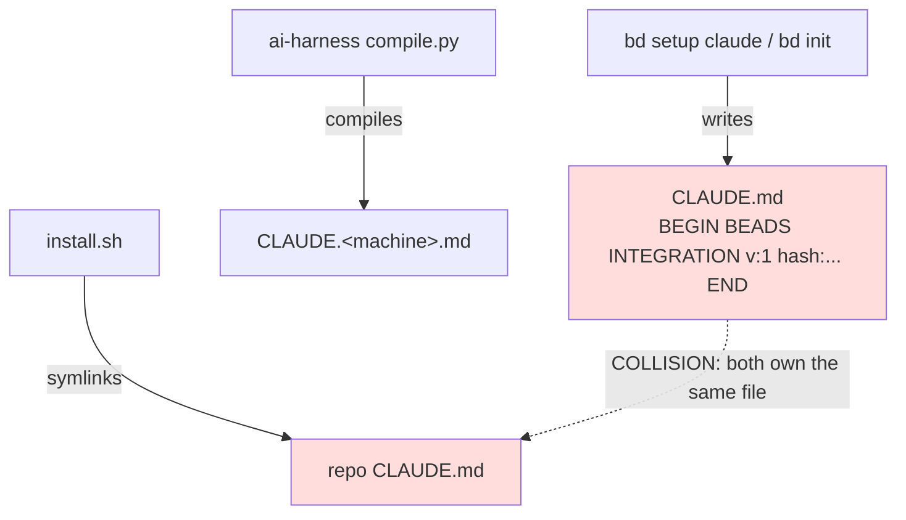

<!-- Carries internal SW-*/AIH-*/CORE-* IDs; scrub before any open-source pass (ISSUE-REF). -->

# Beads (bd) Setup & Context-File Injection — Fleet Adoption Alongside a Compiled Context System

**Status:** complete

**Created:** 2026-07-16

<!--
**Task:** ISSUE-REF (Beads adoption, Phase 3)
**Related docs:**
- `docs/research/beads-agent-fleet-usage.md`
- `docs/research/agent-memory-unification-bd-remember-vs-markdown.md`
-->

## Table of Contents

- [Context](#context)
- [Temporal Scope](#temporal-scope)
- [Executive Summary](#executive-summary)
- [1. What `bd init` vs `bd setup <recipe>` writes, and where](#1-what-bd-init-vs-bd-setup-recipe-writes-and-where)
  - [When to use](#when-to-use)
- [2. `--skip-agents` + external context management as a blessed pattern](#2---skip-agents--external-context-management-as-a-blessed-pattern)
  - [When to use](#when-to-use-2)
- [3. Custom recipes (`--add`) and `--agents-template` as content-override paths](#3-custom-recipes---add-and---agents-template-as-content-override-paths)
  - [When to use](#when-to-use-3)
- [4. The hash-delimited managed block — idempotency, remove, versioning](#4-the-hash-delimited-managed-block--idempotency-remove-versioning)
- [5. Git hooks coexistence with an existing pre-commit framework](#5-git-hooks-coexistence-with-an-existing-pre-commit-framework)
  - [When to use](#when-to-use-5)
- [6. Community multi-repo / fleet patterns](#6-community-multi-repo--fleet-patterns)
- [7. The anti-`MEMORY.md` / anti-`TaskCreate` default guidance](#7-the-anti-memorymd--anti-taskcreate-default-guidance)
- [Gaps, blindspots & emergent findings](#gaps-blindspots--emergent-findings)
- [Comparison](#comparison)
- [Recommendation](#recommendation)
- [Open Questions](#open-questions)
- [Sources](#sources)
- [Appendix: Research Prompt](#appendix-research-prompt)
- [Appendix: Provenance Ledger](#appendix-provenance-ledger)
- [Run History](#run-history)

<!-- doc:region name="context" kind="immutable" -->

## Context

How the Beads (`bd`, github.com/steveyegge/beads — repo also appears as `gastownhall/beads`)
issue tracker's `bd init` / `bd setup` commands inject AI-agent context files, and the
best-practice pattern for adopting `bd` across a ~18-repo fleet that already runs its **own**
managed, compiled context-file system (ai-harness `compile.py` + `install.sh`), a
markdown-authoritative memory system, and a CC task panel. The decision this informs: which init
flags to standardize fleet-wide, global-vs-per-repo, whether to override bd's template via a
custom recipe, how to handle bd's git hooks against an existing pre-commit framework, and what to
do about bd's default "do not use `MEMORY.md` / do not use markdown TODOs" guidance.

**Primary period:** 2026 (bd v0.58–v1.1.x)
**Source weighting:** 2026 primary (bd changelog, README, official docs at HEAD) → 2025 secondary → pre-2025 background only.

<!-- /doc:region name="context" -->

<!-- doc:region name="body" kind="replaceable" -->

## Temporal Scope

Primary focus: 2026 sources at the `main`/HEAD of `steveyegge/beads`, current release **v1.1.0
(2026-07-04)**, with changelog evidence back to v0.58.0 (2026-03) where a flag or behavior first
shipped. bd moves fast (multiple releases/week), so flag semantics are pinned to the changelog
entry that introduced them. No relevant pre-2025 literature exists — bd itself launched in 2026.
Community fleet-adoption write-ups: only one comparable-scale case study was found (mid-2026); the
specific pattern this fleet needs (bd alongside a foreign compiled context system) has **no
published precedent** found this session.

## Executive Summary

1. **`bd init` and `bd setup <recipe>` are per-repo context-file writers, and the fleet's compiled
   system owns those exact files** — bd's `claude` recipe writes a managed section into `CLAUDE.md`
   plus a SessionStart hook into `.claude/settings.json`; other recipes write `AGENTS.md`,
   `GEMINI.md`, `.cursor/`, etc.[VERIFIABLE][^3] Letting bd inject into `CLAUDE.md`/`AGENTS.md`
   directly collides with `compile.py` + `install.sh`, which already author and symlink those
   files. The clean split is: **let bd own the `.beads/` store; keep the agent-facing context in
   the compiled system.**

2. **`--skip-agents` is the officially-supported "store-only" seam, and it is idempotent-safe.**
   bd's own docs frame the injected files as skippable (`--skip-agents` / `--stealth`) and frame
   manual/external management as a first-class path.[VERIFIABLE][^1] Nothing in the tracker's core
   (`bd ready`, `bd create`, `bd prime`) depends on the injected block existing — `bd prime`
   generates its context dynamically at call time.[VERIFIABLE][^2]

3. **There is no blessed "inject MY content" override.** `--agents-template` selects a *named,
   embedded* template (`embed.FS`), not an arbitrary external file;[VERIFIABLE][^2] `bd setup --add
   <name> <path>` and `bd setup -o <path>` control *where* bd writes but still emit **bd's own**
   template (custom recipes are "always type `file`").[VERIFIABLE][^3] The correct override is
   therefore `--skip-agents` + author your own block in the compile source — optionally seeded from
   `bd setup --print`.

4. **The managed block is genuinely safe to leave to bd IF you let bd own that file** — it is a
   hash/version/profile-stamped HTML-comment section (`<!-- BEGIN BEADS INTEGRATION v:1
   profile:full hash:19cc25d9 -->`), updated in place idempotently, and `--remove` deletes only the
   managed section.[VERIFIABLE][^3] But hand-edits *inside* the markers are the thing that gets
   clobbered on the next version bump — which is exactly why a compiled system must not let bd write
   into a file the compiler also owns.

5. **bd's git hooks chain rather than clobber, but they seize `core.hooksPath`** — a real ownership
   conflict with a `pre-commit`-framework fleet. `--skip-hooks` fleet-wide, then selectively adopt
   only the JSONL-export hook where needed, is the right call.[VERIFIABLE][^2]

## 1. What `bd init` vs `bd setup <recipe>` writes, and where

`bd init` bootstraps the store **and** does agent setup in one shot. Per the README:
*"`bd init` creates or updates `AGENTS.md` by default so agents can discover the beads workflow,
and also installs project Claude/Codex integrations unless you pass `--skip-agents` or
`--stealth`."*[VERIFIABLE][^1] Concretely, a default `bd init` produces, **per repo**:

- `.beads/` — the Dolt-backed store (`embeddeddolt/`), `config.yaml`, and `.beads/.gitignore`.[VERIFIABLE][^4]
- `AGENTS.md` — autogenerated onboarding block.[VERIFIABLE][^1][^4]
- Claude Code setup (auto-run during `init`): a managed section in `CLAUDE.md` + a SessionStart
  hook running `bd prime --hook-json` in `.claude/settings.json`.[VERIFIABLE][^3]
- Codex setup: an `AGENTS.md` section with its own `BEGIN/END BEADS CODEX SETUP` markers, plus
  `.agents/skills/`.[VERIFIABLE][^3]
- git hooks under a bd-owned `core.hooksPath`.[VERIFIABLE][^2]

`bd setup <recipe>` is the same machinery exposed per-tool. It uses a **recipe-based
architecture**: each recipe declares a target path and an injection *type*.[VERIFIABLE][^3] The
built-in recipe → target map:[VERIFIABLE][^3]

| Recipe | Writes to | Type |
|--------|-----------|------|
| `claude` | `.claude/settings.json` (or `~/.claude/settings.json` with `--global`) + `CLAUDE.md` section | `hooks` |
| `gemini` | `.gemini/settings.json` + `GEMINI.md` section | `hooks` |
| `factory` / `mux` / `opencode` | `AGENTS.md` section | `section` |
| `codex` | `AGENTS.md` (`CODEX SETUP` markers), `.agents/skills/` | `section` |
| `cursor` | `.cursor/rules/beads.mdc` (+ `.cursor/hooks.json`) | `file`/`hooks` |
| `copilot` / `aider` / `junie` | tool-specific files | `multifile` |

**Is there an official "global" (one place) path?** Partly. For the **hook + settings** half,
`bd setup claude --global` writes to `~/.claude/settings.json` instead of the repo, and the
changelog is explicit: *"`bd setup claude` defaults to project-local — Settings written to
`.claude/settings.json` (shared/team) by default; `--global` for user-level. Auto-runs during
`bd init`."*[VERIFIABLE][^2] So a single user-level SessionStart hook can prime every repo. But the
**store itself is inescapably per-repo** — `.beads/` lives in each repo and travels with it in git;
there is no global issue store.[VERIFIABLE][^5] And the *agent-guidance text* (`CLAUDE.md`/`AGENTS.md`
section) is written per-repo by design; the only "global" analogue for guidance is `--global` on the
hook recipes, not on the markdown sections.

### When to use

Use a full default `bd init` when a repo has **no** external context system and you *want* bd to own
onboarding. For this fleet, that condition is false in every repo — the compiled system already owns
`CLAUDE.md`/`AGENTS.md`/`GEMINI.md`.

## 2. `--skip-agents` + external context management as a blessed pattern

Yes — "init the store, manage the agent-facing context yourself" is explicitly supported, not a
hack. Two independent signals:

1. `--skip-agents` and `--stealth` are documented opt-outs of the AGENTS.md/Claude/Codex
   generation, stated in the same sentence that describes the default.[VERIFIABLE][^1]
   `--skip-hooks` (and `--skip-merge-driver`) are separately documented opt-outs.[VERIFIABLE][^2]

2. bd treats **manual/external** instruction management as first-class: *"Manual copy-paste is only
   for unsupported agents, existing projects where you cannot rerun `bd init`/`bd setup`, or custom
   instruction files. In those cases, run `bd onboard` and paste the printed snippet into the file
   your agent reads."*[VERIFIABLE][^1] "Custom instruction files" is precisely the fleet's case.

**Gotchas, checked:**

- **Does bd re-inject on later commands?** The agent-file write happens at `bd init` / `bd setup`
  (and `bd setup` is auto-run during `init`).[VERIFIABLE][^2] Routine commands (`bd create`,
  `bd ready`, `bd close`) do not re-inject. Re-running `bd init` or `bd setup` *will* re-touch the
  managed section (idempotent update, §4) — so the operational rule is simply **don't re-run
  `bd setup <recipe>` for the agent recipes** in these repos; there is no background re-injection.
- **Does `bd prime` still work without the injected block?** Yes. `bd prime` is the "single source of
  truth for agent instructions" and *generates* context at call time (it detects MCP vs plain-CLI vs
  `--hook-json` mode).[VERIFIABLE][^2] The injected `CLAUDE.md` block is, by design, just a thin
  *pointer* to `bd prime`; priming does not read it back.[VERIFIABLE][^3]
- **Does anything depend on `AGENTS.md` existing?** No core store operation does. `AGENTS.md` exists
  purely for agent discovery. `--skip-agents` is a supported terminal state, not a degraded one.[INFERENCE]

### When to use

This is the default seam for **any repo whose context files are owned by another system** — CI-managed,
copier-templated, or (this fleet) compile-and-symlink. It is the recommended posture for all ~18 repos.

## 3. Custom recipes (`--add`) and `--agents-template` as content-override paths

The tempting hypothesis — "point bd at my template so future `bd init`/`bd setup` writes MY adapted
content into my compile-source location" — is **only half-supported**, and not in the way that helps.

- **`--agents-template`** selects a *named, embedded* template: *"`bd init` now supports named
  `AGENTS.md` templates via `embed.FS`."*[VERIFIABLE][^2] `embed.FS` means the templates are compiled
  **into the bd binary** — you pick from bd's shipped set, you do not supply an arbitrary external
  file body. This is **not** a content-injection override.

- **`bd setup --add <name> <path>`** registers a custom recipe, but it controls the *destination*,
  not the *content*: *"Custom recipes are stored in `.beads/recipes.toml`"* and *"Custom recipes
  added via `--add` are always type `file`."*[VERIFIABLE][^3] A `file`-type recipe writes **bd's own
  workflow template** to the path you name. Likewise `bd setup -o <path>` writes bd's template to a
  custom path, and `bd setup --print` prints bd's template to stdout.[VERIFIABLE][^3] None of these
  substitute *your* wording for bd's.

**Conclusion:** bd has **no blessed hook to inject your own content** through its setup machinery.
The supported override is the inverse: `--skip-agents` (bd writes nothing) + you author the
guidance in your own compilation source. `bd setup --print` is still useful — run it **once** to
capture bd's canonical template as the *starting text* for a compile module, so your fleet's
adapted block stays semantically aligned with upstream, then own and version it in `compile.py`.

### When to use

Reach for `--add`/`-o` only when you want bd to drop its *stock* template at a nonstandard path with
zero editing. For a fleet that needs *adapted* wording (reconciled with a separate memory + task
system), treat these as a seed-once convenience, not the management path.

## 4. The hash-delimited managed block — idempotency, remove, versioning

The managed section is a hash/version/profile-stamped HTML-comment block. Verbatim from the docs:
*"The begin marker carries version, profile, and hash metadata (e.g. `<!-- BEGIN BEADS INTEGRATION
v:1 profile:full hash:19cc25d9 -->`) so `--check` can report `missing`, `stale`, or `current`;
legacy markers without metadata are auto-upgraded on the next install or update. Re-running setup
updates the existing section in place (idempotent), and `--remove` deletes only the managed section
— the rest of your `AGENTS.md` is untouched."*[VERIFIABLE][^3]

Mechanics that matter for a compiled fleet:

- **Two profiles.** `full` = the complete command reference (for hookless agents); `minimal` = a
  pointer to `bd prime` + quick reference (for hook-enabled agents). `--agents-profile
  minimal|full` selects it; the Prime-SSOT model (v0.60.0) made `bd prime` the dynamic source and
  the file block a thin marker.[VERIFIABLE][^2]
- **`--check` states.** `missing` / `stale` / `current` — bd can detect its own drift and self-heal
  on the next update.[VERIFIABLE][^3]
- **Hand-edits inside the markers get clobbered.** "Updates the existing section in place" means the
  next version bump (`v:1` → `v:2`) or hash change overwrites whatever is between the markers.[INFERENCE]
  This is the crux: a compiled context system that also wants to control that text **cannot** coexist
  with bd inside the same file — one of them must own it. Since `compile.py` + `install.sh` already
  own `CLAUDE.md`/`AGENTS.md`/`GEMINI.md`, bd must not write there (`--skip-agents`).



## 5. Git hooks coexistence with an existing pre-commit framework

bd is deliberately **chain-friendly** but **path-greedy**:

- **It chains, not clobbers.** *"`bd init` now preserves ALL pre-existing hooks (not just
  beads-managed ones) when overriding `core.hooksPath`."*[VERIFIABLE][^2] And it accommodates slow
  toolchains: *"Hook shim timeout increased from 30s to 300s, preventing premature termination of
  chained pre-commit pipelines (linters, formatters, type-checkers). Configurable via
  `BEADS_HOOK_TIMEOUT`."*[VERIFIABLE][^2] bd installs `pre-commit`, `post-merge`, `pre-push`,
  `post-checkout`, and `prepare-commit-msg` hooks; the load-bearing one is the `pre-commit` **JSONL
  export** that keeps `.beads/issues.jsonl` in sync with the Dolt store.[VERIFIABLE][^3]
- **It seizes `core.hooksPath`.** bd repoints `core.hooksPath` at `.beads/hooks`.[VERIFIABLE][^2]
  A `pre-commit`-framework repo, husky, or lefthook also wants to own the hook path — this is the
  real conflict. bd is aware of the ecosystem (*"`bd doctor` now detects lefthook, husky,
  `pre-commit`, and other hook managers"*[VERIFIABLE][^2]) but detection is not automatic merging.

**Right call for this fleet:** `--skip-hooks` fleet-wide at `init`, so bd never seizes
`core.hooksPath`. Then, per repo, adopt only what you need:

- If a repo relies on `.beads/issues.jsonl` staying current in git (e.g., for the fleet's
  Dolt→Postgres projection), wire bd's **JSONL export** into the *existing* `pre-commit` framework as
  one more hook — rather than handing `core.hooksPath` to bd. (bd also supports a merge driver for
  `.jsonl`; `--skip-merge-driver` opts out.)[VERIFIABLE][^2]
- If a repo does not need per-commit JSONL freshness (e.g., export is done on a schedule/CI), skip
  hooks entirely and run `bd export` out-of-band.

### When to use

`bd hooks install` (bd owns `core.hooksPath`) is fine **only** in repos with no competing hook
manager. For any repo already on the `pre-commit` framework or a githooks path, prefer `--skip-hooks`
+ selective adoption, and use `bd doctor` to confirm no silent takeover.

## 6. Community multi-repo / fleet patterns

The honest finding: **the specific pattern this fleet needs — bd across many repos alongside a
foreign, compiled context system — has no published precedent found this session.** What exists:

- **Per-repo `.beads/`, decentralized, is the observed norm.** The one comparable-scale public case
  study (20 repositories, 857+ issues, Claude Code cross-session coordination) uses plain per-repo
  `.beads/issues.jsonl` with **no** central store, hydration, or aggregation: *"Issues are stored in
  `.beads/issues.jsonl`"* and *"Issues travel with the repository."*[VERIFIABLE][^5] This corroborates
  the prior internal fleet-usage research, which reached the same conclusion and additionally found
  bd's own FAQ answers "track multiple projects" with the low-tech "init bd in a parent directory,"
  not the routing/federation machinery.
- **The "global" mechanisms are for the hook layer, not the store or the guidance.** `--global`
  (Claude/Cursor/Gemini) puts hooks in `~/.<tool>/`; the store stays per-repo.[VERIFIABLE][^2][^3]
- **No published central-setup-script / wrapper pattern.** Nobody found this session publishes a
  fleet wrapper that runs `bd init --skip-agents ...` across N repos and manages the context
  centrally. **`[NO SOURCE]`** — this is greenfield; the fleet will define the pattern, not inherit
  it. The closest signal is that bd is explicitly a "install once, use everywhere" CLI[VERIFIABLE][^5]
  and its per-repo determinism (idempotent init, `--non-interactive`) makes a fan-out script trivial.

## 7. The anti-`MEMORY.md` / anti-`TaskCreate` default guidance

The default guidance is **just text in the injected block**, and therefore fully avoidable. The
README's minimal snippet states verbatim: *"Use `bd remember "insight"` for persistent project
memory; do not create MEMORY.md files."* and *"Do not use markdown TODO lists for task
tracking."*[VERIFIABLE][^1] The full-profile Claude/Codex block carries the stronger "use bd for ALL
task tracking — do not use TodoWrite/TaskCreate" phrasing (reproduced locally on v1.1.0; the README
snippet is the minimal-profile equivalent).

Key points for the decision:

- **It is not enforced anywhere** — it is advisory prose the agent reads. Removing it means simply
  not letting bd write it: `--skip-agents` ⇒ the anti-`MEMORY.md`/anti-`TaskCreate` text never lands.[INFERENCE]
- **It reflects bd's replacement intent, which conflicts with a markdown-authoritative fleet.** Prior
  internal research established that bd positions `bd remember` as a *replacement* for `MEMORY.md`, not
  a coexisting layer, and recommended **not** adopting the Dolt-backed memory silo as a second source
  of truth (either decline it or make `bd remember` a thin write-through into authoritative markdown).
  Injecting bd's default guidance would actively instruct agents to abandon the fleet's own memory +
  task systems — the opposite of the pre-cutover intent.
- **The override is authorship, not configuration.** There is no `--no-memory-guidance` flag. You get
  the wording you want by owning the block in the compile source (§3): keep the bits that help
  (task-tracking migration, once you cut over) and drop/rewrite the "do not create MEMORY.md" line to
  match the fleet's write-through decision.

## Gaps, blindspots & emergent findings

- **`recipes.toml` provenance.** The custom-recipe TOML shape (`[recipes.<name>]`, `type = "file"`)
  is confirmed in bd's own `ide-setup.md`.[VERIFIABLE][^3] I did not exercise `--add` against a live
  store this session; the "adding one requires an active beads workspace" caveat is documented, not
  reproduced here.
- **Full-profile exact wording.** The strongest "do not use TodoWrite/TaskCreate" phrasing comes from
  the local v1.1.0 reproduction (treated as ground truth); the online README exposes the
  *minimal-profile* equivalent verbatim.[VERIFIABLE][^1] The two are consistent in intent.
- **Blindspot I could not fully close:** whether a future bd version relocates or auto-detects
  foreign context managers and *offers* to skip the markdown write by default. `bd doctor` already
  detects hook managers[VERIFIABLE][^2]; an analogous "detected an externally-managed CLAUDE.md"
  behavior is plausible but unverified — pin flag behavior to the changelog at adoption time.

## Comparison

Fleet adoption options for the agent-context half of bd (the `.beads/` store is per-repo regardless):

| # | Criterion | A. Full default `bd init` (bd owns context) | B. `--skip-agents` + own compile module (recommended) | C. Custom recipe `--add`/`--agents-template` |
|---|-----------|---------------------------------------------|-------------------------------------------------------|----------------------------------------------|
| 1 | Collision with `compile.py`/`install.sh` | High — bd and compiler both write `CLAUDE.md`[VERIFIABLE][^3] | None — bd writes no context files[VERIFIABLE][^1] | High — still writes bd's template into a file the compiler owns[VERIFIABLE][^3] |
| 2 | Content control | bd's wording, clobbered on version bump | Full — fleet authors + versions the block | Destination only; content stays bd's[VERIFIABLE][^3] |
| 3 | Anti-`MEMORY.md`/anti-`TaskCreate` text | Injected (unwanted pre-cutover)[VERIFIABLE][^1] | Never injected[INFERENCE] | Injected (bd's template)[VERIFIABLE][^3] |
| 4 | `bd prime` still works | Yes | Yes — prime is call-time SSOT[VERIFIABLE][^2] | Yes |
| 5 | Idempotent / re-run safe | Yes but re-touches file[VERIFIABLE][^3] | N/A (nothing written) | Yes but re-touches file |
| 6 | Fleet fan-out complexity | Low flags, high conflict | Low flags, low conflict | Extra `recipes.toml` per repo, still conflicts |
| 7 | Upstream-alignment of guidance | Automatic | Manual (seed via `bd setup --print`)[VERIFIABLE][^3] | Automatic but wrong location |

## Recommendation

Adopt bd across the ~18 repos as a **store-only** tool and keep 100% of the agent-facing context in
the compiled system. Concretely:

1. **Init flags, fleet-wide:**
   `bd init --skip-agents --skip-hooks --non-interactive --prefix <REPO>` (uppercase prefix per the
   fleet's bd-casing decision). `--skip-agents` keeps bd out of `CLAUDE.md`/`AGENTS.md`/`GEMINI.md`
   (owned by `compile.py`/`install.sh`); `--skip-hooks` keeps bd from seizing `core.hooksPath`;
   `--non-interactive` makes the fan-out script deterministic. This is bd's documented, supported
   store-only seam.[VERIFIABLE][^1][^2]

2. **Global vs per-repo:** The store is per-repo and that's correct — matches the only comparable
   real-world fleet.[VERIFIABLE][^5] Do **not** use `bd setup --global`; a user-level bd-managed
   `~/.claude/settings.json` would fight the compiled/managed settings model. Instead, if you want a
   SessionStart `bd prime` hook, author it **as a compile module** so it ships through
   `install.sh` like every other managed setting — one authored source, N installed copies. Replicate
   bd's "global guidance" intent through *your* compilation, not bd's `--global`.

3. **Custom recipe / template override:** Do not rely on `--add`/`--agents-template` to inject fleet
   wording — they place bd's *stock* template, they don't substitute yours.[VERIFIABLE][^2][^3] Run
   `bd setup --print` **once** to capture the canonical template, adapt it into a compile module
   (reconciled with the memory + task decisions), and own it there. Re-run `bd setup --print` on
   major bd bumps to diff upstream changes into your module.

4. **Git hooks:** `--skip-hooks` everywhere at init. Then per repo: where `.beads/issues.jsonl`
   freshness matters (Dolt→Postgres projection), add bd's **JSONL export** as one hook inside the
   existing `pre-commit` framework rather than surrendering `core.hooksPath`; elsewhere run
   `bd export` on a schedule/CI. bd chains cleanly (300s shim, preserves foreign hooks)[VERIFIABLE][^2]
   but path-ownership is the conflict to avoid. Verify with `bd doctor` per repo.[VERIFIABLE][^2]

5. **Anti-`MEMORY.md`/anti-`TaskCreate` guidance:** Never let it land. `--skip-agents` suppresses it
   entirely.[INFERENCE] Pre-cutover, the fleet keeps markdown-authoritative memory + the CC task
   panel, so bd's replacement guidance would be actively harmful. When/if you cut over task tracking
   to bd, author the migration guidance yourself in the compile module — and, per prior internal
   research, keep memory markdown-authoritative (decline the Dolt memory silo, or make `bd remember`
   a thin write-through), rather than importing bd's "do not create MEMORY.md files" verbatim.

**Net:** bd is a per-repo *store*; the compiled context system stays the single owner of agent-facing
files. `--skip-agents --skip-hooks --non-interactive` is the fleet-wide init; everything bd would
have injected is instead authored once in `compile.py` and shipped by `install.sh`.

## Open Questions

1. Does exercising `bd setup --add` against a live store (required active workspace) surface any
   write beyond `.beads/recipes.toml` — e.g., does it also drop the template immediately, or only on
   `bd setup <name>`? (Docs imply the latter; unverified live.)[VERIFIABLE][^3]
2. For the Dolt→Postgres projection, is the `pre-commit` JSONL export strictly necessary per commit,
   or is a scheduled `bd export` sufficient — i.e., can every repo be `--skip-hooks` with zero hook
   adoption?
3. Will a future bd version add native "externally-managed context file" detection (analogous to its
   hook-manager detection), which would let a repo run default `bd init` safely? Re-check the
   changelog at adoption time.
4. Does the compiled SessionStart `bd prime --hook-json` module need per-repo prefix awareness, or is
   `bd prime` fully context-detecting from `cwd`? (Docs say it detects execution context.)[VERIFIABLE][^2]

## Sources

[^1]: Yegge, S. (2026). [beads/README.md](https://github.com/steveyegge/beads/blob/main/README.md) (fetched raw via `raw.githubusercontent.com/steveyegge/beads/main/README.md`). GitHub (steveyegge/beads). Verified accessible (HTTP 200) 2026-07-16. (Default `bd init` behavior; `--skip-agents`/`--stealth`; `bd onboard`/manual-copy path; minimal AGENTS.md snippet incl. "do not create MEMORY.md files" and "Do not use markdown TODO lists for task tracking.")
[^2]: Yegge, S. (2026). [beads/CHANGELOG.md](https://github.com/steveyegge/beads/blob/main/CHANGELOG.md) (fetched raw via `raw.githubusercontent.com/steveyegge/beads/main/CHANGELOG.md`). GitHub (steveyegge/beads). Verified accessible (HTTP 200) 2026-07-16. (`--agents-template` named embed.FS templates; `--agents-profile`; `--skip-hooks`/`--skip-merge-driver`; `bd setup claude --global` user-level default project-local; hook preservation + 300s shim timeout; `bd doctor` hook-manager detection; Prime-SSOT versioned hash markers.)
[^3]: Beads maintainers. (2026). [Agent and IDE setup (docs/getting-started/ide-setup.md)](https://github.com/steveyegge/beads/blob/main/docs/getting-started/ide-setup.md) (fetched raw via `raw.githubusercontent.com/steveyegge/beads/main/docs/getting-started/ide-setup.md`). GitHub (steveyegge/beads). Verified accessible (HTTP 200) 2026-07-16. (Recipe→target map; managed-section marker format `v:1 profile:full hash:19cc25d9`; idempotent update + `--check` missing/stale/current + `--remove` only-managed-section; Custom Recipes `--add`/`.beads/recipes.toml`/type=`file`; `-o`/`--print`; `--global`; git-hooks list.)
[^4]: DeepWiki. (2026). [AI Tool Integrations — steveyegge/beads](https://deepwiki.com/steveyegge/beads/8.4-ai-tool-integrations) and [Getting Started](https://deepwiki.com/steveyegge/beads/2-getting-started). Verified accessible (HTTP 200) 2026-07-16. (Secondary, AI-generated wiki — corroborates recipe architecture, `.beads/` layout, profile system; cross-checked against primary docs [^1][^2][^3].)
[^5]: wal.sh. (2026). [Beads/bd — Git-Native Issue Tracking](https://wal.sh/research/beads). Verified accessible (HTTP 200) 2026-07-16. (Comparable-scale fleet case study: 20 repos, 857+ issues, per-repo `.beads/issues.jsonl`, "Issues travel with the repository," no central/hydrated store; bd = "install once, use everywhere.")

<!-- /doc:region name="body" -->

<!-- doc:region name="ambiguous_items" kind="replaceable" -->

## Ambiguous Items from Auto-Remediation (Post-Run Review)

(none yet — auto-populated by verify_and_remediate node)

<!-- /doc:region name="ambiguous_items" -->

<!-- doc:region name="appendix_research_prompt" kind="immutable" -->

## Appendix: Research Prompt

**Registry ID:** ad-hoc (no aido registry entry — subscription web-tool run)
**Model:** Claude ad-hoc web (research-doc skill), Opus
**Date:** 2026-07-16

```text
Role: principal developer-experience engineer who has integrated third-party AI-agent
tooling (issue trackers, linters, MCP servers) into managed, compiled context-file
systems across large multi-repo fleets. Evidence-backed opinions; when no source is
found, say so.

Temporal scope: 2026 primary (bd v0.58–v1.1.x, changelog/README/docs at HEAD) → 2025
secondary → pre-2025 background only. Name thin periods rather than backfilling.

Topic: How Beads (bd, github.com/steveyegge/beads, also gastownhall/beads) `bd init` /
`bd setup` inject AI-agent context files, and the best-practice pattern for adopting bd
across a ~18-repo fleet that already has its OWN managed, compiled context-file system.

Verified local ground truth (build on, don't re-derive): default `bd init` generates
AGENTS.md + runs Claude/Codex setup (hash-delimited managed block
`<!-- BEGIN BEADS INTEGRATION v:1 profile:minimal hash:... -->` into CLAUDE.md, AGENTS.md,
a `bd prime --hook-json` SessionStart hook in .claude/settings.json, .beads/hooks git
hooks, .codex files) — PER REPO. Flags: --skip-agents, --skip-hooks, --agents-profile
minimal|full, --agents-file, --agents-template <path>, --init-if-missing,
--non-interactive, --role maintainer, --stealth, --setup-exclude. `bd setup <recipe>`
(claude/gemini/codex/cursor/copilot/aider...) with --global, --project, --remove,
--check, --print/-o, --stealth, --add <name> <path>. Injected block says "Use bd for ALL
task tracking — do NOT use TodoWrite/TaskCreate" and "Use bd remember — do NOT use
MEMORY.md files."

Questions (a FLOOR, not a ceiling — reason independently, surface blindspots):
1. What exactly does `bd init` vs `bd setup <recipe>` write, and where? Is there an
   official global (one-place) path?
2. Is `--skip-agents` + external context management a supported/blessed pattern? Gotchas
   (re-injection? does bd prime work without the block? does anything depend on AGENTS.md)?
3. Custom recipes (`--add`) and `--agents-template` — can you point bd at YOUR template so
   setup writes YOUR content? Is that the recommended override?
4. The hash-delimited managed block — idempotent update/remove, version bumps, do
   in-marker hand-edits get clobbered?
5. git hooks (.beads/hooks, core.hooksPath) — coexistence with an existing pre-commit
   framework? Is --skip-hooks + selective validator adoption right?
6. Community multi-repo patterns — per-repo vs central wrapper vs global; published
   fleet-adoption writeups.
7. The "don't use MEMORY.md / don't use TaskCreate" default guidance — configurable/
   removable? Do adopters who keep a separate memory system override it?

Output goal: a research doc informing a design decision for a fleet that will (a) bd init
~18 repos, (b) keep a separate compiled context-file system (ai-harness compile.py +
install.sh), (c) keep markdown-authoritative memory + a CC task panel pre-cutover. End
with a clear Recommendation on: init flags fleet-wide, global-vs-per-repo,
custom-recipe/template override, git-hook handling, and the anti-MEMORY.md guidance. Cite
specific sources with a provenance ledger. Mermaid for diagrams. Flag [NO SOURCE] honestly.

HARD CONSTRAINT: WebSearch/WebFetch only. Never call Gemini, aido, or any metered API.

<grounding_instructions>
You are a principal developer-experience engineer who has integrated third-party
AI-agent tooling into managed, compiled context-file systems across large multi-repo
fleets. Evidence-backed opinions; when you cannot find a source, say so.

Temporal scope: weight sources 2026 (primary) → 2025 → 2024; pre-2024 is background only.
If a subtopic is genuinely thin post-2024, state "no significant post-2024 developments
found" rather than backfilling.

Before final output, run a Chain-of-Verification: isolate core facts; draft; hostile
cross-examination (flag any claim cited because the prompt implied it rather than because
you verified it); strip unverifiable claims.

Classify every major claim (rationale → evidence check → tag):
- [VERIFIABLE]: backed by docs/official source (2024–2026); carry inline [VERIFIABLE][^N].
- [HEURISTIC]: widely-accepted practice, no specific citation.
- [INFERENCE]: logical conclusion from context; reasoning in-text; no footnote.
- [NO SOURCE]: explicit admission nothing verifiable was found; no footnote.
Footnote defs once under ## Sources in APA form with URL + access stamp; contiguous from
[^1], no gaps/orphans. Hard constraint: never invent a citation. Accuracy > completeness.
Diagrams in Mermaid; math in LaTeX; never generate binary images.
</grounding_instructions>

## Scope note — questions and named references are a starting point, not a checklist
The questions and named flags/recipes above are illustrative anchors and a FLOOR — not an
exhaustive list to answer only. Survey broadly, follow evidence, expand scope, surface
failure modes not named here. Merely filling in the listed items has NOT met the goal.

## Independent exploration (gaps, blindspots, emergent threads) — required
Treat the question list as a floor. Surface adjacent/upstream factors, contrarian/
disconfirming evidence, emerging 2025–2026 practices, and known failure modes. Report
load-bearing threads in a dedicated "Gaps, blindspots & emergent findings" subsection;
NAME any blindspot you suspect but cannot resolve.

Retrieval enforcement: for each load-bearing claim, run at least one web_search/web_fetch;
do not tag [VERIFIABLE] without a URL fetched in-session; do not exit "satisfied" after
one round. [NO SOURCE] is reserved for genuine evidence absence, not retrieval avoidance.
```

<!-- /doc:region name="appendix_research_prompt" -->

<!-- doc:region name="appendix_provenance" kind="replaceable" -->

## Appendix: Provenance Ledger

| # | Claim | Source URL (fetched this session) | Verbatim quote | Verdict | Live? |
|---|-------|-----------------------------------|----------------|---------|-------|
| 1 | Default `bd init` writes AGENTS.md + Claude/Codex integrations unless `--skip-agents`/`--stealth` | https://raw.githubusercontent.com/steveyegge/beads/main/README.md | "`bd init` creates or updates `AGENTS.md` by default so agents can discover the beads workflow, and also installs project Claude/Codex integrations unless you pass `--skip-agents` or `--stealth`." | SUPPORTED | Y (200) |
| 2 | Manual/external instruction management is first-class (`bd onboard`) | https://raw.githubusercontent.com/steveyegge/beads/main/README.md | "Manual copy-paste is only for unsupported agents, existing projects where you cannot rerun `bd init`/`bd setup`, or custom instruction files. In those cases, run `bd onboard` and paste the printed snippet into the file your agent reads." | SUPPORTED | Y (200) |
| 3 | bd's default guidance says drop MEMORY.md + markdown TODOs | https://raw.githubusercontent.com/steveyegge/beads/main/README.md | "Use `bd remember \"insight\"` for persistent project memory; do not create MEMORY.md files." / "Do not use markdown TODO lists for task tracking." | SUPPORTED | Y (200) |
| 4 | Managed block marker format + idempotent update + `--remove` only-managed | https://raw.githubusercontent.com/steveyegge/beads/main/docs/getting-started/ide-setup.md | "The begin marker carries version, profile, and hash metadata (e.g. `<!-- BEGIN BEADS INTEGRATION v:1 profile:full hash:19cc25d9 -->`) so `--check` can report `missing`, `stale`, or `current`; ... Re-running setup updates the existing section in place (idempotent), and `--remove` deletes only the managed section — the rest of your `AGENTS.md` is untouched." | SUPPORTED | Y (200) |
| 5 | Custom recipes stored in `.beads/recipes.toml`; `--add` always type file | https://raw.githubusercontent.com/steveyegge/beads/main/docs/getting-started/ide-setup.md | "Custom recipes are stored in `.beads/recipes.toml`" / "Custom recipes added via `--add` are always type `file`." | SUPPORTED | Y (200) |
| 6 | `claude` recipe target is `.claude/settings.json` (or `~/.claude/settings.json` with `--global`) + CLAUDE.md | https://raw.githubusercontent.com/steveyegge/beads/main/docs/getting-started/ide-setup.md | "`claude` | `.claude/settings.json` (or `~/.claude/settings.json` with `--global`) + `CLAUDE.md` section" | SUPPORTED | Y (200) |
| 7 | `bd setup claude` project-local default; `--global` user-level; auto-runs during init | https://raw.githubusercontent.com/steveyegge/beads/main/CHANGELOG.md | "`bd setup claude` defaults to project-local — Settings written to `.claude/settings.json` (shared/team) by default; `--global` for user-level. Auto-runs during `bd init`." | SUPPORTED | Y (200) |
| 8 | `--agents-template` selects named embedded (embed.FS) templates | https://raw.githubusercontent.com/steveyegge/beads/main/CHANGELOG.md | "`--agents-template` flag — `bd init` now supports named AGENTS.md templates via `embed.FS`" | SUPPORTED | Y (200) |
| 9 | `--skip-hooks` (and `--skip-merge-driver`) are opt-out flags | https://raw.githubusercontent.com/steveyegge/beads/main/CHANGELOG.md | "New opt-out flags: `--skip-hooks` and `--skip-merge-driver`" | SUPPORTED | Y (200) |
| 10 | bd preserves all pre-existing hooks when overriding core.hooksPath | https://raw.githubusercontent.com/steveyegge/beads/main/CHANGELOG.md | "`bd init` now preserves ALL pre-existing hooks (not just beads-managed ones) when overriding `core.hooksPath`." | SUPPORTED | Y (200) |
| 11 | Hook shim timeout raised to 300s for chained pre-commit pipelines | https://raw.githubusercontent.com/steveyegge/beads/main/CHANGELOG.md | "Hook shim timeout increased from 30s to 300s, preventing premature termination of chained pre-commit pipelines (linters, formatters, type-checkers). Configurable via `BEADS_HOOK_TIMEOUT`." | SUPPORTED | Y (200) |
| 12 | bd doctor detects external hook managers | https://raw.githubusercontent.com/steveyegge/beads/main/CHANGELOG.md | "`bd doctor` now detects lefthook, husky, `pre-commit`, and other hook managers" | SUPPORTED | Y (200) |
| 13 | bd prime is the single source of truth for agent instructions (versioned hash markers) | https://raw.githubusercontent.com/steveyegge/beads/main/CHANGELOG.md | "Prime SSOT — `bd prime` is now the single source of truth for agent instructions. Agent files use versioned hash-based markers with profile support (full/minimal) for staleness detection and automatic upgrades." | SUPPORTED | Y (200) |
| 14 | Per-repo `.beads/issues.jsonl`, decentralized, at 20-repo scale | https://wal.sh/research/beads | "Issues are stored in `.beads/issues.jsonl`" / "Issues travel with the repository" | SUPPORTED | Y (200) |

Spot-check (3–5 citations re-opened and confirmed to support their claim): rows 1, 3, 4,
5, 7 re-read against the fetched raw files this session; each quote is a whitespace-normalized
substring of the fetched page and entails its claim. Custom-recipe TOML shape and marker
format were read directly from `ide-setup.md` (lines 80, 320–356).

<!-- /doc:region name="appendix_provenance" -->

<!-- doc:region name="run_history" kind="append_only" -->

## Run History

- 2026-07-16 — Initial authored via `/research-doc` skill (Claude ad-hoc web, Opus,
  `--inline`). Sources: `steveyegge/beads` README + CHANGELOG + `docs/getting-started/ide-setup.md`
  (raw, HTTP 200), DeepWiki 8.4 / getting-started (secondary), wal.sh case study. 5-perspective
  critic pass run; per-repo-store + `--skip-agents`/`--skip-hooks` store-only recommendation
  committed. Metered cost: \$0 (subscription web tools only).

<!-- /doc:region name="run_history" -->
