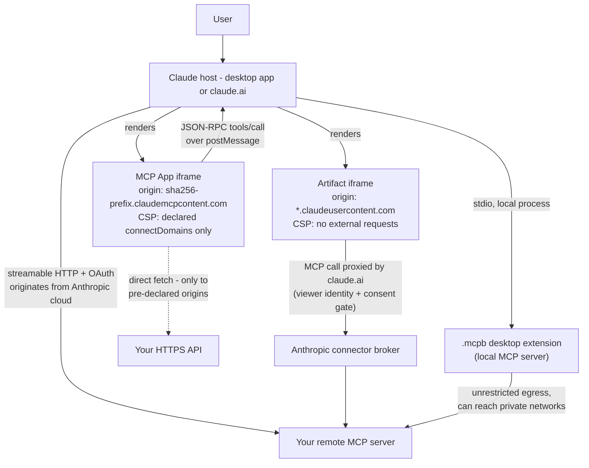
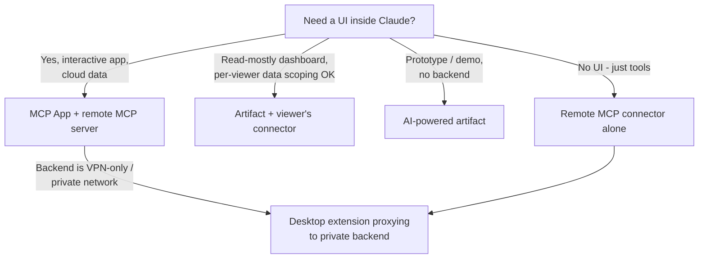
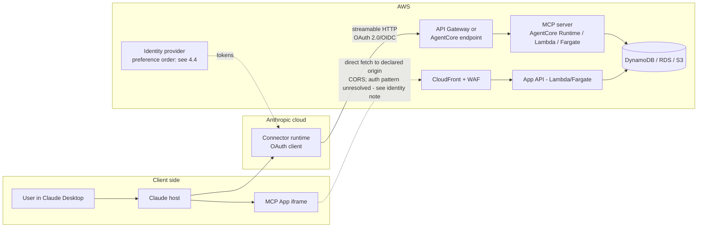

# Building Frontend UIs in the Claude Desktop App and Hosting Them on Cloud Infrastructure

**Status:** complete

**Created:** 2026-08-11

<!-- doc:region name="context" kind="immutable" -->

## Table of Contents

- [Context](#context)
- [Executive Summary](#executive-summary)
  - [TL;DR](#tldr)
- [Temporal Scope](#temporal-scope)
- [1. The Big Picture](#1-the-big-picture)
  - [1.1 The four delivery mechanisms at a glance](#11-the-four-delivery-mechanisms-at-a-glance)
  - [1.2 Delivery architecture inside the Claude desktop app](#12-delivery-architecture-inside-the-claude-desktop-app)
  - [1.3 Choosing a mechanism](#13-choosing-a-mechanism)
- [2. Delivery Mechanisms in Depth](#2-delivery-mechanisms-in-depth)
  - [2.1 MCP Apps: interactive UI from your MCP server](#21-mcp-apps-interactive-ui-from-your-mcp-server)
  - [2.2 Artifacts: host-generated pages](#22-artifacts-host-generated-pages)
  - [2.3 Desktop Extensions: MCP Bundles (.mcpb)](#23-desktop-extensions-mcp-bundles-mcpb)
  - [2.4 Remote MCP custom connectors: transport, auth, limits](#24-remote-mcp-custom-connectors-transport-auth-limits)
- [3. End-to-End Architecture Patterns](#3-end-to-end-architecture-patterns)
- [4. Cloud Hosting: AWS (primary)](#4-cloud-hosting-aws-primary)
  - [4.1 Amazon Bedrock AgentCore Runtime](#41-amazon-bedrock-agentcore-runtime)
  - [4.2 AWS Lambda](#42-aws-lambda)
  - [4.3 Containers: ECS on Fargate, EKS, and the App Runner sunset](#43-containers-ecs-on-fargate-eks-and-the-app-runner-sunset)
  - [4.4 Authentication on AWS: Cognito and the DCR gap](#44-authentication-on-aws-cognito-and-the-dcr-gap)
  - [4.5 Edge, static assets, and CORS](#45-edge-static-assets-and-cors)
  - [4.6 AWS option comparison](#46-aws-option-comparison)
- [5. Cloud Hosting: Google Cloud (GCP)](#5-cloud-hosting-google-cloud-gcp)
  - [5.1 Cloud Run: the GCP default](#51-cloud-run-the-gcp-default)
  - [5.2 Cloud Run functions](#52-cloud-run-functions)
  - [5.3 GKE and GKE Autopilot](#53-gke-and-gke-autopilot)
  - [5.4 Apigee and API Gateway](#54-apigee-and-api-gateway)
  - [5.5 Authentication on GCP](#55-authentication-on-gcp)
  - [5.6 Static assets and Vertex AI](#56-static-assets-and-vertex-ai)
  - [5.7 GCP option comparison](#57-gcp-option-comparison)
- [6. Cloud Hosting: Microsoft Azure](#6-cloud-hosting-microsoft-azure)
  - [6.1 Azure Container Apps: the Azure default](#61-azure-container-apps-the-azure-default)
  - [6.2 Azure Functions](#62-azure-functions)
  - [6.3 Azure API Management](#63-azure-api-management)
  - [6.4 App Service and AKS](#64-app-service-and-aks)
  - [6.5 Authentication on Azure: Entra ID and the DCR gap](#65-authentication-on-azure-entra-id-and-the-dcr-gap)
  - [6.6 Static assets and Microsoft Foundry](#66-static-assets-and-microsoft-foundry)
  - [6.7 Azure option comparison](#67-azure-option-comparison)
- [Comparison](#comparison)
- [Recommendation](#recommendation)
  - [Pre-production validation checklist](#pre-production-validation-checklist)
- [Open Questions](#open-questions)
- [Sources](#sources)
- [Ambiguous Items from Auto-Remediation (Post-Run Review)](#ambiguous-items-from-auto-remediation-post-run-review)
- [Appendix: Research Prompt](#appendix-research-prompt)
- [Appendix: Provenance Ledger](#appendix-provenance-ledger)
- [Run History](#run-history)

## Context

How do you build an application whose frontend UI is delivered inside the Claude desktop app (as an artifact, via MCP, or through a desktop extension), and how do you host that application - or parts of it - on cloud infrastructure? This survey covers the delivery mechanisms Anthropic ships as of mid-2026 and the hosting options on AWS (primary focus), Google Cloud, and Microsoft Azure, ordered by depth in that sequence. It is written to be shareable outside the authoring team: every externally sourced claim carries an inline clickable citation, and it links to no other internal documents.

**Primary period:** 2024-2026
**Source weighting:** 2026 primary, 2025 secondary, pre-2024 background only

<!-- /doc:region name="context" -->

<!-- doc:region name="body" kind="replaceable" -->

## Executive Summary

As of mid-2026 there are two first-class ways to put a real UI in front of a Claude user - **MCP Apps** (interactive, server-supplied iframes standardized as an MCP extension in January 2026 [VERIFIABLE][^1]) and **Artifacts** (host-generated pages [VERIFIABLE][^16], best suited to prototypes and per-viewer dashboards [INFERENCE]) - plus two supporting mechanisms: **Desktop Extensions** (one-click local MCP server installs [VERIFIABLE][^5]) and **remote MCP custom connectors** (registered cloud MCP servers [VERIFIABLE][^4] - the backbone every hosted pattern in this document relies on [INFERENCE]). The recommended production pattern is an MCP App UI backed by a remote MCP server; the strongest hosting defaults for that server - this document's own synthesis, defended in sections 4-6 - are **Amazon Bedrock AgentCore Runtime or Lambda on AWS**, **Cloud Run on GCP**, and **Container Apps on Azure** [HEURISTIC]; each platform's MCP hosting support is documented [VERIFIABLE][^7][^10][^11][^32]. The two constraints that shape every architecture: sandboxes strictly limit what in-app UI can fetch (artifacts cannot reach the network at all [VERIFIABLE][^3]; MCP App iframes reach only pre-declared origins [VERIFIABLE][^2]), and Claude dials remote connectors from Anthropic's cloud, so your endpoint must be internet-reachable [VERIFIABLE][^4], with OAuth as the production-default authorization. Neither AWS's nor Azure's native identity provider implements the Dynamic Client Registration that MCP clients lean on - evidenced by a community implementation report and a Microsoft Q&A answer rather than first-party documentation, because neither vendor documents the absence [VERIFIABLE][^12][^13] (GCP's position is undocumented) - and the cleanest bridge is often pre-registered credentials rather than any registration service (section 4.4). [HEURISTIC]

### TL;DR

1. **Ship interactive apps as MCP Apps, not artifacts.** MCP Apps (spec `SEP-1865`, stable 2026-01-26, live in Claude web and desktop) render your server-supplied HTML in a sandboxed iframe with a JSON-RPC bridge to your MCP server - the only mechanism that combines a full interactive UI with direct, pre-declared network access to your backend (artifacts are interactive too, but can reach the cloud only through viewer-consented proxied connector calls) [VERIFIABLE][^1][^2].
2. **Artifacts cannot call your backend.** Their CSP blocks all external fetch/XHR/WebSocket (documented for published artifacts, inferred for in-conversation ones - see section 2.2); the only network path is MCP connector calls proxied by claude.ai under the viewer's own identity and consent [VERIFIABLE][^3]. Treat artifacts as prototypes and per-viewer dashboards, not applications.
3. **Your cloud endpoint must be public and speak streamable HTTP; OAuth is the production-default auth.** Pre-registered credentials, static request headers, and authless modes exist for constrained internal cases (section 2.4). Claude connects to remote MCP servers from Anthropic's cloud, never from the user's machine - VPN-only backends will not connect [VERIFIABLE][^4]. The desktop-extension escape hatch (local MCP proxying to a private backend) trades that away for desktop-only reach [VERIFIABLE][^4][^5].
4. **On AWS, start with Bedrock AgentCore Runtime or Lambda.** AgentCore Runtime is purpose-built for MCP, prices per second of active consumption, and supports stateful MCP [VERIFIABLE][^6][^7][^8]; Lambda has an official adapter library covering four transport and auth combinations [VERIFIABLE][^32]. Which of the two to reach for first, and the move to ECS on Fargate once connections are long-lived and traffic is sustained, are this document's synthesis, defended in section 4: Lambda is typically the low-cost shape for spiky, idle-heavy traffic, but no published cost model for agent workloads exists, so model your own duty cycle [HEURISTIC]. Do not start on App Runner - it stops accepting new customers 2026-04-30 [VERIFIABLE][^9].
5. **On GCP start with Cloud Run; on Azure start with Container Apps.** Both are documented MCP hosts [VERIFIABLE][^10][^11]. Cloud Run's request timeout defaults to 5 minutes and is configurable up to 60 [VERIFIABLE][^40], with scale-to-zero unless you set minimum instances [VERIFIABLE][^42]; Container Apps scales on KEDA rules including scale-to-zero [VERIFIABLE][^63], and its ingress idle timeout defaults to four minutes, extended to 4-30 minutes only with premium ingress [VERIFIABLE][^65]. Ranking either as its cloud's first choice is this document's synthesis, defended in sections 5 and 6. [HEURISTIC]
6. **Auth is the cross-cloud sore spot.** Claude's connector docs accept OAuth with Dynamic Client Registration, Client ID Metadata Documents, Anthropic-held pre-registered credentials, static headers, or no auth [VERIFIABLE][^55]; Amazon Cognito and Microsoft Entra ID both lack native DCR, with proxy and facade workarounds available [VERIFIABLE][^12][^13]; and DCR itself was deprecated in the July 2026 MCP core spec in favor of CIMD [VERIFIABLE][^14]. Build the auth layer expecting churn. [HEURISTIC]

## Temporal Scope

Primary focus: 2026 and late-2025 sources, because both the delivery surface (MCP Apps became stable in January 2026 [VERIFIABLE][^1]) and the hosting surface (Bedrock AgentCore stateful MCP [VERIFIABLE][^6], the July 2026 stateless MCP core revision [VERIFIABLE][^14], Azure Functions MCP updates at Build 2026 [VERIFIABLE][^67]) changed materially within the last twelve months. Earlier material is cited only where foundational. All cited URLs were fetched and verified accessible on 2026-08-11.

## 1. The Big Picture

"An app inside the Claude desktop app" can mean four different things, and they compose. The naming matters because their capabilities differ sharply.

### 1.1 The four delivery mechanisms at a glance

| Mechanism | What it is | Interactive? | Can reach your cloud? | Where it runs |
|---|---|---|---|---|
| **MCP Apps** | Your MCP server ships HTML views (`ui://` resources) that Claude renders in a sandboxed iframe | Yes - full JS app | Yes: JSON-RPC to your MCP server via the host, plus direct fetch to origins you pre-declare | claude.ai web, Claude Desktop, mobile (WebView) [VERIFIABLE][^1][^15] |
| **Artifacts** | Pages Claude generates in-conversation (React/HTML/SVG/Mermaid) | Yes, but sandboxed harder | Only via claude.ai-proxied MCP connector calls under the viewer's identity; no direct network | claude.ai and desktop app [VERIFIABLE][^3][^16] |
| **Desktop Extensions (.mcpb)** | One-click installable bundle of a local MCP server | n/a (no UI of its own) | Yes - a local process with unrestricted egress; can proxy to private networks | Claude Desktop only [VERIFIABLE][^5] |
| **Remote MCP custom connector** | Your cloud-hosted MCP server registered in Claude settings | n/a (tools/resources; pair with MCP Apps for UI) | It IS your cloud | All surfaces: web, desktop, mobile, Cowork [VERIFIABLE][^4] |

### 1.2 Delivery architecture inside the Claude desktop app

The diagram below shows every UI-bearing path and what each leg is allowed to carry. The dashed line is the one most people get wrong in both directions: MCP App iframes CAN fetch your API directly, but only origins declared in the app's CSP metadata; artifact pages can NEVER fetch anything directly.



Three structural facts drive everything downstream:

1. **Claude's cloud is the caller.** Remote connector traffic originates from Anthropic infrastructure even when the user is on the desktop app, so the MCP endpoint must be internet-reachable [VERIFIABLE][^4].
2. **Sandbox origins are fixed and knowable.** Artifacts render on `*.claudeusercontent.com`; each MCP App gets a per-server subdomain of `claudemcpcontent.com` derived from the first 32 hex characters of `sha256(serverUrl)` - enterprise network allowlists need both [VERIFIABLE][^3][^17].
3. **The model is not available inside your UI.** MCP sampling (borrowing the host's model) is absent from the MCP Apps protocol subset, unsupported by Claude connectors, and deprecated in the July 2026 core spec - if your app needs LLM calls, make them from your own backend [VERIFIABLE][^2][^14][^18].

### 1.3 Choosing a mechanism



- **Default: MCP App + remote MCP server.** The only pattern that combines an interactive UI, direct cloud backing, and per-user authentication, available on Claude web, desktop, and mobile (Cowork support is undocumented). Anthropic's own guidance for products is to build a remote MCP server with OAuth first [VERIFIABLE][^19].
- **Artifact + viewer's connector** suits read-mostly dashboards where per-viewer data scoping is a feature. Hard limit: a connector-backed artifact cannot be shared to a public link on any plan (org-wide on Team/Enterprise only) [VERIFIABLE][^3].
- **Desktop extension** is the escape hatch for private/VPN-only backends, at the cost of desktop-only reach and self-managed distribution [VERIFIABLE][^4][^5].

## 2. Delivery Mechanisms in Depth

### 2.1 MCP Apps: interactive UI from your MCP server

**Status and reach.** The MCP Apps extension (`SEP-1865`, extension id `io.modelcontextprotocol/ui`) became stable on 2026-01-26 and is live in Claude on web and desktop, plus Goose and VS Code Insiders, with OpenAI shipping compatibility in ChatGPT [VERIFIABLE][^1][^2][^20]. The community `mcp-ui` project standardized into it and its client SDK is the recommended host-side implementation [VERIFIABLE][^21].

**Mechanics.** A tool declares `_meta.ui.resourceUri` pointing at a `ui://...` resource whose mimeType must be `text/html;profile=mcp-app`. The host fetches it via `resources/read` and renders it in a sandboxed iframe; the app and host exchange JSON-RPC over `postMessage`. Web hosts must use a double-iframe sandbox proxy on a separate origin [VERIFIABLE][^2].

**What your UI can do.** The app-visible protocol subset includes `tools/call`, `resources/read`, logging, `ui/initialize`, display-mode negotiation (`inline`, `fullscreen`, `pip`), size-change notifications, host-context updates, and `ui/update-model-context` for feeding state back to the conversation. Tool visibility can be scoped `"model"` or `"app"`, and cross-server tool calls are blocked [VERIFIABLE][^2][^15].

**Networking is opt-in and pre-declared.** `_meta.ui.csp` carries `connectDomains`, `resourceDomains`, `frameDomains`, and `baseUriDomains`; the host builds the iframe CSP from these and must not allow anything undeclared. Omit `connectDomains` and the iframe gets `connect-src 'none'` [VERIFIABLE][^2]. Claude currently restricts `frameDomains` pending security review [VERIFIABLE][^15].

**Claude-specific fit and finish.** Claude injects design tokens as CSS custom properties (colors, typography, radii) and requires light and dark support; inline cards must auto-fit height (max two actions), with fullscreen recommended for anything tall - on mobile the UI renders in a native WebView with no camera/mic/location access [VERIFIABLE][^15].

**Build path.** `@modelcontextprotocol/ext-apps` plus the MCP SDK: `registerAppTool` / `registerAppResource` on the server, Vite with `vite-plugin-singlefile` to inline the view into one HTML file, `App.connect()` in the view, `app.callServerTool(...)` for fresh data [VERIFIABLE][^22]. A migration guide exists from the OpenAI Apps SDK, and `registerAppTool` can emit both hosts' metadata from one codebase [VERIFIABLE][^17][^20].

**Security model.** The spec's threat model covers malicious HTML, sandbox escape, unauthorized tool execution, exfiltration, and phishing; mandatory mitigations are sandboxing, pre-declared inspectable templates, auditable JSON-RPC, and CSP enforcement, with acknowledged residual risks (misleading content, resource exhaustion) [VERIFIABLE][^2]. Claude gates first render behind a user permission prompt [VERIFIABLE][^20].

**Watch item - spec drift.** MCP Apps is stamped against the 2026-01-26 protocol era, but the core MCP spec changed hard on 2026-07-28: sessions and the `initialize` handshake were removed in favor of stateless operation, and Sampling, Roots, Logging, HTTP+SSE, and DCR were deprecated [VERIFIABLE][^14]. No post-July-2026 MCP Apps re-baseline was found during this research; verify current compatibility guidance when you build. [INFERENCE]

### 2.2 Artifacts: host-generated pages

**What renders.** Markdown, code, single-page HTML sites, SVG, Mermaid diagrams, and interactive React components, generated by Claude in-conversation [VERIFIABLE][^16].

**The sandbox is airtight for network access - verified for Claude Code / Cowork published artifacts, inferred for conversation artifacts.** The CSP blocks scripts, stylesheets, fonts, and images from any other host, along with fetch, XHR, and WebSocket; Claude inlines CSS/JS and embeds images as data URIs. The documented exception: the page can hand MCP connector calls to claude.ai, which makes the network call itself. Rendered pages are capped at 16 MiB, and Anthropic describes an artifact as "a capture of work, not an application" - no backend, no routes, no form persistence [VERIFIABLE][^3]. That page documents Claude Code / Cowork published artifacts; the support documentation for in-conversation artifacts states no general outbound-fetch policy and frames all external connectivity through MCP connectors [VERIFIABLE][^16]. Because the org toggle governing connector calls is shared across both artifact surfaces, the same CSP shell very likely applies to conversation artifacts as well - but that equivalence is inferred, not documented. [INFERENCE]

**The connector leg is real and per-viewer.** At publish time Claude declares which of your claude.ai-account connectors the page may call. At view time, each call runs through the viewing account's own connection: two viewers see different data, the page never sees credentials, each viewer consents before the first call, and side-effecting actions run as the viewer [VERIFIABLE][^3]. A connector-backed artifact cannot be publicly shared on any plan [VERIFIABLE][^3].

**AI-powered artifacts.** An artifact can embed Claude itself via a limited text-based completion API; the resulting "app" runs on Anthropic infrastructure with no API keys, and each user's usage bills to their own Claude subscription - Anthropic's tutorial frames this as prototyping, with production graduation to your own stack [VERIFIABLE][^16][^23]. The widely blogged `window.claude.complete` identifier appears in no official documentation fetched for this research. [NO SOURCE]

**Storage.** 20 MB per artifact, text-only, isolated per artifact, functional only after publishing; unpublishing permanently deletes storage and the artifact can never be republished [VERIFIABLE][^16][^24].

**Operational prerequisites and enterprise controls.** Artifacts now require the "Code execution and file creation" capability [VERIFIABLE][^24]. Enterprise admins get separate toggles for artifacts and artifact connectors, RBAC scoping, retention policies, audit-log events, and Compliance API endpoints [VERIFIABLE][^3]. Note also that "artifacts" is one name for two products: conversation artifacts (described above) and Claude Code / Cowork "live artifacts" (single HTML/MD page, republish-in-place, Team/Enterprise beta) with different constraints [VERIFIABLE][^16][^25]. Two deployment-blocking exclusions for enterprises: Claude Code / Cowork artifacts require the Anthropic API as the model provider (not Bedrock, Vertex, or Foundry) and are unavailable to organizations under CMEK, HIPAA, or Zero Data Retention agreements [VERIFIABLE][^3].

### 2.3 Desktop Extensions: MCP Bundles (.mcpb)

A `.mcpb` bundle is a ZIP with a `manifest.json`, the server code, and bundled dependencies; server types are `node`, `python`, or `binary`, with Node bundled inside Claude Desktop so users need no runtime. `user_config` declares typed inputs that Claude Desktop renders as a form, storing `sensitive` values in the OS keychain. Tooling is `npx @anthropic-ai/mcpb init` and `mcpb pack`; installation is drag-and-drop [VERIFIABLE][^5]. The format was renamed from `.dxt` in September 2025 and donated to the MCP project in November 2025; old `.dxt` files still load [VERIFIABLE][^5][^26].

Enterprise controls include Windows Group Policy and macOS MDM support, admin pre-installs, publisher and extension blocklists, and the ability to replace the built-in directory with a private one [VERIFIABLE][^5]. Anthropic's docs assert code-signing support, but no fetched source documents the trust model - treat signing details as unverified [VERIFIABLE][^27] [NO SOURCE].

The hosting-relevant use: a local extension has unrestricted egress, so it can proxy to backends that Claude's cloud-originated connectors cannot reach (VPN-only, private VPCs). The cost is desktop-only reach - no web, mobile, or Cowork [VERIFIABLE][^4][^19].

### 2.4 Remote MCP custom connectors: transport, auth, limits

This is the backbone of every hosted pattern, whether or not you add MCP Apps UI on top.

- **Transport:** streamable HTTP is current; HTTP+SSE is supported but deprecated (and formally deprecated in the 2026-07-28 core spec) [VERIFIABLE][^14][^18].
- **Auth:** OAuth per the 2025 MCP auth specs with Dynamic Client Registration; the OAuth callback is `https://claude.ai/api/mcp/auth_callback`; pre-registered credentials are supported for non-DCR servers, and a beta allows up to four allowlisted static request headers (for shared-credential internal tools and gateway routing) [VERIFIABLE][^18][^28]. The July 2026 core spec deprecates DCR in favor of Client ID Metadata Documents, which Claude's connector docs do not yet reflect - build for CIMD with DCR as fallback [VERIFIABLE][^14][^18]. [HEURISTIC]
- **Capabilities:** tools, prompts, resources, text and image tool results; resource subscriptions and sampling are not supported [VERIFIABLE][^18].
- **Limits:** roughly 150,000 characters per tool result and a 300-second timeout on claude.ai and desktop [VERIFIABLE][^18]. Microsoft's field guidance observes MCP clients commonly timing out at 30-60 seconds in practice, well below platform HTTP ceilings - design long operations as start-then-poll [VERIFIABLE][^29].
- **Availability:** all plans (Free limited to one custom connector); on Team/Enterprise only Owners add connectors, then each member connects individually so Claude inherits that user's access [VERIFIABLE][^4].

## 3. End-to-End Architecture Patterns

Ranked by how much real application you can ship:

**Pattern A - MCP App UI + remote MCP server (recommended default).** Full interactive UI with two legs to your cloud: JSON-RPC tool calls brokered by the host, plus direct iframe fetch to pre-declared origins. OAuth identifies each user. Available on Claude web, desktop, and mobile; Cowork support is undocumented. Composed from the verified mechanics in sections 2.1 and 2.4. [INFERENCE]

**Pattern B - Artifact + viewer's connector.** Read-mostly dashboards with per-viewer data scoping; no public sharing, no backend of its own [VERIFIABLE][^3].

**Pattern C - Desktop extension proxying to a private backend.** The private-network escape hatch; desktop-only [VERIFIABLE][^4][^5].

**Pattern D - Artifact making direct API calls.** Not possible; blocked by CSP [VERIFIABLE][^3].

The reference deployment for Pattern A on the primary cloud (AWS) looks like this; sections 4-6 substitute the per-cloud services.



Two cross-cutting implementation notes:

- **Identity hand-off to the iframe.** Nothing in the MCP Apps spec or Claude docs describes credential injection into the iframe. Default to brokering all protected data through MCP tool calls - the already-authenticated path - rather than handing the iframe credentials. If the direct-fetch leg must carry authenticated traffic, treat token delivery as unsolved: a token minted server-side and returned in a tool result may be visible to the model, the conversation history, or logs, and no confidentiality guarantee for tool-result fields is documented. Adopt that pattern only after an end-to-end test proves the channel is not model- or transcript-visible, and then only with audience-bound, short-TTL, one-time tokens. [INFERENCE]
- **Statelessness wins.** The July 2026 MCP revision removed protocol sessions entirely [VERIFIABLE][^14]. Design MCP servers stateless (externalize session state to a store) and every hosting option in sections 4-6 gets simpler and cheaper. [HEURISTIC]

## 4. Cloud Hosting: AWS (primary)

AWS offers the widest spread of MCP-relevant hosting options and the only purpose-built managed MCP runtime among the three clouds. An AWS Builder Center field guide frames the 2026 decision as four paths - purpose-built runtime (AgentCore), serverless (Lambda), containers (ECS/Fargate), and Kubernetes (EKS) [VERIFIABLE][^30].

### 4.1 Amazon Bedrock AgentCore Runtime

The purpose-built option: AgentCore Runtime hosts MCP servers as managed, container-based runtimes in isolated microVMs with per-session resources [VERIFIABLE][^6][^7]. Key facts:

- **Stateful MCP support** (announced 2026-03-10) adds elicitation, sampling, and progress notifications with per-session context, across fourteen regions [VERIFIABLE][^6]. Note the tension with the stateless direction of the July 2026 core spec; stateful features target long-lived agent sessions rather than simple connectors. [INFERENCE]
- **Contract:** your container serves MCP at `0.0.0.0:8000/mcp`; both x86_64 and ARM64 are supported [VERIFIABLE][^7][^31].
- **Pricing** is consumption-based with no upfront fees. MicroVMs bill actual CPU at $0.0895 per vCPU-hour plus peak memory at $0.00945 per GB-hour, 1-second minimum, 128 MB memory minimum - and idle/I-O wait CPU time is free. AWS's own worked example lands at $0.0007235 per 60-second customer-support session. An EC2-backed Instances mode (persistent sessions up to 14 days, GPUs) bills the instance plus a management fee - 12% in AWS's own worked example, reduced to 7.8% for G-series GPU families [VERIFIABLE][^8].
- **Identity:** IAM integration plus OAuth flows for user-facing auth [VERIFIABLE][^7].

When to use: agentic or session-heavy workloads already near Bedrock, teams that want MCP-native managed infrastructure, or anyone who wants per-second consumption pricing without owning scaling. It is also the newest option of the four; maturity evidence is thinner than for Lambda or ECS. [INFERENCE]

### 4.2 AWS Lambda

The serverless option, and usually the cost-efficient shape for spiky, idle-heavy agent traffic - a conditional heuristic, not a universal: no published cost model for agent workloads exists (see Open Questions), so model your own duty cycle:

- **Official adapter library.** `awslabs/run-model-context-protocol-servers-with-aws-lambda` (Python and TypeScript) wraps existing stdio MCP servers in Lambda functions; each invocation spawns the server, forwards the request, and shuts it down. Four documented transport/auth combinations: streamable HTTP via API Gateway (OAuth, with Cognito examples), streamable HTTP via Bedrock AgentCore Gateway (OAuth), Lambda function URL with a custom SigV4-signing transport (IAM), and direct Invoke API (IAM). The two IAM options need non-standard client transports, so they suit service-to-service use, not Claude end users [VERIFIABLE][^32].
- **Streaming and the 29-second myth.** API Gateway REST APIs now support a `STREAM` response transfer mode: streams up to 15 minutes, idle timeout 5 minutes (regional/private; 30 seconds edge-optimized), first 10 MB unthrottled then 2 MB/s, explicitly positioned for SSE and for exceeding the legacy 29-second integration timeout. Caching, content encoding, and VTL transformation are disabled in STREAM mode [VERIFIABLE][^33]. Lambda's own response streaming (Function URLs in `RESPONSE_STREAM` mode, or the Lambda Web Adapter for FastAPI/Express-style apps) raises the response cap to 200 MB [VERIFIABLE][^32][^33]; the Lambda Web Adapter detail is a widely documented pattern with no single canonical source. [HEURISTIC]
- **Statelessness fits.** The library keeps no state between invocations, which matches the July 2026 stateless MCP revision; community tooling such as the production-grade AWS Lambda MCP cookbook (Lambda Web Adapter + MCP Python SDK v2, updated July 2026 for the v2 spec) follows the same shape [VERIFIABLE][^32][^34].
- **Cold starts** are the price: a few hundred milliseconds for optimized Python/Node deployments, worse for container images; SnapStart and provisioned concurrency mitigate. [HEURISTIC]
- **Function URLs vs API Gateway:** function URLs are free and lower-latency but support only IAM-or-nothing auth and no WAF or custom domain without CloudFront; API Gateway adds OAuth/JWT authorizers, throttling, usage plans, and WAF at $1.00-$3.50 per million requests. [HEURISTIC]

### 4.3 Containers: ECS on Fargate, EKS, and the App Runner sunset

For long-lived, warm, or connection-heavy MCP servers:

- **ECS on Fargate** is the mainstream container route. For streaming transports, load balancer behavior is the design center: ALB idle timeout defaults to 60 seconds (configurable 1-4000 seconds), and stateful sessions over SSE need cookie-based sticky sessions so consecutive requests hit the task holding the session; NLB's TCP-level pass-through avoids HTTP-layer buffering. Tasks are ephemeral - externalize state to EFS, a database, or a cache. This paragraph is assembled from standard, individually documented AWS load-balancer and ECS behaviors. [HEURISTIC]
- **Fargate pricing** is per-vCPU-hour and per-GB-hour, which beats Lambda for sustained high-utilization traffic and loses to it for spiky, mostly idle agent traffic - model your actual duty cycle rather than trusting either generalization. [HEURISTIC]
- **AWS's own reference architecture** for enterprise MCP hosting ("Deploying Model Context Protocol Servers on AWS") combines CloudFront, WAF, OAuth, ECS/Fargate plus Lambda, Secrets Manager, and DynamoDB for session/token management. The AWS Solutions page was reported by a research worker and not independently re-verified; locate it via the AWS Solutions Library before relying on specifics. [NO SOURCE]
- **EKS** suits organizations already operating Kubernetes; AWS also ships a fully managed EKS MCP server (preview, late 2025) for cluster operations with SigV4 auth and CloudTrail logging - note that is AWS's own operational tool, distinct from you hosting a custom MCP server on an EKS cluster [VERIFIABLE][^35].
- **App Runner is closed to new customers from 2026-04-30**; AWS recommends ECS Express Mode instead. Do not start new MCP hosting on it [VERIFIABLE][^9].
- **AWS's managed MCP estate** is also worth knowing before you build custom: the AWS MCP Server went GA in May 2026 (15,000+ AWS APIs behind IAM guardrails, no charge beyond consumed resources), and the `awslabs/mcp` project ships 50+ service-specific servers - with a stated successor, "Agent Toolkit for AWS", signaling churn in that estate [VERIFIABLE][^36][^37].

### 4.4 Authentication on AWS: Cognito and the DCR gap

Amazon Cognito supports OAuth 2.0 / OIDC authorization-code flows (OAuth 2.1 conformance is not established by first-party documentation) but has no native RFC 7591 Dynamic Client Registration endpoint and no RFC 8414 authorization-server metadata endpoint - both of which MCP's 2025 auth specs lean on [VERIFIABLE][^12]. A community reference pattern - not first-party guidance and not a security-reviewed architecture - keeps Cognito as the actual authorization server and fronts it with lightweight API Gateway proxy endpoints that serve the metadata and DCR responses MCP clients expect, with your MCP server acting as an RFC 9728 protected resource [VERIFIABLE][^12][^38]. Prefer, in order: (1) Anthropic-held pre-registered credentials, supported by Claude connectors, which avoid operating any public registration surface [VERIFIABLE][^18]; (2) an authorization server with native DCR / Client ID Metadata Document support; (3) a hardened custom facade only with a formal threat model and security review covering registration policy, redirect validation, PKCE, secret handling, and rate limiting. The DCR-to-CIMD transition in the July 2026 spec means whatever you build here should be thin and replaceable [VERIFIABLE][^14]. [HEURISTIC]

### 4.5 Edge, static assets, and CORS

For app surfaces outside the desktop app (landing pages, OAuth consent UX, admin consoles) and for assets an MCP App iframe fetches directly:

- **S3 + CloudFront** is the standard static stack. For iframe-origin fetches, CORS must be configured on the bucket and CloudFront must forward the `Origin` header (or attach a response-headers policy adding CORS at the edge); a response cached without CORS headers will poison subsequent cross-origin requests until invalidated. Standard AWS behavior. [HEURISTIC]
- **WAF** in front of CloudFront/API Gateway is the right place for DDoS and bot mitigation on public MCP endpoints. [HEURISTIC]
- Remember the two Claude sandbox origins from section 1.2 when writing CORS allowlists: the MCP App origin is a per-server sha256-prefixed subdomain of `claudemcpcontent.com` [VERIFIABLE][^17].

### 4.6 AWS option comparison

| Criterion | AgentCore Runtime | Lambda (+API GW) | ECS on Fargate | EKS |
|---|---|---|---|---|
| Pricing shape | Per-second active CPU + peak memory; $0.0007235 worked session example [VERIFIABLE][^8] | Per-request + GB-second; API GW $1.00-$3.50/M req [HEURISTIC] | Per vCPU-hour + GB-hour, always-on [HEURISTIC] | Cluster fee + nodes [HEURISTIC] |
| Cold start | Managed microVMs minimal [INFERENCE] | 200-800 ms optimized, worse for containers [HEURISTIC] | None (warm tasks) | None (warm pods) |
| Streaming | Native MCP incl. stateful sessions [VERIFIABLE][^6] | STREAM mode 15 min / 5 min idle [VERIFIABLE][^33] | ALB/NLB, config-dependent | Ingress-dependent |
| MCP fit | Purpose-built [VERIFIABLE][^7] | Official adapter library [VERIFIABLE][^32] | DIY container | DIY container |
| Ops burden | Lowest | Low | Moderate | High |
| Maturity | Newest [INFERENCE] | High | High | High |

## 5. Cloud Hosting: Google Cloud (GCP)

### 5.1 Cloud Run: the GCP default

Google documents Cloud Run as a direct host for MCP servers over streamable HTTP (stdio is local-only) [VERIFIABLE][^10]; streamable HTTP replaced the older HTTP+SSE transport in the 2025 MCP spec, though it may still deliver messages via SSE within a request [VERIFIABLE][^39].

- **Timeouts:** request timeout defaults to 5 minutes, configurable up to 60 minutes - the most generous synchronous ceiling among the three clouds' serverless tiers. A timeout returns HTTP 504; Google recommends resumable or idempotent handling past 15 minutes [VERIFIABLE][^40]. Long tool operations should still return a job handle and poll. [INFERENCE]
- **Concurrency and state:** per-instance concurrency is configurable up to 1,000 requests [VERIFIABLE][^41]; scale-out means consecutive requests can land on different instances, so session state must live in external storage or stateless tokens. [INFERENCE]
- **Cold starts and cost:** scale-to-zero introduces cold starts; minimum instances keep containers warm at idle cost [VERIFIABLE][^42]. Pricing is usage-based across CPU, memory, requests, and network, with request-based and instance-based billing options [VERIFIABLE][^43]. No official cold-start latency guarantee is published. [NO SOURCE]

### 5.2 Cloud Run functions

Suitable for narrow HTTP tools, webhooks, and event adapters: second-generation HTTP functions run up to 60 minutes and Google ships an official HTTP response-streaming sample [VERIFIABLE][^44][^45]. Pricing follows the Cloud Run model [VERIFIABLE][^46]. Once a server needs routing, middleware, multiple tools, or connection management, a containerized Cloud Run service is the better shape. [INFERENCE]

### 5.3 GKE and GKE Autopilot

Autopilot manages nodes, scaling, and patching while billing per Pod-requested resources; GKE supports StatefulSets, stable Pod identities, and persistent volumes [VERIFIABLE][^47][^48]. Choose it for MCP servers needing continuously warm replicas, sidecars, custom networking, or Kubernetes-native controls; connection lifetimes then depend on your ingress choice, not a platform request ceiling. [INFERENCE] Pricing combines a cluster management fee with compute/storage; operational burden is materially higher than Cloud Run [VERIFIABLE][^49]. [INFERENCE]

### 5.4 Apigee and API Gateway

- **Apigee** has a managed MCP capability: it exposes existing APIs as MCP tools with discovery through API Hub and centralized security/governance/analytics policies [VERIFIABLE][^50]. Its pay-as-you-go model includes standing charges for active environments, which is hard to justify for a single small connector [VERIFIABLE][^51]. [INFERENCE] The reviewed documentation does not state streamable HTTP/SSE timeout behavior or Claude-connector interoperability - test end-to-end before making Apigee the Claude-facing edge. [NO SOURCE]
- **Google Cloud API Gateway** explicitly does not support streaming, which disqualifies it as a direct MCP edge; it remains useful for ordinary REST backends behind your MCP server [VERIFIABLE][^52]. Pricing is per-call plus data transfer [VERIFIABLE][^53].

### 5.5 Authentication on GCP

Cloud Run's native IAM auth (invoker roles, Google-signed OIDC ID tokens) covers service-to-service calls but is not what Claude speaks [VERIFIABLE][^54]. Claude connectors document OAuth via DCR, Client ID Metadata Documents, Anthropic-held credentials, static headers, or no auth - not Google ID tokens - so a Claude-facing endpoint needs application-level OAuth at an internet-reachable Cloud Run URL, with IAM retained behind that edge for internal calls [VERIFIABLE][^55]. [INFERENCE] Google recommends Identity Platform / Firebase Auth for end users and IAP primarily for internal users; no source establishes turnkey compatibility between either and Claude's connector OAuth - treat as an integration-test item [VERIFIABLE][^56]. [NO SOURCE]

### 5.6 Static assets and Vertex AI

- **Firebase Hosting** serves CDN-backed static content and can rewrite paths to Cloud Run - the simplest companion-surface option (docs, OAuth callback pages) [VERIFIABLE][^57]. Keep the MCP endpoint on its own hostname so CDN caching cannot interfere with streaming or auth. [HEURISTIC]
- **Cloud Storage + external ALB + Cloud CDN** offers more control (custom domains with HTTPS require the load balancer) at more assembly cost [VERIFIABLE][^58][^59].
- **Vertex AI:** Anthropic Claude models are available as managed partner models in Model Garden (pay-as-you-go or provisioned throughput), which matters when your backend should keep model inference inside your Google Cloud boundary; Vertex AI Agent Engine is an agent runtime, not a substitute for a Claude-reachable MCP endpoint [VERIFIABLE][^60][^61].

### 5.7 GCP option comparison

| Criterion | Cloud Run | Cloud Run functions | GKE Autopilot | Apigee (MCP edge) |
|---|---|---|---|---|
| Pricing shape | CPU + memory + requests, scale-to-zero [VERIFIABLE][^43] | Pay-as-you-go executions [VERIFIABLE][^46] | Pod-requested resources + cluster fee [VERIFIABLE][^49] | Standing environment + per-call [VERIFIABLE][^51] |
| Cold start | Yes unless min instances [VERIFIABLE][^42] | Yes [HEURISTIC] | Pod/node startup, not per-request | n/a (gateway) |
| Streaming / timeout | Streamable HTTP; up to 60 min [VERIFIABLE][^10][^40] | Streaming sample; 60 min gen-2 [VERIFIABLE][^44][^45] | Ingress-dependent [INFERENCE] | Undocumented for MCP [NO SOURCE] |
| MCP fit | Documented MCP host [VERIFIABLE][^10] | Single tools | DIY | Managed MCP governance [VERIFIABLE][^50] |
| Ops burden | Low | Very low | Medium-high | Medium |

## 6. Cloud Hosting: Microsoft Azure

### 6.1 Azure Container Apps: the Azure default

Container Apps officially supports standalone containerized MCP servers (its "dynamic sessions" feature targets sandboxed code execution, a different use case) [VERIFIABLE][^11]. Ingress supports HTTP/1.1, HTTP/2, WebSockets, gRPC, TLS, CORS, and session affinity, so the container can implement streamable HTTP or legacy SSE itself [VERIFIABLE][^62]. KEDA-based rules scale on HTTP concurrency, TCP connections, queues, or custom metrics, including scale-to-zero; consumption pricing meters vCPU-seconds, GiB-seconds, and requests [VERIFIABLE][^63][^64]. Two operational traps:

- **Default ingress idle timeout is four minutes.** Premium ingress extends request idle timeout to 4-30 minutes and termination grace up to 3,600 seconds, but requires a dedicated workload profile with at least two nodes [VERIFIABLE][^65].
- **Scale-to-zero vs interactivity:** an interactive Claude connector should keep one minimum replica to avoid image-pull cold starts. [HEURISTIC]

### 6.2 Azure Functions

The Functions MCP extension expanded substantially in the Build 2026 release - tools, resources, prompts, MCP Apps support, Entra authentication, and On-Behalf-Of access - but no explicit GA statement was found, and the separate self-hosted MCP SDK hosting path is explicitly public preview [VERIFIABLE][^66][^67]. [NO SOURCE]

Flex Consumption offers per-function scaling to 1,000 instances and configurable execution timeout to 30 minutes, but HTTP-triggered responses face an approximately 230-second platform limit; billing combines executions and provisioned-memory time, with always-ready instances reducing cold starts at a baseline cost [VERIFIABLE][^68][^69]. Microsoft's own guidance for long-running MCP tools is Durable Functions with an async handle-and-poll pattern, observing that MCP clients commonly time out at 30-60 seconds regardless of platform ceilings [VERIFIABLE][^29]. Use Functions for bounded, stateless tools; do not put a multi-minute workflow behind one synchronous MCP call. [HEURISTIC]

### 6.3 Azure API Management

APIM can proxy and govern an existing MCP server, or expose selected REST API operations as MCP tools; it currently supports tools only (no MCP resources/prompts), and the MCP capability is unavailable on the Consumption tier - so MCP gateway pricing starts at provisioned capacity [VERIFIABLE][^70][^71]. Inbound security supports subscription keys and Entra-issued OAuth validated in policy [VERIFIABLE][^72]. For SSE: use classic or v2 tiers, disable response buffering, avoid response-body logging, and keep connections alive around the four-minute idle timeout; `forward-request` timeouts above 240 seconds may not be honored [VERIFIABLE][^73][^74]. APIM is the gateway, never the compute - the server still runs on Functions, Container Apps, App Service, or AKS. [INFERENCE] Credential Manager handles APIM-to-backend OAuth tokens; it does not give Entra inbound DCR [VERIFIABLE][^75]. [INFERENCE]

### 6.4 App Service and AKS

- **App Service** ships a preview built-in MCP capability that converts OpenAPI 3.0.x operations into streamable HTTP MCP tools without code changes, integrating with App Service Authentication; it requires Basic or higher dedicated tiers [VERIFIABLE][^76]. Always-allocated instances avoid cold starts; the ~230-second request timeout still applies, so it is no route around long synchronous calls [VERIFIABLE][^77].
- **AKS** offers maximum control (ingress, session routing, sidecars, workload identity); Microsoft also documents its own AKS MCP server for cluster operations [VERIFIABLE][^78]. A dedicated cluster for one MCP server is operationally unjustified; use AKS when you already run Kubernetes. [HEURISTIC]

### 6.5 Authentication on Azure: Entra ID and the DCR gap

Claude supports OAuth DCR, Client ID Metadata Documents, Anthropic-held credentials, static headers, and authless servers [VERIFIABLE][^55]; Microsoft Entra ID does not implement RFC 7591 DCR and has published no roadmap commitment to add it [VERIFIABLE][^13]. The cleanest workaround is a pre-registered Entra app whose credentials Anthropic holds, with Claude's callback URL registered in Entra; an OAuth facade or APIM-based broker can present MCP-compatible discovery/registration over a fixed Entra registration, at the cost of owning security-sensitive identity infrastructure. [INFERENCE] Do not assume CIMD solves Entra compatibility without testing - Entra's token endpoint still expects its own registered client identifiers. [INFERENCE]

### 6.6 Static assets and Microsoft Foundry

- **Azure Static Web Apps** (Free/Standard, managed TLS, auth, API integration) fits companion portals; Blob static websites are cheaper but have no authorization or custom response headers - put Azure Front Door in front for edge caching, WAF, or custom headers, and avoid classic Azure CDN, which retires 2027-09-30 [VERIFIABLE][^79][^80][^81].
- **Microsoft Foundry** offers Claude models (Anthropic-hosted or Azure-hosted end to end), and Foundry Agent Service can consume remote MCP tools - relevant only if you add an Azure-resident agent or need Azure-hosted Claude inference; a Claude Desktop connector calls your MCP server directly without Foundry [VERIFIABLE][^82][^83]. [INFERENCE]

### 6.7 Azure option comparison

| Criterion | Container Apps | Functions (Flex) | APIM (gateway) | App Service |
|---|---|---|---|---|
| Pricing shape | vCPU-s + GiB-s + requests; scale-to-zero [VERIFIABLE][^64] | Executions + memory-time; always-ready optional [VERIFIABLE][^69] | Provisioned capacity (MCP excluded from Consumption) [VERIFIABLE][^71] | Allocated instances, always warm [HEURISTIC] |
| Cold start | On zero-scale; keep 1 replica [HEURISTIC] | On zero-scale; always-ready mitigates [VERIFIABLE][^68] | n/a | None |
| Streaming / timeout | SDK-controlled; default 4 min idle, premium 4-30 min [VERIFIABLE][^65] | ~230 s HTTP response limit [VERIFIABLE][^68] | SSE with buffering disabled; 4-min keepalive concern [VERIFIABLE][^73] | ~230 s limit [VERIFIABLE][^77] |
| MCP fit | Documented MCP host [VERIFIABLE][^11] | MCP extension (GA unclear) [VERIFIABLE][^66] | Expose/govern MCP, tools only [VERIFIABLE][^70][^71] | Built-in OpenAPI-to-MCP preview [VERIFIABLE][^76] |
| Ops burden | Low-medium | Low | Medium | Low-medium |

## Comparison

**Decision prerequisites first.** The per-cloud defaults in this document are generic starting points, not production selections. Before committing, fix: target regions and data residency; SLA, recovery time, and recovery point objectives; tolerance for preview-status services (several MCP features on Azure are preview); expected concurrency and duty cycle; egress volume; tenancy and compliance constraints (including the CMEK / HIPAA / Zero Data Retention exclusions in section 2.2); and the platform skills your team already has. Both the GCP and Azure research passes flagged explicitly that no region or multi-region topology can be selected responsibly without these inputs. [HEURISTIC]

Cross-cloud, for the recommended pattern (MCP App UI + remote MCP server):

| # | Criterion | AWS | GCP | Azure |
|---|-----------|-----|-----|-------|
| 1 | Purpose-built MCP runtime | Yes - Bedrock AgentCore Runtime, incl. stateful MCP [VERIFIABLE][^6][^7] | No (Cloud Run is general-purpose, MCP-documented) [VERIFIABLE][^10] | No (Container Apps general-purpose, MCP-documented) [VERIFIABLE][^11] |
| 2 | Serverless default | Lambda + adapter library [VERIFIABLE][^32] | Cloud Run [VERIFIABLE][^10] | Container Apps [VERIFIABLE][^11] |
| 3 | Platform HTTP stream ceiling | 15 min (API GW STREAM) [VERIFIABLE][^33] | 60 min (Cloud Run) [VERIFIABLE][^40] | 4-30 min (premium ingress); ~230 s on Functions/App Service HTTP [VERIFIABLE][^65][^68][^77] |
| 4 | Native IdP DCR support | No (Cognito; proxy workaround) [VERIFIABLE][^12] | No (integration-test item) [NO SOURCE] | No (Entra; facade workaround) [VERIFIABLE][^13] |
| 5 | MCP-aware API gateway | AgentCore Gateway; API GW generic [VERIFIABLE][^32] | Apigee MCP (governance) [VERIFIABLE][^50] | APIM MCP export/governance (tools only) [VERIFIABLE][^70][^71] |
| 6 | Claude model colocation | Amazon Bedrock [HEURISTIC] | Vertex AI Model Garden [VERIFIABLE][^60] | Microsoft Foundry [VERIFIABLE][^82] |
| 7 | Watch items | App Runner sunset 2026-04-30 [VERIFIABLE][^9]; AgentCore is newest [INFERENCE] | API Gateway cannot stream [VERIFIABLE][^52] | Functions MCP GA status unclear [NO SOURCE]; 4-min default ingress idle timeout [VERIFIABLE][^65] |

The platform ceilings in row 3 are not what a Claude user experiences: Claude's documented connector cap is 300 seconds and Microsoft observes real MCP clients giving up at 30-60 seconds, so on every cloud a long operation must return a handle and poll rather than hold the connection [VERIFIABLE][^18][^29].

## Recommendation

1. **Build the UI as an MCP App backed by a remote MCP server** (Pattern A). It is the pattern that combines an interactive UI, direct cloud backing, and per-user authentication, and it is available on Claude web, desktop, and mobile. Use artifacts for prototypes and per-viewer dashboards; use a desktop extension only when the backend cannot be made internet-reachable.
2. **On AWS (primary): start with Bedrock AgentCore Runtime if you want managed MCP-native infrastructure, or Lambda + the official adapter library if your traffic is spiky and idle-heavy (verify against your own duty-cycle cost model)** [VERIFIABLE][^7][^8][^32]. Move to ECS on Fargate when connections are long-lived and traffic is sustained. Front public endpoints with CloudFront + WAF; for user auth follow the preference order in section 4.4 (pre-registered credentials first; the community Cognito DCR proxy pattern only with security review) [VERIFIABLE][^12][^38].
3. **On GCP: Cloud Run**, with the 60-minute request ceiling and documented MCP hosting support [VERIFIABLE][^10][^40]; add Apigee only for enterprise API-governance needs [VERIFIABLE][^50].
4. **On Azure: Container Apps**, with premium ingress if sessions exceed four minutes [VERIFIABLE][^11][^65]; Functions for bounded stateless tools [VERIFIABLE][^66]; APIM where governance justifies provisioned-tier cost [VERIFIABLE][^71].
5. **Design stateless and async-first everywhere.** The July 2026 MCP revision removed protocol sessions [VERIFIABLE][^14], real MCP clients time out in 30-60 seconds [VERIFIABLE][^29], and every cloud's cheapest tier rewards statelessness. Long operations return a handle and poll.
6. **Treat the auth layer as churn-prone.** Follow the same preference order everywhere - Anthropic-held pre-registered credentials first, an identity provider with native DCR/CIMD second, a thin security-reviewed facade last; the ordering is this document's recommendation (section 4.4). [HEURISTIC] Expect to swap DCR for Client ID Metadata Documents as the ecosystem follows the 2026-07-28 spec [VERIFIABLE][^14].

### Pre-production validation checklist

The interoperability gaps this research could not close from documentation must be closed by testing. Before shipping, validate end to end, on the exact production path:

- Each Claude surface you target (web, desktop, mobile; Cowork if it matters to you), on the plan tier your users hold.
- Your chosen auth mode (OAuth DCR, CIMD, pre-registered credentials, or static headers) against your actual identity provider, including token refresh and re-consent.
- Streamable HTTP behavior through every intermediary in the path (gateway, CDN, load balancer): buffering, idle timeouts, reconnect behavior.
- Operations at 30 s, 60 s, and 300 s duration - confirm the handle-and-poll path engages before real clients give up.
- MCP App CSP: every declared origin reachable, every undeclared origin blocked; CORS on the declared-origin API.
- Token exposure: confirm nothing sensitive lands in model-visible tool results, transcripts, or logs.
- Duplicate-delivery behavior: retries after a timeout must be idempotent.

## Open Questions

1. Whether the MCP Apps extension will be re-baselined against the 2026-07-28 stateless core revision, and on what timeline - its protocol subset still names methods the core spec removed [VERIFIABLE][^2][^14].
2. Whether an MCP App iframe's declared-origin fetches can carry any host-mediated user identity, or whether short-lived tokens minted server-side remain the only viable pattern. [NO SOURCE]
3. MCP Apps availability by Claude plan tier - no plan gate is documented in the announcement or the Claude docs. [NO SOURCE]
4. Claude's authoritative connector timeout, retry, reconnection, and session-affinity behavior beyond the documented 300-second cap - needed for sizing idle timeouts on ALB/Container Apps ingress. [NO SOURCE]
5. GA status and binding-level streamable HTTP guarantees for the Azure Functions MCP extension. [NO SOURCE]
6. Apigee's MCP streaming/timeout behavior and Claude-connector interoperability, which its documentation does not yet state. [NO SOURCE]
7. Cost models for bursty agent traffic (the Lambda-vs-Fargate breakeven assumes steady utilization; agent workloads are spiky and idle-heavy). [NO SOURCE]

## Sources
[^1]: Model Context Protocol. (2026, January 26). [Introducing MCP Apps](https://blog.modelcontextprotocol.io/posts/2026-01-26-mcp-apps/). MCP Blog. Verified accessible (HTTP 200) 2026-08-11. (Stable release, host adoption list.)
[^2]: Model Context Protocol. (2026). [MCP Apps specification, revision 2026-01-26, SEP-1865](https://github.com/modelcontextprotocol/ext-apps/blob/main/specification/2026-01-26/apps.mdx). GitHub. Verified accessible (HTTP 200) 2026-08-11. (Mechanics, protocol subset, CSP metadata, threat model.)
[^3]: Anthropic. (2026). [Share session output as artifacts](https://code.claude.com/docs/en/artifacts). Claude Code Docs. Verified accessible (HTTP 200) 2026-08-11. (Artifact CSP and page constraints, connector-call semantics, sharing limits, enterprise controls.)
[^4]: Anthropic. (2026). [Get started with custom connectors using remote MCP](https://support.claude.com/en/articles/11175166-get-started-with-custom-connectors-using-remote-mcp). Claude Help Center. Verified accessible (HTTP 200) 2026-08-11. (Anthropic-cloud origination, plan availability.)
[^5]: Anthropic. (2025, June 26; updated 2025-09-11). [Desktop Extensions: One-click MCP server installation](https://www.anthropic.com/engineering/desktop-extensions). Anthropic Engineering. Verified accessible (HTTP 200) 2026-08-11. (MCPB bundle format, user_config, keychain, enterprise controls, .dxt rename.)
[^6]: AWS. (2026, March 10). [Amazon Bedrock AgentCore Runtime adds stateful MCP support](https://aws.amazon.com/about-aws/whats-new/2026/03/amazon-bedrock-agentcore-runtime-stateful-mcp/). AWS What's New. Verified accessible (HTTP 200) 2026-08-11.
[^7]: AWS. (2026). [Deploy MCP servers in AgentCore Runtime](https://docs.aws.amazon.com/bedrock-agentcore/latest/devguide/runtime-mcp.html). AWS Documentation. Verified accessible (HTTP 200) 2026-08-11. (Endpoint contract, session model, identity.)
[^8]: AWS. (2026). [Amazon Bedrock AgentCore pricing](https://aws.amazon.com/bedrock/agentcore/pricing/). AWS. Verified accessible (HTTP 200) 2026-08-11. (MicroVM rates, worked session example, Instances management fee.)
[^9]: AWS. (2026). [AWS App Runner](https://aws.amazon.com/apprunner/). AWS. Verified accessible (HTTP 200) 2026-08-11. (End-of-support notice: no new customers from 2026-04-30; ECS Express Mode recommendation.)
[^10]: Google Cloud. (2026). [Host MCP servers on Cloud Run](https://docs.cloud.google.com/run/docs/host-mcp-servers). Google Cloud Documentation. Verified accessible (HTTP 200) 2026-08-11.
[^11]: Microsoft. (2026). [Model Context Protocol in Azure Container Apps](https://learn.microsoft.com/en-us/azure/container-apps/mcp-overview). Microsoft Learn. Verified accessible (HTTP 200) 2026-08-11.
[^12]: empires-security. (2025). [mcp-oauth2-aws-cognito](https://github.com/empires-security/mcp-oauth2-aws-cognito). GitHub. Verified accessible (HTTP 200) 2026-08-11. (Cognito DCR gap and API Gateway proxy implementation.)
[^13]: Microsoft. (2025). [Does Entra ID have a plan to introduce dynamic client registration?](https://learn.microsoft.com/en-us/answers/questions/5516363/does-entraid-has-a-plan-to-introduce-dynamic-clien). Microsoft Q&A. Verified accessible 2026-08-11 (HTTP status not recorded at retrieval).
[^14]: Model Context Protocol. (2026). [Key changes, specification revision 2026-07-28](https://modelcontextprotocol.io/specification/2026-07-28/changelog). Verified accessible (HTTP 200) 2026-08-11. (Stateless core, deprecation of Sampling/Roots/Logging/HTTP+SSE/DCR, CIMD.)
[^15]: Anthropic. (2026). [MCP Apps design guidelines](https://claude.com/docs/connectors/building/mcp-apps/design-guidelines). Claude Docs. Verified accessible (HTTP 200) 2026-08-11. (Display modes, design tokens, mobile WebView, frameDomains restriction.)
[^16]: Anthropic. (2026). [What are Artifacts and how do I use them?](https://support.claude.com/en/articles/9487310-what-are-artifacts-and-how-do-i-use-them) Claude Help Center. Verified accessible (HTTP 200) 2026-08-11. (Artifact types, MCP access, storage, AI-feature billing.)
[^17]: Anthropic. (2026). [Building cross-platform MCP Apps](https://claude.com/docs/connectors/building/mcp-apps/cross-compatibility). Claude Docs. Verified accessible (HTTP 200) 2026-08-11. (claudemcpcontent.com domain derivation, OpenAI Apps SDK migration.)
[^18]: Anthropic. (2026). [Building custom connectors](https://claude.com/docs/connectors/building). Claude Docs. Verified accessible (HTTP 200) 2026-08-11. (Transports, auth specs, capability and limits tables.)
[^19]: Anthropic. (2026). [What should I build: MCP, plugin, or both?](https://claude.com/docs/connectors/building/what-to-build) Claude Docs. Verified accessible (HTTP 200) 2026-08-11.
[^20]: Anthropic. (2026). [Get started with MCP Apps](https://claude.com/docs/connectors/building/mcp-apps/getting-started). Claude Docs. Verified accessible (HTTP 200) 2026-08-11.
[^21]: Salomon, I. (2026). [MCP-UI](https://mcpui.dev/). Verified accessible (HTTP 200) 2026-08-11. (Standardization into MCP Apps; recommended client SDK.)
[^22]: Model Context Protocol. (2026). [MCP Apps SDK Quickstart](https://apps.extensions.modelcontextprotocol.io/api/documents/Quickstart.html). Verified accessible (HTTP 200) 2026-08-11.
[^23]: Anthropic. (2026). [Prototype AI-powered apps with Claude Artifacts](https://claude.com/resources/tutorials/prototype-ai-powered-apps-with-claude-artifacts). Claude Resources. Verified accessible (HTTP 200) 2026-08-11.
[^24]: Anthropic. (2026). [Publish and share Artifacts](https://support.claude.com/en/articles/9547008-publish-and-share-artifacts). Claude Help Center. Verified accessible (HTTP 200) 2026-08-11.
[^25]: Anthropic. (2026, June 18). [Artifacts in Claude Code](https://claude.com/blog/artifacts-in-claude-code). Claude Blog. Verified accessible (HTTP 200) 2026-08-11.
[^26]: Model Context Protocol. (2025, November 20). [Adopting MCPB](https://blog.modelcontextprotocol.io/posts/2025-11-20-adopting-mcpb/). MCP Blog. Verified accessible (HTTP 200) 2026-08-11.
[^27]: Anthropic. (2026). [Desktop extensions](https://claude.com/docs/connectors/custom/desktop-extensions). Claude Docs. Verified accessible (HTTP 200) 2026-08-11. (Code-signing assertion.)
[^28]: Anthropic. (2026). [Third party connectors with remote MCP](https://claude.com/docs/connectors/custom/remote-mcp). Claude Docs. Verified accessible (HTTP 200) 2026-08-11. (Request-header auth beta.)
[^29]: Microsoft. (2026). [How to build long-running MCP tools on Azure Functions](https://devblogs.microsoft.com/azure-sdk/long-running-mcp-tools-azure-functions/). Azure SDK Blog. Verified accessible 2026-08-11 (HTTP status not recorded at retrieval). (Client timeout observation, Durable Functions pattern.)
[^30]: AWS Builder Center. (2026). [Hosting an MCP Server on AWS in 2026](https://builder.aws.com/content/3Dujid4QBzCvCrJKOfhf6O6kl5Y/hosting-an-mcp-server-on-aws-in-2026). AWS Builder Center. Verified accessible (HTTP 200) 2026-08-11.
[^31]: AWS. (2026). [Amazon Bedrock AgentCore release notes](https://docs.aws.amazon.com/bedrock-agentcore/latest/devguide/release-notes.html). AWS Documentation. Verified accessible (HTTP 200) 2026-08-11. (ARM64 support.)
[^32]: AWS Labs. (2025-2026). [run-model-context-protocol-servers-with-aws-lambda](https://github.com/awslabs/run-model-context-protocol-servers-with-aws-lambda). GitHub. Verified accessible (HTTP 200) 2026-08-11. (Four transports, Python/TypeScript, stateless model.)
[^33]: AWS. (2026). [Stream the integration response for your proxy integrations in API Gateway](https://docs.aws.amazon.com/apigateway/latest/developerguide/response-transfer-mode.html). AWS Documentation. Verified accessible (HTTP 200) 2026-08-11. (STREAM mode limits: 15 min, 5-min idle regional, 10MB then 2MB/s, disabled features.)
[^34]: Isenberg, R. (2026). [aws-lambda-mcp-cookbook](https://github.com/ran-isenberg/aws-lambda-mcp-cookbook). GitHub. Verified accessible (HTTP 200) 2026-08-11.
[^35]: AWS. (2025, November). [Introducing the fully managed Amazon EKS MCP server (preview)](https://aws.amazon.com/blogs/containers/introducing-the-fully-managed-amazon-eks-mcp-server-preview/). AWS Containers Blog. Verified accessible (HTTP 200) 2026-08-11.
[^36]: AWS. (2026, May). [AWS MCP Server general availability](https://aws.amazon.com/about-aws/whats-new/2026/05/aws-mcp-server/). AWS What's New. Verified accessible (HTTP 200) 2026-08-11.
[^37]: AWS Labs. (2025-2026). [awslabs/mcp](https://github.com/awslabs/mcp). GitHub. Verified accessible (HTTP 200) 2026-08-11. (50+ servers; Agent Toolkit successor note.)
[^38]: AWS Builders / DEV Community. (2025). [Building a remote MCP server with OAuth authorization using Amazon API Gateway and Cognito](https://dev.to/aws-builders/building-a-remote-mcp-server-with-oauth-authorization-using-amazon-api-gateway-and-cognito-19ab). DEV Community. Verified accessible (HTTP 200) 2026-08-11.
[^39]: Model Context Protocol. (2025). [Transports, specification revision 2025-06-18](https://modelcontextprotocol.io/specification/2025-06-18/basic/transports). Verified accessible 2026-08-11 (HTTP status not recorded at retrieval).
[^40]: Google Cloud. (2026). [Configure request timeout for services](https://docs.cloud.google.com/run/docs/configuring/request-timeout). Google Cloud Documentation. Verified accessible (HTTP 200) 2026-08-11.
[^41]: Google Cloud. (2026). [Maximum concurrent requests for services](https://docs.cloud.google.com/run/docs/about-concurrency). Google Cloud Documentation. Verified accessible 2026-08-11 (HTTP status not recorded at retrieval).
[^42]: Google Cloud. (2026). [Configure minimum instances for services](https://docs.cloud.google.com/run/docs/configuring/min-instances). Google Cloud Documentation. Verified accessible 2026-08-11 (HTTP status not recorded at retrieval).
[^43]: Google Cloud. (2026). [Cloud Run pricing](https://cloud.google.com/run/pricing). Google Cloud. Verified accessible 2026-08-11 (HTTP status not recorded at retrieval).
[^44]: Google Cloud. (2026). [Stream an HTTP response from a function](https://docs.cloud.google.com/functions/docs/samples/functions-response-streaming). Google Cloud Documentation. Verified accessible 2026-08-11 (HTTP status not recorded at retrieval).
[^45]: Google Cloud. (2026). [Cloud Run functions quotas and limits](https://docs.cloud.google.com/functions/quotas). Google Cloud Documentation. Verified accessible 2026-08-11 (HTTP status not recorded at retrieval).
[^46]: Google Cloud. (2026). [Cloud Run functions pricing overview](https://cloud.google.com/functions/pricing-overview). Google Cloud. Verified accessible 2026-08-11 (HTTP status not recorded at retrieval).
[^47]: Google Cloud. (2026). [GKE Autopilot overview](https://docs.cloud.google.com/kubernetes-engine/docs/concepts/autopilot-overview). Google Cloud Documentation. Verified accessible 2026-08-11 (HTTP status not recorded at retrieval).
[^48]: Google Cloud. (2026). [Deploying a stateful application](https://docs.cloud.google.com/kubernetes-engine/docs/how-to/stateful-workloads). Google Cloud Documentation. Verified accessible 2026-08-11 (HTTP status not recorded at retrieval).
[^49]: Google Cloud. (2026). [Google Kubernetes Engine pricing](https://cloud.google.com/kubernetes-engine/pricing). Google Cloud. Verified accessible 2026-08-11 (HTTP status not recorded at retrieval).
[^50]: Google Cloud. (2026). [Apigee Model Context Protocol overview](https://docs.cloud.google.com/apigee/docs/api-platform/apigee-mcp/apigee-mcp-overview). Google Cloud Documentation. Verified accessible 2026-08-11 (HTTP status not recorded at retrieval).
[^51]: Google Cloud. (2026). [Apigee pay-as-you-go pricing overview](https://docs.cloud.google.com/apigee/docs/api-platform/reference/pay-as-you-go-updated-overview). Google Cloud Documentation. Verified accessible 2026-08-11 (HTTP status not recorded at retrieval).
[^52]: Google Cloud. (2026). [API Gateway quotas and limits](https://docs.cloud.google.com/api-gateway/docs/quotas). Google Cloud Documentation. Verified accessible 2026-08-11 (HTTP status not recorded at retrieval). (Streaming unsupported.)
[^53]: Google Cloud. (2026). [API Gateway pricing](https://cloud.google.com/api-gateway/pricing). Google Cloud. Verified accessible 2026-08-11 (HTTP status not recorded at retrieval).
[^54]: Google Cloud. (2026). [Authenticating service-to-service](https://docs.cloud.google.com/run/docs/authenticating/service-to-service). Google Cloud Documentation. Verified accessible 2026-08-11 (HTTP status not recorded at retrieval).
[^55]: Anthropic. (2026). [Authentication for connectors](https://claude.com/docs/connectors/building/authentication). Claude Docs. Verified accessible 2026-08-11 (HTTP status not recorded at retrieval). (DCR, CIMD, Anthropic-held credentials, static headers.)
[^56]: Google Cloud. (2026). [Authenticating end users](https://docs.cloud.google.com/run/docs/authenticating/end-users). Google Cloud Documentation. Verified accessible 2026-08-11 (HTTP status not recorded at retrieval).
[^57]: Firebase. (2026). [Integrate Cloud Run with Firebase Hosting](https://firebase.google.com/docs/hosting/cloud-run). Firebase Documentation. Verified accessible 2026-08-11 (HTTP status not recorded at retrieval).
[^58]: Google Cloud. (2026). [Host a static website in Cloud Storage](https://docs.cloud.google.com/storage/docs/hosting-static-website). Google Cloud Documentation. Verified accessible 2026-08-11 (HTTP status not recorded at retrieval).
[^59]: Google Cloud. (2026). [Configure private bucket access for Cloud CDN](https://docs.cloud.google.com/cdn/docs/configure-private-bucket-access). Google Cloud Documentation. Verified accessible 2026-08-11 (HTTP status not recorded at retrieval).
[^60]: Google Cloud. (2026). [Anthropic Claude on Model Garden](https://cloud.google.com/products/model-garden/claude). Google Cloud. Verified accessible 2026-08-11 (HTTP status not recorded at retrieval).
[^61]: Google Cloud. (2026). [Vertex AI Agent Engine overview](https://docs.cloud.google.com/vertex-ai/generative-ai/docs/agent-engine/overview). Google Cloud Documentation. Verified accessible 2026-08-11 (HTTP status not recorded at retrieval).
[^62]: Microsoft. (2026). [Ingress in Azure Container Apps](https://learn.microsoft.com/en-us/azure/container-apps/ingress-overview). Microsoft Learn. Verified accessible 2026-08-11 (HTTP status not recorded at retrieval).
[^63]: Microsoft. (2026). [Set scaling rules in Azure Container Apps](https://learn.microsoft.com/en-us/azure/container-apps/scale-app). Microsoft Learn. Verified accessible 2026-08-11 (HTTP status not recorded at retrieval).
[^64]: Microsoft. (2026). [Azure Container Apps pricing](https://azure.microsoft.com/en-us/pricing/details/container-apps/). Azure. Verified accessible 2026-08-11 (HTTP status not recorded at retrieval).
[^65]: Microsoft. (2026). [Use premium ingress in Azure Container Apps](https://learn.microsoft.com/en-us/azure/container-apps/premium-ingress). Microsoft Learn. Verified accessible (HTTP 200) 2026-08-11.
[^66]: Microsoft. (2026). [Azure Functions MCP extension: What's new at Build 2026](https://devblogs.microsoft.com/azure-sdk/functions-mcp-updates-build-2026/). Azure SDK Blog. Verified accessible 2026-08-11 (HTTP status not recorded at retrieval).
[^67]: Microsoft. (2026). [Self-hosted MCP servers on Azure Functions](https://learn.microsoft.com/en-us/azure/azure-functions/self-hosted-mcp-servers). Microsoft Learn. Verified accessible 2026-08-11 (HTTP status not recorded at retrieval). (Public preview.)
[^68]: Microsoft. (2026). [Event-driven scaling in Azure Functions](https://learn.microsoft.com/en-us/azure/azure-functions/functions-scale). Microsoft Learn. Verified accessible 2026-08-11 (HTTP status not recorded at retrieval). (Flex Consumption limits and timeouts.)
[^69]: Microsoft. (2026). [Azure Functions pricing](https://azure.microsoft.com/en-us/pricing/details/functions/). Azure. Verified accessible 2026-08-11 (HTTP status not recorded at retrieval).
[^70]: Microsoft. (2026). [Expose and govern an existing MCP server](https://learn.microsoft.com/en-us/azure/api-management/expose-existing-mcp-server). Microsoft Learn. Verified accessible 2026-08-11 (HTTP status not recorded at retrieval).
[^71]: Microsoft. (2026). [Expose a REST API as an MCP server](https://learn.microsoft.com/en-us/azure/api-management/export-rest-mcp-server). Microsoft Learn. Verified accessible 2026-08-11 (HTTP status not recorded at retrieval). (Tools-only, Consumption-tier exclusion.)
[^72]: Microsoft. (2026). [Secure access to MCP servers](https://learn.microsoft.com/en-us/azure/api-management/secure-mcp-servers). Microsoft Learn. Verified accessible 2026-08-11 (HTTP status not recorded at retrieval).
[^73]: Microsoft. (2026). [Configure server-sent events in API Management](https://learn.microsoft.com/en-us/azure/api-management/how-to-server-sent-events). Microsoft Learn. Verified accessible 2026-08-11 (HTTP status not recorded at retrieval).
[^74]: Microsoft. (2026). [API Management forward-request policy](https://learn.microsoft.com/en-us/azure/api-management/forward-request-policy). Microsoft Learn. Verified accessible 2026-08-11 (HTTP status not recorded at retrieval).
[^75]: Microsoft. (2026). [Credentials overview in API Management](https://learn.microsoft.com/en-us/azure/api-management/credentials-overview). Microsoft Learn. Verified accessible 2026-08-11 (HTTP status not recorded at retrieval).
[^76]: Microsoft. (2026). [Configure App Service built-in MCP](https://learn.microsoft.com/en-us/azure/app-service/configure-mcp-built-in). Microsoft Learn. Verified accessible 2026-08-11 (HTTP status not recorded at retrieval). (Preview, OpenAPI conversion, tier requirement.)
[^77]: Microsoft. (2026). [Why does my request time out after 230 seconds?](https://learn.microsoft.com/en-us/troubleshoot/azure/app-service/web-apps-performance-faqs) Microsoft Learn. Verified accessible 2026-08-11 (HTTP status not recorded at retrieval).
[^78]: Microsoft. (2026). [AKS Model Context Protocol server](https://learn.microsoft.com/en-us/azure/aks/aks-model-context-protocol-server). Microsoft Learn. Verified accessible 2026-08-11 (HTTP status not recorded at retrieval).
[^79]: Microsoft. (2026). [Azure Static Web Apps hosting plans](https://learn.microsoft.com/en-us/azure/static-web-apps/plans). Microsoft Learn. Verified accessible 2026-08-11 (HTTP status not recorded at retrieval).
[^80]: Microsoft. (2026). [Static website hosting in Azure Storage](https://learn.microsoft.com/en-us/azure/storage/blobs/storage-blob-static-website). Microsoft Learn. Verified accessible 2026-08-11 (HTTP status not recorded at retrieval).
[^81]: Microsoft. (2026). [Azure Front Door tier migration](https://learn.microsoft.com/en-us/azure/frontdoor/tier-migration). Microsoft Learn. Verified accessible 2026-08-11 (HTTP status not recorded at retrieval). (Classic Azure CDN retirement 2027-09-30.)
[^82]: Microsoft. (2026). [Claude models in Microsoft Foundry](https://learn.microsoft.com/en-us/azure/foundry/foundry-models/concepts/claude-models). Microsoft Learn. Verified accessible 2026-08-11 (HTTP status not recorded at retrieval).
[^83]: Microsoft. (2026). [Use Model Context Protocol tools with Foundry Agent Service](https://learn.microsoft.com/en-us/azure/ai-foundry/agents/how-to/tools/model-context-protocol). Microsoft Learn. Verified accessible 2026-08-11 (HTTP status not recorded at retrieval).

<!-- /doc:region name="body" -->

<!-- doc:region name="ambiguous_items" kind="replaceable" -->

## Ambiguous Items from Auto-Remediation (Post-Run Review)

None.

<!-- /doc:region name="ambiguous_items" -->

<!-- doc:region name="appendix_research_prompt" kind="immutable" -->

## Appendix: Research Prompt

**Registry ID:** orchestrated multi-worker run (no single registry entry)
**Model:** Claude (Fable orchestrator; Opus and Sonnet research workers) plus a cross-vendor research CLI for two cloud sub-topics
**Date:** 2026-08-11

The run fanned out to four research workers (Claude-app delivery mechanisms; AWS; GCP; Azure), each briefed with the same canonical grounding block and a sub-topic-specific role identity. One representative prompt follows; unicode punctuation transliterated to ASCII for this shared document.

```text
OBJECTIVE: Web research on HOW TO BUILD AN APPLICATION WITH A FRONTEND UI DELIVERED
INSIDE THE CLAUDE DESKTOP APP (and claude.ai where the mechanism is shared).
External, online research only.

TOPICS (a FLOOR, not a checklist): Claude Artifacts as an app frontend (sandbox and
network restrictions); MCP-based UI delivery (MCP Apps, mcp-ui, ui:// resources);
Desktop Extensions (.dxt/.mcpb); remote MCP custom connectors (transport, OAuth,
plan availability); end-to-end architecture patterns; security model.

## Scope note - questions, examples, and named references are a starting point, not a checklist
Reason independently: survey the landscape broadly, follow the evidence where it
leads, expand scope where warranted, and surface relevant work, factors, and failure
modes not named here.

## Independent exploration (gaps, blindspots, emergent threads) - required
Surface adjacent factors, contrarian evidence, emerging 2025-2026 practices, and
known failure modes in a dedicated "Gaps, blindspots and emergent findings" section.

<grounding_instructions>
[Role identity tailored per worker, e.g.: You are a principal product engineer who
has shipped production applications embedded inside AI chat clients and built MCP
servers used by enterprise teams. You have strong opinions backed by evidence. When
you cannot find a source, you say so explicitly.]

Temporal scope: Weight sources by recency - 2026 (primary) -> 2025 -> 2024.
Pre-2024 sources are background context only unless foundational to the topic.
If post-2024 literature is genuinely sparse for a subtopic, state
"[subtopic]: no significant post-2024 developments found" rather than
backfilling with older sources. Backfilling is a failure mode, not a hedge.

Before generating your final output, execute a Chain-of-Verification (CoVe)
to ensure factual fidelity over compliance.

Inside your thought process:
1. Isolate the core facts required.
2. Draft a tentative response.
3. Hostile Cross-Examination: flag any claim where you are citing a source because
   the prompt implied you should, rather than because you verified it.
4. Strip away any claim that cannot be empirically verified.

When generating your final output, classify every major claim. Write your rationale
before appending the tag - writing the tag first causes post-hoc rationalization.
Rationale -> evidence check -> tag.

- [VERIFIABLE]: backed by documentation, peer-reviewed research, or official
  tech blogs (2024-2026). Carry an inline footnote ref to the source: [VERIFIABLE][^N].
- [HEURISTIC]: widely accepted best practice without a specific citation.
- [INFERENCE]: a logical conclusion drawn from context. Provide your reasoning
  in-text. Do not fabricate a source. Tier tag only - NO footnote ref.
- [NO SOURCE]: explicitly state when you cannot find verifiable data. Tier tag
  only - NO footnote ref.

Citation format (mandatory for every externally-sourced claim): inline GFM footnote
refs after the tier tag; footnote definitions once under ## Sources in APA form with
a clickable URL and an access-verification stamp; refs contiguous with no gaps and
no orphans; never invent a citation to satisfy a formatting instruction.
Accuracy > completeness.

Format diagrams using Mermaid.js or ASCII. NEVER generate binary images.
</grounding_instructions>
```

<!-- /doc:region name="appendix_research_prompt" -->

<!-- doc:region name="appendix_provenance" kind="replaceable" -->

## Appendix: Provenance Ledger

The validated claim-to-quote provenance ledger with per-claim entailment verdicts that this document format can carry was NOT generated for this run - treat this appendix as an explicit statement of that gap, not an equivalent substitute. What this document does carry: a confidence tier tag on externally sourced claims; footnote references to source URLs fetched and confirmed accessible on 2026-08-11; independent re-verification of the load-bearing AWS claims by the synthesizing orchestrator; and an independent cross-vendor adversarial review of synthesis fidelity against the four research-worker source reports, whose findings were incorporated on the same date. Claims tagged as inference, heuristic, or no-source are deliberately presented as reasoning, accepted practice, or open gaps rather than sourced facts.

<!-- /doc:region name="appendix_provenance" -->

<!-- doc:region name="run_history" kind="append_only" -->

## Run History

- 2026-08-11: Initial synthesis. Orchestrated run: four web-research workers (delivery mechanisms; AWS; GCP; Azure), independent verification of load-bearing AWS claims by the orchestrator, synthesis into this document by the orchestrator. Findings from an independent cross-vendor adversarial review were incorporated the same day.

<!-- /doc:region name="run_history" -->
