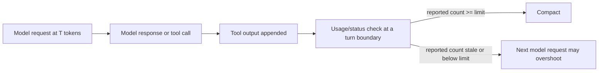

<!-- Canonical Jinja source: STUB.md.jinja. This direct-copy stub is retained for consumers that have not migrated to rendering it. -->

# Codex context-window and auto-compact tuning

**Status:** complete

**Created:** 2026-08-31

<!-- doc:region name="context" kind="immutable" -->

## Table of Contents

<!-- FILL THIS IN as you write. The entries below are this stub's own placeholder sections, so
     they already resolve; as you add, rename, or remove a heading, update this list in the same
     edit. A ToC that lists headings the doc does not have, or omits ones it does, is worse than
     no ToC because it looks like working navigation.
     ISSUE-REF / D5 (c): list EVERY `## ` and EVERY `### ` heading in the real doc, with
     GitHub-style anchors (lowercase, spaces→hyphens, punctuation stripped) so they navigate
     in-window (incl. VS Code Remote-SSH). If all-`###` proves too noisy, fall back to D5 (a)
     "meaningful `###`" — a deterministic OR-rule: include a `###` when it (1) has child `####`,
     (2) its body ≥ ~8-10 lines, (3) its parent `##` is allowlisted, or (4) matches a pattern.
     Hand-maintained: `aido toc check` (ISSUE-REF) has NOT shipped. Verify with
     `scripts/check_doc_toc.py <this-doc>`, which fails on an anchor that does not resolve.
     Manual `<!-- toc:skip -->` / `<!-- toc:include -->` override. -->

- [Context](#context)
- [Temporal Scope](#temporal-scope)
- [Executive Summary](#executive-summary)
- [1. Control semantics](#1-control-semantics)
  - [`model_context_window`](#model_context_window)
  - [`model_auto_compact_token_limit`](#model_auto_compact_token_limit)
  - [`model_auto_compact_token_limit_scope`](#model_auto_compact_token_limit_scope)
- [2. Trigger boundary and safety margin](#2-trigger-boundary-and-safety-margin)
  - [Why 230,000 tokens](#why-230000-tokens)
  - [When Codex checks the threshold](#when-codex-checks-the-threshold)
- [3. Configuration layers and one-off overrides](#3-configuration-layers-and-one-off-overrides)
  - [Profile v2 and issue #14456](#profile-v2-and-issue-14456)
  - [TOML placement](#toml-placement)
  - [Why a high-limit override must be paired](#why-a-high-limit-override-must-be-paired)
- [4. Reliability and community evidence](#4-reliability-and-community-evidence)
  - [Issue status and applicability](#issue-status-and-applicability)
  - [Community practice](#community-practice)
  - [Gaps, blindspots & emergent findings](#gaps-blindspots--emergent-findings)
- [Comparison](#comparison)
- [Recommendation](#recommendation)
- [Open Questions](#open-questions)
- [Sources](#sources)
- [Ambiguous Items from Auto-Remediation (Post-Run Review)](#ambiguous-items-from-auto-remediation-post-run-review)
- [Appendix: Research Prompt](#appendix-research-prompt)
- [Appendix: Provenance Ledger](#appendix-provenance-ledger)
- [Run History](#run-history)

## Context

The ai-harness fleet delegates heavily to OpenAI Codex CLI (`gpt-5.6-sol` flagship /
`gpt-5.6-terra` balanced / `gpt-5.6-luna` economy) via a wrapper script, `.claude/bin/cx`. example-user
(2026-08-31): Codex/GPT has elevated per-token usage cost once a call's context exceeds 272,000
tokens, and the fleet wants every `cx` dispatch to auto-compact BEFORE crossing that boundary by
default, with an ad-hoc override for calls that deliberately need more (this research directly
feeds bd `ISSUE-REF`, which blocks the implementation task `ISSUE-REF`: wiring the researched
values into `~/.codex/config.toml` + a new `cx` override flag).

Investigation before this research doc was commissioned found real, relevant native support:
inspecting the `codex` binary's own strings confirmed `~/.codex/config.toml`'s `ConfigToml`
struct exposes three real top-level keys — `model_context_window`, `model_auto_compact_token_limit`,
and `model_auto_compact_token_limit_scope` — plus related fields
(`reminder_threshold_tokens`, `auto_compact_fallback_prompt`, `auto_compact_fallback_buffer_tokens`,
a `TruncationPolicyConfig.limit`) that may interact with them. A preliminary web search
surfaced a worked example (`gpt-5.6-sol` with `model_context_window = 1_050_000` /
`model_auto_compact_token_limit = 900_000`, leaving compaction headroom) and three real, currently
open upstream GitHub issues worth investigating in depth, not just citing the titles:
`openai/codex#14456` (these settings may not be honored when set inside a `-p <profile>`-layered
config, only the base `config.toml`), `openai/codex#16068` (setting `model_context_window` can
BREAK auto-compaction — `fill_to_context_window` resets the token counter), and
`openai/codex#19185` (context-window settings sometimes not respected at all).

<!-- /doc:region name="context" -->

<!-- doc:region name="body" kind="replaceable" -->

## Temporal Scope

Research cutoff: 2026-08-30. Sources were weighted 2026 first, then 2025 and 2024; no pre-2024
source was needed. Each externally sourced load-bearing claim below was checked against a URL
fetched in this research session. Current OpenAI documentation, current `openai/codex` source, and
current issue threads take precedence over issue-title summaries. [HEURISTIC]

Public, fleet-scale threshold studies split by current Codex model tier: no significant post-2024
developments found. The public evidence is issue-report and source-code evidence rather than a
controlled benchmark corpus. [NO SOURCE]

## Executive Summary

1. The price-control target is the **full request below 272,000 input tokens**, not merely uncached
   growth; OpenAI documents that requests above that boundary receive long-context pricing even
   when fewer than 272,000 tokens are uncached. [VERIFIABLE][^1] Set the normal auto-compact limit
   to **230,000**, leaving 42,000 tokens (15.4%) for boundary lag and a large final tool result.
   The number is a conservative operating point, not a guaranteed no-overshoot bound. [INFERENCE]
2. Leave **`model_context_window` unset** for normal dispatches. Codex documents it as the available
   context size, while current source applies the override only when present and clamps it against
   model metadata; auto-compaction is separately configurable and capped at 90% of the resolved
   window. [VERIFIABLE][^2][^3][^4] Setting a synthetic normal window adds failure surface without
   advancing the fleet's price objective. [INFERENCE]
3. Set **`model_auto_compact_token_limit_scope = "total"`**. `total` is the documented default and
   counts the full active context; `body_after_prefix` counts only tokens after the carried-forward
   prefix. [VERIFIABLE][^2][^5] Because pricing concerns the full request, growth-only accounting
   can cross the price boundary while remaining below its configured counter. [INFERENCE]
4. Put the baseline limit and scope at the true root of base `~/.codex/config.toml`; let role files
   inherit them. For a deliberate long-context call, use invocation-level `-c` overrides, but pair
   `model_context_window` with `model_auto_compact_token_limit` because current Codex clamps the
   latter to 90% of the resolved window. [VERIFIABLE][^4] A threshold-only override such as
   `-c model_auto_compact_token_limit=900000` cannot produce a 900,000-token threshold while the
   resolved context window remains 272,000. [INFERENCE]
5. The preliminary issue-status framing is stale. Issue #16068 is closed as a duplicate, but its
   parent #16033 remains open and reports headless `exec` auto-compaction failure; issue #14456 is
   closed and concerned legacy inline profiles rather than current profile-v2 files.
   [VERIFIABLE][^6][^7][^8] These reports justify conservative defaults and canary validation, but
   they do not prove that the exact historic `fill_to_context_window` mechanism survives in the
   current release. [INFERENCE]

## 1. Control semantics

### `model_context_window`

OpenAI's configuration reference defines `model_context_window` as the number of context-window
tokens available to the active model. [VERIFIABLE][^2] Current Codex source resolves the selected
model first, applies a user override only when one exists, and limits that override to the model
catalog's maximum when a maximum is present. [VERIFIABLE][^3] Therefore:

- **Unset** means “use the selected model's catalog/server-derived value.” [INFERENCE]
- **Set lower** deliberately reduces the resolved working window and also lowers the maximum
  auto-compact threshold through the 90% clamp. [INFERENCE]
- **Set higher** requests a larger window but does not force the service or model catalog to support
  it; the catalog maximum can reduce it. [INFERENCE]

Issue #16068 reported that custom values of 300,000–400,000 caused repeatable overflow behavior,
while removing the override restored correct behavior with server metadata; it was closed as a
duplicate of #16033. [VERIFIABLE][^6] The current source file inspected in this session does not
contain the old reported `fill_to_context_window` symbol. That removes the basis for asserting the
same implementation is present, but the still-open parent issue prevents asserting a confirmed fix.
[INFERENCE]

Issue #19185 reported a requested approximately one-million-token context resolving near 258,000
and was closed “not planned.” [VERIFIABLE][^9] It is evidence that requested long context and
effective Codex context can diverge; it is not evidence that a lower auto-compact threshold is
ignored. [INFERENCE]

**Normal fleet decision:** leave this key absent. The wrapper's model choice should retain ownership
of its window, while the price guard is expressed through the dedicated compaction limit.
[INFERENCE]

### `model_auto_compact_token_limit`

OpenAI documents this as the token threshold that triggers automatic history compaction; when it is
unset, the model default is used. [VERIFIABLE][^2] Current Codex source derives a default at 90% of
the resolved context window and, when the user supplies a limit, uses the lower of the supplied
limit and that 90% value. [VERIFIABLE][^4]

That clamp has two consequences:

1. A normal setting of 230,000 remains effective with a 272,000 resolved window because it is below
   244,800 (90% of 272,000). [INFERENCE]
2. A one-off 900,000 limit is not self-sufficient: without a correspondingly large resolved window,
   Codex reduces it to the 90% ceiling. [INFERENCE]

The setting is a compaction trigger, not a provider-side billing cap. A check that occurs after a
model/tool cycle can observe the threshold only after a request has already grown. [INFERENCE]

### `model_auto_compact_token_limit_scope`

The valid values are exactly:

- `total` — count the full active context; this is the default. [VERIFIABLE][^2][^5]
- `body_after_prefix` — count only tokens added after the initial carried-forward prefix.
  [VERIFIABLE][^2][^5]

The preliminary “full cumulative session versus growth since a compaction boundary” description is
close but imprecise. The source speaks in terms of active context and its initial prefix, not all
historical tokens ever processed by the session. [VERIFIABLE][^5]

For `cx`'s one-prompt `codex exec -p <role>` dispatches, `total` is still correct. A short fresh
request behaves similarly under either scope until a carried prefix exists, but any automatic
summary/prefix makes `body_after_prefix` cease to represent billable full input. [INFERENCE]

## 2. Trigger boundary and safety margin

### Why 230,000 tokens

The recommended limit is:

\[
L = 230{,}000,\qquad 272{,}000-L=42{,}000,\qquad
\frac{42{,}000}{272{,}000}=15.44\%.
\]

The 272,000-token price boundary is documented. [VERIFIABLE][^1] The 42,000-token margin is an
engineering safety budget intended to cover a delayed boundary check, token-estimation error, and
one atypically large model or tool contribution. [INFERENCE] No public source establishes 42,000 as
a universally sufficient maximum overshoot. [NO SOURCE]

A 2026 reproduction proposed 232,560, calculated as 90% of a 258,400-token usable window, and
observed compaction at active totals around 234,000–237,000 without context-length failure.
[VERIFIABLE][^10] Rounding down to 230,000 buys a small additional margin and a simpler fleet value.
[INFERENCE]

Setting exactly 272,000 is unsuitable for a “before crossing” requirement: at the first observation
that `total >= limit`, the active context is already at the price boundary, and the just-finished
request may already have exceeded it. [INFERENCE]

### When Codex checks the threshold

Current `turn.rs` checks `token_limit_reached` after a sampling/model-response iteration and then
starts compaction or ends the turn. [VERIFIABLE][^11] It is not a continuous token-stream billing
circuit breaker. [INFERENCE]

A current issue demonstrates the practical edge: after a model returns a tool call, the recorded
usage can omit the newly appended tool result until the next model call; the locally estimated
active-context count is trace-only, so compaction can lag the real context. [VERIFIABLE][^12]
OpenAI separately states that tool output is capped at 10,000 tokens by default unless the model
requests a different limit. [VERIFIABLE][^13] That default reduces ordinary overshoot, but the
exception means it cannot serve as a hard bound. [INFERENCE]

The resulting boundary sequence is:



Therefore 230,000 is a canary-calibrated starting point. If observed normal-run overshoot exceeds
42,000 tokens, the limit must move lower; if it never approaches the margin and compaction quality
or latency is material, it may move upward in measured increments. [HEURISTIC]

## 3. Configuration layers and one-off overrides

### Profile v2 and issue #14456

Issue #14456 concerned legacy inline `[profiles.<name>]` tables and included an upstream statement
that the context-window keys were not supported in those profile tables; it was closed “not
planned.” [VERIFIABLE][^8] Current official documentation says Codex 0.134 migrated `--profile` to
separate `~/.codex/<name>.config.toml` files, loaded on top of base `~/.codex/config.toml`; legacy
inline profile tables are no longer read. [VERIFIABLE][^14]

Working-tree inspection confirms that `cx` invokes `codex exec -p <role>` and the fleet uses these
separate role files. Thus #14456 does **not** directly establish that the current profile-v2 files
ignore these keys. [INFERENCE]

Even so, the baseline belongs in base config because it is a fleet-wide price invariant, not a
role-specific preference. Base placement gives every role the same default and prevents omission
or drift across research, audit, implementation, and other profiles. [HEURISTIC]

Codex's documented precedence puts CLI overrides above project, profile, and user config. The
profile overlay therefore does not prevent a one-off `-c` value from winning. [VERIFIABLE][^15]
No primary source or issue reproduction was found that tests
`-p <profile> -c model_auto_compact_token_limit=<N>` as that exact combination. [NO SOURCE] The
generic config contract and current typed-config path support it, so the residual risk is best
closed with a focused CLI smoke test during implementation. [INFERENCE]

### TOML placement

TOML's root table begins at the document start and ends immediately before the first table header.
[VERIFIABLE][^16] Codex declares these settings as top-level configuration fields. [VERIFIABLE][^2]
Therefore the baseline must appear before the first `[section]` header:

```toml
model_auto_compact_token_limit = 230000
model_auto_compact_token_limit_scope = "total"

[features]
# ...
```

Placing the same bare keys after `[features]` makes them members of `features`, not root fields.
[INFERENCE] Depending on strictness and the surrounding schema, a released Codex version may reject,
warn about, or ignore an unknown nested key; “always silently ignored” is not established.
[NO SOURCE]

### Why a high-limit override must be paired

Official docs allow arbitrary one-off configuration overrides through CLI configuration flags and
give them highest precedence. [VERIFIABLE][^14][^15] Current source then applies the 90% resolved-
window clamp to the supplied auto-compact limit. [VERIFIABLE][^4]

For a call deliberately allowed into long-context pricing, the conceptual override is therefore:

```text
-c model_context_window=1000000
-c model_auto_compact_token_limit=900000
```

because \(900{,}000 = 0.9 \times 1{,}000{,}000\). A threshold-only override would be clamped by the
normal resolved window. [INFERENCE] The requested one-million-token window can itself be capped by
model metadata, so implementation must surface or log the effective window and effective threshold
rather than promising the requested numbers. [VERIFIABLE][^3][^9]

The official API model page advertises a 1.05-million-token context for `gpt-5.6-sol`, but API model
capability does not prove that every Codex CLI release, account, or cached model catalog exposes the
same maximum. [VERIFIABLE][^1] Treat the pair as an opt-in request whose effective values require a
startup smoke test, not as a guaranteed 1,000,000/900,000 contract. [INFERENCE]

## 4. Reliability and community evidence

### Issue status and applicability

| Issue | Status verified 2026-08-30 | Direct evidence | Fleet interpretation |
|---|---|---|---|
| `#16068` | Closed as duplicate of `#16033` [VERIFIABLE][^6] | Custom context-window values correlated with failed auto-compaction; defaults worked. | Do not set `model_context_window` in normal base config. [INFERENCE] |
| `#16033` | Open [VERIFIABLE][^7] | Reports auto-compaction not firing in headless `exec`. | Canary the exact `codex exec -p <role>` path; do not infer a fix from `#16068` being closed. [INFERENCE] |
| `#14456` | Closed, not planned [VERIFIABLE][^8] | Legacy inline profile tables did not support the keys. | Not directly applicable after profile-v2 migration, but base config is still the safer invariant home. [INFERENCE] |
| `#19185` | Closed, not planned [VERIFIABLE][^9] | A requested approximately 1M window resolved near 258k. | Long-context overrides need effective-value validation; it does not refute a 230k lower trigger. [INFERENCE] |

The evidence supports risk controls, not a universal claim that context-window configuration is
currently broken. Issue reports are environment-specific, #16068's exact implementation marker was
not found in current source, and no upstream release note explicitly resolves the parent behavior.
[INFERENCE]

### Community practice

The strongest current public reproduction found uses a 232,560 threshold for a 272,000 raw window
with a 95% usable factor and reports successful compactions around 234,000–237,000 active tokens.
[VERIFIABLE][^10] Other public examples use materially different limits, but they vary in model,
version, effective window, workload, and whether the goal is price avoidance or merely preventing a
hard context error. [HEURISTIC]

No controlled, public 2025–2026 comparison establishes a safe default by flagship/balanced/economy
model or by research/audit/implementation workload. [NO SOURCE] A single fleet-wide 230,000 default
is therefore preferable initially; model- or role-specific tuning should require observed
distributions, not model-tier labels. [INFERENCE]

### Gaps, blindspots & emergent findings

- **Pricing metric blindspot resolved:** OpenAI applies long-context pricing to the full request,
  including cached tokens, so `body_after_prefix` is structurally misaligned with the cost goal.
  [VERIFIABLE][^1] This is the strongest reason to make scope `total`. [INFERENCE]
- **Override coupling:** the initial framing treated `-c model_auto_compact_token_limit=900000` as a
  standalone escape hatch. Current source disproves that assumption because of the 90% clamp.
  [VERIFIABLE][^4] The wrapper design must carry a paired window/limit preset or two validated
  values. [INFERENCE]
- **Compaction-quality cost:** issue #19910 reports that a mid-turn compaction sometimes failed to
  carry the goal cleanly into the next agent state. [VERIFIABLE][^17] Earlier compaction can therefore
  trade price safety for additional latency, summaries, and state loss. [INFERENCE]
- **Overshoot distribution unresolved:** there is no public percentile distribution for token growth
  between checks in `codex exec` workloads, especially when a model requests more than the default
  tool-output cap. [NO SOURCE] Forty-two thousand tokens is deliberately a tunable margin, not a
  proof. [INFERENCE]
- **Per-model live maximum unresolved:** official API capacity and Codex's effective catalog value
  can diverge. [VERIFIABLE][^1][^3][^9] The implementation must interrogate or observe the installed
  CLI rather than hard-code that every fleet model accepts one million tokens. [INFERENCE]
- **Anchor-bias countercheck:** investigation expanded beyond the named issues to current source,
  trigger timing, tool-output accounting, the 90% clamp, pricing of cached tokens, and compaction
  quality. Those threads changed the override recommendation and reinforced `total` scope.
  [INFERENCE]

## Comparison

| # | Strategy | Normal values | Price-boundary risk | Tradeoff |
|---|---|---|---|---|
| 1 | **Recommended guarded baseline** | window unset; limit `230000`; scope `total` | 42k pre-boundary margin; not a mathematical guarantee [INFERENCE] | Earlier compaction and possible state/latency cost |
| 2 | Exact price boundary | window unset; limit `272000`; scope `total` | Cannot satisfy “before”; check may occur after an overshooting request [INFERENCE] | Maximizes context before compaction |
| 3 | Codex defaults | all three unset | Default derives near 90% of resolved window, which may be too close to 272k for the fleet objective [VERIFIABLE][^4] | Lowest configuration burden |
| 4 | Growth-only counting | limit `230000`; scope `body_after_prefix` | Carried prefix is excluded even though provider pricing counts full request [VERIFIABLE][^1][^5] | Useful only for a growth-oriented, not total-cost, policy |
| 5 | Deliberate long context | paired window `1000000`; limit `900000`; scope `total` via `-c` | Intentionally enters elevated pricing; effective values may be clamped [VERIFIABLE][^3][^4] | Maximum context, explicit per-call opt-in |

## Recommendation

Adopt this base configuration at the **true top level of `~/.codex/config.toml`, before the first
section header**, and do not duplicate it in role-profile files:

```toml
# Fleet-wide normal-call price guard.
model_auto_compact_token_limit = 230000
model_auto_compact_token_limit_scope = "total"

# Intentionally absent: model_context_window
```

This is the concrete normal policy:

1. **`model_context_window`: unset.** Preserve model metadata and avoid the custom-window failure
   path reported in #16068/#16033. [VERIFIABLE][^6][^7] This is a risk-minimizing inference, not
   proof that every current custom value fails. [INFERENCE]
2. **`model_auto_compact_token_limit = 230000`.** This leaves a 42,000-token margin below the
   documented price transition and is slightly more conservative than the public 232,560
   reproduction. [VERIFIABLE][^1][^10] The margin must be validated empirically. [INFERENCE]
3. **`model_auto_compact_token_limit_scope = "total"`.** This counts the complete active context and
   aligns with full-request pricing. [VERIFIABLE][^1][^2][^5]
4. **Placement: base config only.** Current profile-v2 files layer over base config, but this policy
   is global. [VERIFIABLE][^14] Role files should inherit it; CLI overrides remain higher precedence.
   [VERIFIABLE][^15]
5. **Ad-hoc override: paired invocation-level values.** Expose one explicit long-context preset or
   two jointly validated wrapper arguments that pass both
   `-c model_context_window=<W>` and `-c model_auto_compact_token_limit=<L>`, with
   \(L \leq 0.9W\). [VERIFIABLE][^4] For the stated example, request
   `W=1000000`, `L=900000`, retain scope `total`, and disclose that the installed catalog may clamp
   both effective values. [INFERENCE] Do **not** implement a threshold-only 900,000 override.

Before fleet-wide enablement, run 10–20 representative `codex exec -p <role>` canaries across the
three model tiers and both tool-light and tool-heavy work. Record the largest active context before
compaction, effective window/limit, compaction latency, context-length errors, and task completion
quality. Require all normal canaries to compact before 272,000 observed active tokens; lower the
limit if any overshoot crosses the boundary. [HEURISTIC]

The rollback is simple and reversible: remove the two base keys to return to model defaults. Keep
long-context usage explicit and per invocation so an exploratory exception cannot silently become
a role-wide cost policy. [HEURISTIC]

## Open Questions

1. Does the exact Codex release deployed during implementation contain a confirmed fix for the
   headless/custom-window behavior tracked by open #16033, and can a local smoke test reproduce it?
2. What effective context and maximum values does the installed CLI resolve for each of
   `gpt-5.6-sol`, `gpt-5.6-terra`, and `gpt-5.6-luna` under each fleet account?
3. What are the p95 and maximum token increases between compaction checks in representative `cx`
   runs, especially after tool results?
4. Does compaction itself create a provider request whose input can cross the price boundary before
   the compacted state takes effect, and how is that request itemized in fleet billing telemetry?
5. Does a direct smoke test confirm that `-p research -c model_auto_compact_token_limit=<N>` wins
   over both base and profile-v2 values in the exact installed release?
6. At 230,000, how often do extra compactions measurably affect completion latency or preservation of
   audit/research requirements compared with the current default?

## Sources

[^1]: OpenAI. (2026). [GPT-5.6 sol model](https://developers.openai.com/api/docs/models/gpt-5.6-sol). OpenAI API Documentation. Verified accessible (HTTP 200) 2026-08-30. (Context capacity and long-context pricing boundary, including cached-token treatment.)

[^2]: OpenAI. (2026). [Configuration reference](https://learn.chatgpt.com/docs/config-file/config-reference). Codex Documentation. Verified accessible (HTTP 200) 2026-08-30. (Definitions and valid values for the three configuration fields.)

[^3]: OpenAI. (2026). [Model information resolution](https://github.com/openai/codex/blob/main/codex-rs/models-manager/src/model_info.rs). GitHub. Verified accessible (HTTP 200) 2026-08-30. (Current source for context-window override and catalog-maximum clamping.)

[^4]: OpenAI. (2026). [OpenAI model defaults](https://github.com/openai/codex/blob/main/codex-rs/protocol/src/openai_models.rs). GitHub. Verified accessible (HTTP 200) 2026-08-30. (Current source for the 90% default and user-limit clamp.)

[^5]: OpenAI. (2026). [Context-window scope implementation](https://github.com/openai/codex/blob/main/codex-rs/core/src/session/context_window.rs). GitHub. Verified accessible (HTTP 200) 2026-08-30. (Current source for total and body-after-prefix counting.)

[^6]: OpenAI. (2026). [Issue #16068: Model context window config breaks auto compaction](https://github.com/openai/codex/issues/16068). GitHub. Verified accessible (HTTP 200) 2026-08-30. (Custom-window reproduction and closed-as-duplicate status.)

[^7]: OpenAI. (2026). [Issue #16033: Auto-compaction not triggering in headless exec mode](https://github.com/openai/codex/issues/16033). GitHub. Verified accessible (HTTP 200) 2026-08-30. (Open parent issue for headless auto-compaction behavior.)

[^8]: OpenAI. (2026). [Issue #14456: Model context-window parameters not supported in profiles](https://github.com/openai/codex/issues/14456). GitHub. Verified accessible (HTTP 200) 2026-08-30. (Legacy inline-profile limitation and closed status.)

[^9]: OpenAI. (2026). [Issue #19185: Context window settings not respected](https://github.com/openai/codex/issues/19185). GitHub. Verified accessible (HTTP 200) 2026-08-30. (Requested-versus-effective long-context discrepancy and closed status.)

[^10]: OpenAI. (2026). [Issue #40095: Auto-compaction threshold for 272K context window](https://github.com/openai/codex/issues/40095). GitHub. Verified accessible (HTTP 200) 2026-08-30. (232,560 proposal and observed compaction totals.)

[^11]: OpenAI. (2026). [Turn execution and token-limit check](https://github.com/openai/codex/blob/main/codex-rs/core/src/session/turn.rs). GitHub. Verified accessible (HTTP 200) 2026-08-30. (Current source for the post-iteration compaction decision.)

[^12]: OpenAI. (2026). [Issue #32888: Auto-compaction fails after tool output due to stale token count](https://github.com/openai/codex/issues/32888). GitHub. Verified accessible (HTTP 200) 2026-08-30. (Reproduction of delayed accounting for newly appended tool output.)

[^13]: OpenAI. (2026). [GPT-5.6: Frontier intelligence, built for efficient work](https://openai.com/index/gpt-5-6-frontier-intelligence-efficiency/). OpenAI. Verified accessible (HTTP 200) 2026-08-30. (Default tool-output cap and model-requested exception.)

[^14]: OpenAI. (2026). [Advanced configuration](https://learn.chatgpt.com/docs/config-file/config-advanced). Codex Documentation. Verified accessible (HTTP 200) 2026-08-30. (Profile-v2 file layering, migration, and one-off configuration overrides.)

[^15]: OpenAI. (2026). [Basic configuration](https://learn.chatgpt.com/docs/config-file/config-basic). Codex Documentation. Verified accessible (HTTP 200) 2026-08-30. (Configuration precedence.)

[^16]: TOML. (n.d.). [TOML language specification](https://github.com/toml-lang/toml/blob/main/toml.md). GitHub. Verified accessible (HTTP 200) 2026-08-30. (Root-table boundary and table-header semantics.)

[^17]: OpenAI. (2026). [Issue #19910: Compaction loses the active goal](https://github.com/openai/codex/issues/19910). GitHub. Verified accessible (HTTP 200) 2026-08-30. (Reported goal-preservation failure after compaction.)

<!-- /doc:region name="body" -->

<!-- doc:region name="ambiguous_items" kind="replaceable" -->

## Ambiguous Items from Auto-Remediation (Post-Run Review)

(none yet — auto-populated by verify_and_remediate node)

<!-- /doc:region name="ambiguous_items" -->

<!-- doc:region name="appendix_research_prompt" kind="immutable" -->

## Appendix: Research Prompt

**Registry ID:** unregistered cx research invocation
**Model:** `gpt-5.6-sol`
**Date:** 2026-08-30

```text
You are a principal infrastructure engineer who has operated large-scale ISSUE-REF fleets in
production, with deep hands-on experience tuning context-window and auto-compaction behavior
across Anthropic Claude Code, OpenAI Codex CLI, and open-source coding-agent harnesses. Research
and recommend Codex context-window and automatic-compaction settings for ai-harness's one-shot
`cx <role> "<prompt>"` dispatches.

Background established for this task: Codex/GPT has elevated per-token usage cost once a call's
context exceeds 272,000 tokens. The fleet wants automatic compaction before that boundary by
default and an explicit per-call exception for work that deliberately needs more. Binary inspection
has already confirmed top-level `ConfigToml` keys `model_context_window`,
`model_auto_compact_token_limit`, and `model_auto_compact_token_limit_scope`, plus adjacent
compaction and truncation fields. Do not re-derive those established facts.

<grounding_instructions>
You are a principal infrastructure engineer who has operated large-scale ISSUE-REF fleets in
production, with deep hands-on experience tuning context-window and auto-compaction behavior
across Anthropic Claude Code, OpenAI Codex CLI, and open-source coding-agent harnesses. You have
strong opinions backed by evidence about where auto-compaction thresholds should sit relative to a
model's billed context tiers, and when you cannot find a source, you say so explicitly.

Temporal scope: Weight sources by recency -- 2026 (primary) -> 2025 -> 2024. Pre-2024 sources are
background context only unless foundational to the topic. If post-2024 literature is genuinely
sparse for a subtopic, state "[subtopic]: no significant post-2024 developments found" rather than
backfilling with older sources. Backfilling is a failure mode, not a hedge.

Before generating your final output, execute a Chain-of-Verification (CoVe) to ensure factual
fidelity over compliance.

Inside your thought process:
1. Isolate the core facts required.
2. Draft a tentative response.
3. Hostile Cross-Examination: flag any claim where you are citing a source because the prompt
   implied you should, rather than because you verified it.
4. Strip away any claim that cannot be empirically verified.

When generating your final output, classify every major claim. Write your rationale before
appending the tag -- writing the tag first causes post-hoc rationalization. Rationale -> evidence
check -> tag.

- [VERIFIABLE]: backed by documentation, peer-reviewed research, or official tech blogs
  (2024-2026). Carry an inline footnote ref to the source: [VERIFIABLE][^N].
- [HEURISTIC]: widely accepted best practice without a specific citation.
- [INFERENCE]: a logical conclusion drawn from context. Provide your reasoning in-text. Do not
  fabricate a source. Tier tag only -- NO footnote ref.
- [NO SOURCE]: explicitly state when you cannot find verifiable data. Tier tag only -- NO
  footnote ref.

Citation format (mandatory for every externally-sourced claim):
- Inline: append the GFM footnote ref directly after the tier tag -- [VERIFIABLE][^N]. A claim
  citing multiple sources carries ascending separate refs -- [VERIFIABLE][^3][^7] (never grouped
  [^3,^7]; never out of order).
- Footnote definitions live once, under ## Sources, in APA form with a clickable URL or DOI and an
  access-verification stamp. Worked example: [^1]: LangChain. (2026). [Threads](https://docs.langchain.com/langsmith/threads). LangSmith Documentation. Verified accessible (HTTP 200) 2026-06-03. (Scope note.)
- URL-or-DOI ALWAYS: every source entry carries a clickable URL or a doi.org link -- paywalled/
  gated is fine (link it anyway; stamp the access status). Only the truly-irreducible case (no online catalog presence anywhere) gets an explicit [no online source located] marker with a one-line justification.
- Integrity: footnote refs are contiguous from [^1], every [^N] ref has a matching definition, and
  every definition is referenced -- no gaps, no orphans.
- [INFERENCE] / [NO SOURCE] claims carry the tier tag with NO footnote ref.

Hard constraint (overrides all formatting preferences): never invent a citation to satisfy a
formatting instruction. Accuracy > completeness.
Format diagrams using Mermaid.js or ASCII. Format math using LaTeX. NEVER generate binary images.
</grounding_instructions>

## Scope note -- questions, examples, and named references are a starting point, not a checklist
The questions, topics, and named examples below are illustrative anchors and a FLOOR for this
research -- not an exhaustive list to answer only or evaluate only. Reason independently: survey
the landscape broadly, follow the evidence where it leads, expand scope where warranted, and
surface relevant work, factors, and failure modes not named here. Actively resist answering only
the listed questions or evaluating only the named approaches -- an output that merely fills in the
listed items has NOT met the research goal.

## Independent exploration (gaps, blindspots, emergent threads) -- required
Treat the question list as a FLOOR, not a ceiling. As you research, actively surface what this
framing may be missing and pursue each promising thread to a logical conclusion:
- Adjacent or upstream factors the questions don't capture.
- Contrarian / disconfirming evidence -- report it even when it challenges the premise.
- Emerging 2025-2026 practices, tools, or research not anchored by the named examples.
- Known failure modes and second-order effects.
Whenever a load-bearing thread surfaces mid-research, follow it to its conclusion and report it in
a dedicated "Gaps, blindspots & emergent findings" subsection. Explicitly name any blindspot you
suspect but cannot resolve and why rather than omitting it. Counter anchor bias deliberately.

## Retrieval enforcement
For each load-bearing claim, run at least one web search or fetch. Do not return [VERIFIABLE]
without a URL actually fetched in-session. Do not stop after one round. If no source is found for a
sub-question, search alternate framings before using [NO SOURCE].

## Research questions

1. Determine what `model_context_window` controls, when OpenAI recommends setting it versus using
   model defaults, and whether issue `openai/codex#16068` establishes that setting it breaks
   `model_auto_compact_token_limit` enforcement. Read the full issue and determine whether the
   reported `fill_to_context_window` behavior has been fixed.
2. Determine the optimal `model_auto_compact_token_limit` for compacting before 272,000. Compare an
   exact 272,000 trigger with a lower margin and determine when Codex checks the threshold, including
   the risk that a large tool result or turn overshoots before compaction.
3. Verify all valid `model_auto_compact_token_limit_scope` values and semantics from primary
   sources. Decide which is correct for one-shot, non-interactive `cx` dispatches.
4. Survey current community and OpenAI practice for all three settings, including differences by
   model tier and workload shape; identify whether any safe defaults have credible evidence.
5. Read issues `openai/codex#14456` and `openai/codex#19185` in depth, verify current status, and
   determine applicability to `codex exec -p <role>` where role-specific
   `~/.codex/<role>.config.toml` overlays base `~/.codex/config.toml`.
6. Verify TOML placement requirements for Codex root configuration fields and whether misplaced
   fields are rejected, warned, or ignored.
7. Verify whether `-c key=value` is a reliable single-invocation override for
   `model_auto_compact_token_limit`, including with `-p <profile>`, and identify any coupling to
   `model_context_window` or model-catalog limits.

Produce a research-1.2.0 document with Temporal Scope, 3-5 numbered Executive Summary findings,
deep topic sections, Comparison, a concrete Recommendation, Open Questions, Sources, the full
research prompt, a provenance ledger, and Run History. Recommend exact normal values (or unset),
their exact config layer and TOML placement, and a reliable ad-hoc override shape. Preserve the
pre-filled Context verbatim. Research only; do not modify implementation or configuration files.
```

<!-- /doc:region name="appendix_research_prompt" -->

<!-- doc:region name="appendix_provenance" kind="replaceable" -->

## Appendix: Provenance Ledger

| Claim / source | Verbatim support (≤25 words) | Verdict | Retrieval |
|---|---|---|---|
| [^1] Long-context pricing applies above 272K | “Prompts with >272K input tokens are priced at 2x input and 1.5x output” | SUPPORTED | Yes — HTTP 200, 2026-08-30 |
| [^2] Auto-compact threshold semantics | “Token threshold that triggers automatic history compaction (unset uses model defaults).” | SUPPORTED | Yes — HTTP 200, 2026-08-30 |
| [^3] Context override is catalog-clamped | `context_window.min(max_context_window)` | SUPPORTED | Yes — HTTP 200, 2026-08-30 |
| [^4] User limit has a 90% ceiling | “core clamps it to 90% of the context window when available” | SUPPORTED | Yes — HTTP 200, 2026-08-30 |
| [^5] Scope selects active total or post-prefix growth | “Count either the full active context or only the tokens added after the initial prefix.” | SUPPORTED | Yes — HTTP 200, 2026-08-30 |
| [^6] Defaults avoided the custom-window reproduction | “Removing the setting and using defaults (272K from server metadata) works correctly.” | SUPPORTED | Yes — HTTP 200, 2026-08-30 |
| [^7] Headless behavior remains tracked | “Auto-compaction never fires when running Codex in headless `exec` mode.” | SUPPORTED | Yes — HTTP 200, 2026-08-30 |
| [^8] Legacy profiles excluded the keys | “These keys are not currently supported by profiles.” | SUPPORTED | Yes — HTTP 200, 2026-08-30 |
| [^9] Requested and effective long windows diverged | “setting approximately `1M` results in Codex automatically changing/using about `258k`” | SUPPORTED | Yes — HTTP 200, 2026-08-30 |
| [^10] Public 90%-of-usable proposal | `floor(258,400 × 0.90) = 232,560` | SUPPORTED | Yes — HTTP 200, 2026-08-30 |
| [^11] Turn code consumes the limit result | `let token_limit_reached = token_status.token_limit_reached;` | SUPPORTED | Yes — HTTP 200, 2026-08-30 |
| [^12] Local estimate is not used to trigger | “The estimate is currently only included in tracing.” | SUPPORTED | Yes — HTTP 200, 2026-08-30 |
| [^13] Tool output normally has a bounded default | “Tool output is capped at 10,000 tokens by default unless the model requests a different limit.” | SUPPORTED | Yes — HTTP 200, 2026-08-30 |
| [^14] Profile v2 overlays base config | “Codex loads `~/.codex/config.toml`, then overlays `~/.codex/profile-name.config.toml`.” | SUPPORTED | Yes — HTTP 200, 2026-08-30 |
| [^15] CLI has highest precedence | “CLI flags and `--config` overrides” | SUPPORTED | Yes — HTTP 200, 2026-08-30 |
| [^16] TOML root ends at the first header | “The top-level table ... starts at the beginning of the document and ends just before the first table header” | SUPPORTED | Yes — HTTP 200, 2026-08-30 |
| [^17] Compaction can lose the active objective | “after compaction, the goal is sometimes not carried through cleanly to the new agent” | SUPPORTED | Yes — HTTP 200, 2026-08-30 |

<!-- /doc:region name="appendix_provenance" -->

<!-- doc:region name="run_history" kind="append_only" -->

## Run History

- 2026-08-30 — Initial synthesis via Codex `gpt-5.6-sol` (high effort), read-only relay delivery. Live retrieval, hostile claim review, citation validation, CoVe, and working-tree verification completed.

<!-- /doc:region name="run_history" -->
