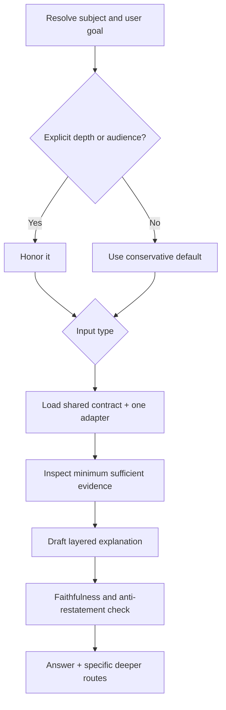

<!-- Canonical Jinja source: STUB.md.jinja. This direct-copy stub is retained for consumers that have not migrated to rendering it. -->

# Designing a /explain Skill — Prompt, Template, and Procedure for On-Demand Explanations

## Founding Ask Coverage

`founding_ask_ref`: verbatim founding ask embedded in [Appendix: Research Prompt](#appendix-research-prompt)

The founding ask requested a current breadth-and-depth survey before designing `/explain`, asked
whether equivalent research had already launched for `/explain` and `/summarize`, and asked why
`/summarize` was blocked by item 625. This document covers the `/explain` research only.

Repository and Beads inspection on 2026-09-02 found this `/explain` research dispatch active and no
completed sibling `/summarize` research artifact. The current summarize issue is in progress with
zero dependencies; its only connection to explain is a non-blocking `related` edge. Item 625 now
resolves to a closed, unrelated human gate about publishing ai-harness-lite. The founding premise
that summarize is blocked by 625 therefore conflicts with current tracker state. Identifier drift or
a stale conversational reference is the most likely explanation, but the historical identity of the
intended “625” could not be established from current state. [INFERENCE]

**Status:** complete

**Created:** 2026-09-02

<!-- doc:region name="context" kind="immutable" -->

## Table of Contents

- [Context](#context)
- [Temporal Scope](#temporal-scope)
- [Executive Summary](#executive-summary)
- [1. Explanation Is a Mental-Model Task](#1-explanation-is-a-mental-model-task)
  - [Calibrate once, then remain adjustable](#calibrate-once-then-remain-adjustable)
  - [Use a layered explanatory sequence](#use-a-layered-explanatory-sequence)
  - [Treat faithfulness as a separate gate](#treat-faithfulness-as-a-separate-gate)
- [2. Prior Art and Transferable Patterns](#2-prior-art-and-transferable-patterns)
  - [Claude Code skills](#claude-code-skills)
  - [IDE explainers](#ide-explainers)
  - [Educational and research systems](#educational-and-research-systems)
  - [Community Claude Code skill](#community-claude-code-skill)
- [3. Prompt Engineering for Explanation](#3-prompt-engineering-for-explanation)
- [4. Handling Heterogeneous Inputs](#4-handling-heterogeneous-inputs)
- [Comparison](#comparison)
- [Gaps, Blindspots & Emergent Findings](#gaps-blindspots--emergent-findings)
- [Recommendation](#recommendation)
  - [Recommended procedure](#recommended-procedure)
  - [Recommended prompt contract](#recommended-prompt-contract)
  - [Recommended output template](#recommended-output-template)
  - [Acceptance and evaluation](#acceptance-and-evaluation)
- [Open Questions](#open-questions)
- [Sources](#sources)
- [Ambiguous Items from Auto-Remediation (Post-Run Review)](#ambiguous-items-from-auto-remediation-post-run-review)
- [Appendix: Research Prompt](#appendix-research-prompt)
- [Appendix: Provenance Ledger](#appendix-provenance-ledger)
- [Run History](#run-history)

## Context

The intended `/explain` skill serves a coding-agent CLI and must explain a design or plan document,
a Beads issue, source code, or a technical concept on demand. The skill should help the user build a
usable mental model, not merely paraphrase the input or produce a shorter version.

**Primary period:** 2024–2026, with a research cutoff of 2026-09-02
**Source weighting:** 2026 primary → 2025 → 2024; pre-2024 material excluded unless foundational
**Decision target:** the prompt, procedure, output template, routing strategy, and evaluation plan for
an ai-harness `/explain` skill

<!-- /doc:region name="context" -->

<!-- doc:region name="body" kind="replaceable" -->

## Temporal Scope

The survey prioritized 2026 research, then 2025 and 2024 peer-reviewed work and current official
product documentation. It searched for Claude Code skills/plugins, IDE explainers, repository-aware
assistants, code-explanation research, personalization, progressive disclosure, educational agents,
and explanation taxonomies. Product behavior is reported as of 2026-09-02.

General-purpose document/issue explanation: no significant post-2024 controlled studies were found.
[NO SOURCE] The strongest recent empirical evidence concerns code or AI-system explanations, so any
transfer to design docs, plans, or issue tickets is identified as an inference rather than presented
as direct validation.

## Executive Summary

1. A good explanation is not a summary with extra words. It identifies the reader's missing mental-model
   links—purpose, mechanism, causality, tradeoffs, and consequences—then supplies only those links.
   [HEURISTIC]
2. Calibration should be low-friction and reversible: honor an explicit audience/depth request; otherwise
   infer a conservative default from the request and project context, state the assumption briefly, and
   offer named ways to go deeper. Small studies show that desired structure and detail vary with prior
   experience and goals, while knowledge-level personalization is generally preferred over interest-based
   personalization. [VERIFIABLE][^2][^13]
3. Progressive disclosure is a navigation strategy, not a proven cognitive-load cure. A 2026 study of 32
   participants found that detail improved understanding and subjective impressions but increased cognitive
   load; progressive disclosure improved perceived learning without significantly reducing load.
   [VERIFIABLE][^4]
4. The best architecture is one shared explanation contract plus input-type adapters. IDE evidence favors
   automatic, selective context and intent-specific actions; code-review evidence shows that explicitly
   requesting an explanation type materially improves output control. [VERIFIABLE][^3][^8][^9][^15]
5. Ship `/explain` with a faithfulness pass and scenario-based evals, not as an untested prose prompt.
   Personalization can compete with faithfulness, and preference studies do not establish learning gains.
   [VERIFIABLE][^5][^13]

## 1. Explanation Is a Mental-Model Task

An explanation succeeds when the reader can predict or reason about the subject after reading it; a
summary succeeds when it preserves salient information in less space. [HEURISTIC] This distinction changes
the prompt's objective. `/explain` should diagnose and bridge comprehension gaps, connect causes to effects,
make hidden assumptions explicit, and use an example or trace when abstraction alone is insufficient.
`/summarize` should compress. Neither behavior should silently substitute for the other. [HEURISTIC]

### Calibrate once, then remain adjustable

Recent user research is consistent on one point: there is no universally correct detail level. IBM's 2025
study with ten programmers found value in configurable structure and detail, with needs changing by prior
experience and goal. [VERIFIABLE][^2] A 2025 study of 33 graduate students found knowledge-level profiles
were generally preferred for term explanations, but effects were weaker for code explanations and the study
did not measure learning gains. [VERIFIABLE][^13]

The skill should use this calibration order: [INFERENCE]

1. **Explicit signal:** obey “quick refresher,” “assume I know Python,” “ELI5,” “deep dive,” or a requested
   format before inferring anything.
2. **Task signal:** a debugging question usually needs causal flow and state; a review question needs rationale,
   alternatives, and consequences; a refresher needs recognition cues and deltas.
3. **Context signal:** use only current-conversation and repository evidence. Do not infer expertise from
   demographic traits, job titles, or a single syntactic mistake. [HEURISTIC]
4. **Conservative default:** assume technical literacy but not subject familiarity, state that assumption in
   one short phrase only when it affects the answer, and produce a useful first pass.
5. **One adjustment affordance:** end with concrete choices such as “I can trace the retry path” or “compare
   this with the rejected design,” not the vague “want more detail?”

Ask a clarifying question only when a missing answer changes the explanation materially—for example, the
referent is ambiguous, a file cannot be located, or “why” could mean design rationale versus runtime cause.
Otherwise, explain immediately. [HEURISTIC]

### Use a layered explanatory sequence

A robust sequence is: **orientation → mechanism → evidence/example → boundaries → consequence**.
[HEURISTIC] The opening should answer “what is this and why should I care?” in one or two sentences. The
mechanism should expose the smallest causal or structural chain that makes the subject predictable. A worked
example, concrete trace, counterexample, or analogy should be added only if it maps precisely; the mapping and
where it breaks should be stated. Boundaries cover non-goals, failure modes, and common confusions. The close
connects the explanation to the user's likely next action.

Progressive disclosure should be implemented in text as a short usable core followed by clearly named deeper
layers—not by withholding an essential premise. [INFERENCE] This is compatible with Claude Code's skill model,
which supports concise core instructions and supporting files loaded on demand. [VERIFIABLE][^1] It should not
be sold as reducing cognitive load: the best 2026 evidence in an adjacent explanation domain did not find that
effect. [VERIFIABLE][^4]

Avoid restating obvious surrounding context. The procedure should first inventory what the user supplied, then
spend tokens on relationships the source does not directly spell out: “because,” “therefore,” “unlike,” “if this
fails,” and “this matters here.” [HEURISTIC] Repetition is justified only to establish a shared anchor or quote
a decisive source line.

### Treat faithfulness as a separate gate

Personalization and correctness are different objectives. FaithfulPersona formalizes a tradeoff in which more
personalization can drift from code behavior; its self-critique approach improved its benchmark's balance but
used automated metrics including ISSUE-REF, not proof that any personalized explanation is correct.
[VERIFIABLE][^5] The transferable lesson is to separate two passes: first establish a source-grounded account,
then adapt its presentation without changing claims. [INFERENCE]

For repository artifacts, every concrete claim about current behavior, dependencies, defaults, or intent should
point to inspected evidence (file/symbol/line, issue field, linked decision, or command output). [HEURISTIC]
For abstract concepts, distinguish stable definition from project-specific usage and mark uncertainty rather
than manufacturing a rationale. [HEURISTIC]

## 2. Prior Art and Transferable Patterns

### Claude Code skills

Claude Code skills package instructions in `SKILL.md`, can add supporting files, remain active as relevant, and
load supporting material on demand. Anthropic recommends keeping the main file concise and moving detailed
reference material into separate files. [VERIFIABLE][^1] This favors a thin routing/procedure skill plus a
reference containing input adapters and examples, not four duplicated skills. [INFERENCE]

Useful pattern: a skill can accept explicit arguments while still inspecting current conversation and repository
context. Risk: a large monolithic `SKILL.md` can consume context on every invocation, so examples and detailed
rubrics should be references rather than unconditional prompt text. [INFERENCE]

### IDE explainers

Google's GILT research plugin exposed four promptless actions—explain selected code, API details, domain terms,
and API usage examples—while automatically adding edited-program context. In a 32-person study it aided task
completion more than web search, and usage differed between students and professionals. [VERIFIABLE][^3] The
important design pattern is not its specific model; it is **one-click intent selection plus automatic narrow
context**. [INFERENCE]

Current VS Code documentation distinguishes implicit from explicit context and warns that more context is not
always better. Its workspace context combines semantic search, text search, file-name search, symbol usages,
and targeted file reads rather than attaching an entire repository indiscriminately. [VERIFIABLE][^8][^9]
GitHub's Copilot tutorial demonstrates explanation at repository, directory, file, line, symbol, and commit
scope, reinforcing that scope is a first-class control. [VERIFIABLE][^10] VS Code also exposes “Explain” as a
selected-code smart action. [VERIFIABLE][^11]

JetBrains AI Assistant uses a prewritten explain-code prompt with project context and accepts attached files,
folders, symbols, commits, and other context. It also separates code explanation from specialized regexp, SQL,
cron, and runtime-error explanation flows. [VERIFIABLE][^12] This supports shared orchestration with specialized
adapters; it does not prove that every artifact needs an independent skill. [INFERENCE]

What works across these products: selection-scoped invocation, repository grounding, named intents, and an
immediate first answer. [INFERENCE] What remains largely unevaluated publicly: long-term comprehension,
faithfulness under large repositories, expertise inference, and a unified explainer spanning code, documents,
issues, and concepts. [NO SOURCE]

### Educational and research systems

CodeAid deployed an LLM programming assistant to 700 students for 12 weeks and analyzed 8,000 uses. Its design
considerations included simpler query formulation, cognitive engagement, avoiding direct answers when learning
is the goal, and user transparency/control. [VERIFIABLE][^16] This is a reminder that “explain” has at least two
modes: task-enabling explanation and learning-oriented scaffolding. [INFERENCE] The CLI should default to
helpful directness, but accept an explicit “teach me / don't give me the answer” mode. [HEURISTIC]

Worked-example research in introductory programming notes that line-by-line explanation is common, but this is
an educational presentation pattern, not a universal default for production code. [VERIFIABLE][^17] Use a trace
or line-level walk-through when local mechanics are the gap; use architecture and invariants when the user's
question is about the system. [INFERENCE]

A 2026 preprint generated 1,072 code explanations across six open-weight models and identified 13 linguistic
adaptations tied to five problem-solving-style dimensions. [VERIFIABLE][^14] It did not validate automatic style
inference with users, so its prompts are design hypotheses, not an adoption-ready personalization engine.
[INFERENCE]

A 2025 empirical study of 793 Gerrit review comments found seven explanation types and reported 88 of 90 correct
type generations when ChatGPT was explicitly asked for the type. [VERIFIABLE][^15] The practical lesson is to
make explanation intent explicit—rationale, rule, example, consequence, mechanism, comparison—rather than rely
only on “explain this.” [INFERENCE]

### Community Claude Code skill

The community `/explain` prompt indexed by Crystl asks for purpose, components, data flow, patterns, dependencies,
and gotchas, and explicitly discourages restating code in English. [VERIFIABLE][^18] These are useful checklist
items for the code adapter. However, the page exposes no evaluation, adoption, release, or maintenance evidence;
under the repository's vetting procedure it is exploratory inspiration, not an established best practice.
[INFERENCE]

No maintained, evaluated Claude Code plugin covering documents, issues, code, and concepts was found after
alternate searches. [NO SOURCE]

## 3. Prompt Engineering for Explanation

Official Anthropic guidance emphasizes clear/direct instructions, contextual motivation, examples, and XML-style
structure; Google similarly recommends a test-driven prompt-development loop with explicit objective,
instructions, context, examples, and output format. [VERIFIABLE][^6][^7] For explanation, these generic practices
need a genre-specific objective and quality gates. [INFERENCE]

The prompt should contain: [HEURISTIC]

- **Outcome:** “help the user form a correct, usable mental model,” not “describe” or “summarize.”
- **Reader model:** explicit familiarity, goal, desired depth, and learning-versus-task mode when supplied;
  otherwise a reversible default.
- **Grounding:** inspect the named artifact and the minimum surrounding evidence needed to explain relationships.
- **Known/new split:** identify what is already explicit in the request or source; do not spend the response
  paraphrasing it.
- **Explanation plan:** select the relevant moves—orientation, causal chain, structure, rationale, comparison,
  example/trace, failure mode, consequence—rather than force every heading.
- **Faithfulness check:** verify symbols, behavior, issue state, and rationale; label inference and unknowns.
- **Presentation:** lead with the answer, define terms just before use, keep one idea per paragraph, and use a
  small diagram or table only when relationships are otherwise difficult to hold in working memory.
- **Adjustment:** offer one or two specific deeper routes based on unresolved complexity.

Examples should demonstrate branching, not merely preferred tone: one terse refresher, one novice concept
explanation with a bounded analogy, one code trace, and one design-rationale explanation that separates recorded
intent from inferred intent. [HEURISTIC] A single ornamental example risks overfitting the model to one artifact
type. [INFERENCE]

Do not prompt for hidden chain-of-thought or ask the model to print its internal reasoning. Require observable
work products instead: source references, a compact mechanism map, stated assumptions, a worked trace, and a
final verification checklist. [HEURISTIC]

## 4. Handling Heterogeneous Inputs

Use **one shared contract with input-type adapters**, not one undifferentiated template and not four independent
skills. [INFERENCE] The invariant contract controls calibration, grounding, faithfulness, anti-restatement,
progressive depth, and response quality. The adapter selects evidence and explanation moves.

| Input | Evidence to inspect | Explanation emphasis | Avoid |
|---|---|---|---|
| Design doc | Context, decision, alternatives, non-goals, evidence, open questions, linked docs | Problem → constraints → decision → mechanism → tradeoffs → consequences | Treating proposals as shipped behavior; inventing rationale |
| Plan doc | Objective, ordered steps, dependencies, gates, risks, status | Why this sequence, what each step unlocks, critical path, verification | Rewriting the checklist without causal links |
| Beads issue | Description, status, dependency graph, acceptance criteria, comments, related artifacts | Why it exists, present vs expected behavior, scope, blockers, definition of done | Equating `related` with `blocks`; trusting stale prose over fields |
| Code | Selected symbol plus callers/callees, types, tests, config, history only as needed | Purpose, inputs/outputs, control/data flow, state, invariants, errors, example trace | Line-by-line narration by default; claims from names alone |
| Technical concept | Authoritative definition and project-specific use, if any | Prerequisites, mechanism, contrast, bounded analogy, worked example, limits | Analogy without mapping; collapsing disputed definitions |

Routing should be deterministic: explicit user type wins; otherwise classify from a resolved path/object; if one
artifact mixes types, choose a primary adapter and add only the necessary secondary lens. [HEURISTIC] Ask when
the referent cannot be resolved or two interpretations would produce materially different answers. [HEURISTIC]

A simple flow is sufficient:



## Comparison

| Approach | Calibration | Heterogeneous inputs | Maintenance | Main failure | Verdict |
|---|---|---|---|---|---|
| One generic “explain this” prompt | Mostly implicit | Superficial | Low | Restatement and wrong emphasis | Reject |
| Four independent skills/templates | Strong per type | Strong | High; rules drift | Inconsistent quality and duplicated policy | Reject |
| Long fixed comprehensive answer | None | Medium | Low | Cognitive overload and buried answer | Reject |
| Interview before every answer | Strong | Strong | Medium | Friction; user asked for an explanation, not intake | Use only for material ambiguity |
| Shared contract + one type adapter + optional deeper routes | Explicit when available, conservative otherwise | Strong | Moderate, centralized invariants | Misclassification; transfer assumptions | Recommend |

The recommendation synthesizes independently corroborated patterns—narrow context, explicit intent, adjustable
detail, and source grounding—rather than adopting any single external prompt or repository. [INFERENCE] The
community skill remains exploratory because it lacks the maintenance and evaluation signals required for an
adoption claim. [INFERENCE]

## Gaps, Blindspots & Emergent Findings

- **Document and issue explanations are under-studied.** The controlled recent literature retrieved is dominated
  by source code and AI-system explanations. Transfer to plans, design docs, and Beads issues is plausible but
  unvalidated. [NO SOURCE]
- **Preference is not comprehension.** The knowledge-personalization study explicitly did not measure learning
  outcomes, so “users liked it” must not become “users learned more.” [VERIFIABLE][^13]
- **Progressive disclosure has mixed evidence.** The 2026 study found perceived-learning benefits but no cognitive-
  load reduction, and its subject was training-dataset transparency rather than developer tooling.
  [VERIFIABLE][^4]
- **Automatic familiarity inference is a blindspot.** The 2026 problem-solving-style work tested generated
  linguistic adaptations, not whether a CLI can accurately infer a person's style or expertise. [VERIFIABLE][^14]
- **Personalization can distort substance.** FaithfulPersona reports a faithfulness/personalization tension;
  presentation adaptation therefore belongs after evidence grounding, not inside fact discovery.
  [VERIFIABLE][^5]
- **Retrieval quality is part of explanation quality.** Workspace-aware products use iterative, selective search;
  a beautifully worded answer grounded in the wrong symbol or stale issue state is still a failed explanation.
  [VERIFIABLE][^9]
- **“Why” is overloaded.** It can request recorded design rationale, causal runtime behavior, or pedagogical
  motivation. The adapter should name which meaning it is answering and must not convert absence of recorded
  rationale into a confident story. [HEURISTIC]
- **Privacy and stereotyping risk were not resolved.** No retrieved study establishes a safe, accurate method for
  silently inferring expertise from developer telemetry in this setting. [NO SOURCE]

Anchor bias was countered by searching beyond named IDE examples into personalization, educational deployment,
code-review explanation types, cognitive load, faithful generation, skill packaging, and workspace retrieval.
No evidence justified broadening the deliverable into a `/summarize` design; explanation and summarization should
share grounding utilities but keep distinct outcome contracts. [INFERENCE]

## Recommendation

Build `/explain` as a concise Claude Code skill with a shared procedure in `SKILL.md`, one reference file for
input adapters, one reference file for examples/evaluation, and no model-specific prose unless testing proves it
necessary. [INFERENCE] The skill should answer immediately when the subject is resolvable, calibrate from explicit
signals first, retrieve minimum sufficient evidence, generate a layered mental-model explanation, and run a
faithfulness/anti-restatement check before returning it.

### Recommended procedure

1. **Resolve:** identify the subject, primary artifact type, requested question, and user's goal. If the subject is
   missing or ambiguous enough to change the answer, ask one focused question; otherwise continue.
2. **Calibrate:** extract explicit audience/depth/mode signals. Default to “technically literate, unfamiliar with
   this subject, wants a practical explanation.” Never infer demographic attributes. [HEURISTIC]
3. **Ground:** inspect the target and only the surrounding evidence necessary to explain it. Prefer current fields
   and code over stale narrative. Record missing evidence.
4. **Plan:** choose a small subset of explanation moves appropriate to the adapter. Do not force all headings.
5. **Explain:** lead with gist and relevance, then mechanism, example/trace, boundaries/tradeoffs, and consequence.
6. **Verify:** check every factual statement against evidence; separate recorded rationale, observation, inference,
   and unknown. Remove paraphrase that adds no understanding.
7. **Offer depth:** suggest one or two specific next layers. Do not ask a generic follow-up question.

### Recommended prompt contract

```text
Goal: Help the user form a correct, usable mental model of <subject> for <goal>.
Do not merely summarize, translate syntax into prose, or repeat context already obvious to the user.

Calibration:
- Honor explicit familiarity, depth, format, and learning-mode signals.
- Otherwise assume technical literacy but no subject familiarity; proceed without an intake interview.
- Ask one focused question only if unresolved ambiguity would materially change the explanation.

Grounding:
- Classify the input and apply exactly one primary adapter.
- Inspect the subject and minimum sufficient surrounding evidence.
- Distinguish observed facts, recorded rationale, inference, and unknowns.

Explanation:
- Lead with what it is and why it matters here.
- Expose the causal/structural mechanism needed to predict behavior.
- Add a precise example, trace, comparison, or bounded analogy when it closes a real gap.
- Cover relevant boundaries, tradeoffs, failure modes, and consequences.
- Cite repository evidence for concrete project claims.

Quality gate:
- Remove restatement that adds no relationship or implication.
- Verify names, behavior, status, dependencies, and rationale.
- Preserve truth while adapting vocabulary and depth.
- End with at most two specific deeper routes.
```

Keep adapter instructions declarative and compact. For example, the issue adapter says “distinguish status,
blocking dependencies, related links, and stale prose”; the code adapter says “trace control/data flow and
invariants before narrating lines.” [HEURISTIC]

### Recommended output template

The response should not impose empty headings. Use this as an ordered selection rule: [HEURISTIC]

```markdown
<one- or two-sentence gist and why it matters>

<mechanism or structure; diagram only if it materially clarifies relationships>

<worked example / trace / comparison, when useful>

<relevant tradeoffs, boundaries, failure modes, or unknowns>

Evidence: <compact file/symbol/issue/doc references for project-specific claims>
Next depth: <one or two concrete optional routes>
```

For a quick refresher, gist plus one mechanism paragraph may be enough. For a deep design explanation, all layers
may be appropriate. Depth controls explanation density, not factual rigor. [HEURISTIC]

### Acceptance and evaluation

Create a fixed evaluation set spanning at least: novice and expert requests; quick refresher and deep dive; design
doc, plan, issue, code, and concept; explicit and absent calibration; ambiguous referent; stale issue prose;
recorded versus absent rationale; code with misleading names; and a request where an analogy would mislead.
[HEURISTIC]

Score outputs independently on: [HEURISTIC]

1. factual/source faithfulness;
2. calibrated depth and vocabulary;
3. added understanding versus restatement;
4. causal/structural completeness;
5. example or analogy precision;
6. uncertainty and rationale provenance;
7. first-answer usefulness without needless questioning;
8. concision and navigability;
9. adapter correctness; and
10. usefulness of offered deeper routes.

Use pairwise human review against a baseline “explain this” prompt and include task questions that test whether the
reader can predict behavior or consequences after reading. Preference alone is insufficient. [INFERENCE] Track
regressions per input type so improvements to code explanation do not silently degrade issue or design explanation.
[HEURISTIC]

## Open Questions

1. Should `/explain` accept explicit flags such as `--quick`, `--deep`, `--teach`, or rely on natural-language
   arguments? Test discoverability and invocation friction before deciding.
2. Which repository citation syntax is most useful in Claude Code output while remaining readable for concepts
   with no local source?
3. Can existing conversation memory provide a reliable familiarity signal without stereotyping or privacy cost?
   Current evidence does not answer this. [NO SOURCE]
4. Should rationale explanation inspect git history by default, or only when the current artifact does not record
   intent? The latter is safer for latency/context, but needs evaluation. [HEURISTIC]
5. What behavior, if any, should be shared with `/summarize`? Grounding and artifact routing can be shared;
   optimization target and output contract should remain separate. [INFERENCE]
6. Which model(s) will run the skill, and do adapter examples transfer across them? Prompt guidance recommends
   iterative testing, so model portability must be measured rather than assumed. [VERIFIABLE][^7]

## Sources

[^1]: Anthropic. (2026). [Extend Claude with skills](https://code.claude.com/docs/en/slash-commands). Claude Code Documentation. Verified accessible (HTTP 200) 2026-09-02. (Official skill structure, supporting files, persistence, and progressive loading.)
[^2]: Brachman, M., Goldberg, A., Anderson, A., Houde, S., Muller, M., & Weisz, J. D. (2025). [Towards Personalized and Contextualized Code Explanations](https://research.ibm.com/publications/towards-personalized-and-contextualized-code-explanations). UMAP 2025 / IBM Research. Verified accessible (HTTP 200) 2026-09-02. (Exploratory study with 10 programmers.)
[^3]: Nam, D., Macvean, A., Hellendoorn, V., Vasilescu, B., & Myers, B. A. (2024). [Using an LLM to Help With Code Understanding](https://research.google/pubs/using-an-llm-to-help-with-code-understanding/). ICSE 2024 / Google Research. Verified accessible (HTTP 200) 2026-09-02. (GILT design and 32-participant evaluation.)
[^4]: Anik, A. I., & Bunt, A. (2026). [Designing Effective Training Dataset Explanations: The Impact of Information Depth and Progressive Disclosure](https://doi.org/10.1145/3742413.3789087). Proceedings of IUI 2026. Author-hosted full text verified accessible (HTTP 200) 2026-09-02 at [University of Manitoba](https://hci.cs.umanitoba.ca/assets/publication_files/iui26-28.pdf). (Adjacent domain; 32-participant study.)
[^5]: Luo, Z., Li, Y., Xu, Z., Lee, K., & Etesami, S. R. (2025). [FaithfulPersona: Balancing Faithfulness and Personalization in Code Explanations through Self-Critique](https://doi.org/10.18653/v1/2025.findings-naacl.53). Findings of NAACL 2025. Verified accessible (HTTP 200) 2026-09-02. (Benchmark and method; automated evaluation caveats apply.)
[^6]: Anthropic. (2026). [Prompt templates and variables](https://docs.anthropic.com/en/docs/build-with-claude/prompt-engineering/prompt-templates-and-variables). Claude Documentation. Verified accessible (HTTP 200) 2026-09-02. (Official prompt-structure guidance.)
[^7]: Google Cloud. (2026). [Prompt design strategies](https://docs.cloud.google.com/gemini-enterprise-agent-platform/models/prompts/prompt-design-strategies). Google Cloud Documentation. Verified accessible (HTTP 200) 2026-09-02. (Official iterative prompt-design guidance.)
[^8]: Microsoft. (2026). [Manage context for AI](https://code.visualstudio.com/docs/agents/concepts/context). Visual Studio Code Documentation. Verified accessible (HTTP 200) 2026-09-02. (Implicit/explicit context and context-selection guidance.)
[^9]: Microsoft. (2026). [Workspace context](https://code.visualstudio.com/docs/agents/reference/workspace-context). Visual Studio Code Documentation. Verified accessible (HTTP 200) 2026-09-02. (Workspace retrieval mechanisms.)
[^10]: GitHub. (2026). [Exploring a codebase with GitHub Copilot](https://docs.github.com/en/enterprise-cloud@latest/copilot/tutorials/explore-a-codebase). GitHub Documentation. Verified accessible (HTTP 200) 2026-09-02. (Repository-, path-, line-, symbol-, and commit-scoped explanation examples.)
[^11]: Microsoft. (2026). [AI-powered code editing](https://code.visualstudio.com/docs/editing/copilot-smart-actions). Visual Studio Code Documentation. Verified accessible (HTTP 200) 2026-09-02. (Selected-code Explain smart action.)
[^12]: JetBrains. (2026). [Explain code](https://www.jetbrains.com/help/ai-assistant/explain-code-with-ai.html). AI Assistant Documentation. Verified accessible (HTTP 200) 2026-09-02. (Prewritten prompt, project context, attachments, and specialized explanation actions.)
[^13]: Zheng, Y., Lu, X., Yu, X., & Kambhampati, V. (2025). [Personalizing Educational Responses with LLMs: The Influence of Knowledge, Interests, and Preferences](https://doi.org/10.1145/3769694.3771123). Proceedings of ACM SIGCITE 2025. Publisher content verified via indexed page; direct fetch returned HTTP 403 on 2026-09-02. (33-participant preference study; no learning-outcome measure.)
[^14]: Anderson, A., Piorkowski, D., Weisz, J. D., Burnett, M., & Varshney, K. R. (2026). [Can LLM Code Explanations Adapt to Diverse Problem-Solvers' Needs?](https://arxiv.org/abs/2607.17022). arXiv. Verified accessible (HTTP 200) 2026-09-02. (Preprint; generated-output analysis, not a human evaluation of inference.)
[^15]: Widyasari, R., Zhang, T., Bouraffa, A., Maalej, W., & Lo, D. (2025). [Explaining Explanations: An Empirical Study of Explanations in Code Reviews](https://doi.org/10.1145/3708518). ACM Transactions on Software Engineering and Methodology, 34(6), Article 177. Author metadata/abstract verified accessible (HTTP 200) 2026-09-02 at [Monash University](https://research.monash.edu/en/publications/explaining-explanations-an-empirical-study-of-explanations-in-cod/). (793-comment taxonomy and 90-case generation evaluation.)
[^16]: Kazemitabaar, M., Ye, R., Wang, X., Henley, A. Z., Denny, P., Craig, M., & Grossman, T. (2024). [CodeAid: Evaluating a Classroom Deployment of an ISSUE-REF Programming Assistant that Balances Student and Educator Needs](https://arxiv.org/abs/2401.11314). CHI 2024. Verified accessible (HTTP 200) 2026-09-02. (700-student, 12-week deployment.)
[^17]: Lekshmi-Narayanan, A.-B., Oli, P., Chapagain, J., Hassany, M., Banjade, R., Brusilovsky, P., & Rus, V. (2024). [Explaining Code Examples in Introductory Programming Courses: LLM vs Humans](https://proceedings.mlr.press/v257/lekshmi-narayanan24a.html). PMLR 257, 107–117. Verified accessible (HTTP 200) 2026-09-02. (Worked-example explanation study.)
[^18]: Crystl. (2026). [Explain](https://crystl.dev/library/skills/claude-code/explain/). Claude Code Skill Library. Verified accessible (HTTP 200) 2026-09-02. (Community prompt artifact; no adoption, evaluation, release, or maintenance signals found.)

<!-- /doc:region name="body" -->

<!-- doc:region name="ambiguous_items" kind="replaceable" -->

## Ambiguous Items from Auto-Remediation (Post-Run Review)

(none — no auto-remediation run)

<!-- /doc:region name="ambiguous_items" -->

<!-- doc:region name="appendix_research_prompt" kind="immutable" -->

## Appendix: Research Prompt

**Registry ID:** N/A — ad hoc founding ask
**Model:** OpenAI Codex (concrete model identifier not exposed to worker)
**Date:** 2026-09-02

````text
## FOUNDING ASK — fidelity tier 1

verbatim_exact_ask:
```text
did we already launch a /delegate /codex /research-doc for these two? and why is the summarize skill blocked by another one? what is #625? if we haven't already launched /delegate /codex /research-doc for these two To see what's already out there and do a broad, breadth and depth survey on the best practices for this type of concept of like an explain skill and a summarize skill and how to prompt engineer that and if there's any existing repos or skills or CC plugins or articles or whatever. Whatever is out there as of September 2nd, 2026. you know an anchor on more recent stuff and so let's just see what is out there and what we can learn so you know as usual use the canonical research prompt stub and go ahead and let's research this first and then you know research how best to do this and write these skills and templates and prompts and all that and if there's anything we can adopt or take inspiration from and learn from whatever research or whatever so if let's do that for both of these depending on that blocked by number 625, but at least do the explain skill.
```

## STAGE FRAMING — non-authoritative

This is a `cx research --write-target` dispatch executing the `/research-doc` skill's documented workflow for the /explain skill topic named in the ask above. It writes the finished research document into an already-scaffolded target file; no design decisions are made by this dispatch.

## ALIGNMENT OBLIGATION

Preserve the exact ask and surface any conflict.
## Role Identity & Task

You are a principal prompt engineer and AI-agent UX designer who has built and shipped multiple production "explain this" features across developer tools (IDE assistants, CLI copilots, documentation bots). You have strong, evidence-backed opinions about what separates a genuinely useful on-demand explanation from a generic restatement, and you say explicitly when you cannot find a source.

**Task:** Survey existing open-source implementations, Claude Code plugins/skills, prompts, technical blogs, and expert AI perspectives on how to design a good "/explain" skill/prompt/template for a coding-agent CLI (specifically Claude Code, but draw from the broader agentic-CLI ecosystem too). The target skill is invoked when a user wants something explained on request: a design doc, a plan doc, a bd/issue-tracker ticket, a piece of code, or a technical topic/concept they need more context or a refresher on. Cover:

1. What structurally makes an "explain" prompt/output effective: depth-calibration to the reader's stated or inferred familiarity level, avoiding restating what's already obvious from surrounding context, audience-adaptive explanation techniques (e.g. progressive disclosure, analogy use, worked examples), and how to detect/ask for the right calibration signal without excessive back-and-forth.
2. Any existing "explain"-style CLI tools, Claude Code plugins/skills, or agentic-CLI features worth learning from (e.g. IDE "explain this code" features, doc-QA tools, RAG-based explainer bots) — what worked, what didn't, and why.
3. General prompt-engineering best practices specific to EXPLANATORY output as a distinct genre from summarization or content generation — what changes when the goal is "help me understand X" rather than "condense X" or "write new X".
4. How an explain skill should handle heterogeneous input types (a design doc vs. a bd issue vs. raw code vs. an abstract technical concept) — one unified prompt template with input-type branching, or genuinely different templates per input type?

<grounding_instructions>
You are a principal prompt engineer and AI-agent UX designer who has built and shipped multiple production "explain this" features across developer tools. You have strong opinions backed by evidence. When you cannot find a source, you say so explicitly.

Temporal scope: Weight sources by recency — 2026 (primary) → 2025 → 2024. Pre-2024 sources are background context only unless foundational to the topic. If post-2024 literature is genuinely sparse for a subtopic, state "[subtopic]: no significant post-2024 developments found" rather than backfilling with older sources. Backfilling is a failure mode, not a hedge.

Before generating your final output, execute a Chain-of-Verification (CoVe) to ensure factual fidelity over compliance.

Inside your thought process:
1. Isolate the core facts required.
2. Draft a tentative response.
3. Hostile Cross-Examination: flag any claim where you are citing a source because the prompt implied you should, rather than because you verified it.
4. Strip away any claim that cannot be empirically verified.

When generating your final output, classify every major claim. Write your rationale before appending the tag — writing the tag first causes post-hoc rationalization. Rationale → evidence check → tag.

- [VERIFIABLE]: backed by documentation, peer-reviewed research, or official tech blogs (2024–2026). Carry an inline footnote ref to the source: [VERIFIABLE][^N].
- [HEURISTIC]: widely accepted best practice without a specific citation.
- [INFERENCE]: a logical conclusion drawn from context. Provide your reasoning in-text. Do not fabricate a source. Tier tag only — NO footnote ref.
- [NO SOURCE]: explicitly state when you cannot find verifiable data. Tier tag only — NO footnote ref.

Citation format (mandatory for every externally-sourced claim):
- Inline: append the GFM footnote ref directly after the tier tag — [VERIFIABLE][^N]. A claim citing multiple sources carries ascending separate refs — [VERIFIABLE][^3][^7] (never grouped [^3,^7]; never out of order).
- Footnote definitions live once, under ## Sources, in APA form with a clickable URL or DOI and an access-verification stamp. Worked example:
    [^1]: LangChain. (2026). [Threads](https://docs.langchain.com/langsmith/threads). LangSmith Documentation. Verified accessible (HTTP 200) 2026-06-03. (Scope note.)
- URL-or-DOI ALWAYS: every source entry carries a clickable URL or a doi.org link — paywalled/gated is fine (link it anyway; stamp the access status). Only the truly-irreducible case (no online catalog presence anywhere) gets an explicit [no online source located] marker with a one-line justification.
- Integrity: footnote refs are contiguous from [^1], every [^N] ref has a matching definition, and every definition is referenced — no gaps, no orphans.
- [INFERENCE] / [NO SOURCE] claims carry the tier tag with NO footnote ref.

Hard constraint (overrides all formatting preferences): never invent a citation to satisfy a formatting instruction. Accuracy > completeness.

When evaluating an externally sourced idea, feature, repository, package, tool, or pattern for adoption, apply `docs/procedures/source-vetting-and-corroboration.md`: record concrete adoption/maintenance signals or independently corroborate the underlying pattern. If neither route passes, call it exploratory rather than an established best practice.

Format diagrams using Mermaid.js or ASCII. Format math using LaTeX. NEVER generate binary images.
</grounding_instructions>

## Scope note — questions, examples, and named references are a starting point, not a checklist
The questions, topics, and named examples below are illustrative anchors and a FLOOR for this research — not an exhaustive list to answer only or evaluate only. Reason independently: survey the landscape broadly, follow the evidence where it leads, expand scope where warranted, and surface relevant work, factors, and failure modes not named here. Actively resist answering only the listed questions or evaluating only the named approaches — an output that merely fills in the listed items has NOT met the research goal.

## Independent exploration (gaps, blindspots, emergent threads) — required
Treat the question list as a FLOOR, not a ceiling. As you research, actively surface what this framing may be missing and pursue each promising thread to a logical conclusion:
- Adjacent or upstream factors the questions don't capture.
- Contrarian / disconfirming evidence — report it even when it challenges the premise.
- Emerging 2025–2026 practices, tools, or research not anchored by the named examples.
- Known failure modes and second-order effects.
Whenever a load-bearing thread surfaces mid-research, follow it to its conclusion and report it in a dedicated "Gaps, blindspots & emergent findings" subsection. Explicitly NAME any blindspot you suspect but cannot resolve (and why) rather than omitting it. Anchor bias — over-fitting to the listed questions and example approaches — is a known failure mode; counter it deliberately and say where you did.

## Retrieval enforcement
For each load-bearing claim, run at least one web_search or web_fetch call; do not return [VERIFIABLE] without a URL you actually fetched in-session. Do not stop after one round. If no source is found for a sub-question, run additional searches across alternate framings before tagging it [NO SOURCE] — that tag is reserved for genuine evidence absence, not retrieval avoidance.

## Deliverable

Write the finished research document directly into the target file, conforming to the canonical `docs/research/TEMPLATE.md` (template_version research-1.2.0) structure already scaffolded there: frontmatter, Table of Contents, Context, Executive Summary (3-5 numbered findings), numbered topic sections, Comparison, Recommendation, Open Questions, Sources (GFM footnote definitions), Appendix: Research Prompt (this prompt, verbatim), Appendix: Provenance Ledger (claim -> verbatim quote -> verdict -> live URL for every [VERIFIABLE] claim), Run History. End with a clear, opinionated Recommendation for what an ai-harness `/explain` skill's prompt/procedure/template should actually contain, informed by everything found.
````

<!-- /doc:region name="appendix_research_prompt" -->

<!-- doc:region name="appendix_provenance" kind="replaceable" -->

## Appendix: Provenance Ledger

| Ref | Claim supported | Verbatim source evidence | Verdict | Live URL |
|---|---|---|---|---|
| [^1] | Claude Code skills support concise cores plus on-demand references. | “Put essential information in SKILL.md and detailed reference material in separate files that Claude reads only when needed.” | PASS — official current documentation. | https://code.claude.com/docs/en/slash-commands |
| [^2] | Desired code-explanation structure/detail varies with experience and goal. | “configure the structure and detail level” / “needs might change depending on their prior experience and goals” | PASS — exploratory 10-programmer study; sample limitation preserved. | https://research.ibm.com/publications/towards-personalized-and-contextualized-code-explanations |
| [^3] | GILT offered four promptless intents and outperformed web search on task completion. | “four high-level requests without the user having to write explicit prompts” / “aid task completion more than web search” | PASS — primary research abstract; 32 participants. | https://research.google/pubs/using-an-llm-to-help-with-code-understanding/ |
| [^4] | Detail improved understanding but raised load; disclosure did not reduce that load. | “detailed explanations improved users’ understanding” / “Progressive Disclosure did not reduce cognitive load, but enhanced perceived learning” | PASS — peer-reviewed adjacent-domain study; transfer caveat preserved. | https://hci.cs.umanitoba.ca/assets/publication_files/iui26-28.pdf |
| [^5] | Personalization can trade off against faithfulness. | “Increasing personalization often risks deviating from the code’s functionality.” | PASS — peer-reviewed paper; benchmark-specific result not universalized. | https://aclanthology.org/2025.findings-naacl.53/ |
| [^6] | Anthropic recommends explicit prompt structure and context. | “Be clear and direct” | PASS — official guidance; used only for generic prompt practice. | https://docs.anthropic.com/en/docs/build-with-claude/prompt-engineering/prompt-templates-and-variables |
| [^7] | Prompt design should be explicit and iterative. | “Clearly define your task objective.” | PASS — official guidance; supports iterative evaluation recommendation. | https://docs.cloud.google.com/gemini-enterprise-agent-platform/models/prompts/prompt-design-strategies |
| [^8] | Context should be selected rather than maximized. | “Context is what an AI model knows when it generates a response.” | PASS — official product documentation. | https://code.visualstudio.com/docs/agents/concepts/context |
| [^9] | VS Code workspace grounding combines retrieval techniques. | “The agent uses a combination of different techniques to efficiently search your workspace.” | PASS — official product documentation. | https://code.visualstudio.com/docs/agents/reference/workspace-context |
| [^10] | Copilot supports explanation at multiple repository scopes. | “You can ask Copilot to explain the entire codebase, a particular directory, or a specific file.” | PASS — official tutorial. | https://docs.github.com/en/enterprise-cloud@latest/copilot/tutorials/explore-a-codebase |
| [^11] | VS Code has a selection-scoped explain action. | “Explain the selected code.” | PASS — official product documentation. | https://code.visualstudio.com/docs/editing/copilot-smart-actions |
| [^12] | JetBrains uses project context and specialized explanation actions. | “select a code fragment and ask AI Assistant to explain it” | PASS — official product documentation. | https://www.jetbrains.com/help/ai-assistant/explain-code-with-ai.html |
| [^13] | Knowledge-level personalization was preferred, but learning was not measured. | “students tended to favor personalized responses that were generated using their knowledge level” / “did not directly measure learning outcomes or comprehension gains” | PASS — 33-participant preference study; limitation explicit. | https://doi.org/10.1145/3769694.3771123 |
| [^14] | The 2026 preprint analyzed 1,072 explanations, six models, and 13 adaptations. | “generated 1,072 code explanations from six open-weight LLMs” / “taxonomy of 13 linguistic adaptations” | PASS — primary preprint; no human inference-validation claim made. | https://arxiv.org/abs/2607.17022 |
| [^15] | Explicit explanation types controlled review-comment generation. | “seven distinct types” / “correctly generate the explanation in 88 out of 90 cases” | PASS — peer-reviewed empirical study. | https://doi.org/10.1145/3708518 |
| [^16] | CodeAid was a large classroom deployment with pedagogical controls. | “programming class of 700 students for a 12-week semester” / “avoiding direct responses while encouraging motivated learning” | PASS — CHI 2024 deployment. | https://arxiv.org/abs/2401.11314 |
| [^17] | Line-by-line explanation is common in introductory worked examples. | “Most approaches and tools for presenting these examples to students are based on line-by-line explanations.” | PASS — primary proceedings page; scope limited to introductory education. | https://proceedings.mlr.press/v257/lekshmi-narayanan24a.html |
| [^18] | A community skill discourages code paraphrase and supplies a code checklist. | “Do not simply restate the code in English.” | PASS for artifact content; EXPLORATORY for adoption because no signals were found. | https://crystl.dev/library/skills/claude-code/explain/ |

<!-- /doc:region name="appendix_provenance" -->

<!-- doc:region name="run_history" kind="append_only" -->

## Run History

- 2026-09-02 — Initial breadth-and-depth research synthesis. Current primary sources fetched and
  citation/provenance claims cross-checked; scoped to `/explain` per the dispatch.

<!-- /doc:region name="run_history" -->
