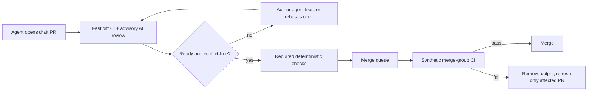

# PR Bots, Security Scanning, Dependency Automation, and Multi-Agent PR Workflow Best Practices

**Status:** complete

**Created:** 2026-08-12

## Table of Contents

- [Context](#context)
- [Temporal Scope](#temporal-scope)
- [Executive Summary](#executive-summary)
- [1. AI-Based Pull-Request Review Bots](#1-ai-based-pull-request-review-bots)
- [2. Standing Review Prompt Engineering](#2-standing-review-prompt-engineering)
- [3. Security Scanning](#3-security-scanning)
- [4. Dependency Automation](#4-dependency-automation)
- [5. Pull-Request Title Conventions](#5-pull-request-title-conventions)
- [6. Multi-Agent PR Orchestration](#6-multi-agent-pr-orchestration)
- [7. Cross-Agent Review Assignment](#7-cross-agent-review-assignment)
- [8. Gaps, Blindspots & Emergent Findings](#8-gaps-blindspots--emergent-findings)
- [Comparison](#comparison)
- [Recommendation](#recommendation)
- [Open Questions](#open-questions)
- [Sources](#sources)
- [Ambiguous Items from Auto-Remediation (Post-Run Review)](#ambiguous-items-from-auto-remediation-post-run-review)
- [Appendix: Research Prompt](#appendix-research-prompt)
- [Appendix: Provenance Ledger](#appendix-provenance-ledger)
- [Run History](#run-history)

<!-- doc:region name="context" kind="immutable" -->

## Context

Feeds ai-harness bd issue ISSUE-REF (hash ISSUE-REF, P2, type research). A personal fleet of
~20 GitHub repos (private, personal-account-owned) runs 3+ concurrent Claude Code / Codex agent
sessions that write code and open PRs, and needs a full breadth-and-depth survey of PR-workflow
tooling: AI-based GitHub Action review bots, cybersecurity/security-scanning bots, dependency
automation (Dependabot-class), PR title conventions, PR templates, and — the genuinely novel part
— best practices for orchestration-heavy fleets where many parallel agents create and must keep
PRs in sync with low operator overhead. Three prior docs exist and cover partial adjacent ground
(`docs/research/pr-template-best-practices.md`, `docs/research/llm-pr-review-bot-and-context-file-
test-enforcement.md`, `docs/research/merge-queue-options-for-multiagent-fleet.md`) — this is a
deliberately full fresh survey, not a narrow delta, per the repo owner's explicit request.

**Primary period:** 2025–2026
**Source weighting:** 2026 primary, 2025 secondary, 2024 tertiary; earlier sources only where foundational.

<!-- /doc:region name="context" -->

<!-- doc:region name="body" kind="replaceable" -->

## Temporal Scope

The survey reflects products and documentation live-fetched on 2026-08-12. Prices are snapshots,
not promises. Product capability claims use vendor or project documentation; vendor benchmarks are
identified as such and are not treated as independent comparative evaluations. Conventional
Commits is the one pre-2024 source retained because its 1.0.0 specification is foundational.

## Executive Summary

1. The correct control-plane split is **deterministic checks block; AI review advises**. GitHub
   Copilot and Anthropic's managed review explicitly do not satisfy approvals or block merges, and
   that is the right default for a high-throughput agent fleet until locally measured precision is
   strong. **V01.** [VERIFIABLE][^1][^5]

2. For this private, personal-account-owned fleet, GitHub's native CodeQL and repository secret
   scanning are not the assumed free baseline: private CodeQL needs GitHub Code Security on Team or
   Enterprise, while private secret scanning/push protection similarly depends on paid Secret
   Protection eligibility. **V02.** [VERIFIABLE][^13][^14] A free-first baseline should instead use
   Semgrep Community Edition or a small Semgrep App pilot, Gitleaks, ecosystem tests, and Trivy only
   where containers/IaC justify it. [INFERENCE]

3. Start with Dependabot because it is native and now supports both per-ecosystem and
   multi-ecosystem grouping; move selected repos to Renovate when age controls, package-manager
   breadth, or richer grouping justify the configuration cost. **V03.** [VERIFIABLE][^19][^20]

4. Do not continuously rebase or update every open agent PR after every `main` merge. Cancel
   superseded CI per PR, update only when a PR becomes ready/queued or crosses a lag threshold, and
   let the merge queue validate synthetic merge groups. GitHub exposes the needed concurrency and
   `merge_group` primitives; Mergify itself warns its update action is unnecessary with a merge
   queue. **V04.** [VERIFIABLE][^28][^29][^30]

5. Cross-agent review should be a distinct, auditable role and preferably use a different model
   family for high-risk changes. The only direct 2026 evidence found is an experimental Greptile
   vendor study, not independent research, so model inversion is a pilot hypothesis rather than a
   gate. **V05.** [VERIFIABLE][^33]

## 1. AI-Based Pull-Request Review Bots

There is no single “best reviewer.” The useful dividing line is deployment and control:

- **Managed reviewer/App:** easiest to operate and usually indexes the repository, but sends code
  to a vendor and offers less cost/runtime control.
- **Action-driven agent:** prompt and permissions are explicit YAML/repository state, but the owner
  pays model and Actions costs and owns prompt-injection, token, and workflow hardening.
- **Deterministic action:** not an AI reviewer, but should own any required merge status.

| Reviewer | Setup | Standing policy on every PR | Current cost for this fleet | Default merge effect |
|---|---|---|---|---|
| GitHub Copilot code review | Native GitHub ruleset/automatic-review setting | Yes: `.github/copilot-instructions.md`, root `AGENTS.md`, and path-scoped instruction files | Paid Copilot plan; reviews consume AI credits and Actions minutes | Comment-only; does not count as approval or block **V06.** [VERIFIABLE][^1][^2] |
| OpenAI Codex code review | Connect GitHub to Codex cloud; `@codex review` or automatic reviews | Yes: repository/nested `AGENTS.md` `## Code Review Rules`; concise scoped rules are recommended | Precise standalone per-review price/entitlement was not found in fetched public docs [NO SOURCE] | Standard review; automatic mode intentionally flags only P0/P1 **V07.** [VERIFIABLE][^3][^4] |
| Anthropic managed Code Review | GitHub App, Team/Enterprise research preview | Yes: hierarchical `CLAUDE.md`; root `REVIEW.md` adds “always flag” and “skip” rules | Vendor states about $15–$25 per review, token-billed separately | Advisory; neither approves nor blocks **V08.** [VERIFIABLE][^5] |
| `anthropics/claude-code-action` | Repository Action YAML plus Anthropic API, Bedrock, Vertex, or Foundry credentials | Yes: `prompt`/`prompt_file`, explicit tools and Action inputs | MIT Action; provider tokens plus GitHub Actions | Whatever status/comment behavior the workflow defines; should be advisory **V09.** [VERIFIABLE][^6] |
| CodeRabbit | Installed GitHub App; `.coderabbit.yaml` | Yes: auto-review, path instructions, exclusions, labels, tools, pre-merge checks | Pro $24/developer/month annual or $30 monthly; Pro+ $48/$60 | Reviews advisory; configured pre-merge checks can gate; `fail_commit_status` defaults false **V10.** [VERIFIABLE][^7][^8] |
| Qodo Merge / Qodo Code Review | Qodo GitHub App; legacy PR-Agent also has Action/self-hosted modes | Yes: governance rules, severity and triggers; legacy `extra_instructions` | Commercial credit plans/trial; qualifying OSS may be free; exact effective cost varies by credits | Configurable governance/status behavior; do not assume it is a required approval **V11.** [VERIFIABLE][^9][^37][^38][^39] |
| Greptile | GitHub/GitLab App with repository indexing | Custom rules are a Pro feature | Starter free: 50 credits/month, one active developer; Pro $30/seat/month plus overage | Inline advisory comments; agent-fix handoff is optional **V12.** [VERIFIABLE][^10] |
| Graphite Reviewer/Agent; no current standalone “Diamond” documentation was located [NO SOURCE] | Graphite GitHub App/dashboard | Yes: global, repository and file rules; PR filters and exclusions | Hobby free with limited AI reviews; Starter $20/user/month annual; Team $40 | Advisory comments; custom rule availability varies by plan **V13.** [VERIFIABLE][^11][^40] |
| Sourcery | Connected GitHub/GitLab App | Yes: taught review rules and coding standards | No current official public price was located after alternate official-site searches [NO SOURCE] | Automatic advisory review on each new PR **V14.** [VERIFIABLE][^12] |
| Cursor Bugbot | GitHub/GitLab integration tied to Cursor plans | Custom effort/logic; incremental-only re-review is configurable | Usage-based; vendor says average $1.00–$1.50/run; eligible Cursor plan required | Advisory findings, with optional Autofix **V15.** [VERIFIABLE][^34][^35] |

**Selection judgment.** For a personal fleet already using Codex and Claude, first pilot the
reviewer already included in an existing subscription, then compare it with one cross-model option
on the same seeded corpus. CodeRabbit and Greptile are operationally attractive, but buying a
second reviewer before measuring the included one creates cost without evidence of incremental
recall. [INFERENCE]

**Blocking policy.** AI output should remain advisory even when a product can emit a failing
status. Promote only narrow, named checks to blocking after a replay evaluation shows high
precision and a documented bypass. A model finding can create a human/agent task; tests, scanners,
required checks, and the queue decide mergeability. [HEURISTIC]

## 2. Standing Review Prompt Engineering

The strongest concrete product examples converge on repository-resident, scoped instructions:
Copilot supports root and path-specific instructions; Codex asks for short rules containing an
invariant and safe path; Anthropic separates general `CLAUDE.md` guidance from review-only
`REVIEW.md`; CodeRabbit exposes path instructions. **V16.** [VERIFIABLE][^1][^4][^5][^7]

A standing prompt should be a **review contract**, not a request to “find everything.” Recommended
stub:

```text
Role: You are the independent reviewer, not the author. Review only the PR diff against
the current base plus applicable repository/path instructions.

Priority: Report concrete P0/P1 correctness, security, data-loss, concurrency, API/schema,
backward-compatibility, or requirement violations. Report P2 only when evidence is strong.

Evidence: For each finding, give file/line, the violated invariant, a reproducible failure
scenario, severity, and the smallest safe remediation. If you cannot demonstrate impact,
do not report it.

Do not flag: style/formatting handled by CI; speculative future concerns; pre-existing code;
generated/vendor files; optional refactors; generic “add tests” requests without an uncovered
behavioral gap; praise or summaries masquerading as findings.

Checks: Verify the stated acceptance criteria, changed tests, boundary/error paths, authorization,
input validation, and migration/rollback behavior. Defer mechanical rules to deterministic CI.

Output: At most 5 findings, ordered P0→P2. One issue per finding. Say “No actionable findings”
when appropriate. Never approve, merge, push, or modify the branch.
```

This is intentionally shorter than a general coding-agent context file. Long global checklists
compete for attention and cause boilerplate findings; put domain invariants beside the affected
paths and keep deterministic policies in CI. OpenAI's 2026 guidance likewise says broad
instructions create noise and reports a vendor eval in which rule-guided review found 98% of
custom-rule issues versus 58.3% for its control. **V17.** [VERIFIABLE][^4] The percentage is a
vendor benchmark and should not be generalized to this fleet. [INFERENCE]

**Evaluation before rollout.** Build 20–50 replay PRs containing known P0/P1 bugs and matched safe
counterexamples. Track finding precision, known-bug recall, comments/PR, dismissal rate, latency,
cost, and reproducibility across three runs. Use a fixed noise budget (for example, median ≤2
findings/PR) and canary one repository before fleet rollout. [HEURISTIC]

## 3. Security Scanning

Security tools answer different questions; “install one security bot” is the wrong abstraction.
Use separate lanes for secrets, dependency advisories, source analysis, container/IaC exposure,
and workflow/supply-chain posture.

| Tool | Private personal repo economics | Setup/coverage | Noise assessment and gate policy |
|---|---|---|---|
| GitHub CodeQL | Not a free private-personal baseline: private/internal use requires GitHub Team/Enterprise plus GitHub Code Security **V18.** [VERIFIABLE][^13] | Lowest operational effort when eligible; default/advanced setup; broad supported-language SAST | Gate high-confidence new findings only; no current independent 2025–2026 comparative false-positive rate found [NO SOURCE] |
| GitHub secret scanning / push protection | Public-repo coverage is free; private repository coverage requires GitHub Secret Protection eligibility and does not fit the stated personal-account baseline **V19.** [VERIFIABLE][^14] | Very low effort when entitled; blocks supported secrets before push | High-value gate, but custom patterns need tuning [HEURISTIC] |
| Semgrep | Free App tier covers at most 10 private repos/10 contributors; Code and Supply Chain Teams begin at $30/contributor/month per product **V20.** [VERIFIABLE][^15] | GitHub App/CI or free CLI; diff-aware PR scans; broad custom rules | Start advisory, then gate a curated high-confidence ruleset/new findings; no controlled current cross-tool noise rate found [NO SOURCE] |
| Snyk | Free plan exposes SCA/SAST/IaC/container with five projects and per-product test limits; Team starts $25/contributing developer/month **V21.** [VERIFIABLE][^16] | Easy SCM App; strongest value when one dashboard across modalities matters | Advisory by default; gate only fixable new critical/high issues after baseline [HEURISTIC] |
| Trivy | Apache-2.0 Action/CLI; free | One workflow can scan filesystem, repository, image, IaC and SBOM; exit code can gate chosen severities **V22.** [VERIFIABLE][^17] | Useful for container/IaC repos; blanket installation on code-only repos adds low-value CVE churn [INFERENCE] |
| Gitleaks | Free for personal-account repos via Action; CLI can run directly | Fast secret scan in PR CI and pre-commit; organization use of the v2 Action has separate licensing **V23.** [VERIFIABLE][^18] | Good required check after allowlist/baseline tuning [HEURISTIC] |
| OpenSSF Scorecard | Official Action is free for public repos; private Action support is documented with GitHub Advanced Security, while CLI remains available **V24.** [VERIFIABLE][^36] | Audits workflow tokens, branch protection, dependency update practice and other supply-chain posture | Schedule/weekly posture check, not per-PR blocker [INFERENCE] |

**Recommended free-first security lanes.** Run Gitleaks on every PR; run language-native tests and
package audit where trustworthy; add Semgrep CE with a deliberately small ruleset; add Trivy only
to container/IaC repositories; schedule OpenSSF Scorecard or equivalent workflow hardening checks.
Keep all findings advisory during baseline burn-down, then require only “new, high-confidence,
fixable” failures. [HEURISTIC]

**False-positive evidence gap.** Marketing pages describe accuracy, but no comparable,
independent, current study using the same private-repository corpus and definition of false
positive was located for CodeQL, Semgrep, Snyk, and Trivy. Tool-by-tool “noise reputation” claims
would therefore be anecdote, not evidence. [NO SOURCE]

**Action security is upstream of scanner choice.** Pin third-party actions by full commit SHA,
declare minimum `GITHUB_TOKEN` permissions, avoid executing untrusted fork code under
`pull_request_target`, and isolate write-capable fixers from read-only reviewers. [HEURISTIC]

## 4. Dependency Automation

GitHub Free includes Dependabot security and version updates. Dependabot can group version updates
within an ecosystem and, in current documentation, group updates across ecosystems/directories
into one PR; GitHub's optimization guide explicitly recommends grouping minor/patch updates while
keeping majors individual. **V25.** [VERIFIABLE][^19][^41]

Renovate's hosted Community App and self-hosted edition are free, including private repositories;
its configuration supports `groupName`, concurrent PR/branch limits, `minimumReleaseAge`, and
platform automerge. Its own docs warn that platform automerge can merge failing tests unless at
least one status check is required. **V26.** [VERIFIABLE][^20][^21]

| Dimension | Dependabot | Renovate | Operational implication |
|---|---|---|---|
| Configuration | `.github/dependabot.yml`, native vocabulary | `renovate.json`/preset inheritance and extensive rules | Dependabot wins for uniform low-touch rollout; Renovate wins for policy expressiveness |
| Grouping | Ecosystem groups and multi-ecosystem groups | Arbitrary package rules, group names, presets, directories | Both can prevent PR floods; Renovate handles exceptional ecosystems/policies better |
| Rate control | Open-PR limit and schedule | PR/branch concurrent and hourly limits, schedules | Set a low fleet default (for example 2–3 open update PRs/repo) [HEURISTIC] |
| Release safety | Ignore/version rules | `minimumReleaseAge`, confidence and package rules | Renovate is stronger where supply-chain cooling-off periods matter |
| Merge queue | Normal PR with required checks/auto-merge | Normal PR; platform automerge respects required checks when configured correctly | Never give either bot a branch-protection bypass [HEURISTIC] |
| Failure blast radius | Grouped PR may contain several updates | Same | One failure blocks the group; split majors/risky ecosystems [INFERENCE] |

Use one dependency bot per repository, not both. Group routine patch/minor updates weekly; keep
majors, security emergencies, runtime/framework upgrades, and known fragile ecosystems separate.
Queue the bot PR only after the same required checks as agent PRs pass. [HEURISTIC]

## 5. Pull-Request Title Conventions

There is no verified universal industry-standard PR-title convention. [NO SOURCE] Conventional
Commits specifies **commit messages**, in the form `type[scope]: description`; `fix` maps to a
patch, `feat` to a minor, and `!`/`BREAKING CHANGE` to a major. **V27.** [VERIFIABLE][^22]

PR titles become release metadata only through repository configuration. GitHub can generate a
squash commit from the PR title/body, while semantic-release analyzes commit messages (Angular
convention by default) to determine a release. Therefore, title linting is load-bearing only when
the squash title becomes the commit subject or another automation directly parses PR titles.
**V28.** [VERIFIABLE][^23][^25]

`amannn/action-semantic-pull-request` is the pragmatic standard action: it validates types, scopes
and subjects and documents the `synchronize` event needed when the check is required. Its
`pull_request_target` mode must not be combined with checkout/execution of untrusted PR code.
**V29.** [VERIFIABLE][^24] Electron is a concrete OSS example: its documentation requires
Conventional Commit-formatted PRs, uses squash merges, and says only the PR-title prefix needs that
format. **V30.** [VERIFIABLE][^26]

**Recommendation:** configure squash commits to use the PR title, adopt
`feat|fix|perf|refactor|docs|test|build|ci|chore|revert` with optional scope, and add a cheap
required title check if changelog/release automation consumes the result. If it does not, use an
advisory check or skip it; title aesthetics alone do not justify another blocking failure mode.
[HEURISTIC]

## 6. Multi-Agent PR Orchestration

The core scaling problem is not Git conflict frequency; it is **speculative-work invalidation**.
Every automatic update changes a PR SHA, retriggers CI and AI review, and may dismiss stale
approvals. GitHub explicitly documents that a new code-modifying commit can dismiss approvals when
stale-review dismissal is enabled. **V31.** [VERIFIABLE][^32]

Recommended state machine:



**Branch freshness.** GitHub's update-branch REST endpoint merges the base into the PR head and
supports `expected_head_sha` to reject a raced update; it does not promise automatic conflict
resolution. **V32.** [VERIFIABLE][^27] Use it only for an explicit `ready-to-queue` label, a merge
conflict, or a configured lag threshold. Mergify's own documentation calls its update action
unnecessary with merge queue and demonstrates threshold/label conditions to avoid needless CI
reruns. **V33.** [VERIFIABLE][^28]

**CI deduplication.** Key Actions concurrency by workflow plus PR head/ref and set
`cancel-in-progress: true`; GitHub documents that a newer run in the group can cancel the in-flight
one. Also add the `merge_group` trigger to every workflow whose check is required by the queue,
because GitHub warns the queue cannot merge without those group checks. **V34.**
[VERIFIABLE][^29][^30]

**Sharding.** Run lint/typecheck/unit tests first; start costly integration/security/reviewer jobs
only when the cheap lane passes or the PR is labeled ready. Cache by lockfile/toolchain, not branch
name, and serialize scarce external environments separately from PR concurrency. [HEURISTIC]

**Stacked PRs.** Graphite can restack descendants and merge a stack while rebasing it, but current
docs say conflicts still require terminal resolution and its stack merge is not compatible with
GitHub merge queue. **V35.** [VERIFIABLE][^31] Stacks are therefore useful for one deliberate,
dependent change series—not as the default representation of independent agents. They amplify CI
and dependency fanout when a lower PR changes. [INFERENCE]

**Conflict repair.** Permit an author agent to rebase or resolve conflicts on its own branch only
after fetching current base, rerunning affected tests, and showing the resulting diff. Do not let a
review agent silently write the branch it reviews. Generated lockfile conflicts may be regenerated
from manifests; semantic source conflicts need the author agent or human because line-level merge
success does not establish behavioral intent. [HEURISTIC]

**Ownership and leases.** Give each PR one author-agent lease, record base SHA and task scope, and
prevent two agents from pushing the same branch. Before costly work, agents should check whether
the file set overlaps active PRs; route overlapping work to sequencing or a shared parent task.
[HEURISTIC]

## 7. Cross-Agent Review Assignment

GitHub prevents a PR author from approving its own PR. **V36.** [VERIFIABLE][^32] That account-level
rule is necessary but insufficient for agents: several sessions may share one bot identity, model,
context, or write token.

No mature cross-vendor standard was found for recording AI authorship and assigning a distinct AI
reviewer identity across a personal fleet. [NO SOURCE] The nearest direct evidence is Greptile's
July 2026 vendor study: two datasets of 500 Claude- and Codex-authored PRs, roughly 1,500 verified
high-severity comments, and three review runs per model. It reported Claude recall of 53.7% on
Claude-authored versus 62.0% on Codex-authored PRs, and GPT recall of 60.0% versus 50.5%, then
shipped experimental model-inversion routing. **V37.** [VERIFIABLE][^33] Authorship detection and
ISSUE-REF matching are methodological limitations, and the vendor benefits from the result.
[INFERENCE]

Minimum guardrails for a pilot:

1. Record `author_agent`, model/version, run/session ID and base SHA in machine-readable PR
   metadata; assign a different review run and, for high-risk PRs, a different model family.
2. Reviewer token is read-only except PR comments/check output. It cannot push, approve, dismiss,
   label for auto-merge, or bypass checks.
3. Reviewer sees the diff, base, acceptance criteria, tests and repository rules—not the author's
   private chain of reasoning. This reduces correlated anchoring but does not create independence.
4. Author agent addresses findings; reviewer rechecks only the new delta. Deterministic checks
   still gate. Human review remains required for auth, secrets, destructive migrations, release
   signing, permission changes and workflow-token expansion.
5. Measure same-model and cross-model precision/recall locally before routing by author model.

These are operational guardrails derived from separation of duties, not a documented community
standard. [HEURISTIC]

## 8. Gaps, Blindspots & Emergent Findings

**Blindspot: data residency and training terms can dominate price.** Managed reviewers may index
entire private repositories, while Action-based reviewers can still transmit selected context to a
model provider. The exact retention, regional-processing and model-training terms vary by plan and
contract and were not normalized in this survey. [NO SOURCE] Treat privacy review as a deployment
gate, especially before future open-source status changes. [HEURISTIC]

**Emergent finding: incremental review is a first-class cost/noise control.** CodeRabbit can review
incrementally, and Cursor added a mode that reviews only changes since the last review because
whole-PR re-review could surface new flags on previously reviewed code. **V38.**
[VERIFIABLE][^7][^35] Prefer incremental review after the first pass, with a full pass only when
base, configuration, or broad dependencies change. [INFERENCE]

**Contrarian finding: more bots can reduce safety.** A fleet with several overlapping AI reviewers,
SAST products and dependency scanners creates duplicated comments, status ambiguity, cost and
alert fatigue. There is no evidence that installing every named tool yields additive defect
coverage. [NO SOURCE] Give each tool an explicit lane and success metric; remove it if it does not
find unique actionable defects. [HEURISTIC]

**Blindspot: benchmark independence.** Current reviewer evidence is overwhelmingly vendor-produced;
no independent 2025–2026 benchmark was found that compares all named tools on identical private,
agent-authored PRs and reports precision, recall, latency and cost. [NO SOURCE] This makes a local
replay corpus more decision-relevant than vendor leaderboards. [INFERENCE]

**Emergent finding: supply-chain posture deserves its own lane.** OpenSSF Scorecard checks token
permissions, branch protection, review, dependency-update practice and other controls that source
scanners do not. **V39.** [VERIFIABLE][^36] For private personal repos its CLI/scheduled-report path
is more realistic than treating Security-tab integration as a required PR check. [INFERENCE]

**Unresolved blindspot: repository rulesets on personal private repositories.** Feature availability
and plan entitlements change; the exact fleet-wide ruleset/merge-queue availability must be checked
against the owner's current GitHub plan and repository UI before rollout. [NO SOURCE]

## Comparison

| Layer/tool | Cost snapshot | Setup effort | Free/private fit | Recommended fleet role |
|---|---:|---|---|---|
| Existing-subscription Codex or Copilot review | Entitlement + usage/credits | Low | Conditional | One advisory reviewer pilot |
| Claude managed review | ~$15–$25/review; Team/Enterprise | Low | Poor | Reference option; too costly for every PR at fleet volume |
| Claude Code Action | Model tokens + Actions | Medium/high | Good if API budget exists | Most controllable custom standing prompt |
| CodeRabbit Pro | $24/dev/mo annual | Low | Paid | Polished managed alternative after local eval |
| Greptile Starter/Pro | Free 50 credits; $30/seat/mo | Low | Good pilot | Cross-model/repository-aware comparison |
| Graphite | Free limited; $20/$40 annual-plan tiers | Medium | Conditional | Useful only if stacks/Graphite workflow are also desired |
| Qodo | Trial/credits; qualified OSS free | Low/medium | Conditional | Governance-heavy teams, not first free choice |
| Cursor Bugbot | Usage-based, ~$1–$1.50 average run | Low | Conditional | Candidate if fleet already pays for Cursor |
| Gitleaks | Free personal use/CLI | Low | Excellent | Required secret check after baseline tuning |
| Semgrep CE/App free | CE free; App ≤10 private repos | Medium | Good but App cap below 20 repos | Curated new-finding SAST |
| Trivy | Free OSS | Low/medium | Excellent | Required high/critical container/IaC check where relevant |
| Snyk Free | Five projects | Low | Pilot only | Multi-modal dashboard comparison |
| GitHub CodeQL/secret protection | Paid GitHub security entitlements for private repos | Low | Poor for stated account shape | Revisit if fleet moves to paid organization |
| Dependabot | Free on GitHub Free (V25) | Low | Excellent | Default grouped weekly dependency updates |
| Renovate Community/self-hosted | Free | Medium/high | Excellent | Repos needing age controls or advanced grouping |
| Semantic PR action | Free OSS | Low | Excellent | Required only when squash title drives release/changelog |
| Mergify update/queue | See adjacent merge-queue research | Medium | Conditional | Update only ready/lagged PRs; avoid with queue when redundant |

Cost figures are current vendor list-price snapshots from the cited product rows, excluding GitHub
Actions minutes, taxes, model-token variance, and operator time. Cross-repository volume discounts
were not publicly verifiable. [NO SOURCE]

## Recommendation

This is an input to the owner's decision, not a final decision.

**Phase 0 — establish the control plane (all repos).** Require branch protection/rules, tests,
lint/typecheck, Gitleaks, least-privilege Action tokens and one dependency bot. Add PR-level
concurrency cancellation and ensure queue-required workflows listen for `merge_group`. Configure
squash titles consistently. [HEURISTIC]

**Phase 1 — free-first automation.** Use grouped weekly Dependabot updates (minor/patch together,
majors separate). Run Semgrep CE on a small high-confidence ruleset; add Trivy only for container or
IaC repos. Use `amannn/action-semantic-pull-request` only where the squash title feeds release notes
or semantic-release. [HEURISTIC]

**Phase 2 — one advisory AI reviewer.** Pilot whichever of Codex/Copilot is already entitled on
two representative repos, using the standing prompt in §2 and path-scoped invariants. Cap at five
findings and review incrementally. Do not make it required. Compare against 20–50 labeled replay
PRs and record unique actionable findings, precision, known-bug recall, cost and latency.
[HEURISTIC]

**Phase 3 — cross-model experiment.** On high-risk or AI-authored PRs, route Claude-authored changes
to Codex/GPT review and Codex-authored changes to Claude only as an experiment. Keep identities,
tokens and run metadata separate. Stop if local precision/recall does not beat the single-reviewer
baseline enough to justify cost. [INFERENCE]

**Phase 4 — readiness-based synchronization.** Agent PRs start as drafts. The author updates from
`main` only at ready/queue time, when conflicted, or beyond a measured lag threshold. Superseded CI
runs cancel; the merge queue performs final synthetic-head validation. Stacked PR tooling is opt-in
for truly dependent series. [HEURISTIC]

**Tradeoffs.** This stack sacrifices “AI blocks bad merges” theater for auditable deterministic
gates, and it accepts that some semantic bugs still need human review. It also favors lower bot
count and manual escalation over maximal comment coverage. In return, it minimizes PR noise,
duplicate compute, secret exposure surfaces and subscription sprawl. [INFERENCE]

## Open Questions

1. Which Codex/Copilot/Claude entitlements does the owner already have, and what is the measured
   marginal review cost under real PR sizes?
2. Which repositories contain containers, Terraform/Kubernetes, release automation, or destructive
   migrations and therefore need stricter, path-specific lanes?
3. Does the current GitHub account/plan expose rulesets and merge queue for every private repository?
4. What local replay corpus and defect taxonomy will be used to compare reviewers without leaking
   private code to additional vendors?
5. What minimum cross-model recall/precision improvement justifies a second model review?
6. Should the fleet move to an organization account if private CodeQL, secret protection, shared
   rulesets, auditability, or App governance becomes more valuable than free personal ownership?
7. Which bot identity owns author branches, and how will leases prevent concurrent pushes?
8. Which status checks are stable names across `pull_request` and `merge_group` events?

## Sources

[^1]: GitHub. (2026). [Using GitHub Copilot code review](https://docs.github.com/en/copilot/how-tos/copilot-on-github/use-copilot-agents/copilot-code-review). GitHub Docs. Verified accessible (HTTP 200) 2026-08-12. (Instruction-file support and comment-only review behavior.)

[^2]: GitHub. (2026). [Configuring automatic code review by GitHub Copilot](https://docs.github.com/en/copilot/how-tos/copilot-on-github/set-up-copilot/configure-automatic-review). GitHub Docs. Verified accessible (HTTP 200) 2026-08-12. (Ruleset triggers and personal-plan behavior.)

[^3]: OpenAI. (2026). [Using Codex with GitHub](https://learn.chatgpt.com/docs/third-party/github). OpenAI Learning Center. Verified accessible (HTTP 200) 2026-08-12. (Automatic/mention review, P0/P1 behavior, AGENTS.md rules, security-review preview.)

[^4]: OpenAI. (2026, July 20). [Custom code review rules for Codex](https://learn.chatgpt.com/blog/custom-code-review-rules-for-codex). OpenAI Learning Center. Verified accessible (HTTP 200) 2026-08-12. (Rule design and vendor evaluation results.)

[^5]: Anthropic. (2026). [Set up Code Review for Claude Code](https://support.claude.com/en/articles/14233555-set-up-code-review-for-claude-code). Claude Help Center. Verified accessible (HTTP 200) 2026-08-12. (App setup, REVIEW.md, advisory behavior, access and cost.)

[^6]: Anthropic. (2026). [Claude Code Action](https://github.com/anthropics/claude-code-action). GitHub. Verified accessible (HTTP 200) 2026-08-12. (Action deployment, authentication providers, prompts and license.)

[^7]: CodeRabbit. (2026). [Configuration reference](https://docs.coderabbit.ai/reference/configuration). CodeRabbit Documentation. Verified accessible (HTTP 200) 2026-08-12. (Auto-review, path instructions, incremental review and commit-status configuration.)

[^8]: CodeRabbit. (2026). [Plans](https://docs.coderabbit.ai/management/plans). CodeRabbit Documentation. Verified accessible (HTTP 200) 2026-08-12. (Current Pro and Pro+ list prices and plan features.)

[^9]: Qodo. (2026). [Pricing](https://www.qodo.ai/pricing/). Qodo. Verified accessible (HTTP 200) 2026-08-12. (Trial, credits and qualifying open-source terms; effective cost remains usage-dependent.)

[^10]: Greptile. (2026). [Pricing](https://www.greptile.com/pricing). Greptile. Verified accessible (HTTP 200) 2026-08-12. (Starter/Pro credits, developer limits and custom-rule entitlement.)

[^11]: Graphite. (2026). [Pricing](https://www.graphite.com/pricing). Graphite. Verified accessible (HTTP 200) 2026-08-12. (Hobby, Starter and Team list-price snapshot.)

[^12]: Sourcery. (2026). [Code reviews on pull requests: Overview](https://docs.sourcery.ai/Code-Review/Code-Reviews-on-Pull-Requests/Overview/). Sourcery Documentation. Verified accessible (HTTP 200) 2026-08-12. (Automatic review and review categories.)

[^13]: GitHub. (2026). [Enabling code scanning for private repositories](https://docs.github.com/en/code-security/reference/code-scanning/troubleshoot-analysis-errors/private-repository-enablement). GitHub Docs. Verified accessible (HTTP 200) 2026-08-12. (Private-repository CodeQL entitlement.)

[^14]: GitHub. (2026). [Secret scanning scope](https://docs.github.com/en/code-security/reference/secret-security/secret-scanning-scope). GitHub Docs. Verified accessible (HTTP 200) 2026-08-12. (Public and private repository entitlement boundaries.)

[^15]: Semgrep. (2026). [Pricing](https://semgrep.dev/pricing/). Semgrep. Verified accessible (HTTP 200) 2026-08-12. (Free private-repository/contributor limits and Teams prices.)

[^16]: Snyk. (2026). [Plans and pricing](https://snyk.io/plans/). Snyk. Verified accessible (HTTP 200) 2026-08-12. (Free project/test limits and Team starting price.)

[^17]: Aqua Security. (2026). [Trivy GitHub Action](https://github.com/aquasecurity/trivy-action). GitHub. Verified accessible (HTTP 200) 2026-08-12. (License, scan targets, formats and exit-code gating.)

[^18]: Gitleaks. (2026). [Gitleaks Action](https://github.com/gitleaks/gitleaks-action). GitHub. Verified accessible (HTTP 200) 2026-08-12. (Personal-use terms, CI usage and organization licensing note.)

[^19]: GitHub. (2026). [Optimizing Dependabot version updates](https://docs.github.com/en/code-security/tutorials/secure-your-dependencies/optimizing-pr-creation-version-updates). GitHub Docs. Verified accessible (HTTP 200) 2026-08-12. (Grouping and PR-volume guidance.)

[^20]: Renovate. (2026). [Mend Renovate Community hosted app overview](https://docs.renovatebot.com/mend-hosted/overview/). Renovate Documentation. Verified accessible (HTTP 200) 2026-08-12. (Free hosted public/private repository service.)

[^21]: Renovate. (2026). [Configuration options](https://docs.renovatebot.com/configuration-options/). Renovate Documentation. Verified accessible (HTTP 200) 2026-08-12. (Grouping, release age, concurrency and automerge/status-check behavior.)

[^22]: Conventional Commits. (n.d.). [Conventional Commits 1.0.0](https://www.conventionalcommits.org/en/v1.0.0/). Conventional Commits. Verified accessible (HTTP 200) 2026-08-12. (Foundational commit-message specification.)

[^23]: GitHub. (2026). [Configuring commit squashing for pull requests](https://docs.github.com/enterprise-cloud@latest/repositories/configuring-branches-and-merges-in-your-repository/configuring-pull-request-merges/configuring-commit-squashing-for-pull-requests). GitHub Docs. Verified accessible (HTTP 200) 2026-08-12. (Squash commit title/message sources.)

[^24]: Mann, A. (2026). [Semantic Pull Request Action](https://github.com/amannn/action-semantic-pull-request). GitHub. Verified accessible (HTTP 200) 2026-08-12. (Title validation, event and security configuration.)

[^25]: semantic-release. (2026). [semantic-release](https://semantic-release.gitbook.io/semantic-release). semantic-release Documentation. Verified accessible (HTTP 200) 2026-08-12. (Commit analysis and default convention.)

[^26]: Electron. (2026). [Electron versioning](https://github.com/electron/electron/blob/main/docs/tutorial/electron-versioning.md). GitHub. Verified accessible (HTTP 200) 2026-08-12. (Conventional PR titles and squash-merge practice.)

[^27]: GitHub. (2026). [REST API endpoints for pull requests: Update a pull request branch](https://docs.github.com/en/rest/pulls/pulls?apiVersion=2022-11-28#update-a-pull-request-branch). GitHub Docs. Verified accessible (HTTP 200) 2026-08-12. (Base-to-head update operation and expected-head precondition.)

[^28]: Mergify. (2026). [Update pull request action](https://docs.mergify.com/workflow/actions/update/). Mergify Documentation. Verified accessible (HTTP 200) 2026-08-12. (Queue redundancy and conditional update examples.)

[^29]: GitHub. (2026). [Control the concurrency of workflows and jobs](https://docs.github.com/en/actions/how-tos/write-workflows/choose-when-workflows-run/control-workflow-concurrency). GitHub Docs. Verified accessible (HTTP 200) 2026-08-12. (Concurrency groups and cancellation.)

[^30]: GitHub. (2026). [Events that trigger workflows: `merge_group`](https://docs.github.com/en/actions/reference/workflows-and-actions/events-that-trigger-workflows#merge_group). GitHub Docs. Verified accessible (HTTP 200) 2026-08-12. (Merge-queue required-check trigger.)

[^31]: Graphite. (2026). [Merge pull requests](https://graphite.com/docs/merge-pull-requests). Graphite Documentation. Verified accessible (HTTP 200) 2026-08-12. (Stack rebase/conflict handling and GitHub merge-queue incompatibility.)

[^32]: GitHub. (2026). [Approving a pull request with required reviews](https://docs.github.com/en/pull-requests/how-tos/review-pull-requests/approving-a-pull-request-with-required-reviews). GitHub Docs. Verified accessible (HTTP 200) 2026-08-12. (Self-approval prohibition and stale approval behavior.)

[^33]: Caridad, R. (2026, July 21). [Models are worse at reviewing their own code](https://www.greptile.com/blog/model-inversion). Greptile. Verified accessible (HTTP 200) 2026-08-12. (Vendor study of same-model versus cross-model review; experimental evidence.)

[^34]: Cursor. (2026, May 11). [Updates to Bugbot for Teams and Individuals](https://cursor.com/blog/may-2026-bugbot-changes). Cursor. Verified accessible (HTTP 200) 2026-08-12. (Usage-based billing, average run cost and effort control.)

[^35]: Smale, J., Volkov, Y., & Zhao, M. (2026, June 10). [Bugbot updates](https://cursor.com/blog/bugbot-updates-june-2026). Cursor. Verified accessible (HTTP 200) 2026-08-12. (Incremental review and local/GitHub review deduplication.)

[^36]: OpenSSF. (2026). [Scorecard GitHub Action](https://github.com/ossf/scorecard-action). GitHub. Verified accessible (HTTP 200) 2026-08-12. (Private-repository eligibility, CLI alternative and supply-chain checks.)

[^37]: Qodo. (2026). [Get started with Qodo Merge](https://docs.qodo.ai/get-started). Qodo Documentation. Verified accessible (HTTP 200) 2026-08-12. (GitHub App installation and automatic review setup.)

[^38]: Qodo. (2026). [Governance management](https://docs.qodo.ai/governance/governance-management). Qodo Documentation. Verified accessible (HTTP 200) 2026-08-12. (Rules, triggers and severity configuration.)

[^39]: Qodo. (2026). [PR-Agent documentation](https://qodo-merge-docs.qodo.ai/). Qodo Documentation. Verified accessible (HTTP 200) 2026-08-12. (Legacy open-source PR-Agent deployment and configuration scope.)

[^40]: Graphite. (2026). [AI review customization](https://graphite.com/docs/ai-review-customization). Graphite Documentation. Verified accessible (HTTP 200) 2026-08-12. (Global/repository/file rules, filters and exclusions.)

[^41]: GitHub. (2026). [Pricing](https://github.com/pricing). GitHub. Verified accessible (HTTP 200) 2026-08-12. (GitHub Free includes Dependabot security and version updates.)

<!-- /doc:region name="body" -->

<!-- doc:region name="ambiguous_items" kind="replaceable" -->

## Ambiguous Items from Auto-Remediation (Post-Run Review)

(none — this was a direct scoped research run, not an auto-remediation pass)

<!-- /doc:region name="ambiguous_items" -->

<!-- doc:region name="appendix_research_prompt" kind="immutable" -->

## Appendix: Research Prompt

**Registry ID:** ISSUE-REF
**Model:** `gpt-5-codex` (high effort)
**Date:** 2026-08-12

```text
## Role identity and task

You are a principal engineer who has designed and operated PR-workflow tooling (review bots,
security scanners, dependency automation, PR templates, and merge-queue coordination) for
engineering organizations, and specifically for fleets where AI coding agents (not only humans)
open and manage a high volume of concurrent pull requests. You have strong opinions backed by
evidence. When you cannot find a source, you say so explicitly.

## Background — treat as established, do not re-derive

A personal fleet of ~20 GitHub repos (private, personal-account-owned, some candidates for future
open-sourcing) runs 3+ concurrent Claude Code / Codex agent sessions that write code, open PRs,
and increasingly will need those PRs reviewed, merged, and kept in sync with a moving `main`
branch with minimal human operator overhead. The fleet already has partial prior research on three
adjacent topics — do NOT re-derive their findings, they are established background, and this
research should build on them without duplicating their content:

- `docs/research/pr-template-best-practices.md` (complete) — PR-template anatomy: essential vs.
  conditional sections (Summary/Why, linked issue, test plan, checklist as essential; screenshots,
  breaking-change/risk, release notes as conditional), gold-standard OSS examples (Kubernetes,
  React, Angular, Django's AI-disclosure checkboxes), Action-Items-vs-Follow-ups placement.
- `docs/research/llm-pr-review-bot-and-context-file-test-enforcement.md` (draft) — prompt
  engineering for a low-noise LLM review bot (explicit "what NOT to flag" lists, advisory framing,
  structured output, severity calibration), a comparison table of CodeRabbit / GitHub Copilot Code
  Review / Claude Code Action / Qodo-PR-Agent / Sourcery / Greptile / Danger JS / Codecov, and
  agent-context-file best practices (imperative + short + path-scoped + single-source-via-import).
- `docs/research/merge-queue-options-for-multiagent-fleet.md` (complete) — GitHub-native merge
  queue vs. Mergify vs. Graphite vs. Trunk vs. Aviator vs. self-hosted, with pricing and a staged
  recommendation (protected-PR baseline first, then a Mergify pilot).

This research is deliberately a FULL fresh breadth-and-depth survey of the surrounding space, not
a narrow delta — the repo owner explicitly wants independent coverage rather than an assumption
that the above three docs already answer everything. Cross-reference them where genuinely relevant
but do not treat their framing as a ceiling.

Assume all Background points above are established and do not re-derive them.

## Research questions (a floor, not a checklist — see independent-exploration block below)

### Part 1 — GitHub Action review bots (AI-based)

1. What are the current (2025-2026) leading GitHub Action / App-based AI code-review bots —
   GitHub Copilot Code Review, Claude Code Action (Anthropic's own GitHub Action), a Codex-based
   review action/bot, CodeRabbit, Qodo/PR-Agent, Sourcery, Greptile, Diamond, and any other
   widely-adopted option? For each: setup mechanism (Action YAML vs. installed App vs. webhook
   service), pricing/free tier, whether it can be configured to ALWAYS run a specific standing
   prompt/checklist on every PR (vs. purely autonomous judgment), and how blocking vs. advisory it
   is by default.
2. What does effective prompt engineering look like for a STANDING review-bot prompt meant to run
   on every PR in an AI-agent-heavy fleet — i.e., what should the "prompt stub" that always fires
   contain? Survey concrete real-world examples of GitHub Action review-bot system prompts /
   configuration files (not just marketing claims) where available.

### Part 2 — Cybersecurity / security-scanning bots and dependency automation

3. What are the standard, widely-adopted security-scanning bots/Actions for a GitHub repo —
   CodeQL (GitHub's native SAST), Snyk, Semgrep (and its GitHub Action), Trivy, GitHub secret
   scanning / push protection, and any 2025-2026 entrants? For each: free vs. paid tier for a
   private personal-account-owned repo, setup complexity, and false-positive/noise reputation.
4. What are the standard dependency-update bots — Dependabot (GitHub-native), Renovate, and any
   comparable tool? Compare their configuration models, PR-grouping/batching behavior (important
   for not flooding a busy repo with individual bump PRs), and how they interact with a merge
   queue or required-status-check gate.

### Part 3 — PR title conventions

5. What is the current industry-standard convention for PR titles (Conventional Commits-style
   prefixes, or an alternative), and how does it interact with squash-merge commit-message
   generation, changelog automation, and semantic-release tooling? Survey how gold-standard OSS
   projects enforce this (a GitHub Action that lints PR titles, e.g. `amannn/action-semantic-pull-
   request` or equivalents) — is title-linting itself a standard bot/Action worth adopting?

### Part 4 — Multi-agent / orchestration-heavy PR workflows at scale

6. What documented best practices exist (2025-2026, from AI-coding-agent vendors, engineering
   blogs, or OSS projects that operate agent fleets) for a setup where MANY concurrent autonomous
   agents each open, update, and need-to-merge their own PRs against the same fast-moving `main`,
   with a human operator who wants LOW day-to-day overhead? Cover at minimum: auto-rebase/auto-
   update-branch bots that keep stale PRs current with main (e.g. Mergify's update-branch action,
   GitHub's "update branch" button automation, or custom bots), stacked-PR tooling relevance here,
   how to avoid N agents' PRs constantly invalidating each other's CI runs, and any patterns for
   an agent's own review bot to auto-resolve trivial merge conflicts or rebase itself.
7. Is there a documented pattern for having the SAME AI system (e.g. Claude Code or Codex) both
   author a PR and separately review a DIFFERENT agent's PR in the same fleet — cross-agent review
   assignment — and what guardrails (e.g. never let an agent review its own PR; require a distinct
   agent identity/persona for review vs. authorship) does the community recommend?

## Scope note — questions, examples, and named references are a starting point, not a checklist
The questions, topics, and named examples above are illustrative anchors and a FLOOR for this
research — not an exhaustive list to answer only or evaluate only. Reason independently: survey the
landscape broadly, follow the evidence where it leads, expand scope where warranted, and surface
relevant work, factors, and failure modes not named here. Actively resist answering only the listed
questions or evaluating only the named approaches — an output that merely fills in the listed items
has NOT met the research goal. In particular, actively look for free/OSS options throughout (the
repo owner prefers free where viable) while still surfacing strong paid tools for reference.

## Independent exploration (gaps, blindspots, emergent threads) — required
Treat the question list as a FLOOR, not a ceiling. As you research, actively surface what this
framing may be missing and pursue each promising thread to a logical conclusion:
- Adjacent or upstream factors the questions don't capture.
- Contrarian / disconfirming evidence — report it even when it challenges the premise.
- Emerging 2025-2026 practices, tools, or research not anchored by the named examples.
- Known failure modes and second-order effects.
Whenever a load-bearing thread surfaces mid-research, follow it to its conclusion and report it in a
dedicated "Gaps, blindspots & emergent findings" subsection. Explicitly NAME any blindspot you
suspect but cannot resolve (and why) rather than omitting it. Anchor bias — over-fitting to the
listed questions and example approaches — is a known failure mode; counter it deliberately and say
where you did.

<grounding_instructions>
You are a principal engineer who has designed and operated PR-workflow tooling for engineering
organizations, including fleets where AI coding agents open and manage a high volume of concurrent
pull requests. You have strong opinions backed by evidence. When you cannot find a source, you say
so explicitly.

Temporal scope: Weight sources by recency — 2026 (primary) → 2025 → 2024. Pre-2024 sources are
background context only unless foundational to the topic. If post-2024 literature is genuinely
sparse for a subtopic, state "[subtopic]: no significant post-2024 developments found" rather than
backfilling with older sources. Backfilling is a failure mode, not a hedge.

Before generating your final output, execute a Chain-of-Verification (CoVe) to ensure factual
fidelity over compliance.

Inside your thought process:
1. Isolate the core facts required.
2. Draft a tentative response.
3. Hostile Cross-Examination: flag any claim where you are citing a source because the prompt
   implied you should, rather than because you verified it.
4. Strip away any claim that cannot be empirically verified.

When generating your final output, classify every major claim. Write your rationale before
appending the tag -- writing the tag first causes post-hoc rationalization. Rationale -> evidence
check -> tag.

- [VERIFIABLE]: backed by documentation, peer-reviewed research, or official tech blogs
  (2024-2026). Carry an inline footnote ref to the source: [VERIFIABLE][^N].
- [HEURISTIC]: widely accepted best practice without a specific citation.
- [INFERENCE]: a logical conclusion drawn from context. Provide your reasoning in-text. Do not
  fabricate a source. Tier tag only -- NO footnote ref.
- [NO SOURCE]: explicitly state when you cannot find verifiable data. Tier tag only -- NO
  footnote ref.

Citation format (mandatory for every externally-sourced claim):
- Inline: append the GFM footnote ref directly after the tier tag -- [VERIFIABLE][^N]. A claim
  citing multiple sources carries ascending separate refs -- [VERIFIABLE][^3][^7] (never grouped
  [^3,^7]; never out of order).
- Footnote definitions live once, under ## Sources, in APA form with a clickable URL or DOI and an
  access-verification stamp.
- URL-or-DOI ALWAYS: every source entry carries a clickable URL or a doi.org link.
- Integrity: footnote refs are contiguous from [^1], every [^N] ref has a matching definition, and
  every definition is referenced -- no gaps, no orphans.
- [INFERENCE] / [NO SOURCE] claims carry the tier tag with NO footnote ref.

Hard constraint (overrides all formatting preferences): never invent a citation to satisfy a
formatting instruction. Accuracy > completeness.

For each load-bearing claim, require at least one web_search or web_fetch call; you must not
return [VERIFIABLE] without a URL you actually fetched in this session. Do not stop after one
round. If no source is found for a sub-question, run additional searches across alternate framings
before tagging it [NO SOURCE] -- that tag is reserved for genuine evidence absence, not retrieval
avoidance.

Format diagrams using Mermaid.js or ASCII. Format math using LaTeX. NEVER generate binary images.
</grounding_instructions>

## Required deliverable shape

Write the finished research document directly into a new file at
`docs/research/pr-bots-and-multiagent-pr-workflow-best-practices.md`, following
`<workspace>/repository/docs/research/TEMPLATE.md`'s structure exactly (frontmatter with
template_version "research-1.2.0", Table of Contents, Context section stating this feeds
ai-harness bd issue ISSUE-REF [hash ISSUE-REF], Executive Summary with 3-5 numbered findings,
numbered topic sections matching the four parts above plus a dedicated multi-agent-orchestration
section, a Comparison section (tool-by-tool, cost, setup effort, free-vs-paid), a Recommendation
section (a concrete recommended stack for this fleet's shape, with honest tradeoffs — this is an
INPUT for the repo owner's decision, not a final decision), an Open Questions section, a Sources
section as GFM footnote definitions, an Appendix: Research Prompt section with this exact prompt
verbatim in a fenced text block with Registry ID, Model, and Date fields filled, an Appendix:
Provenance Ledger with claim→quote→verdict rows for every [VERIFIABLE] claim, and a Run History
entry. Live-fetch every citation; do not accept a citation from memory alone.

End your final chat message (not the file) with: your top 3 concrete recommendations in one
sentence each, and the file path you wrote to. Under 150 words.
```

<!-- /doc:region name="appendix_research_prompt" -->

<!-- doc:region name="appendix_provenance" kind="replaceable" -->

## Appendix: Provenance Ledger

Each row covers the correspondingly labeled sourced claim. Quotes are short verbatim
excerpts from the live-fetched source; “entailed” means the quote directly supports the claim,
while “qualified” records an important scope or vendor-evidence limitation.

| Claim | Source quote | Verdict |
|---|---|---|
| V01 | GitHub: “Copilot always leaves a ‘Comment’ review”; Anthropic: “Reviews don't approve or block.” | Entailed by [^1], [^5]. |
| V02 | GitHub CodeQL: private/internal repositories require GitHub Code Security; secret-scanning scope limits private coverage to eligible paid contexts. | Entailed by [^13], [^14]. |
| V03 | Dependabot documents grouped updates; Renovate documents a free hosted Community app for public and private repositories. | Entailed by [^19], [^20]. |
| V04 | Mergify: update is “unnecessary if you are using the merge queue”; GitHub documents concurrency cancellation and `merge_group`. | Entailed by [^28]–[^30]. |
| V05 | Greptile: “both models find more bugs in code written by the other model.” | Qualified by [^33]: vendor-run, experimental study. |
| V06 | GitHub: instructions can live in `.github/copilot-instructions.md`/`AGENTS.md`; Copilot review does not count toward required approvals. | Entailed by [^1], [^2]. |
| V07 | OpenAI: automatic Codex review “flags only P0 and P1 issues”; custom rules live under `## Code Review Rules`. | Entailed by [^3], [^4]. |
| V08 | Anthropic: Team/Enterprise research preview; “$15–$25” average; reviews do not approve or block. | Entailed by [^5]. |
| V09 | Action README supports Anthropic API, Bedrock, Vertex and other providers plus custom prompts. | Entailed by [^6]. |
| V10 | CodeRabbit config exposes `auto_review`, `path_instructions`, incremental review and `fail_commit_status`; plans page lists $24/$30 and $48/$60. | Entailed by [^7], [^8]. |
| V11 | Qodo documents GitHub App setup, governance rules, legacy PR-Agent modes and credit-based commercial access. | Qualified by [^9], [^37]–[^39]: effective per-review cost is variable. |
| V12 | Greptile lists Starter “50 credits/month” and Pro “$30” with custom rules. | Entailed by [^10]. |
| V13 | Graphite lists free Hobby and annual Starter/Team prices of $20/$40 per user per month and documents scoped custom rules. | Entailed by [^11], [^40]. |
| V14 | Sourcery: “automatically review any pull request/merge request that is opened.” | Entailed by [^12]. |
| V15 | Cursor: “average Bugbot run costs $1.00–$1.50” and effort is configurable. | Entailed by [^34], [^35]. |
| V16 | The four products document repository/path rules or review-specific instruction files. | Entailed by [^1], [^4], [^5], [^7]. |
| V17 | OpenAI reports “98%” rule-guided custom findings versus “58.3%” control and cautions against broad rules. | Qualified by [^4]: vendor evaluation. |
| V18 | GitHub: private/internal code scanning requires Team/Enterprise and GitHub Code Security. | Entailed by [^13]. |
| V19 | GitHub secret-scanning scope distinguishes free public coverage from paid private coverage. | Entailed by [^14]. |
| V20 | Semgrep Free lists up to 10 private repos/10 contributors; Teams Code/Supply Chain start at $30. | Entailed by [^15]. |
| V21 | Snyk Free lists five projects/test limits; Team starts at $25 per contributing developer monthly. | Entailed by [^16]. |
| V22 | Trivy Action supports image/filesystem/repository/IaC/SBOM scans and severity-based nonzero exit. | Entailed by [^17]. |
| V23 | Gitleaks Action states personal-account use needs no license key and organization use has licensing. | Entailed by [^18]. |
| V24 | Scorecard Action says private Action support requires Advanced Security and points others to CLI. | Entailed by [^36]. |
| V25 | GitHub Free includes Dependabot updates; GitHub recommends grouping minor/patch updates and keeping major updates individual. | Entailed by [^19], [^41]. |
| V26 | Renovate documents free private hosted use, grouping, limits, release age, and required-check caveat for automerge. | Entailed by [^20], [^21]. |
| V27 | Conventional Commits specifies `type[scope]: description` and SemVer mappings. | Entailed by [^22]. |
| V28 | GitHub exposes squash title/message choices; semantic-release analyzes commit messages using Angular convention by default. | Entailed by [^23], [^25]. |
| V29 | The semantic-pull-request Action documents title validation, required-check events and `pull_request_target` security. | Entailed by [^24]. |
| V30 | Electron says all PRs use Conventional Commits, are squash merged, and only the PR title needs the prefix. | Entailed by [^26]. |
| V31 | GitHub: a code-modifying push dismisses approval when stale-review dismissal is enabled. | Entailed by [^32]. |
| V32 | GitHub's update endpoint updates a PR branch from base and accepts `expected_head_sha`. | Entailed by [^27]. |
| V33 | Mergify documents queue redundancy and example conditions based on lag/label. | Entailed by [^28]. |
| V34 | GitHub documents `cancel-in-progress` and says merge-queue required checks need `merge_group`. | Entailed by [^29], [^30]. |
| V35 | Graphite documents stack rebasing, manual conflict handling, and incompatibility with GitHub merge queue. | Entailed by [^31]. |
| V36 | GitHub: “Pull request authors cannot approve their own pull requests.” | Entailed by [^32]. |
| V37 | Greptile documents two 500-PR datasets, three runs/model, recall values, and experimental inversion routing. | Qualified by [^33]: vendor methodology and LLM judge. |
| V38 | CodeRabbit supports incremental review; Cursor says incremental-only mode avoids reflagging old code. | Entailed by [^7], [^35]. |
| V39 | OpenSSF lists Token-Permissions, Branch-Protection, Code-Review and Dependency-Update-Tool checks. | Entailed by [^36]. |

<!-- /doc:region name="appendix_provenance" -->

<!-- doc:region name="run_history" kind="append_only" -->

## Run History

- 2026-08-12 — Initial complete research pass; `gpt-5-codex`, high effort. Live-fetched 36
  primary vendor/project sources, performed claim/source cross-check, and wrote the designated
  artifact only. No aido autonomous research preset was used.

<!-- /doc:region name="run_history" -->
