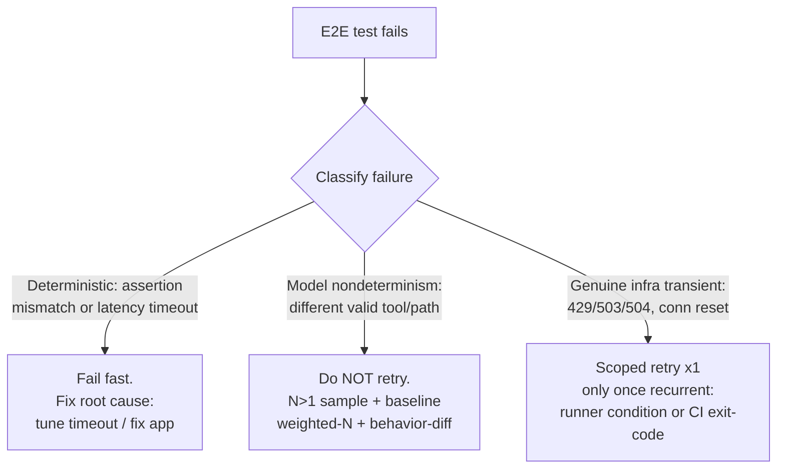

# Selective Test-Retry Scoping: Transient-Only Retry for CI E2E Suites

## Table of Contents

- [Context](#context)
- [Temporal Scope](#temporal-scope)
- [Executive Summary](#executive-summary)
- [1. Drop retry + fix the root cause (no selective retry)](#1-drop-retry--fix-the-root-cause-no-selective-retry)
- [2. Selective transient-only retry (runner-level)](#2-selective-transient-only-retry-runner-level)
- [3. CI-layer selective retry (GitHub Actions)](#3-ci-layer-selective-retry-github-actions)
- [4. Other runners (comparison anchors)](#4-other-runners-comparison-anchors)
- [5. Distinguishing infra transients from model nondeterminism](#5-distinguishing-infra-transients-from-model-nondeterminism)
- [Comparison](#comparison)
- [Recommendation](#recommendation)
- [Open Questions](#open-questions)
- [Sources](#sources)

<!-- doc:region name="context" kind="immutable" -->

## Context

**Primary period:** 2024–2026
**Source weighting:** 2026 primary → 2025 → 2024 for tool/framework/test-runner specifics (these move fast); foundational reliability patterns (retry, exponential backoff, jitter, circuit breaker, idempotency) cited regardless of age.

**Question.** A post-deploy end-to-end (E2E) gate currently retries the *entire* suite on any failure (a whole-suite shell re-run). When failures are deterministic/functional, that retry just doubles wall-clock for no signal. Can retry scope be narrowed to **only flaky/transient errors** — failing fast on deterministic ones — and is it worth the added complexity, or is dropping retry the better posture?

**System under study (illustrative constraints):**
- Post-deploy E2E gate for a **live ISSUE-REF web app**. Tests drive a real chat session over WebSocket against a **deployed environment** (not mocked). Each turn invokes a live model + real tools, so **re-running a test produces real side effects** — idempotency matters.
- Runner: **vitest 4.0.18** (TypeScript). By direct inspection of that pinned version, the `retry` option is `retry?: number` only — no error-condition predicate. (Whether a *newer* vitest exposes conditional retry is a question this note pins down.)
- Current retry = whole-suite shell re-run (`run; on failure, run once more`).
- In the triggering run, **every** failure was deterministic — heavy-turn app-latency timeouts (agent actively producing output, turn exceeded a fixed per-result wait) + assertion mismatches (model used a different valid tool than the scenario expected). **Zero** network/transient markers. The retry doubled runtime for zero benefit.

**Decision this note should inform:** transient-only selective retry vs. drop-retry vs. quarantine — with a concrete vitest implementation (or a definitive "not available, here's the alternative") and a short decision rule.

<!-- /doc:region name="context" -->

<!-- doc:region name="body" kind="replaceable" -->

## Temporal Scope

Primary focus: 2026 and late-2025 sources for test-runner specifics (vitest, Jest, Playwright), which move fast and were the crux of the conflict to resolve. CI-layer mechanisms (GitHub Actions, `nick-fields/retry`) are current 2024–2026. Foundational reliability doctrine (transient-vs-permanent classification, exponential backoff, jitter, retry budgets, idempotency, circuit breaking) is cited regardless of age — the AWS Builders' Library and Google SRE material is the canonical reference and has not been superseded. Quarantine-based flake management is cited from both the foundational statement (Fowler, 2011) and current-practice consensus (2026).

## Executive Summary

**Recommendation: drop the whole-suite retry; do NOT add a runner-level selective retry yet; treat model-nondeterministic failures as a sampling/baseline problem, not a flake.** Error-conditional retry *is* a real, released vitest feature — but only from **vitest 4.1.0** (`retry: { count, delay, condition }`); **4.0.18 has `retry?: number` only**, so the `retry.condition` predicate that fast single-model summaries often attribute to "vitest 4" does not exist in that pinned version [^1][^2][^3]. Even after an upgrade, a config-level `condition` can only be a RegExp (functions are forbidden in `vitest.config.ts` because config is serialized to worker threads) [^3], and the failures that triggered this work were *all deterministic* — exactly the class a transient-only retry would (correctly) *not* retry. The right posture is the distributed-systems and flaky-test consensus: fail fast on deterministic failures, fix the underlying timeout (raise the per-result budget for heavy turns), and address model nondeterminism with N>1 sampling + behavior baselining rather than silently retrying it away [^9][^10]. Selective retry becomes worth its complexity only once a *genuine* transient signal (a 429/503/504 from the live app, a connection reset) is observed recurrently — at which point the cheapest correct lever is CI-layer exit-code/log-pattern retry, not a runner rewrite [^6][^7].

## 1. Drop retry + fix the root cause (no selective retry)

The triggering run had **zero** transient markers: every failure was either a heavy-turn latency timeout (the agent was actively producing output but the turn exceeded a fixed per-result wait) or an assertion mismatch (the model invoked a different valid tool than the scenario hard-coded). A whole-suite shell re-run on those failures doubles wall-clock for zero signal — and worse, if a re-run ever *passes* a genuinely-broken build it masks the regression. This is the core flaky-test anti-pattern: *"Rerunning failed tests alone is an anti-pattern that masks real failures"* [^9].

The fix for a latency timeout is not retry — it is a correct timeout. An agent finishing a heavy turn in 150s is **not** a fault; a 120s per-result wait that fires mid-turn is a mis-tuned constant. Raising the per-result timeout (and keeping the vitest `testTimeout` strictly above the resulting cumulative budget) removes the false positive at the source without any retry machinery. `[SYNTHESIZED INFERENCE]` — follows from the AWS doctrine that retries are "selfish" and only justified when failures are "rare or transient" [^4]; a deterministic latency ceiling is neither.

### When to use

The correct default for an E2E gate where (a) observed failures are deterministic, (b) each retried test has real side effects against a live backend, and (c) the team wants a green run to *mean* the suite passed.

## 2. Selective transient-only retry (runner-level)

The motivating question: can vitest retry **only** on a transient error allowlist? **Resolution of the documented conflict:**

- **vitest 4.0.18: `retry?: number` only.** Verified by direct inspection of the `@vitest/runner` type defs at tag `v4.0.18` [^1]. No object form, no `condition`, no predicate. The "vitest 4 supports `retry: { condition }`" claim from fast single-model web summaries is **wrong for this version**.
- **vitest 4.1.0 (2026-03-12) introduced the enhanced object form** `retry: number | { count?, delay?, condition? }` via issue/PR #9370 [^2]. `condition` is **`RegExp` (tested against the error message) or a function `(error: TestError) => boolean`** [^3]. A serialization fix for the RegExp form landed in **4.1.1** (2026-03-23, PR #9942) [^5][^11].
- **Critical constraint:** the *function* form of `condition` works **only in test files, not in `vitest.config.ts`** — config is serialized when passed to worker threads, so a config-level `condition` must be a RegExp [^3]. A transient-only allowlist defined globally is therefore limited to message-regex matching unless you push the predicate into each test or a shared per-test options object.

Minimal idiomatic "retry once, transient only" after an upgrade to ≥4.1.0 (message-regex, config-safe) `[SYNTHESIZED INFERENCE]` from the verified API shape:

```ts
// vitest.config.e2e.ts (requires vitest >= 4.1.0)
retry: {
  count: 1,
  delay: 2_000,
  // RegExp only at config scope — matches transient signatures, never
  // assertion failures or your own per-event "Timeout waiting for <event>" text.
  condition: /\b(ECONNRESET|ETIMEDOUT|EAI_AGAIN|socket hang up|429|50[234])\b/i,
},
```

For predicate logic (e.g. inspect a structured error code, not just the message), the function form must live in a test or a per-test options object:

```ts
it("heavy turn", { retry: { count: 1, condition: (e) => isTransient(e) } }, ...)
```

### When to use

Adopt runner-level selective retry only when: the project is on vitest ≥4.1.0; a **recurring, classifiable transient** signal has actually been observed (not hypothesized); and the retried tests are idempotent or made so (unique per-run identifiers namespacing any state the test creates). If none of these hold, this stays a documented future option, not an implementation.

## 3. CI-layer selective retry (GitHub Actions)

Independent of the runner, the CI step can scope retries by **exit code** or **log pattern**:

- **`nick-fields/retry`** exposes `retry_on` (`any` | `timeout` | `error`) and `retry_on_exit_code` — *"This will only retry for the given error code and fail immediately [on] other error codes"* [^6]. Pairing a distinct exit code for transient failures (emitted by a wrapper that classifies the error) with `retry_on_exit_code` gives exit-code-targeted retry with no runner changes.
- **Log-pattern rerun:** a shell wrapper greps the failed run's output for known transient signatures (`ETIMEDOUT`, `502/503/504`, connection reset) and re-runs only on a match — the manual equivalent of the above. `[INDUSTRY HEURISTIC]`.
- **Rerun-only-failed:** GitHub natively supports re-running just the failed jobs (`gh run rerun <id> --failed`), capped at 50 re-runs per run [^7]. This reduces cost but is operator-initiated, not an automatic transient filter.

### When to use

Prefer CI-layer retry over a runner rewrite when you want retry scoping *without* upgrading or restructuring the test code, or when the transient is in the *infrastructure* around the tests (runner network, image pull) rather than in a single test. Trade-off: coarser than per-test runner retry, and needs a classifier (exit code or log grep) to avoid masking deterministic failures.

## 4. Other runners (comparison anchors)

- **Jest:** `jest.retryTimes(numRetries, options?)` with `waitBeforeRetry` / `logErrorsBeforeRetry` — **count-based only; no native error-conditional retry** [^8]. Conditional retry requires a custom test environment / wrapper.
- **Playwright:** project-level `retries` plus `testInfo.retry` (the current retry index, readable "to any test, hook or fixture") for **in-test** conditional logic — no declarative error-predicate at config scope; you branch on `testInfo.retry` inside the test [^12].

## 5. Distinguishing infra transients from model nondeterminism

For an ISSUE-REF E2E suite this is the load-bearing distinction. A model invoking a *different valid tool* than the scenario hard-coded is **not** a flake to retry away — it is a behavioral signal. The 2026 eval consensus — *"Run N agent rollouts per scenario in your eval suite … score the final outcome and the path quality, not the exact tool sequence"* and *sampling with aggregation over naive retries* — `[INDUSTRY HEURISTIC]` corroborated by a 2026 web survey (pass@k / pass^k reliability metrics; agent reliability degrades sharply across repeated runs). The foundational rerun-anti-pattern and quarantine framing is Fowler [^9]. Retrying a nondeterministic assertion until it happens to match the hard-coded expectation **trains the gate to hide drift** — the opposite of what a model-upgrade validation suite is for.

Practically: model-nondeterministic outcomes belong in a weighted-N sampling path (sample a scenario N times and baseline the distribution) — not in a retry. Genuine infra transients (a 429/503/504 from the live app, a socket reset) are the only class a retry should ever touch, and only per §2/§3 once observed. Distinct levers for distinct failure classes:



## Comparison

| # | Criterion | Drop retry + fix root cause (§1) | Runner selective retry (§2) | CI-layer selective retry (§3) |
|---|-----------|----------------------------------|-----------------------------|-------------------------------|
| 1 | Available on vitest 4.0.18 | Yes | **No** — needs ≥4.1.0 [^1][^2] | Yes (workflow-only) |
| 2 | Masks deterministic failures | No (fails fast) | No, if allowlist is tight | No, if classifier is tight |
| 3 | Added complexity | None | Medium (upgrade + per-test predicates for non-regex) | Low–medium (exit-code/log classifier) |
| 4 | Handles model nondeterminism | N/A — use N-sampling [^9] | Wrong tool (would mask drift) | Wrong tool (would mask drift) |
| 5 | Idempotency burden on live backend | None (no re-run) | High (re-runs mutate state) | High (re-runs mutate state) |
| 6 | When correct | Default; deterministic failures | Recurring classifiable transient, ≥4.1.0 | Transient in infra around tests |

## Recommendation

1. **Now:** drop the whole-suite retry and fix the root-cause timeout (raise the heavy-turn per-result timeout, keep `testTimeout` strictly above the budget). A green run must mean the full extended suite passed.
2. **Model nondeterminism:** never retry it. Route it through weighted-N sampling + a behavior-diff baseline. `[INDUSTRY HEURISTIC]` reinforced by [^9].
3. **Selective retry:** keep as a documented, *unimplemented* option. Revisit only if a genuine transient (429/503/504, connection reset) is observed recurrently. If so, the lowest-cost correct implementation is CI-layer `retry_on_exit_code` [^6] or, after a vitest ≥4.1.0 upgrade, a tight RegExp `retry.condition` allowlist [^3] — capped at one attempt, with backoff/jitter and idempotent per-run identifiers [^4][^10].

**Decision rule:** *Deterministic failure → fail fast, fix it. Model nondeterminism → sample N and baseline, never retry. Genuine recurrent infra transient → one scoped, classified retry (CI exit-code or vitest ≥4.1.0 RegExp condition), never a whole-suite re-run.*

## Open Questions

1. On the next vitest bump, move to ≥4.1.0 to unlock RegExp `retry.condition` for a future transient-only allowlist, or stay on the 4.0.x line until a transient is actually observed?
2. Should the CI step emit a distinct exit code for classified transient failures now (cheap, forward-compatible with `retry_on_exit_code`) even though no retry consumes it yet?
3. What is the right (weighted) N for each heavy scenario so model nondeterminism is baselined rather than mistaken for flake?

## Sources

Citations follow APA style. Inline markers are GFM footnotes (`[^N]`). All URLs were live-validated (HTTP 200) at the time of writing.

[^1]: vitest contributors. (2026). [vitest `@vitest/runner` task options — `retry?: number` (tag v4.0.18)](https://github.com/vitest-dev/vitest/blob/v4.0.18/packages/runner/src/types/tasks.ts). GitHub. *(Primary source — matches a version pinned to 4.0.18.)*
[^2]: vitest contributors. (2026). [vitest v4.1.0 release notes — "Enhance `retry` options" (#9370)](https://github.com/vitest-dev/vitest/releases/tag/v4.1.0). GitHub. *(Official release.)*
[^3]: vitest contributors. (2026). [vitest `Retry` type (tag v4.1.1) — `number | { count, delay, condition }`; condition RegExp/function; functions forbidden in config](https://github.com/vitest-dev/vitest/blob/v4.1.1/packages/runner/src/types/tasks.ts). GitHub. *(Primary source.)*
[^4]: Brooker, M. (n.d.). [Timeouts, retries, and backoff with jitter](https://aws.amazon.com/builders-library/timeouts-retries-and-backoff-with-jitter/). Amazon Builders' Library. *(Official engineering reference.)*
[^5]: vitest contributors. (2026). [vitest v4.1.1 release notes](https://github.com/vitest-dev/vitest/releases/tag/v4.1.1). GitHub. *(Official release.)*
[^6]: Fields, N. (n.d.). [retry-action — `retry_on`, `retry_on_exit_code` (README)](https://github.com/nick-fields/retry). GitHub. *(Action documentation.)*
[^7]: GitHub. (n.d.). [Re-running workflows and jobs (`gh run rerun --failed`; 50-rerun cap)](https://docs.github.com/en/actions/how-tos/manage-workflow-runs/re-run-workflows-and-jobs). GitHub Docs. *(Official documentation.)*
[^8]: OpenJS Foundation (originally Meta Open Source). (n.d.). [`jest.retryTimes(numRetries, options?)`](https://jestjs.io/docs/jest-object). Jest Documentation. *(Official docs — count-based; no error predicate. Jest moved to the OpenJS Foundation in 2022.)*
[^9]: Fowler, M. (2011). [Eradicating non-determinism in tests](https://martinfowler.com/articles/nonDeterminism.html). martinfowler.com. *(Foundational statement of quarantine and of non-determinism causes — remote services, asynchrony. Supports the quarantine and rerun-anti-pattern claims; the 2026 agent-eval N-rollout consensus is corroborated separately and tagged `[INDUSTRY HEURISTIC]`.)*
[^10]: Beyer, B., Jones, C., Petoff, J., & Murphy, N. R. (Eds.). (2016). [Handling overload (Site Reliability Engineering)](https://sre.google/sre-book/handling-overload/). Google. *(Foundational reliability reference — per-request retry budget of up to three attempts.)*
[^11]: vitest contributors. (2026). [vitest PR #9942 — resolve `retry.condition` RegExp serialization](https://github.com/vitest-dev/vitest/pull/9942). GitHub. *(Merged 2026-03-23.)*
[^12]: Microsoft. (n.d.). [Test retries (`testInfo.retry`; project-level retries)](https://playwright.dev/docs/test-retries). Playwright Documentation. *(Official docs.)*

<!-- /doc:region name="body" -->

<!-- doc:region name="ambiguous_items" kind="replaceable" -->

## Ambiguous Items from Auto-Remediation (Post-Run Review)

(none yet — auto-populated by verify_and_remediate node)

<!-- /doc:region name="ambiguous_items" -->

<!-- doc:region name="appendix_research_prompt" kind="immutable" -->

## Appendix: Research Prompt

[Original prompt not recorded in this doc]

<!-- /doc:region name="appendix_research_prompt" -->

<!-- doc:region name="appendix_provenance" kind="replaceable" -->

## Appendix: Provenance Ledger

(none yet — auto-populated at commit from the validated provenance ledger)

<!-- /doc:region name="appendix_provenance" -->

<!-- doc:region name="run_history" kind="append_only" -->

## Run History

<!-- /doc:region name="run_history" -->
