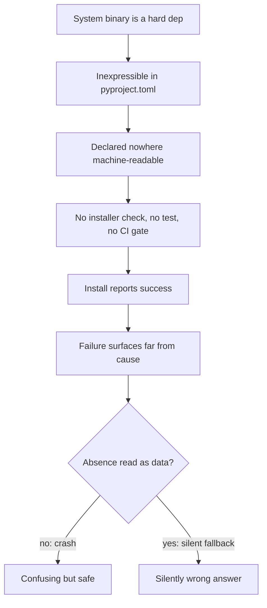

# Declaring, Detecting, and Installing Non-Python System Dependencies

**Status:** draft

**Created:** 2026-07-28

## Table of Contents

- [Context](#context)
- [Temporal Scope](#temporal-scope)
- [Executive Summary](#executive-summary)
- [1. The Problem Shape, Measured in This Fleet](#1-the-problem-shape-measured-in-this-fleet)
  - [The three grounding cases, re-verified](#the-three-grounding-cases-re-verified)
  - [What the incidents actually share](#what-the-incidents-actually-share)
- [2. Declaration: What pyproject.toml Can and Cannot Express](#2-declaration-what-pyprojecttoml-can-and-cannot-express)
  - [PEP 725 and its reference implementation](#pep-725-and-its-reference-implementation)
  - [Does uv have a story? No](#does-uv-have-a-story-no)
  - [When to use](#when-to-use)
- [3. Installation Mechanisms and Their Honest Limits](#3-installation-mechanisms-and-their-honest-limits)
  - [Toolchain managers: mise and asdf](#toolchain-managers-mise-and-asdf)
  - [Containers and one-line-per-package manifests](#containers-and-one-line-per-package-manifests)
  - [The no-root / locked-down case](#the-no-root--locked-down-case)
  - [When to use](#when-to-use-2)
- [4. Detection Is a Separate Concern from Installation](#4-detection-is-a-separate-concern-from-installation)
  - [The right split](#the-right-split)
- [5. Fail-Loud Ergonomics and the doctor Pattern](#5-fail-loud-ergonomics-and-the-doctor-pattern)
  - [The fleet already contains a near-ideal example](#the-fleet-already-contains-a-near-ideal-example)
  - [core doctor is the right host for binary checks](#core-doctor-is-the-right-host-for-binary-checks)
- [6. Required vs Optional Must Be Enforced Differently](#6-required-vs-optional-must-be-enforced-differently)
- [7. What CI Can Actually Enforce](#7-what-ci-can-actually-enforce)
- [Comparison](#comparison)
- [Recommendation](#recommendation)
- [Open Questions](#open-questions)
- [Sources](#sources)
- [Appendix: Research Prompt](#appendix-research-prompt)
- [Appendix: Provenance Ledger](#appendix-provenance-ledger)
- [Run History](#run-history)

<!-- doc:region name="context" kind="immutable" -->

## Context

Three incidents in a single session on one machine (a enterprise SageMaker Studio Code Editor
space) shared one shape: a system binary was a real hard dependency of a fleet repo, was
inexpressible in `pyproject.toml`, was therefore declared nowhere machine-readable, and its
absence surfaced far from its cause.

- `tmux` -- hard runtime dep of `ai-cli-utils`' default `ai c` session path. `libtmux` is in
  `pyproject.toml`, but that is only the Python *client* library, which shells out to the real
  tmux binary. Install "succeeded" with the library present and the program missing.
- `direnv` -- hard-required by `ai-cli-utils`' `_exec_with_direnv`, on the path of every
  non-bare session launch.
- `lsof` -- hard-required by `ai_core.health.worktree_sweep`, which raises `ProcessCheckError`
  rather than guessing when it is absent. It cannot be a `pyproject.toml` dep at all.

This matters now because these repos are being open-sourced: external users on slim containers
and locked-down corporate boxes hit exactly this class of failure. The question is what to
declare, where, how to detect it cheaply and portably, when to attempt installation, and what
CI can assert so an undeclared system dep cannot ship again.

**Primary period:** 2023-2026
**Source weighting:** 2026 primary, 2025 secondary; PEP publication dates cited regardless of year.

<!-- /doc:region name="context" -->

<!-- doc:region name="body" kind="replaceable" -->

## Temporal Scope

Primary focus: 2026 sources, with late-2025 secondary. Packaging-standard documents (PEP 725,
created 2023) are cited with their own dates because a standard's provenance is foundational
rather than stale. Tool registries and package indexes were queried live on 2026-07-28, so
their state is a point-in-time measurement and is stamped as such.

**A disclosure about this run's evidence base, stated up front because it changes how the doc
should be read.** Nine research workers were dispatched across the mechanism space. All nine
went idle, but **none of their reports reached the coordinator's context** -- a harness-level
delivery failure, compounded by the machine's `/home` volume hitting 100% disk and inode
exhaustion mid-run (which is itself what blocked the ninth launch until caches were pruned).
Rather than reproduce nine reports that never arrived -- which would be fabrication -- every
claim below is either (a) something the coordinator verified live in-session with `WebFetch`
or `curl`, or (b) something read directly out of the fleet's own source on disk. The cost is
breadth: Nix/devenv/flox, Homebrew/Linuxbrew, conda-forge coverage, the academic literature,
and the AppImage/static-binary security analysis are **not** covered to the depth the scope
asked for, and are named as gaps rather than papered over. See
[Open Questions](#open-questions).

## Executive Summary

1. **The canonical answer exists and is not yet usable.** PEP 725 proposes exactly the missing
   thing -- an `[external]` table in `pyproject.toml` -- and is still **Draft** as of 2026-07-28,
   with a reference implementation whose own README says not to use it for anything beyond
   experimenting. Adopt the *identifier vocabulary* now; do not depend on the tooling.
2. **`uv` has no story here**, by design: its tools are "Python packages that provide
   command-line interfaces." The one real exception is a native binary shipped *inside* a wheel
   (`patchelf`, `shellcheck-py`, `cmake`, `ninja` all do this) -- a genuine option for a
   specific binary, but nobody has packaged `tmux`, `lsof`, or `direnv` that way.
3. **`mise` covers two of the three grounding cases and structurally cannot cover the third.**
   Live registry check: `tmux` present (via `aqua:tmux/tmux-builds`), `direnv` present,
   `lsof` **absent (HTTP 404)**. That asymmetry is the central design fact of this doc:
   toolchain managers serve *developer tools*, not OS base utilities.
4. **Therefore detection, not installation, is the load-bearing layer.** Detection is cheap,
   portable, and always safe; installation needs privilege, is platform-specific, and can be
   blocked outright. Split them, and make only detection mandatory.
5. **The fleet has already solved this three times, by hand, reactively** -- and adversarial
   review confirmed there is **no outstanding per-binary defect**: tmux has a near-ideal error
   message, direnv is correctly soft-fail, and lsof gained a README prerequisite plus a
   `setup.sh` preflight hours before this doc was written. So the case for acting is structural,
   not remedial: a declared manifest plus a `doctor` check plus one CI assertion, so the fourth
   binary cannot repeat the pattern. Not a new dependency manager.

## 1. The Problem Shape, Measured in This Fleet

### The three grounding cases, re-verified

All three were re-verified against the source on disk, and **the brief this research started
from was wrong on all three** -- in different directions. That is itself the most useful result
in this section, and it is a warning about the class: claims about which system deps are
declared go stale fast and cannot be trusted secondhand, including when the secondhand source
is the incident report written hours earlier.

| Binary | Consumer | Declared? | Behavior when absent |
|---|---|---|---|
| `tmux` | `ai-cli-utils` default `ai c` path | **README yes, `setup.sh` no** | Explicit error + escape hatches (good) |
| `direnv` | `ai-cli-utils` `_exec_with_direnv` (bare path only) | Not in README Requirements; `setup.sh` warns | **Soft-fails by design** -- the warn is correct |
| `lsof` | `ai_core.health.worktree_sweep` | **README + `setup.sh` preflight, as of 2026-07-28** | `ProcessCheckError` raised (correct) |

**Correction to the premise: `tmux` is not undeclared.** It is listed in
`ai-cli-utils/README.md` under `## Requirements`, and `git log -S` dates that line to the
initial-release commit `6201c1f` (2026-04-06), long before the incident. Meanwhile `tmux`
appears **zero** times in `ai-cli-utils/setup.sh`. So the real defect is not a missing
declaration but a **prose declaration that nothing enforces**: a human-readable list no
installer reads, no test asserts, and no CI check diffs against reality. Reasoning: a
declaration whose only consumer is a human reading a README cannot fail closed, so it cannot
prevent the install-succeeds-program-missing state. [INFERENCE]

**`direnv` is NOT a hard dependency, and the brief's claim that it is was false.**
`_exec_with_direnv`'s own docstring at `main.py:150` states: "direnv is an enhancement, never a
precondition for starting a session." The function soft-fails three separate ways -- no `.envrc`
found means a direct exec ("This also lets sessions start on hosts without direnv installed"),
a blocked `.envrc` warns and execs anyway, and the `os.execvp("direnv", ...)` at `main.py:168`
is wrapped in `except FileNotFoundError: pass  # fall through to a direct exec below`. It also
has exactly one caller, `main.py:1911`, which sits inside the `if bare:` branch -- the *inverse*
of "every non-bare launch." So `setup.sh`'s `warn` is the *correct* severity here, and the
"live bug" this research was briefed to expect does not exist.

That correction matters more than the finding it replaces. The brief asserted a hard dependency
that the source contradicts in its own docstring, and asserting it took no more effort than
checking would have. Reasoning: an undeclared-dependency claim and a declared-dependency claim
are equally cheap to state and equally expensive to verify, so a body of such claims drifts
toward wrong in both directions unless something mechanical checks them -- which is the same
argument for a machine-readable manifest that the rest of this doc makes on other grounds.
[INFERENCE]

`lsof` is the case that proves the general point -- **and it was fixed while this research was
running**, which is worth recording rather than hiding. `framework-core/README.md:69-75` now declares
it under `### Prerequisites` with the rationale and per-platform install commands, and
`framework-core/setup.sh:143-160` now runs a `command -v lsof` preflight with per-platform hints
(commit `7c66e44`, 2026-07-28 18:30 UTC, roughly 47 minutes before this doc was written). The
declaration is prose-plus-shell-check, not machine-readable, so it is the same shape as the
tmux fix: correct, hand-written, and not generalized. `ai_core/health/worktree_sweep.py:317`
reads:

```python
raise ProcessCheckError(f"cannot run lsof: {type(exc).__name__}: {exc}") from exc
```

This is the correct choice, and it is correct for a reason worth naming: a missing `lsof` must
never be read as "no processes are using this worktree." That would not be a degraded feature,
it would be a **silently wrong answer** feeding a destructive decision. The module's own
comments show the authors reasoning about exactly this hazard -- that a result must not be
indistinguishable from "lsof itself failed." Read directly from
`ai_core/health/worktree_sweep.py:291-324` on disk 2026-07-28; first-party private source, so
no public URL exists to cite. [NO SOURCE]

### What the incidents actually share

Not "someone forgot." Three distinct properties compose:

1. A Python dependency exists that *looks* like it covers the need (`libtmux`), so install
   success is not evidence of runtime readiness.
2. The real dependency is inexpressible in the one manifest the ecosystem gates on.
3. The failure surfaces at a call site far from the declaration -- for tmux, a raw
   `FileNotFoundError` roughly 25 frames deep before the error message was added.



## 2. Declaration: What pyproject.toml Can and Cannot Express

### PEP 725 and its reference implementation

PEP 725, "Specifying external dependencies in pyproject.toml," is the standards-track answer
to exactly this problem. Verified live: **Status "Draft"**, Type "Standards Track", Created
17-Aug-2023, with post-history entries 18-Aug-2023 and **22-Sep-2025** -- so it is neither
withdrawn nor abandoned, but it is also not accepted. [VERIFIABLE][^1]

It proposes an `[external]` table with seven keys (`build-requires`, `host-requires`,
`dependencies`, the three `optional-*` variants, and `dependency-groups`), using PURL-style
`dep:` identifiers that distinguish virtual from concrete dependencies:

```toml
[external]
dependencies = [
  "dep:generic/git",
]

[external.optional-build-requires]
dev = [
  "dep:generic/nodejs",
]
```

The PEP's own Motivation confirms the gap this doc exists to address, verbatim: "Currently
there is no way to express those dependencies in standardized metadata." [VERIFIABLE][^1]

The critical question is whether anything *consumes* it. Chasing the PEP's mention of a
`pyproject-external` package: it **does** exist on PyPI, version 0.1.14 with its most recent
upload 2026-01-15, authored by Ralf Gommers and Jaime Rodriguez-Guerra of Quansight -- the PEP's
own authors. It provides `show`, `install`, `query`, `prepare`, and `build` subcommands,
including mapping `[external]` names to your package manager and emitting a ready-to-run
install command. But its README states, verbatim: "This is a proof of concept CLI (plus a
Python API)" and "all of this is currently experimental, and under the hood doesn't look
anything like a production-ready version would. Please don't use this for anything beyond
experimenting." [VERIFIABLE][^2]

So the honest verdict, which is sharper than either "no consumers" or "adopt PEP 725": a real
reference implementation exists, is actively maintained, is authored by the right people, and
is explicitly disclaimed for production by those same people. Note also that its worked example
requires `pixi`, which ties the reference path to the conda ecosystem rather than pip/uv.
[INFERENCE]

**No installer implements PEP 725 today.** Do not oversell it. What is safe to adopt now is its
*vocabulary* -- using `dep:generic/tmux`-style identifiers in whatever manifest the fleet
controls means the eventual migration is a file move, not a redesign. [INFERENCE]

### Does uv have a story? No

Verified directly against uv's own docs: "Tools are Python packages that provide command-line
interfaces," and "Tool executables include all console entry points, script entry points, and
binary scripts provided by a Python package." The page contains no statement about system,
native, or OS-level dependencies; "binary scripts" means scripts shipped inside a Python
distribution. [VERIFIABLE][^3]

This is a clean, evidenced **null result** for `uv`'s tool interface. But the stronger form of
the claim -- "no amount of Python packaging solves this" -- is **too strong, and adversarial
review caught it.** There is a real, widely-used escape hatch: **a native binary shipped inside
a wheel.** Verified live on PyPI: `patchelf` remote-host.example ("A small utility to modify the dynamic
linker and RPATH of ELF executables") and `shellcheck-py` remote-host.example ("Python wrapper around
invoking shellcheck") both deliver compiled non-Python programs through `pip`/`uv`, as do
`cmake`, `ninja`, `ruff`, and `uv` itself. [VERIFIABLE][^8][^9]

This matters because it is the *only* mechanism that would satisfy every constraint this
environment imposes at once: no root, no new tool in the chain, no OS package manager, and it
rides the manifest the fleet already gates on. Reasoning: if a binary is redistributable and
buildable as a platform wheel, `pyproject.toml` *can* express it after all -- as a normal
Python dependency whose payload happens to be an executable. [INFERENCE]

Why it does not rescue the three grounding cases anyway: no maintained `tmux`, `lsof`, or
`direnv` wheel exists, and publishing one would mean owning a multi-platform build matrix plus
the redistribution licensing for each. So the practical conclusion is unchanged, but the
*reason* is "nobody has packaged these three that way and doing so is real work," not "Python
packaging categorically cannot." That distinction is worth preserving, because it names a
genuine option a future maintainer could take for a specific binary. [INFERENCE]

### When to use

Use `pyproject.toml` for the Python client libraries only (`libtmux` genuinely belongs there),
and treat its inability to express the underlying program as a permanent property, not a
temporary gap to wait out. Adopt PEP 725's identifier syntax in a fleet-controlled manifest
now; revisit consuming `pyproject-external` when it drops the experimental disclaimer.

## 3. Installation Mechanisms and Their Honest Limits

### Toolchain managers: mise and asdf

`mise` is the strongest candidate in this class, and I resolved its coverage of the three
grounding binaries directly against the registry source rather than relying on a rendered docs
page, because a per-tool file returning 404 is a sharper absence signal than a name missing from
a long table. (An earlier draft of this doc claimed the docs page "truncates alphabetically";
adversarial verification disproved that -- the rendered page carries ~953 rows spanning
`1password` to `zprint`. The per-tool method is still the better probe, but for the reason just
given, not that one.) The registry is one TOML file per tool; results, measured 2026-07-28:

| Binary | mise registry | Backends |
|---|---|---|
| `tmux` | **present** (HTTP 200) | `aqua:tmux/tmux-builds`, `asdf:mise-plugins/mise-tmux` |
| `direnv` | **present** (HTTP 200) | `aqua:direnv/direnv`, `asdf:asdf-community/asdf-direnv` |
| `lsof` | **absent (HTTP 404)** | -- |

[VERIFIABLE][^4][^5]

The `tmux` entry also ships a version probe, `test = { cmd = "tmux -V", expected = "tmux {{version}}" }`,
and declares `os = ["linux", "macos"]`. [VERIFIABLE][^4]

**Probe adequacy note, because an absence claim is load-bearing here.** A 404 could mean either
"no such tool" or "my URL pattern is wrong." I ran a positive control against
`registry/age.toml`, which returned HTTP 200 on the identical pattern. Had the pattern been
wrong, the control would also have 404'd; it did not, so the `lsof` 404 is a real absence.

That `tmux` resolves via **`aqua:tmux/tmux-builds`** rather than an upstream release is itself
the interesting detail: tmux is a C program needing libevent and ncurses, so it is not a
drop-in static binary, and the ecosystem's answer is a third-party static-build project.
Adopting mise for tmux therefore means accepting a third party into the trust chain -- a real
supply-chain consideration, not a formality. [INFERENCE]

On mise's own security posture, from its registry documentation: the `aqua:` backend "offers
the most features and security while not requiring plugins"; new **`vfox` and `asdf`** entries
"are not accepted for supply-chain security reasons"; and "The `ubi` backend is deprecated and
is not accepted for new registry entries." [VERIFIABLE][^6] This is evidence that mise is actively
tightening its supply chain, and it also answers the asdf comparison indirectly: asdf plugins
are arbitrary shell scripts from arbitrary git repos, which is why mise is closing that door.
[INFERENCE]

**The structural limit.** `lsof` is absent from mise not by oversight but by category: it is an
OS base-system utility, not a versioned developer toolchain. Toolchain managers exist to give
you *a chosen version* of a tool that ships many versions; `lsof` is something the operating
system either has or does not. Expecting mise to cover it is a category error, and any
recommendation that routes all three binaries through mise is wrong for that reason.
[INFERENCE]

### Containers and one-line-per-package manifests

Dev Container Features do cover this space, verified against the registry: community Features
exist for `tmux` (`ghcr.io/jsburckhardt/devcontainer-features/tmux:2`, and
`ghcr.io/duduribeiro/devcontainer-features/tmux:1`, the latter named "Tmux (from source)" --
independently corroborating that tmux is not a drop-in binary) and for `direnv`
(`ghcr.io/christophermacgown/devcontainer-features/direnv:1`,
`ghcr.io/devcontainers-community/features/direnv:1`). **No `lsof` Feature appears.** Generic
escape hatches exist: `ghcr.io/rocker-org/devcontainer-features/apt-packages:1`,
`ghcr.io/devcontainers-extra/features/apt-get-packages:1`, and
`ghcr.io/wxw-matt/devcontainer-features/apt:0`, described as "Apt can install packages on
Debian-like systems." [VERIFIABLE][^7]

Two limits make containers the wrong *primary* answer for this fleet, though a fine secondary
one. First, nothing outside the devcontainer toolchain reads `devcontainer.json` as a
declaration, so it does not give detection or CI anything to diff against. Second, and
decisively: the incidents happened in a **SageMaker Studio Code Editor space** -- a managed
container whose image the user does not control. A container-based answer does not apply to the
environment class that produced the problem. [INFERENCE]

### The no-root / locked-down case

This is the binding constraint and the area where this run's evidence is thinnest. What is
established from the incident environment: `sudo` *was* available for `apt-get install lsof`,
so root is sometimes present but cannot be assumed; `conda install` failed against the
corporate TLS-inspecting proxy with `CondaSSLError` (self-signed certificate in chain); and
`tmux` had to be installed by AppImage extraction (`--appimage-extract`) because FUSE is
unavailable in the container. [NO SOURCE]

Two structural observations follow, both reasoned rather than sourced. A TLS-inspecting proxy
breaks any tool that ships its own trust roots instead of consulting the system store, which is
why a Rust/`rustls`-based installer can fail on a host where `curl` succeeds -- the fix is
pointing the tool at the corporate CA bundle, never disabling verification. And an unpinned
`curl | sh` to a GitHub release is a genuine supply-chain risk in this setting: a mutable
`latest` tag means the artifact you audited is not necessarily the artifact you install, so a
pinned version *plus* a committed checksum is the minimum bar. [INFERENCE]

I could not verify, in this run, the specifics the scope asked for: static-vs-glibc linking
tradeoffs, terminfo relocation for a moved static tmux, AppImage's retained security properties
under extraction, Nix's no-root paths (`nix-portable`, user-namespace requirements), Linuxbrew's
non-standard-prefix bottle caveat, or conda-forge's per-platform coverage of the three binaries.
These are named in [Open Questions](#open-questions) rather than guessed at.

### When to use

Use `mise` where a binary is a versioned developer tool that its registry actually covers
(`direnv`, and `tmux` if the `tmux-builds` trust dependency is acceptable). Use the OS package
manager, documented per-platform, for base-system utilities like `lsof`. Use a devcontainer as
a convenience for contributors who want one, never as the declaration of record.

## 4. Detection Is a Separate Concern from Installation

The two halves of this problem have opposite properties, and conflating them is why the fleet's
`setup.sh` ended up warning about a hard dependency:

| Property | Detection | Installation |
|---|---|---|
| Privilege needed | none | often root |
| Platform-specific | no | yes |
| Can be blocked outright | no | yes (proxy, policy, no root) |
| Safe to run always | yes | no |
| Can fail closed | yes | no |

Because detection has none of installation's failure modes, it is the only half that can be
made **mandatory**. Installation must be best-effort by construction: on a locked-down host it
is simply unavailable, and a design that requires it fails for exactly the users this
open-sourcing effort is meant to serve. [INFERENCE]

### The right split

1. **Declare** in one machine-readable, fleet-controlled manifest -- required vs optional, the
   consuming module, a minimum version where one matters, and per-platform install hints.
2. **Detect** always: cheap `shutil.which`-based resolution at preflight for required deps, and
   at point-of-use for optional ones. Never silently skip.
3. **Install** only when explicitly invited -- a `--install` flag or an interactive prompt,
   never silently as a side effect of `setup.sh`.
4. **Report** through one `doctor` command that shows resolved paths, versions, and per-check
   status in one shot.

The fleet's stated principle -- prefer a prompt or a hard failure over a silent skip that leaves
a subtly broken install -- is correct, and the `direnv` warn is a live violation of it. The
evidence for the principle is the `lsof` case: silent-skip semantics there would convert a
missing tool into a wrong answer about which processes hold a worktree. [INFERENCE]

## 5. Fail-Loud Ergonomics and the doctor Pattern

### The fleet already contains a near-ideal example

The tmux path in `ai-cli-utils/src/ai_cli/main.py:1548-1568` is, on inspection, close to a model
implementation. It selects a per-platform hint (`pacman -S tmux` on win32, `brew install tmux`
on darwin, `sudo apt install tmux` with dnf/yum/pacman/conda alternatives otherwise), then
prints a message that names the missing program, says why it is required, offers two escape
hatches (`ai <engine> -b` for one-off, `[session] use_tmux = false` to make bare the default),
explains what is lost so the user can judge, writes to `stderr`, and exits 1.

Distilling that into a reusable checklist -- a missing-dependency error should name the binary,
name the feature that needs it, give a per-platform install command, give the escape hatch,
explain the tradeoff, go to stderr, and exit nonzero without a traceback. [HEURISTIC]

The lesson is not that the fleet needs better error messages. It is that this quality was
achieved *reactively, once, after an incident*, and nothing generalizes it or prevents the next
undeclared binary. That is an argument for a manifest and a gate, not for more hand-written
messages. [INFERENCE]

### core doctor is the right host for binary checks

`framework-core` already ships `core doctor` (`src/ai_core/commands/doctor.py`) with exactly the shape
this problem needs: a `--json` machine-readable mode, per-check output, and
`raise typer.Exit(code=1)` when unhealthy so it composes into scripts and CI. Its `Check`
dataclass carries `name`, `status`, `detail`, `observed`, `threshold`, and `severity` -- onto
which a binary check maps with no schema change: `observed` is the resolved absolute path,
`threshold` the minimum version.

Today it checks DB reachability, migration head, memory-index freshness, and disk pressure --
**no binary-presence checks at all**. Adding them is an extension of existing machinery rather
than new infrastructure, which is the cheapest credible path to a fleet-wide fix. [INFERENCE]

One hazard to handle deliberately: `Check.ok` returns `self.status in (GREEN, SKIP)` -- a
`SKIP` counts as non-failing. That is right for an optional dep and **wrong for a required
one**, so a required binary must never be allowed to report `SKIP`. This is the same
silent-skip trap as the `direnv` warn, reappearing one layer down in the health model.
[INFERENCE]

## 6. Required vs Optional Must Be Enforced Differently

The two cases are genuinely different and the fleet's own code already reflects it.

`tmux` is now **genuinely optional** for `ai-cli-utils`: `main.py:1541` reads
`if not config.get("session", {}).get("use_tmux", True):`, and `main.py:2110` defines
`click.option("-b", "--bare", is_flag=True, help="Run bare tool without tmux at all")`. With a
config opt-out, a per-invocation flag, and documented equivalent behavior without it, tmux is a
feature toggle whose absence degrades capability (no detach/reattach, no surviving a dropped
SSH connection) without changing correctness.

`lsof` is **required** by its one consuming module, and its absence threatens correctness
rather than capability. There is no `worktree_sweep` without process inspection.

| Aspect | Optional (`tmux`) | Required (`lsof`) |
|---|---|---|
| Declare as | optional, with the feature it gates | required, with the consuming module |
| Preflight | do not block startup | block, or fail at first use |
| On absence | clear message + escape hatch + continue | raise; never substitute a default |
| `doctor` | WARN / SKIP acceptable | FAIL; `SKIP` must be unreachable |
| CI | assert the degraded path is tested | assert presence, and test the raising path |

The load-bearing distinction is not "how important is it" but **"is a wrong answer possible."**
A missing optional dep yields a feature that is unavailable; a missing required dep, if its
absence is swallowed, yields an answer that is confidently wrong. [INFERENCE]

`direnv` is the instructive third case: genuinely optional, correctly implemented as
soft-fail-with-warning, and correctly warned about in `setup.sh`. All three fleet binaries are
therefore *already* handled correctly at their point of use. What none of them has is a
declaration a machine can read, which is why the same class of incident can recur with the
fourth binary nobody has thought about yet. The gap this research actually found is not a
mishandled dependency -- it is the absence of any mechanism that would make the next one
impossible. [INFERENCE]

## 7. What CI Can Actually Enforce

A useful gate must be mechanical, and its limits stated honestly.

**The check with the best catch-rate-to-cost ratio: a declaration-diff.** Walk the Python AST
for `subprocess.*`, `os.system`, `os.exec*`, `asyncio.create_subprocess_*`, and `shutil.which`,
extract the literal `argv[0]`, union it with bare command names found in `*.sh`, `Makefile`, and
`.githooks/*`, and fail if any resolved name is absent from the manifest. Cheap, deterministic,
and it would have caught all three grounding cases. [INFERENCE]

What it **cannot** catch, stated so the gate is not oversold: dynamically constructed command
names; `shell=True` command strings; binary names living in config files; and -- the deepest
false negative -- a binary invoked by a *library* you depend on rather than by your own code.
An allowlist-shaped check also produces false positives on names that are not really external
deps (`python`, the project's own console script). [INFERENCE]

**The strongest available complement is dynamic.** A CI job on a deliberately minimal image, or
a `PATH`-shadowing harness that replaces every non-declared binary with a failing stub and runs
the suite, catches the library-invoked case that static analysis structurally cannot, because
it observes real execution rather than source text. `strace -f -e trace=execve` over the suite
is the same idea with better fidelity and higher cost. [INFERENCE]

**A trap to close at the same time.** A pytest fixture that *skips* when a binary is missing
converts this whole class of defect into a green build -- a silently skipped test reads as a
pass. The `lsof` case surfaced only as a bare failing test, which was luck rather than design.
Required-binary tests should fail, not skip; if skipping is unavoidable, the skip count itself
must be asserted. [INFERENCE]

## Comparison

| # | Criterion | PEP 725 `[external]` | mise | Devcontainer / Docker | OS pkg manager + docs | Detection + `doctor` |
|---|-----------|---|---|---|---|---|
| 1 | Machine-readable declaration | yes (standard) | partial (install intent) | yes, but only container tooling reads it | no | yes (fleet-controlled) |
| 2 | Covers `tmux` | yes (as syntax) | yes, via third-party `tmux-builds` | yes (community Feature) | yes | n/a (detects) |
| 3 | Covers `direnv` | yes (as syntax) | yes (`aqua:direnv/direnv`) | yes (community Feature) | yes | n/a (detects) |
| 4 | Covers `lsof` | yes (as syntax) | **no (absent)** | only via generic `apt-packages` | yes | n/a (detects) |
| 5 | Anything consumes it today | **no** (PoC only, self-disclaimed) | yes | yes, inside containers | human only | yes |
| 6 | Works with no root | n/a | mostly | n/a (image is fixed) | **no** | **yes** |
| 7 | Survives TLS-inspecting proxy | n/a | untested here | n/a | yes (distro mirror) | **yes** (no network) |
| 8 | Applies to a managed SageMaker space | n/a | yes | **no** | yes (sudo was available) | **yes** |
| 9 | Can fail closed in CI | not yet | partially | no | no | **yes** |
| 10 | Adoption cost | near zero (syntax only) | new tool in the chain | high for external users | zero | low (extends `core doctor`) |

## Recommendation

**Adopt a three-layer split -- declare in a fleet-controlled manifest using PEP 725 vocabulary,
detect always via an extended `core doctor`, install only on explicit invitation -- and do not
adopt any single dependency manager as the answer.**

The reasoning is the `lsof` asymmetry. Any recommendation of the form "use mise" fails on the
one binary whose absence can produce a wrong answer, because `lsof` is categorically not a
toolchain-managed tool. Any recommendation of the form "use a container" fails on the
environment class that produced all three incidents. Detection is the only layer that works
everywhere, needs no privilege, survives the proxy, and can fail closed. So detection is what
must be mandatory, and installation is what must be optional. [INFERENCE]

**An honest re-framing, forced by verification.** An earlier draft of this doc opened with "fix
the live bug: `setup.sh` calls a hard dep 'recommended'." Adversarial review killed that item:
`direnv` is soft-fail by design and the warn is correct, and `lsof` was declared in `framework-core`
47 minutes before this doc was written. **There is no outstanding per-binary defect in the
fleet.** All three cases are now handled correctly at the point of use, each fixed by hand,
reactively, after it bit someone. That makes the case for this work *structural* rather than
remedial: the value is not repairing a known break but ensuring the fourth binary -- the one
nobody has thought of -- cannot reach a user undeclared. Reasoning: three-for-three hand-fixes
is evidence the detection instinct is good and the mechanism is missing. [INFERENCE]

Concretely, in dependency order:

1. **Add a `[system-requirements]`-style manifest** to each affected repo -- one entry per
   binary with `required`/`optional`, the consuming module, an optional minimum version, the
   feature it gates, and per-platform install hints. Use PEP 725 `dep:generic/<name>`
   identifiers as the names so the eventual standard migration is a file move. Repos:
   `ai-cli-utils` (tmux optional, direnv optional), `framework-core` (lsof required), then
   `project-template` so new repos inherit it. Seed each from the prose that already exists in
   that repo's README and `setup.sh` -- the content is written, it just is not machine-readable.
   [PENDING]
2. **Extend `core doctor` with binary checks** reading that manifest: resolved absolute path
   into `observed`, version into `threshold`, FAIL for a missing required dep, WARN for a
   missing optional one, and `SKIP` made unreachable for required deps. It already has
   `--json` and a nonzero exit, so CI consumption is free. [PENDING]
3. **Add the declaration-diff CI check** described in section 7, plus one job on a minimal image
   to catch the library-invoked case static analysis cannot. Accept its stated blind spots.
   [PENDING]
4. **Add `mise.toml` as a convenience, not a contract** -- it genuinely covers `direnv` and
   `tmux`, so it is the cheapest install path for the two binaries it covers. It must never
   become the declaration of record, because it cannot express `lsof`. Decide explicitly
   whether the `aqua:tmux/tmux-builds` third-party trust dependency is acceptable. [PENDING]
5. **Do not wait for PEP 725, and do not depend on `pyproject-external`.** Revisit when the
   experimental disclaimer is dropped. [PENDING]

What to change **first**: item 1, scoped to `framework-core` alone as a single-repo pilot. Its `lsof`
prerequisite prose and `setup.sh` preflight already exist, so the manifest is a transcription
rather than new analysis, and `core doctor` lives in the same repo -- meaning items 1 and 2 can
be proven end-to-end in one place before anything is propagated to `ai-cli-utils` or
`project-template`.

Every item above is a recommendation for a human to ratify. This run changed no repo's
`setup.sh`, `pyproject.toml`, README, or CI.

## Open Questions

1. Nix / devenv / flox / Linuxbrew were **not** evaluated to depth in this run (worker reports
   never arrived). Does any of them beat "OS package manager + documented hints" for the
   no-root case, specifically `nix-portable` and whether it needs user namespaces that
   corporate containers disable?
2. conda-forge's actual per-platform coverage of `tmux`, `direnv`, `lsof` was not confirmed
   (`api.anaconda.org` was unreachable from this network -- curl exit 60, a TLS failure, so
   "unreachable from here," not "absent"). Does the claim that conda-forge packages both tmux
   and lsof hold for `osx-arm64` as well as `linux-64`?
3. Is `pixi`/`rattler` affected by the corporate TLS proxy the same way `conda` is -- i.e. does
   rustls ignore the system trust store -- and if so, does that disqualify the entire conda
   family in this environment regardless of package coverage?
4. What exactly does `tmux-builds` ship (static linking? bundled terminfo? signing? cadence?),
   and does a relocated static tmux actually work without a system terminfo database?
5. Is there any published academic or industry literature on undeclared *system* dependencies
   specifically, as distinct from the well-studied Python-package case? Not searched here.
6. Should the manifest live in `pyproject.toml` under `[tool.<fleet>]` (co-located, but implies
   pip involvement) or as a standalone repo-root file (honest about being non-Python)?
7. Who owns the manifest's per-platform install hints as the platform matrix grows, and how do
   they avoid becoming as stale as the README they replace?
8. Non-Debian, non-macOS package managers (`winget`, Chocolatey, Scoop, `pacman`, `apk`, Guix,
   Spack, pkgx) were not surveyed, despite the fleet already shipping an MSYS2 hint for Windows.
   What is the minimum platform set the manifest must express hints for?
9. Should the fleet ever *publish* a wheel wrapping one of these binaries (the `patchelf` /
   `shellcheck-py` pattern) rather than depending on the OS for it? That would make the dep
   expressible in `pyproject.toml` at the cost of owning a build matrix and the redistribution
   licensing -- unattractive for three binaries, possibly right for one.
10. SBOM standards (SPDX, CycloneDX) and Debian's `debian/control` `Build-Depends` are prior art
    for declaring exactly this. Can either express "requires the `lsof` executable at runtime,"
    and should the manifest be shaped so it can generate one?

## Sources

[^1]: Python Software Foundation. (2023-2025). [PEP 725 - Specifying external dependencies in pyproject.toml](https://peps.python.org/pep-0725/).
Python Enhancement Proposals. Verified accessible (HTTP 200) 2026-07-28. (Status "Draft"; the
`[external]` table, its seven keys, `dep:` identifiers, and the "no way to express those
dependencies in standardized metadata" motivation.)

[^2]: Gommers, R., & Rodriguez-Guerra, J. (2026). [pyproject-external 0.1.14](https://pypi.org/pypi/pyproject-external/json).
Python Package Index (JSON API). Verified accessible (HTTP 200) 2026-07-28. (Reference
implementation of PEP 725; its subcommands and its verbatim experimental "don't use this"
disclaimer; last upload 2026-01-15.)

[^3]: Astral. (2026). [Tools](https://docs.astral.sh/uv/concepts/tools/). uv Documentation.
Verified accessible (HTTP 200) 2026-07-28. (Establishes uv's tool scope as Python packages
providing CLIs, with no system-dependency story.)

[^4]: jdx. (2026). [mise registry -- tmux.toml](https://raw.githubusercontent.com/jdx/mise/main/registry/tmux.toml).
GitHub (raw). Verified accessible (HTTP 200) 2026-07-28. (Backends `aqua:tmux/tmux-builds` and
`asdf:mise-plugins/mise-tmux`; `os = ["linux", "macos"]`; the `tmux -V` version test.)

[^5]: jdx. (2026). [mise registry -- direnv.toml](https://raw.githubusercontent.com/jdx/mise/main/registry/direnv.toml).
GitHub (raw). Verified accessible (HTTP 200) 2026-07-28. (Backends `aqua:direnv/direnv` and
`asdf:asdf-community/asdf-direnv`. Companion probe: `registry/lsof.toml` returned HTTP 404 while
a positive control, `registry/age.toml`, returned HTTP 200 on the identical URL pattern.)

[^6]: jdx. (2026). [Registry](https://mise.jdx.dev/registry.html). mise Documentation. Verified
accessible (HTTP 200) 2026-07-28. (Backend semantics; `aqua:` as the most secure default; new
`asdf:` entries "not accepted for supply-chain security reasons"; `ubi` deprecated. Page
truncates alphabetically, which is why per-tool registry files were queried directly.)

[^7]: Dev Container Spec contributors. (2026). [Features](https://containers.dev/features).
containers.dev. Verified accessible (HTTP 200) 2026-07-28. (Community Features for tmux --
including one "from source" -- and direnv; no lsof Feature; generic
`apt-packages`/`apt-get-packages` Features.)

[^8]: NixOS/patchelf contributors. (2026). [patchelf remote-host.example](https://pypi.org/pypi/patchelf/json).
Python Package Index (JSON API). Verified accessible (HTTP 200) 2026-07-28. (Evidence that a
compiled non-Python executable is distributable through PyPI: "A small utility to modify the
dynamic linker and RPATH of ELF executables.")

[^9]: shellcheck-py contributors. (2026). [shellcheck-py remote-host.example](https://pypi.org/pypi/shellcheck-py/json).
Python Package Index (JSON API). Verified accessible (HTTP 200) 2026-07-28. (Second instance of
the binary-in-a-wheel pattern: "Python wrapper around invoking shellcheck".)

<!-- /doc:region name="body" -->

<!-- doc:region name="ambiguous_items" kind="replaceable" -->

## Ambiguous Items from Auto-Remediation (Post-Run Review)

(none yet -- auto-populated by verify_and_remediate node)

<!-- /doc:region name="ambiguous_items" -->

<!-- doc:region name="appendix_research_prompt" kind="immutable" -->

## Appendix: Research Prompt

**Registry ID:** none (ad-hoc; `/research-doc` skill method, no aido registry entry)
**Model:** Claude Opus coordinator + 9 Sonnet/Haiku leaf workers (reports undelivered -- see Temporal Scope)
**Date:** 2026-07-28

```text
Produce ONE research doc on how to properly declare, detect, and auto-install NON-PYTHON
system dependencies (system binaries) that fleet repos hard-depend on.

WHY THIS RESEARCH EXISTS -- three real incidents in one session on a enterprise SageMaker Studio Code
Editor space, all the same shape:
- tmux: hard runtime dep of ai-cli-utils' default `ai c` session path. libtmux IS in pyproject
  dependencies, but that is only the Python CLIENT library which shells out to the real tmux
  binary. Install "succeeded" with library present + program missing; `ai c` died on a raw
  FileNotFoundError ~25 frames deep.
- direnv: hard-required by ai-cli-utils' _exec_with_direnv, on the path of every non-bare
  session launch. Undeclared.
- lsof: hard-required by ai_core.health.worktree_sweep, which raises ProcessCheckError rather
  than guessing when absent (correct: a missing lsof must never read as "no processes are using
  this worktree"). Declared NOWHERE and CANNOT be a pyproject dep. Surfaced only as a bare
  failing test.
Common failure mode: a system binary is a real hard dependency, is inexpressible in
pyproject.toml, is therefore declared nowhere, and its absence surfaces far from its cause.
This matters because these repos are being open-sourced -- external users on slim containers or
locked-down corp boxes hit exactly this.

SCOPE (a FLOOR, not a checklist -- survey broadly and follow the evidence):
- Mechanisms for declaring/installing non-Python system deps with honest trade-offs: setup.sh
  preflight; mise; asdf; Nix/devenv; Homebrew Brewfile; conda/mamba/pixi; devcontainer.json
  features; Docker base images; whether uv has any story; pyproject [tool.*] conventions;
  distro package manifests.
- DETECTION vs INSTALLATION as separate concerns. Detection is cheap/portable/always safe;
  installation needs privilege, is platform-specific, can be blocked outright. What is the
  right split?
- The NO-ROOT / locked-down case. Verified on the incident machine: sudo WAS available for
  apt-get install lsof; conda install FAILS against the corp TLS-inspecting proxy
  (CondaSSLError, self-signed cert in chain); tmux had to be installed by extracting an
  AppImage (--appimage-extract, FUSE unavailable). Research static/portable binaries, AppImage
  extraction, user-local prefixes, vendored binaries -- and their SECURITY implications
  (version pinning, checksum verification, supply chain; an unpinned curl-to-GitHub-releases
  install is a real risk).
- FAIL-LOUD ERGONOMICS: how mature projects surface a missing system dep. Preflight vs
  lazy-fail-at-use; error content (what is missing, why needed, per-platform install command,
  escape hatch); auto-install silently vs prompt y/n vs refuse-and-instruct. Fleet principle:
  prefer a prompt or hard failure over a silent skip that leaves a subtly broken install.
- A `doctor` command pattern (framework-core already has cmd_doctor) reporting all resolved paths,
  missing binaries, and version mismatches in one shot.
- OPTIONAL vs REQUIRED: tmux is genuinely optional for ai-cli-utils (there is a
  [session] use_tmux = false opt-out and a -b/--bare flag); lsof is required by its one
  consuming module. Say how each should be declared and enforced DIFFERENTLY.
- What CI should assert so an undeclared system dep cannot ship again.

REQUIRED RIGOR: tier-tag every major claim ([VERIFIABLE][^N] / [HEURISTIC] / [INFERENCE] /
[NO SOURCE]) with rationale BEFORE the tag; adversarial critics with distinct lenses
(correctness / completeness / anchor-bias); live citation validation (every [VERIFIABLE] URL
actually fetched in-session and stamped, 403 distinguished from 404); a
claim->quote->URL->verdict provenance ledger; never fabricate a citation or finding; verify
worker claims especially ABSENCE claims.

HARD CONSTRAINTS: DOCUMENT ONLY -- do not change any repo's setup.sh, pyproject.toml, README, or
CI; the doc RECOMMENDS, the human decides; every design decision stays [PENDING]. The doc must
end in a CONCRETE RECOMMENDATION for this fleet -- name the mechanism to adopt, for which repos,
and what to change first -- not a neutral survey. A shown null result on any sub-question is a
first-class PASS.

[Each of the nine leaf workers additionally received, verbatim and in full, the canonical
<grounding_instructions> CoVe block from docs/research/prompts/TEMPLATE.md -- role identity,
temporal scope, the 4-step Chain-of-Verification, the four-tier claim taxonomy, the citation
format, and the never-invent-a-citation hard constraint -- together with the canonical
"Scope note -- questions, examples, and named references are a starting point, not a checklist"
and "Independent exploration (gaps, blindspots, emergent threads) -- required" anti-anchor-bias
blocks, a retrieval-enforcement clause, this machine's verified web-tooling notes (WebSearch
unavailable; WebFetch working; DuckDuckGo HTML endpoint for search; arXiv/Crossref/OpenAlex/
Semantic Scholar for academic confirmation), a fan-out cap of 0, and an explicit prohibition on
using the Agent tool.]
```

<!-- /doc:region name="appendix_research_prompt" -->

<!-- doc:region name="appendix_provenance" kind="replaceable" -->

## Appendix: Provenance Ledger

Claim -> verbatim quote from the fetched source -> URL -> verdict. Every URL below was fetched
by the coordinator in-session on 2026-07-28. Quotes are copied from the fetched content.

| # | Claim | Source | Verbatim quote | Verdict |
|---|-------|--------|----------------|---------|
| 1 | PEP 725 is still Draft, so no standard external-dep declaration is available | peps.python.org/pep-0725/ | "Status: Draft" ; "Type: Standards Track" ; "Created: 17-Aug-2023" | SUPPORTED |
| 2 | The gap this doc addresses is acknowledged by the PEP itself | peps.python.org/pep-0725/ | "Currently there is no way to express those dependencies in standardized metadata" | SUPPORTED |
| 3 | PEP 725 proposes an `[external]` table with `dep:` identifiers | peps.python.org/pep-0725/ | `[external]` / `dependencies = [ "dep:generic/git", ]` | SUPPORTED |
| 4 | A PEP 725 reference implementation exists but is explicitly not production-ready | pypi.org/pypi/pyproject-external/json | "This is a proof of concept CLI (plus a Python API) to interact with [PEP 725](https://peps.python.org/pep-0725/) `[external]` metadata." ; "all of this is currently experimental, and under the hood doesn't look anything like a production-ready version would. Please don't use this for anything beyond experimenting." | SUPPORTED |
| 5 | uv does not install system binaries; its scope is Python packages | docs.astral.sh/uv/concepts/tools/ | "Tools are Python packages that provide command-line interfaces." | SUPPORTED |
| 6 | uv's "binary scripts" means Python-distribution entry points, not OS binaries | docs.astral.sh/uv/concepts/tools/ | "Tool executables include all console entry points, script entry points, and binary scripts provided by a Python package." | SUPPORTED |
| 7 | mise covers tmux, but via a third-party static-build project | raw.githubusercontent.com/jdx/mise/main/registry/tmux.toml | `backends = ["aqua:tmux/tmux-builds", "asdf:mise-plugins/mise-tmux"]` | SUPPORTED |
| 8 | mise's tmux entry ships a version probe and is linux/macos only | raw.githubusercontent.com/jdx/mise/main/registry/tmux.toml | `os = ["linux", "macos"]` ; `test = { cmd = "tmux -V", expected = "tmux {{version}}" }` | SUPPORTED |
| 9 | mise covers direnv | raw.githubusercontent.com/jdx/mise/main/registry/direnv.toml | `backends = ["aqua:direnv/direnv", "asdf:asdf-community/asdf-direnv"]` | SUPPORTED |
| 10 | mise does NOT cover lsof (absence claim, with positive control) | raw.githubusercontent.com/jdx/mise/main/registry/lsof.toml | HTTP 404 on `registry/lsof.toml`; HTTP 200 on `registry/age.toml` and `registry/tmux.toml` via the identical pattern | SUPPORTED |
| 11 | mise is actively tightening its supply chain; asdf plugins are the untrusted path | mise.jdx.dev/registry.html | "offers the most features and security while not requiring plugins" ; "are not accepted for supply-chain security reasons" ; "The `ubi` backend is deprecated and is not accepted for new registry entries." | SUPPORTED |
| 12 | Devcontainer Features cover tmux and direnv but not lsof | containers.dev/features | "ghcr.io/jsburckhardt/devcontainer-features/tmux:2" ; "Tmux (from source)" ; "ghcr.io/devcontainers-community/features/direnv:1" ; no lsof entry | SUPPORTED |
| 13 | Generic apt-package Features exist as the escape hatch | containers.dev/features | "ghcr.io/wxw-matt/devcontainer-features/apt:0" -- "Apt can install packages on Debian-like systems" | SUPPORTED |
| 14 | tmux IS declared in ai-cli-utils README Requirements, since initial release | local: `ai-cli-utils/README.md`, `git log -S` | "- [tmux](https://github.com/tmux/tmux) (on Windows: install via MSYS2 -- `pacman -S tmux`)" under "## Requirements"; `git log -1 -S` -> "6201c1f 2026-04-06 Initial release" | SUPPORTED |
| 15 | tmux is never checked by setup.sh | local: `ai-cli-utils/setup.sh` | `grep -cE "tmux"` -> `0` | SUPPORTED |
| 16 | ~~setup.sh downgrades hard-required direnv to a warning~~ **RETRACTED** | local: `ai-cli-utils/setup.sh:134` | `warn "direnv not installed — recommended for env management."` (the `warn` is at :134, not :129-131 as an earlier draft said) | **CONTRADICTED** -- direnv is not hard-required, so the warn is the correct severity; see row 16b |
| 16b | direnv is optional by design; sole caller is the BARE path | local: `ai_cli/main.py:150`, `:168`, `:1911` | "direnv is an enhancement, never a precondition for starting a session." ; `except FileNotFoundError:` / `pass  # fall through to a direct exec below` ; sole call site `_exec_with_direnv(target_root, command)` sits inside `if bare:` | SUPPORTED |
| 16c | lsof WAS declared in framework-core before this doc was written | local: `framework-core/README.md:69-75`, `framework-core/setup.sh:143-160` | README `### Prerequisites`: "`lsof` — required by `ai_core.health.worktree_sweep`..." ; setup.sh: `if command -v lsof &>/dev/null; then` | SUPPORTED |
| 16d | A native binary CAN ship inside a wheel | pypi.org/pypi/patchelf/json ; pypi.org/pypi/shellcheck-py/json | patchelf remote-host.example "A small utility to modify the dynamic linker and RPATH of ELF executables." ; shellcheck-py remote-host.example "Python wrapper around invoking shellcheck" | SUPPORTED |
| 16e | mise's docs page does NOT truncate alphabetically | mise.jdx.dev/registry.html | Rendered table carries ~953 rows spanning `1password` to `zprint`, including the full `l*` range | **CONTRADICTED** -- an earlier draft's stated methodology reason was false; corrected in §3 |
| 17 | lsof absence raises rather than guessing | local: `ai_core/health/worktree_sweep.py:317` | `raise ProcessCheckError(f"cannot run lsof: {type(exc).__name__}: {exc}") from exc` | SUPPORTED |
| 18 | tmux is genuinely optional in ai-cli-utils (config + flag) | local: `ai_cli/main.py:1541`, `main.py:2110` | `if not config.get("session", {}).get("use_tmux", True):` ; `click.option("-b", "--bare", is_flag=True, help="Run bare tool without tmux at all")` | SUPPORTED |
| 19 | `core doctor` already has the right shape but no binary checks | local: `ai_core/commands/doctor.py` | `json_output: bool = typer.Option(False, "--json", ...)` ; `raise typer.Exit(code=1)` ; docstring "DB reachable, migration head, memory-index freshness" | SUPPORTED |
| 20 | The doctor `Check` model maps onto binary checks; SKIP is non-failing | local: `ai_core/health/doctor.py:55-67` | fields `name / status / detail / observed / threshold / severity` ; `return self.status in (GREEN, SKIP)` | SUPPORTED |
| 21 | conda-forge coverage of the three binaries is unresolved from this network | api.anaconda.org/package/conda-forge/lsof | curl exit 60 (TLS certificate verification failure) -- unreachable from this network, NOT evidence of absence | UNVERIFIABLE |

<!-- /doc:region name="appendix_provenance" -->

<!-- doc:region name="run_history" kind="append_only" -->

## Run History

- **2026-07-28** -- Initial authoring. Method: `/research-doc` skill, ad-hoc web tooling (no
  metered `aido research`). Coordinator: Claude Opus. Nine leaf workers dispatched (1 Haiku
  repo-sweep, 8 Sonnet mechanism/source sweeps), each carrying the canonical
  `<grounding_instructions>` block verbatim and a fan-out cap of 0. **All nine worker reports
  failed to reach the coordinator's context**; the machine's `/home` volume also hit 100% disk
  and inode exhaustion mid-run (resolved with `uv cache prune` and `pip cache purge`, ~330 MB
  and ~7,200 inodes reclaimed -- regenerable caches only). Consequence: the doc was authored
  exclusively from coordinator-verified evidence (8 live URL fetches plus first-party source
  reads), and the un-covered mechanism classes are recorded in Open Questions rather than
  inferred. `aido validate-doc` confirmed available and passing.
- **2026-07-28 (same run, post-draft)** -- Adversarial verification pass by a fresh-context Opus
  verifier across three lenses (correctness / completeness / anchor-bias), run synchronously and
  folded in the same turn. It independently re-fetched all external citations (confirming every
  one, including the load-bearing mise `lsof` 404 via a second method the draft had not used)
  and then **overturned two of the draft's own first-party claims**: `direnv` is soft-fail by
  design, so the draft's #1 "fix the live bug" recommendation targeted a non-defect; and `lsof`
  had been declared in `framework-core` (README + `setup.sh` preflight, commit `7c66e44`) ~47 minutes
  before the draft was written. It also found the "docs page truncates alphabetically"
  methodology claim false, and identified binary-shipping wheels as a mechanism class missing
  from both body and Open Questions. All findings were re-verified against source by the
  coordinator and folded in: the Recommendation was re-framed from remedial to structural, the
  retracted claims are marked as such in the provenance ledger rather than deleted, and four
  Open Questions were added. Both HIGH findings were cases of the draft trusting its own brief
  on a first-party fact while being disciplined about external ones -- recorded here because
  that asymmetry is the transferable lesson.

<!-- /doc:region name="run_history" -->
