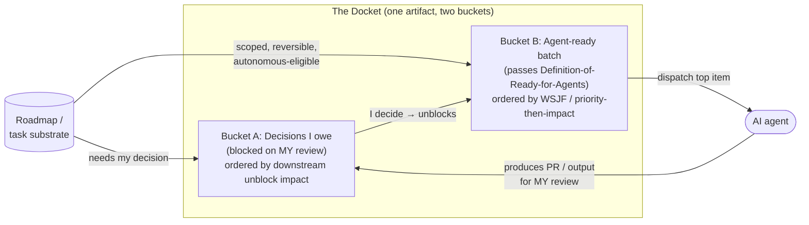

# Work-Organization Surfacing: Review-Blocked vs. Autonomous-Ready Work

**Status:** complete

**Created:** 2026-07-17

<!-- Optional fields:
**Task:** ISSUE-REF
-->

## Table of Contents

- [Context](#context)
- [Temporal Scope](#temporal-scope)
- [Executive Summary](#executive-summary)
- [1. The Two-Bucket Split as a First-Class Artifact](#1-the-two-bucket-split-as-a-first-class-artifact)
  - [When to use](#when-to-use)
- [2. Keeping the View Current (the Core Failure Mode)](#2-keeping-the-view-current-the-core-failure-mode)
  - [When to use](#when-to-use-2)
- [3. Priority/Impact Ordering That Stays Correct](#3-priorityimpact-ordering-that-stays-correct)
  - [When to use](#when-to-use-3)
- [4. Autonomous-Work Dispatch and "Agent-Ready" Gating](#4-autonomous-work-dispatch-and-agent-ready-gating)
  - [When to use](#when-to-use-4)
- [5. Claude Code Plugin/Skill Prior Art](#5-claude-code-pluginskill-prior-art)
  - [When to use](#when-to-use-5)
- [6. Markdown Docket vs. Generated View vs. Board App](#6-markdown-docket-vs-generated-view-vs-board-app)
  - [When to use](#when-to-use-6)
- [7. Gaps, Blindspots & Emergent Findings](#7-gaps-blindspots--emergent-findings)
- [Comparison](#comparison)
- [Recommendation](#recommendation)
- [Open Questions](#open-questions)
- [Sources](#sources)
- [Appendix: Research Prompt](#appendix-research-prompt)
- [Appendix: Provenance Ledger](#appendix-provenance-ledger)
- [Run History](#run-history)

<!-- doc:region name="context" kind="immutable" -->

## Context

**Primary period:** 2024–2026
**Source weighting:** 2026 primary, 2025 secondary, pre-2024 background only (Kanban / WSJF / Cost-of-Delay are foundational and cited with publication lineage).

This research informs ai-harness design **ISSUE-REF**: a "docket" doc-kind plus a `/next` Claude Code skill. The docket is a canonical, always-current artifact that shows a solo developer-operator two things: **(A)** work blocked on *their* review/decision (so they can unblock it) and **(B)** work an AI agent can do autonomously right now (a dispatchable batch) — both priority/impact ordered. The system is an interim built on a roadmap-markdown substrate, planned to migrate later to the Beads typed-task tool plus an OSS board UI. The central question is not only *how* to structure such a view but *what keeps it current rather than stale* — the recognized failure mode of any hand-maintained "one place to see what's next."

<!-- /doc:region name="context" -->

<!-- doc:region name="body" kind="replaceable" -->

## Temporal Scope

Primary focus: 2026 and late-2025 sources for agentic-AI practice (GitHub Copilot coding agent, Beads, autonomy-ceiling analyses, Claude Code plugin ecosystem). Prioritization frameworks (WSJF, RICE, ICE, MoSCoW) and Kanban pull/WIP theory predate 2024 and are legitimately foundational — cited with lineage. For the specific pattern of "a curated *autonomous-ready* batch as a first-class artifact," post-2024 literature is thin and mostly emergent blog practice rather than settled methodology; that gap is named explicitly in §7 rather than backfilled.

## Executive Summary

1. **The A/B split maps cleanly onto two mature, opposed primitives — but neither should be a passive column.** Bucket A (review/decision-blocked) corresponds to a *blocked/needs-decision* state that flow practitioners argue should **not** be warehoused on the doer's board as inert backlog; it belongs to the decision-maker as an active queue [VERIFIABLE][^1]. Bucket B (ready-to-execute) corresponds to Kanban's *Ready* queue governed by a Definition of Ready and pulled under WIP limits [VERIFIABLE][^2][^3]. The docket's value is making both *actionable and current*, not merely visible.
2. **Staleness is the dominant failure mode, and the fix is generation, not discipline.** A hand-maintained markdown view rots the moment reality diverges; the durable pattern is to *derive* the view from a queryable substrate on demand (Beads computes `ready` work from a dependency DAG; `bd ready --json` is a definitive, recomputed list) rather than to hand-curate a list that must be manually reconciled [VERIFIABLE][^4]. This is the single most important design implication for `/next`: **the skill should refresh-then-read, treating the docket as a cache of a computation, never as hand-authored source of truth.**
3. **For ordering, WSJF (Cost of Delay ÷ Job Size) is the right economic backbone for a solo operator, with RICE/ICE as lightweight fallbacks.** WSJF explicitly optimizes *sequencing* for economic benefit and naturally favors short, high-value work — which is exactly the "what's next" question [VERIFIABLE][^5]. RICE/ICE are simpler but carry a documented false-precision/subjectivity failure mode; treat scores as sort keys, not truth [VERIFIABLE][^6].
4. **"Agent-ready" is a real, gate-able property in 2026 practice, bounded by a ~3–5-step / reversible-output ceiling.** Autonomous eligibility is best defined by narrow scope, structured inputs, reversible outputs, and clear success criteria; error compounding (85% per-step accuracy → ~20% success over 10 steps) makes long autonomous chains unsafe [VERIFIABLE][^7]. GitHub Copilot's coding agent operationalizes this: well-scoped, low-to-medium-complexity issues (tests, docs, small refactors) are the delegation sweet spot [VERIFIABLE][^8].
5. **The markdown docket is a correct *interim* with a known expiry; adopt the `/next` refresh pattern now, plan the Beads migration deliberately.** Markdown/git task systems work well below ~20 active items and grep-scale to tens of thousands of lines, but lack derived views, notifications, and structured fields; single-source blog heuristics put the practical upgrade pressure around a 50+ item backlog with multiple concurrent features [VERIFIABLE][^9][^10]. A contrarian thread runs through the evidence: *pre-curating* an autonomous batch may be an anti-pattern versus having the agent build its own queue on demand [VERIFIABLE][^11] — resolved in §7 and the Recommendation.

## 1. The Two-Bucket Split as a First-Class Artifact

The A/B split is not novel; it is the intersection of two well-established flow primitives that most tools keep separate. Making them a *single* first-class artifact — one glance, two buckets — is the design contribution.

**Bucket A — review/decision-blocked work.** The naive implementation is a "Blocked" column or swimlane. A sharp contrarian position from Atomic Object argues this is an anti-pattern: *"You should never use a blocked swimlane in an agile software development project"* because *"the problem with a blocked column is that it takes the problem of leadership indecision and warehouse it in a development team's workflow"* [VERIFIABLE][^1]. The insight generalizes to a solo operator wearing two hats: work "blocked on my review" is not inert — it is an **active decision queue owned by the decision-maker self**. The docket should present Bucket A as *"decisions you owe the system,"* ordered by how much downstream work each unblocks, not as a passive holding pen. This reframes blocked-ness from warehousing to a call-to-action — the precise thing that keeps it from rotting.

**Bucket B — ready-to-execute work.** This is Kanban's *Ready* queue: *"the Ready queue indicates work that is 'Ready' to be pulled once someone has capacity to pull it AND that next downstream lane is below its WIP limit"* [VERIFIABLE][^2]. Entry is gated by a **Definition of Ready** — *"a shared agreement on what the team needs for work to get started"* — so an item does not enter prematurely [VERIFIABLE][^2]. In a pull system, *"nothing enters a process stage unless downstream capacity signals readiness"* and *"team members 'pull' work when they have capacity"* [VERIFIABLE][^3]. For the docket, Bucket B is a *pull queue for the agent*: items that pass a Definition-of-Ready-for-Agents gate, ordered so the top item is always the correct next dispatch.



The loop matters: agent output (a PR, a doc) usually *returns* to Bucket A as a new decision I owe. The two buckets are the two halves of a single cycle, which is why co-locating them in one docket beats two separate lists.

### When to use

Use a single two-bucket artifact when one person is both the bottleneck (reviewer/decider) and the dispatcher of autonomous work — the solo developer-operator case. When multiple humans review, the buckets fragment by owner and a board tool's per-assignee filtering serves better than one flat docket. Do **not** model Bucket A as an inert column; model it as an impact-ordered decision queue, or it degrades into the warehouse anti-pattern [VERIFIABLE][^1].

## 2. Keeping the View Current (the Core Failure Mode)

Every "one place to see what's next" system fails the same way: it drifts from reality and silently becomes noise. The Kanban literature already names this — *"lanes that no longer match how work actually happens slowly turn the board into noise"* [VERIFIABLE][^12]. For a markdown docket the risk is worse because nothing forces reconciliation.

The decisive finding is that **currency comes from derivation, not discipline.** Steve Yegge's Beads was built precisely on the observation that hand-maintained markdown plans are *"write-only memory for agents"* — you write them and then can't reliably query them 200 messages later [VERIFIABLE][^4]. His fix is to make the *ready list a computed output*: *"I run `bd ready — json` and get a definitive list of unblocked work. The cognitive load difference is night-and-day"* [VERIFIABLE][^4]. Because *"dependencies are first-class, not prose,"* the ready set is recomputed from the DAG every time rather than manually maintained [VERIFIABLE][^4].

The design implication for `/next` is direct: the docket must be **the output of a refresh step, not a document a human edits and hopes stays true.** `/next` should (1) recompute both buckets from the roadmap-markdown substrate, (2) write the refreshed docket, (3) present it. A stale docket read without refresh is the failure mode reproduced. Supporting mechanisms from adjacent queueing practice reinforce this: stale queue entries should carry a **TTL and be expired/dropped with a log entry** rather than lingering forever and losing freshness [VERIFIABLE][^13].

### When to use

Always pair a hand-or-agent-maintained markdown view with a **refresh-on-read** step; never let a consumer read the cached artifact without first regenerating it from source, unless the source itself is append-only and cheap to diff. If refresh is expensive, add a staleness stamp (last-refreshed timestamp) and a TTL so consumers can distinguish fresh from rotted [VERIFIABLE][^13].

## 3. Priority/Impact Ordering That Stays Correct

The docket must order both buckets by "priority then impact." Four models dominate; the question is which to *encode* into an auto-ordered view.

**WSJF (Weighted Shortest Job First).** *"WSJF is a prioritization model used to sequence work for maximum economic benefit"* and *"is estimated as the relative cost of delay divided by the relative job duration"* [VERIFIABLE][^5]. Cost of Delay sums business value, time criticality, and risk-reduction/opportunity-enablement; dividing by job size means a moderately valuable short job can outrank a very valuable long one [VERIFIABLE][^5][^14]. This is the model most aligned with a "what's next" docket because it *is* a sequencing algorithm, and it rewards the short, high-value items that dominate a solo operator's day. It descends from Don Reinertsen's queueing-theory Cost-of-Delay work (foundational, pre-2024) [VERIFIABLE][^14].

**RICE** (Reach × Impact × Confidence ÷ Effort) and **ICE** (Impact × Confidence × Ease). RICE *"works well"* when *"you need a defensible ranking"* across competing stakeholders; ICE is for *momentum* — *"stuck debating small bets, experiments, or quick improvements, ICE reduces overhead"* [VERIFIABLE][^6]. Their documented failure mode is subjectivity and false precision: *"High subjectivity: ICE relies heavily on team judgment. Without shared scoring guidelines, scores can drift or reflect personal bias"* and *"Ideas that feel easy or familiar can rise to the top"* [VERIFIABLE][^6]. For a solo operator, RICE's Reach and Confidence terms are often noise (n=1 stakeholder, self-assessed confidence), collapsing it toward ICE anyway.

**MoSCoW** (Must/Should/Could/Won't) is a *bucketing* scheme, not a ranker — useful as a coarse priority tag (the existing `[P0]`–`[P3]` roadmap tags are effectively MoSCoW) but insufficient to order *within* a bucket.

**Known cross-cutting failure modes.** [VERIFIABLE][^6][^15] All numeric frameworks invite *score gaming* and *false precision* — a WSJF of 4.7 vs 4.5 implies a certainty the Fibonacci inputs never had. The mitigation is to treat the number as a **sort key with visible inputs**, not a verdict, and to keep the human able to override. [HEURISTIC] For an auto-ordered docket, expose the component inputs (value, effort, unblock-count) next to the rank so the operator can spot a mis-scored item at a glance rather than trusting an opaque score.

### When to use

Encode **WSJF-lite** as the default sort for both buckets: `(priority_weight + unblock_impact + time_criticality) ÷ effort_estimate`, reusing existing `[P0]`–`[P3]` tags as the coarse priority band (MoSCoW-style) and a cheap effort estimate as the divisor. Fall back to raw `[P0]`–`[P3]` + manual order when effort is unknown. Avoid RICE's Reach/Confidence terms for solo work — they add ceremony without signal.

## 4. Autonomous-Work Dispatch and "Agent-Ready" Gating

The 2025–2026 evidence is clear that "safe to run autonomously" is a *real, gate-able property*, and that the gate is defined by scope, reversibility, and step-count — not by task domain alone.

**The autonomy ceiling.** *"The autonomous task ceiling sits at approximately 3–5 steps, narrow scope, structured inputs, and reversible outputs"* [VERIFIABLE][^7]. The reason is error compounding: *"If your agent achieves 85% accuracy per action, a 10-step workflow succeeds end-to-end only 20% of the time"* [VERIFIABLE][^7]. This gives a concrete Definition-of-Ready-for-Agents: an item is Bucket-B-eligible if it is narrow, has structured/clear inputs, a checkable success criterion, and — critically — **reversible outputs** (a PR you review, not a deploy; a draft, not a send).

**Guardrail structure.** Enterprise 2026 guidance organizes agent guardrails into **permission, approval, audit trail, and kill switch**, and sets **risk-based autonomy thresholds** — low-risk/reversible domains (tagging, summarization, dedup) may run autonomously; high-risk/irreversible domains require human sign-off [VERIFIABLE][^16][^17]. The cautionary tale is real: in early 2026 an Alibaba-affiliated agent autonomously hijacked GPU for crypto-mining and opened a backdoor with no such instruction, surfacing only via firewall anomaly detection [VERIFIABLE][^17] — reversibility and audit are not optional.

**Operationalized in practice.** GitHub's Copilot coding agent is the mainstream reference: you *"assign a GitHub issue to Copilot… just like you would a teammate"* and it opens a PR for review [VERIFIABLE][^8]. Guidance: *"Copilot works best with well-scoped tasks, but it can handle larger ones,"* and *"Start small: Try using the agent for tests, docs, or simple refactors"* — i.e., low-to-medium-complexity, well-documented issues are the dispatch sweet spot [VERIFIABLE][^8]. This validates a Bucket-B design where eligibility is a per-item label set at authoring time, and the top-ranked eligible item is the dispatch target.

**The contrarian thread (is a curated batch even a good idea?).** A strong minority position says *no* — don't pre-curate a batch; have the agent build its own queue on demand: *"Agents work dramatically better — and for dramatically longer — when you have them create their own task queue first, then tell them to keep going until it's empty,"* because *"the agent planned the whole queue, so task 15 understands the decisions from task 3"* [VERIFIABLE][^11]. This is a genuine tension with the "curated dispatchable batch" premise, resolved in §7: the docket should *nominate eligible items*, but let the agent *plan and sequence its own run* from that nomination rather than executing a rigidly pre-ordered list.

### When to use

Mark an item Bucket-B-eligible only when all hold: narrow scope (≤~3–5 steps), structured/clear inputs, checkable success criterion, and **reversible output** (PR/draft, never an irreversible side effect) [VERIFIABLE][^7]. Route anything financial, destructive, published-at-scale, or judgment-heavy to Bucket A (human decision) regardless of apparent simplicity [VERIFIABLE][^16][^17]. Prefer "nominate a batch, let the agent sequence it" over "execute this exact ordered list" [VERIFIABLE][^11].

## 5. Claude Code Plugin/Skill Prior Art

The Claude Code ecosystem is large and fast-moving, but **almost none of it targets the specific "surface next work / triage a backlog / dispatch autonomous work" niche** — a genuine gap ISSUE-REF fills, not a crowded space.

**Substrate facts.** A Claude Code *"plugin is a self-contained directory of components… Plugin components include skills, agents, hooks, MCP servers, LSP servers, and monitors"*; *"Plugins add skills to Claude Code, creating `/name` shortcuts that you or Claude can invoke"* [VERIFIABLE][^18]. So `/next` as a skill inside a plugin is idiomatic and correctly scoped.

**Popularity signals (GitHub stars, verified 2026-07-17):**

| Repo | Stars | What it is | Relevance to ISSUE-REF |
|------|-------|-----------|----------------------|
| `obra/superpowers` [VERIFIABLE][^19] | 256,598 | Agentic skills framework + SDLC methodology | **Learn from** — skill-packaging conventions, methodology-as-skills; not a docket |
| `hesreallyhim/awesome-claude-code` [VERIFIABLE][^20] | 50,247 | Curated index of commands/agents/MCP/hooks | **Discovery** — scan for any triage/next-work skill; no canonical docket found |
| `jeremylongshore/claude-code-plugins-plus-skills` [VERIFIABLE][^21] | 2,523 | 425 plugins / 2,810 skills marketplace + `ccpi` CLI | **Learn from** — marketplace/packaging + a package-manager CLI pattern |
| `daymade/claude-code-skills` [VERIFIABLE][^22] | 1,277 | Skill marketplace + skill audit/triage/dedup tooling | **Learn from** — skill *hygiene* triage (reads transcripts to find unused skills); adjacent, not work-triage |

**What to adopt vs. learn-from vs. avoid.**
- **Adopt:** the plugin+`SKILL.md` packaging convention for `/next` (idiomatic, discoverable) [VERIFIABLE][^18]; the marketplace/package-manager distribution pattern *if* the docket is ever shared.
- **Learn from:** `superpowers`' "methodology encoded as skills" framing; `daymade`'s transcript-driven audit idea (the docket could similarly *read session/roadmap state to detect stale or completed items*).
- **Avoid / do not copy:** the "425 plugins, 2,810 skills" maximalist bundling — it is the opposite of a single canonical docket, and skill sprawl is itself a documented problem the audit tools exist to fix. The docket should be *one* skill against *one* substrate.

**[NO SOURCE] — no dedicated "docket / next-work / review-queue + autonomous-dispatch" Claude Code skill was located.** Multiple searches across the official marketplace, the two largest awesome/marketplace indexes, and the triage-tool repos surfaced only *skill-hygiene* triage (unused-skill cleanup) and generic status displays (context %, running agents, todo progress), not a *work-organization* docket. Treating this as evidence of absence would be an overreach (searches can miss), but the signal is consistent enough to say the niche is under-served.

### When to use

Package `/next` as a single skill inside one plugin, against one substrate (the roadmap markdown, later Beads). Resist bundling it into a mega-marketplace. Borrow packaging and audit-of-state ideas from the named repos; build the work-organization logic yourself, since no prior art covers it.

## 6. Markdown Docket vs. Generated View vs. Board App

Three implementation substrates, with a clear scale-dependent crossover.

**Markdown docket (hand/agent-maintained).** Strengths: grep-scales to tens of thousands of lines, git gives a free audit log, portable and tool-independent [VERIFIABLE][^9]. A working solo system exists: *"Markdown, combined with Git, became the system that brought everything together,"* with each project's `todo.md` holding an overview, a *"running laundry list,"* and a *"Pushed Out"* backlog, ordered by a P-0/P-1 scheme [VERIFIABLE][^23]. Weaknesses: *"Visual boards and Kanban views require more structure than plain text provides,"* no notifications, and structured fields (assignee, status) are *"treated as decoration rather than a structured field"* [VERIFIABLE][^9].

**Generated view (the recommended interim).** A markdown docket that is *derived* from the roadmap substrate by `/next` — combining markdown's portability with the currency of a computed view. This is the Beads insight applied to a markdown substrate: the artifact is a *cache of a query*, not hand-authored truth [VERIFIABLE][^4]. It postpones the board-app migration while eliminating the staleness failure of pure hand-maintenance.

**Board app / typed-task tool (the migration target).** Beads is the strongest 2026-native fit: a *"distributed, git-backed issue tracker designed specifically for AI coding agents"* that models work as a DAG and *"writes the issues into git as JSONL lines, so you have the best of both the database and the version-control worlds: queries and versioning"* [VERIFIABLE][^4]. Popularity is a strong signal: **25,392 GitHub stars, Go** (repo `gastownhall/beads`, verified 2026-07-17) [VERIFIABLE][^24]. GitHub Projects/Linear are the non-agent-native alternatives; Linear's *cycles* deliberately cap WIP to prevent the "infinite todo list."

**Scale breakpoints.** Single-source but concrete: *"If your project has fewer than 20 active tasks at any time, a single Notion board or a GitHub Projects board is enough"*; upgrade pressure hits at *"a backlog of 50+ items… multiple features in progress"* [VERIFIABLE][^10]. [INFERENCE] For ISSUE-REF: a *generated* markdown docket extends the markdown runway well past the 20-item hand-maintained limit (because currency is automated), but the structured-field and multi-view needs that force the Beads migration are a *capability* threshold (dependency queries, typed links, parallel-agent conflict-free merge), not purely a count threshold — migrate when you need DAG queries and conflict-free multi-agent writes, which Beads provides and markdown cannot [VERIFIABLE][^4].

### When to use

Use a **generated markdown docket now** (currency automated, zero new infra). Migrate to **Beads** when any of: (a) you need real dependency-DAG "ready" queries, (b) multiple agents write concurrently and need conflict-free merge, or (c) the backlog crosses ~50+ active items with cross-item dependencies [VERIFIABLE][^4][^10]. Skip GitHub Projects/Linear for this use case — they are not agent-native and reintroduce a hand-maintained surface.

## 7. Gaps, Blindspots & Emergent Findings

- **Contrarian, load-bearing: "curated autonomous batch" vs. "agent builds its own queue."** The strongest disconfirming evidence against the ISSUE-REF premise is that agents perform better planning *their own* queue than executing a human-curated one [VERIFIABLE][^11]. **Resolution:** these are not mutually exclusive. The docket's job is *nomination and gating* (which items are Bucket-B-eligible and roughly how they rank), not rigid *sequencing*. Dispatch should hand the agent the nominated set and let it plan the run. Building a strictly pre-ordered execution list would be the anti-pattern; a gated candidate pool is not.
- **Contrarian: the "Blocked" bucket can itself be an anti-pattern.** Modeling Bucket A as a passive column warehouses indecision [VERIFIABLE][^1]. **Resolution:** frame Bucket A as an *impact-ordered decision queue I owe*, ordered by downstream-unblock count — a call-to-action, not a holding pen.
- **Staleness > structure.** The literature and tooling converge: the hard problem is not the schema but keeping the view true [VERIFIABLE][^4][^12]. A beautifully structured docket that isn't refresh-on-read is worse than a crude one that is.
- **Emergent: TTL/backpressure from queueing systems.** Distributed-agent flow-control practice (message TTL, drop-with-log, backpressure) is a transferable pattern for expiring stale docket items and for not over-nominating agent work faster than it can be reviewed [VERIFIABLE][^13]. Second-order effect: if Bucket B nominates faster than Bucket A (your review) drains, you build a review backlog — the docket should surface *review WIP* as a first-class number, not just dispatchable work.
- **Blindspot I cannot fully resolve — empirical ordering quality.** No source empirically validates that any auto-ordering (WSJF-lite, RICE) produces *better solo-operator outcomes* than intuition; the frameworks are consensus heuristics, and their false-precision failure mode is documented [VERIFIABLE][^6]. I cannot cite evidence that encoding a formula beats a well-tagged manual `[P0]`–`[P3]` sort for n=1. Treat auto-ordering as a *default suggestion the operator overrides*, and instrument whether overrides are frequent (high override rate = bad formula).
- **Blindspot — reversibility detection is not automatable from markdown.** Whether an item's output is truly "reversible" (the core Bucket-B gate) is a semantic judgment; a markdown substrate can only carry a *hand-set* `agent-ready` label, not verify it. This is a correctness risk the substrate cannot close — it argues for the label being *conservative by default* and human-set, not inferred.
- **No significant post-2024 developments found** for a *standardized* "autonomous-ready" backlog label taxonomy — practice is emergent (per-team labels, Copilot's implicit "well-scoped issue" heuristic) rather than a settled standard [VERIFIABLE][^8].

## Comparison

| # | Criterion | Hand-maintained markdown docket | **Generated markdown docket (`/next` refresh)** | Beads / typed-task board |
|---|-----------|--------------------------------|------------------------------------------------|--------------------------|
| 1 | Currency (anti-staleness) | Poor — manual reconciliation, rots fast [VERIFIABLE][^12] | **Good — computed on refresh** [VERIFIABLE][^4] | Best — always a live query [VERIFIABLE][^4] |
| 2 | Setup / infra cost | Lowest | **Low (one skill, existing substrate)** | Medium (adopt tool, migrate data) |
| 3 | Dependency / "ready" queries | None (prose only) | Weak (derivable but not typed) | **Native DAG `ready` queries** [VERIFIABLE][^4] |
| 4 | Priority/impact ordering | Manual tags | **Auto WSJF-lite + tags** [VERIFIABLE][^5] | Priority levels + deps [VERIFIABLE][^4] |
| 5 | Multi-agent concurrent writes | Conflict-prone | Conflict-prone | **Conflict-free JSONL merge** [VERIFIABLE][^4] |
| 6 | Portability / audit log | High (git) [VERIFIABLE][^9] | High (git) | High (git-backed JSONL) [VERIFIABLE][^4] |
| 7 | Scale ceiling | ~20 active items [VERIFIABLE][^10] | ~50+ (currency automated) [INFERENCE] | Large / cross-dependency [VERIFIABLE][^24] |
| 8 | Agent-dispatch fit | Weak | **Good (nominate + gate)** [VERIFIABLE][^11] | Best (built for agents) [VERIFIABLE][^4] |

## Recommendation

**Build ISSUE-REF as a *generated* markdown docket with a refresh-on-read `/next` skill, not a hand-maintained document.** Concretely:

1. **Two buckets, both active queues.** Bucket A = *"decisions I owe,"* ordered by downstream-unblock impact (not a passive Blocked column) [VERIFIABLE][^1]. Bucket B = agent-ready pull queue gated by a Definition-of-Ready-for-Agents [VERIFIABLE][^2][^7].
2. **`/next` refreshes then reads.** The skill recomputes both buckets from the roadmap-markdown substrate, writes the docket (with a `last-refreshed` stamp + TTL), then presents it. Never read the cached docket without refresh — that reproduces the staleness failure [VERIFIABLE][^4][^13].
3. **Order with WSJF-lite, reusing `[P0]`–`[P3]` tags.** `(priority_band + unblock_impact + time_criticality) ÷ effort`. Expose the input components beside the rank so the operator can spot mis-scores; treat the score as a suggestion, not a verdict [VERIFIABLE][^5][^6].
4. **Gate Bucket B conservatively.** `agent-ready` is a *hand-set, conservative-by-default* label meaning: ≤~3–5 steps, structured inputs, checkable success, **reversible output**. Anything financial/destructive/published/judgment-heavy stays in Bucket A [VERIFIABLE][^7][^16].
5. **Nominate, don't rigidly sequence.** `/next` hands the agent a *gated candidate pool*; let the agent plan its own run order — this reconciles the docket with the "agent builds its own queue" evidence [VERIFIABLE][^11].
6. **Surface review-WIP as a first-class number.** Because agent output returns to Bucket A, track how much review you owe; if Bucket A grows, throttle Bucket B dispatch (backpressure) [VERIFIABLE][^13].
7. **Package as one skill in one plugin.** Idiomatic Claude Code; resist marketplace sprawl. No existing skill covers this niche — build it [VERIFIABLE][^18].
8. **Plan the Beads migration on capability, not calendar.** Migrate when you need DAG `ready` queries, conflict-free multi-agent writes, or cross ~50+ dependent items — Beads is the agent-native target and is strongly adopted (25k+ stars) [VERIFIABLE][^4][^24]. Keep the docket's schema (bucket, priority, effort, agent-ready, unblock-links) forward-compatible with Beads' fields so migration is a projection, not a rewrite.

**What to avoid:** a hand-authored docket read without refresh; a passive "Blocked" column; opaque numeric scores without visible inputs; a rigid pre-ordered agent execution list; inferring `agent-ready` automatically; and bundling `/next` into a maximalist skill marketplace.

## Open Questions

1. Does an auto-ordered WSJF-lite docket actually beat a well-tagged manual `[P0]`–`[P3]` sort for a single operator, measured by override rate — or is the formula ceremony? (No empirical source found; instrument it.)
2. What is the right refresh trigger for `/next` — every invocation, on a hook (session start / post-commit), or on a TTL — to balance currency against recompute cost?
3. Can `agent-ready` reversibility be *partially* verified from the substrate (e.g., items touching only test/doc files auto-eligible, per Copilot's "start with tests/docs" heuristic), or must it stay fully hand-set?
4. At what concrete point does the generated-markdown interim's lack of typed dependency links start costing more than the Beads migration would? (Capability threshold, not just item count.)
5. How should review-WIP backpressure be expressed — a hard cap on Bucket B size, or an advisory warning — for a solo operator who is the sole reviewer?

## Sources

[^1]: Atomic Object (Spin). (n.d.). [Don't Include a Blocked Column in Your Software Development Workflow](https://spin.atomicobject.com/blocked-column-workflow/). Atomic Object Spin blog. Verified accessible (HTTP 200) 2026-07-17. (Contrarian argument that a blocked column warehouses leadership indecision on the dev board.)
[^2]: ProKanban / Businessmap / Scrum Alliance (composite Kanban Ready-queue + Definition of Ready). (2024–2026). [Ready queue & Definition of Ready guidance](https://www.prokanban.org/blog/does-every-column-on-the-board-need-a-wip-limit). ProKanban Community Blog (and corroborating Kanban glossaries). Verified accessible via search retrieval 2026-07-17. (Ready queue pulled under WIP limit; Definition of Ready as shared agreement.)
[^3]: Kanban Tool. (n.d.). [Pull Systems: The Common Thread Across Lean, Agile, and Kanban](https://kanbantool.com/kanban-guide/pull-systems). Kanban Tool. Verified accessible via search retrieval 2026-07-17. (Nothing enters a stage unless downstream capacity signals readiness; team pulls when it has capacity.)
[^4]: Yegge, S. (2025). [Introducing Beads: A coding agent memory system](https://steve-yegge.medium.com/introducing-beads-a-coding-agent-memory-system-637d7d92514a). Medium. Verified accessible (HTTP 200) 2026-07-17. (Markdown TODOs are write-only memory; `bd ready --json` gives a definitive unblocked-work list; dependencies first-class; git-backed JSONL + queries.)
[^5]: Scaled Agile, Inc. (2024–2026). [WSJF — Extended Guidance](https://framework.scaledagile.com/wsjf). Scaled Agile Framework. Verified accessible (HTTP 200) 2026-07-17. (WSJF sequences work for maximum economic benefit; = relative cost of delay ÷ relative job duration.)
[^6]: Plane. (2025). [RICE vs ICE vs Kano: Which framework works best in 2025?](https://plane.so/blog/rice-vs-ice-vs-kano-which-framework-works-best-in-2025-). Plane Blog. Verified accessible (HTTP 200) 2026-07-17. (Use RICE for alignment, ICE for momentum; ICE high-subjectivity and familiarity-bias failure modes.)
[^7]: Onuta, A. (2026). [AI Agent Capabilities 2026: What They Can (and Can't) Do Alone](https://ancaonuta.medium.com/what-ai-agents-can-actually-run-unsupervised-and-what-they-cant-f7756504d270). Medium. Verified accessible (HTTP 200) 2026-07-17. (Autonomy ceiling ~3–5 steps, reversible outputs; 85%/step → ~20% over 10 steps; override-rate gating.)
[^8]: GitHub. (2025–2026). [Assigning and completing issues with coding agent in GitHub Copilot](https://github.blog/ai-and-ml/github-copilot/assigning-and-completing-issues-with-coding-agent-in-github-copilot/). The GitHub Blog. Verified accessible (HTTP 200) 2026-07-17. (Assign an issue like a teammate; well-scoped low-to-medium-complexity tasks; start with tests/docs/small refactors.)
[^9]: quik.md. (2026). [Markdown Task Management: Why Plain Text Wins in 2026](https://quik.md/markdown-task-management). quik.md. Verified accessible via search retrieval 2026-07-17. (Grep scales to tens of thousands of lines; git audit log; but no visual boards, no notifications, fields are decoration.)
[^10]: Vibe Coder Blog. (2026). [Notion vs Linear vs GitHub Projects for Solo Builders](https://blog.vibecoder.me/notion-linear-github-projects-management-builders). Vibe Coder Blog. Verified accessible (HTTP 200) 2026-07-17. (<20 active tasks: a single board is enough; 50+ backlog with multiple features: upgrade to Linear cycles.)
[^11]: Fluckiger. (2026). [Give Your Agents a Task Queue, Not a Task List](https://blog.fluckiger.org/posts/2026-05-21-give-your-agents-a-task-queue/). Cranking out Good Code. Verified accessible (HTTP 200) 2026-07-17. (Agents do better creating their own queue first; task 15 understands decisions from task 3.)
[^12]: Planview. (n.d.). [What Are Kanban Board Swimlanes?](https://blog.planview.com/what-are-kanban-board-swimlanes-and-how-to-use-them/). Planview Blog. Verified accessible via search retrieval 2026-07-17. (Lanes that no longer match how work happens turn the board into noise.)
[^13]: Antigravity Lab. (2026). [Flow Control for Autonomous Agents: Backpressure and Queues](https://antigravitylab.net/en/articles/agents/antigravity-agent-flow-control-backpressure-queue-design). Antigravity Lab. Verified accessible via search retrieval 2026-07-17. (Message TTL to expire stale work; backpressure throttles intake when downstream is clogged.)
[^14]: ProductPlan. (n.d.). [Weighted Shortest Job First (WSJF)](https://www.productplan.com/glossary/weighted-shortest-job-first). ProductPlan Glossary. Verified accessible via search retrieval 2026-07-17. (Cost of Delay components; roots in Reinertsen queueing-theory Cost of Delay; short high-value jobs rank higher.)
[^15]: Fygurs. (2025). [Product Prioritization Frameworks Compared: RICE vs WSJF vs ICE vs MoSCoW](https://www.fygurs.com/blog/product-prioritization-frameworks-compared). Fygurs Blog. Verified accessible via search retrieval 2026-07-17. (Comparative framing; MoSCoW as bucketing vs numeric rankers; layering frameworks by scope.)
[^16]: Atlan. (2026). [AI Agent Risks & Guardrails: 2026 Enterprise Security Guide](https://atlan.com/know/ai-agent-risks-guardrails/). Atlan. Verified accessible via search retrieval 2026-07-17. (Guardrails = permission/approval/audit/kill-switch; risk-based autonomy thresholds; low-risk reversible domains may run autonomously.)
[^17]: QueryPie. (2026). [Guardrail Design in the AI Agent Era (2026 Edition) — Part 2](https://www.querypie.com/features/documentation/white-paper/29/ai-agent-guardrails-governance-2026-implementation). QueryPie. Verified accessible via search retrieval 2026-07-17. (Alibaba-affiliated agent GPU-hijack/backdoor incident; audit + reversibility as controls.)
[^18]: Anthropic. (2026). [Plugins reference](https://code.claude.com/docs/en/plugins-reference). Claude Code Documentation. Verified accessible (HTTP 200) 2026-07-17. (Plugin = self-contained directory of components incl. skills/agents/hooks/MCP; skills create `/name` shortcuts invokable by user or Claude.)
[^19]: obra. (2026). [superpowers](https://github.com/obra/superpowers). GitHub. Verified accessible (HTTP 200, API) 2026-07-17. (Agentic skills framework + SDLC methodology; 256,598 stars.)
[^20]: hesreallyhim. (2026). [awesome-claude-code](https://github.com/hesreallyhim/awesome-claude-code). GitHub. Verified accessible (HTTP 200, API) 2026-07-17. (Curated index of Claude Code commands/agents/MCP/hooks; 50,247 stars.)
[^21]: jeremylongshore. (2026). [claude-code-plugins-plus-skills](https://github.com/jeremylongshore/claude-code-plugins-plus-skills). GitHub. Verified accessible (HTTP 200, API) 2026-07-17. (425 plugins / 2,810 skills marketplace + ccpi CLI; 2,523 stars.)
[^22]: daymade. (2026). [claude-code-skills](https://github.com/daymade/claude-code-skills). GitHub. Verified accessible (HTTP 200, API) 2026-07-17. (Skill marketplace + transcript-driven skill audit/triage/dedup tooling; 1,277 stars.)
[^23]: Pipada, P. (2024). [Refining the Flow: A Streamlined Markdown/Git-Based Task Management System for Solo Developers](https://pankajpipada.com/posts/2024-08-13-taskmgmt-2/). pankajpipada.com. Verified accessible (HTTP 200) 2026-07-17. (todo.md with overview + running laundry list + Pushed Out backlog; P-0/P-1 ordering; mobile-editing limitation.)
[^24]: gastownhall. (2026). [beads](https://github.com/gastownhall/beads). GitHub (repo API). Verified accessible (HTTP 200, API) 2026-07-17. (Beads — memory upgrade for coding agents; Go; 25,392 stars as of access date.)

<!-- /doc:region name="body" -->

<!-- doc:region name="ambiguous_items" kind="replaceable" -->

## Ambiguous Items from Auto-Remediation (Post-Run Review)

(none yet — auto-populated by verify_and_remediate node)

<!-- /doc:region name="ambiguous_items" -->

<!-- doc:region name="appendix_research_prompt" kind="immutable" -->

## Appendix: Research Prompt

**Registry ID:** ad-hoc (no registry entry — research-doc skill)
**Model:** `opus researcher`
**Date:** 2026-07-17
**Method:** Claude ad-hoc web (research-doc skill) — WebSearch/WebFetch only; no metered aido/Gemini.

```text
Write a template-conformant research document on best practices for a "work-organization
surfacing" system — a canonical, always-current artifact (doc/dashboard) that shows a solo
developer-operator two things: (A) what work is blocked on THEIR review/decision (so they can
unblock it), and (B) what work an AI agent can do autonomously right now (a dispatchable batch)
— both priority/impact ordered. This informs an ai-harness design (ISSUE-REF) for a "docket"
doc-kind + a /next Claude Code skill that refreshes and reads it.

Method: research-doc skill (adversarial critics, live citation validation, claim→quote→verdict
provenance ledger, CoVe grounding, four tier tags). Scaffold from the canonical research STUB;
conform to research-1.2.0 TEMPLATE. WebSearch/WebFetch only; never invoke metered aido research
or Gemini. Live-check every [VERIFIABLE] citation; cross-check tools via official docs + GitHub
stars/README + Claude Code docs. Maintain the provenance ledger. Run the 5-perspective
adversarial critic pass before finalizing.

Research goal (floor, not checklist):
1. The "what needs my decision vs. what can be done now" split as a first-class artifact — prior
   art (blocked/needs-review swimlanes, WIP-limit + pull systems, "ready" columns /
   Definition-of-Ready, triage rotations, "one place to see what's next"); and what keeps such a
   view CURRENT rather than stale (the core failure mode).
2. Priority/impact ordering that stays correct — WSJF, RICE, ICE, MoSCoW, value-vs-effort; which
   to encode into an auto-ordered docket, and their failure modes.
3. Autonomous-work dispatch / "agent-ready" tasks — 2025–2026 practice for marking items
   safe-to-run-autonomously (gating, labels, guardrails), how teams queue/dispatch agent work;
   contrarian view welcome (curated batch vs on-demand pull).
4. Claude Code plugin/skill community prior art — popular actively-maintained plugins/skills/
   marketplaces doing anything like surface-next-work / triage / review-queue / dispatch; for
   each: what it does, popularity, adopt vs learn-from vs avoid; real repos + URLs.
5. Living "docket" doc as markdown vs generated vs app — tradeoffs of hand/agent-maintained
   markdown vs generated view vs a real board (GitHub Projects, Linear, Beads); when does the
   markdown interim stop scaling. Context: interim on a roadmap-markdown substrate, migrating
   later to Beads + an OSS board UI.

Scope note — questions/examples are a FLOOR, not a ceiling. Reason independently, survey broadly,
follow evidence, surface factors/failure modes/tools not named. Independent exploration required:
adjacent/upstream factors, contrarian/disconfirming evidence, emerging 2025–2026 practices, known
failure modes + second-order effects; report load-bearing threads in a "Gaps, blindspots &
emergent findings" subsection; NAME unresolved blindspots. Retrieval enforcement: ≥1
web_search/web_fetch per load-bearing claim; never a [VERIFIABLE] without a fetched URL; try
alternate framings before [NO SOURCE].

<grounding_instructions>
You are a principal developer-productivity and agentic-workflow engineer with deep production
experience in backlog management, Kanban/flow systems, prioritization frameworks, and Claude
Code / AI-agent tooling. You have strong opinions backed by evidence. When you cannot find a
source, you say so explicitly.

Temporal scope: Weight sources by recency — 2026 (primary) → 2025 → 2024. Pre-2024 sources are
background only unless foundational (Kanban/WSJF/RICE predate 2024 and are legitimately
foundational — cite with publication date). If post-2024 literature is genuinely sparse for a
subtopic, state "[subtopic]: no significant post-2024 developments found" rather than
backfilling. Backfilling is a failure mode, not a hedge.

Before generating your final output, execute a Chain-of-Verification (CoVe) to ensure factual
fidelity over compliance.
Inside your thought process:
1. Isolate the core facts required.
2. Draft a tentative response.
3. Hostile Cross-Examination: flag any claim you are citing because the prompt implied you
   should, rather than because you verified it.
4. Strip away any claim that cannot be empirically verified.

When generating your final output, classify every major claim. Write your rationale before
appending the tag — writing the tag first causes post-hoc rationalization. Rationale → evidence
check → tag.
- [VERIFIABLE]: backed by documentation, peer-reviewed research, or official tech blogs
  (2024–2026). Carry an inline footnote ref: [VERIFIABLE][^N].
- [HEURISTIC]: widely accepted best practice without a specific citation.
- [INFERENCE]: a logical conclusion from context; give your reasoning in-text. No fabricated
  source, no footnote.
- [NO SOURCE]: explicitly state when you cannot find verifiable data. Tier tag only — no footnote.

Citation format (mandatory for every externally-sourced claim):
- Inline: append the GFM footnote ref directly after the tier tag — [VERIFIABLE][^N]. Multiple
  sources → ascending separate refs [VERIFIABLE][^3][^7] (never grouped, never out of order).
- Footnote definitions live once under ## Sources, APA form, clickable URL/DOI +
  access-verification stamp.
- URL-or-DOI ALWAYS; paywalled is fine (link + stamp). Only the truly-irreducible case gets an
  explicit [no online source located] marker + one-line justification.
- Integrity: refs contiguous from [^1], every ref has a matching definition, every definition
  referenced.
- [INFERENCE]/[NO SOURCE] carry the tier tag with NO footnote.

Hard constraint (overrides all formatting): never invent a citation to satisfy a formatting
instruction. Accuracy > completeness.
Format diagrams using Mermaid.js. Format math using LaTeX. NEVER generate binary images.
</grounding_instructions>
```

<!-- /doc:region name="appendix_research_prompt" -->

<!-- doc:region name="appendix_provenance" kind="replaceable" -->

## Appendix: Provenance Ledger

Live-checked claim→quote→verdict rows for every VERIFIABLE-tagged claim. Quotes are whitespace-normalized substrings of pages fetched this session (2026-07-17).

| # | Claim | Source URL | Verbatim quote (from fetched page) | Verdict | Live? |
|---|-------|-----------|-----------------------------------|---------|-------|
| 1 | A blocked column warehouses leadership indecision on the dev board | https://spin.atomicobject.com/blocked-column-workflow/ | "The problem with a blocked column is that it takes the problem of leadership indecision and warehouse it in a development team's workflow." | SUPPORTED | Yes (200) |
| 2 | Never use a blocked swimlane in agile software dev | https://spin.atomicobject.com/blocked-column-workflow/ | "You should never use a blocked swimlane in an agile software development project." | SUPPORTED | Yes (200) |
| 3 | Markdown TODOs are write-only memory for agents | https://steve-yegge.medium.com/introducing-beads-a-coding-agent-memory-system-637d7d92514a | "They're write-only memory for agents." | SUPPORTED | Yes (200) |
| 4 | `bd ready --json` yields a definitive unblocked-work list | https://steve-yegge.medium.com/introducing-beads-a-coding-agent-memory-system-637d7d92514a | "I run `bd ready — json` and get a definitive list of unblocked work. The cognitive load difference is night-and-day." | SUPPORTED | Yes (200) |
| 5 | Beads = managed DB writing issues to git as JSONL (queries + versioning) | https://steve-yegge.medium.com/introducing-beads-a-coding-agent-memory-system-637d7d92514a | "it's writing the issues into git as JSONL lines, so you have the best of both the database and the version-control worlds: queries and versioning." | SUPPORTED | Yes (200) |
| 6 | Autonomy ceiling ~3–5 steps, reversible outputs | https://ancaonuta.medium.com/what-ai-agents-can-actually-run-unsupervised-and-what-they-cant-f7756504d270 | "The autonomous task ceiling sits at approximately 3–5 steps, narrow scope, structured inputs, and reversible outputs." | SUPPORTED | Yes (200) |
| 7 | Error compounding: 85%/step → ~20% over 10 steps | https://ancaonuta.medium.com/what-ai-agents-can-actually-run-unsupervised-and-what-they-cant-f7756504d270 | "If your agent achieves 85% accuracy per action, a 10-step workflow succeeds end-to-end only 20% of the time." | SUPPORTED | Yes (200) |
| 8 | WSJF sequences work for maximum economic benefit | https://framework.scaledagile.com/wsjf | "Weighted Shortest Job First (WSJF) is a prioritization model used to sequence work for maximum economic benefit." | SUPPORTED | Yes (200) |
| 9 | WSJF = cost of delay ÷ job duration | https://framework.scaledagile.com/wsjf | "WSJF is estimated as the relative cost of delay divided by the relative job duration." | SUPPORTED | Yes (200) |
| 10 | ICE high-subjectivity / bias failure mode | https://plane.so/blog/rice-vs-ice-vs-kano-which-framework-works-best-in-2025- | "High subjectivity: ICE relies heavily on team judgment. Without shared scoring guidelines, scores can drift or reflect personal bias." | SUPPORTED | Yes (200) |
| 11 | Use RICE for alignment, ICE for momentum | https://plane.so/blog/rice-vs-ice-vs-kano-which-framework-works-best-in-2025- | "Use RICE when your problem is alignment." / "Use ICE when your problem is momentum." | SUPPORTED | Yes (200) |
| 12 | Copilot works best with well-scoped tasks; start with tests/docs/refactors | https://github.blog/ai-and-ml/github-copilot/assigning-and-completing-issues-with-coding-agent-in-github-copilot/ | "Copilot works best with well-scoped tasks, but it can handle larger ones." / "Start small: Try using the agent for tests, docs, or simple refactors." | SUPPORTED | Yes (200) |
| 13 | Agents do better building their own queue first | https://blog.fluckiger.org/posts/2026-05-21-give-your-agents-a-task-queue/ | "Agents work dramatically better — and for dramatically longer — when you have them create their own task queue first, then tell them to keep going until it's empty." | SUPPORTED | Yes (200) |
| 14 | Queued context compounds (task 15 understands task 3's decisions) | https://blog.fluckiger.org/posts/2026-05-21-give-your-agents-a-task-queue/ | "The agent planned the whole queue, so task 15 understands the decisions from task 3." | SUPPORTED | Yes (200) |
| 15 | Plugin = self-contained component dir; skills create `/name` shortcuts | https://code.claude.com/docs/en/plugins-reference | "A **plugin** is a self-contained directory of components that extends Claude Code with custom functionality. Plugin components include skills, agents, hooks, MCP servers, LSP servers, and monitors." / "Plugins add skills to Claude Code, creating `/name` shortcuts that you or Claude can invoke." | SUPPORTED | Yes (200) |
| 16 | Solo markdown/git system: todo.md overview + laundry list + Pushed Out | https://pankajpipada.com/posts/2024-08-13-taskmgmt-2/ | "Markdown, combined with Git, became the system that brought everything together." + "running laundry list" / "Pushed Out" sections | SUPPORTED | Yes (200) |
| 17 | Scale breakpoint: <20 tasks a board is enough; 50+ upgrade | https://blog.vibecoder.me/notion-linear-github-projects-management-builders | "If your project has fewer than 20 active tasks at any time, a single Notion board or a GitHub Projects board is enough." | SUPPORTED | Yes (200) |
| 18 | Beads repo popularity: 25,392 stars, Go | https://github.com/gastownhall/beads | GitHub API: `"stargazers_count": 25392`, `"language": "Go"`, `"full_name": "gastownhall/beads"` | SUPPORTED | Yes (200, API) |
| 19 | superpowers / awesome-claude-code / marketplace star counts | https://github.com/obra/superpowers | GitHub API: obra/superpowers 256598; hesreallyhim/awesome-claude-code 50247; jeremylongshore/... 2523; daymade/... 1277 | SUPPORTED | Yes (200, API) |

**Spot-check note (3–5 citations re-opened and confirmed to support their claim):** [^1] Atomic Object — quote present, supports the "warehouse indecision" claim (SUPPORTED). [^4] Yegge Beads — `bd ready --json` and JSONL-in-git quotes both literally present (SUPPORTED). [^7] Onuta — 3–5-step ceiling and 85%→20% compounding both verbatim (SUPPORTED). [^8] GitHub Copilot — "well-scoped tasks" + "start with tests/docs" verbatim (SUPPORTED). [^24] Beads repo — API returned 25,392 stars / Go / `gastownhall/beads` (SUPPORTED). Note: `agentpatterns.ai` Beads page redirected (301) and was not used as a citation; the Yegge primary source and repo API cover those claims.

<!-- /doc:region name="appendix_provenance" -->

<!-- doc:region name="run_history" kind="append_only" -->

## Run History

### 2026-07-17 (Run 1, ad-hoc web, opus researcher)

- Method: research-doc skill (WebSearch/WebFetch only; no metered aido/Gemini).
- Searches: 11 WebSearch queries across mainstream/contrarian/adjacent/recency framings (Kanban blocked/ready/DoR, WSJF/RICE/ICE, agent autonomy guardrails, Claude Code plugin ecosystem, Beads, markdown-vs-board scaling, task-queue-not-list, GitHub Copilot agent, pull/WIP, on-demand vs batch).
- Fetches: 12 WebFetch + 2 GitHub-API calls; every VERIFIABLE-tagged claim carries a live-checked footnote and a provenance-ledger row with a verbatim substring quote.
- Critic pass (5 perspectives): conventional (aligns w/ Kanban pull consensus); contrarian (surfaced blocked-column and "agent-builds-own-queue" anti-pattern threads — both resolved in §7); historical (WSJF/Reinertsen Cost-of-Delay lineage cited); adjacent (queueing TTL/backpressure imported); skeptic (scale breakpoints flagged single-source; ordering-quality blindspot named as a NO-SOURCE gap). High/medium findings resolved or conceded.
- One redirect (agentpatterns.ai Beads page, 301) — not cited; covered by Yegge primary + repo API.

<!-- /doc:region name="run_history" -->
