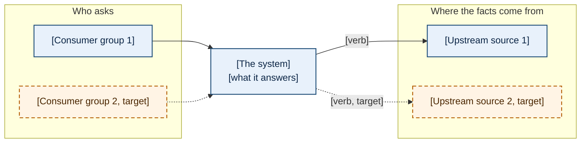
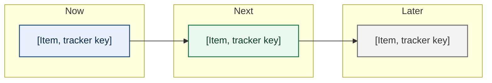
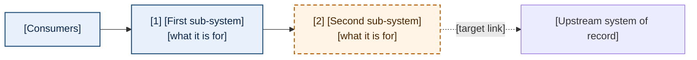
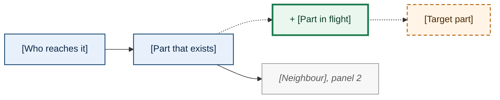
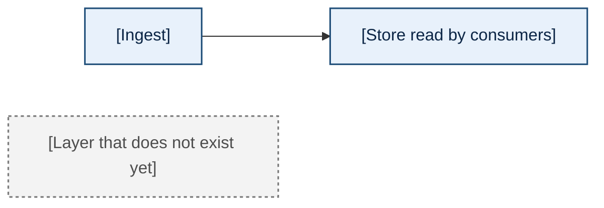
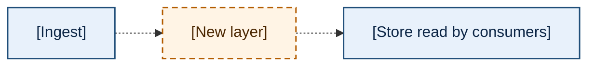
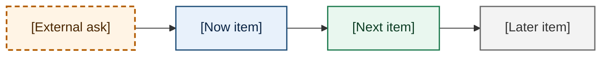

<!-- DOC-LINK CONVENTION (so references open in the VS Code Markdown preview and on GitHub):
     link other docs as PLAIN RELATIVE Markdown links  [<repo>/<relpath>](<relative-path>)
     with plain link text, NO backticks (a code span hides the hyperlink styling).
     The target is an ordinary relative path from THIS doc's directory, e.g. ../analysis/x.md .
     Cross-repo targets carry BOTH a local relative link AND an explicit GitHub URL side by side,
     because GitHub has no cross-repo relative-link syntax.
     NEVER use the vscode://file scheme: the built-in preview reads it as a relative path.
     Links to rendered artifacts (.html, .png, .pdf) must open from VS Code (local and Remote SSH)
     and on GitHub; the exact form is set by rubric criterion R-14 in
     ai-harness docs/procedures/visual-doc-quality-rubric.md. Verify a sample resolves from the
     doc's own directory before shipping.
     Full rule: ai-harness projects-wide-session-config/rules/doc-authoring.md. -->

<!-- DIAGRAM CONVENTIONS (the reviewer rubric checks every one of these; read them once, apply
     them to every fence in the document):
     1. Mermaid is the single source of every diagram. GitHub and the VS Code preview render the
        fence unchanged; the doc-render generator turns the same text into the HTML and PDF. An
        archify view is optional for the three or four master views; link it under its fence as
        "Interactive version: [x.html](x.html)" and keep its node labels identical to the fence.
     2. The first line inside every fence is `%% id: <slug>` (lowercase, hyphens). The generator's
        receipt, screenshots and drift guard key on it.
     3. Before every fence, one bold lead line: `**Diagram X: <what it shows>.**` followed by one or
        two sentences saying what to take from it. A diagram with no lead line fails rubric R-1.
     4. One obvious main path per diagram (R-2); at most twelve primary nodes (R-6); node and edge
        labels in the words a stakeholder uses, never file names (R-3). Node labels break lines
        with  ; edge labels stay on one line.
     5. Current against target uses ONE encoding everywhere in the document (R-7). Delta
        highlighting in one diagram is the default; copy these class definitions exactly, so the
        colours mean the same thing in every diagram and every document:
            classDef today fill:#e8f1fb,stroke:#1f4e79,stroke-width:1.5px,color:#0b2545
            classDef change fill:#e9f7ef,stroke:#1e7b4f,stroke-width:3px,color:#0b3d23
            classDef target fill:#fff4e5,stroke:#b35c00,stroke-width:1.5px,stroke-dasharray:6 4,color:#4a2600
            classDef retiring fill:#f3f3f3,stroke:#767676,stroke-width:1.5px,stroke-dasharray:3 3,color:#4d4d4d
            classDef ctx fill:#f7f7f7,stroke:#888888,stroke-width:1px,color:#595959,font-style:italic
        today = live now (blue, thin solid); change = in flight (green, thick solid, and the
        node's label starts with "+ ", for example "+ Prep graph Sprint 3"); target = no
        contract yet (orange, dashed); retiring = going away or absent (grey, dotted); ctx = a
        neighbouring sub-system drawn only for orientation ("you are here"; grey, thin solid,
        italic label). Every class is told apart without colour, by line style, weight, the "+"
        badge or italics (R-16), and a solid edge against a dotted edge carries the same meaning
        as the node classes (live against target). Contrast, WCAG 2.x relative luminance
        (computed 2026-10-13): every stroke is at least 3:1 against white, its own fill and the
        pair panel #f6f7f9 (WCAG 1.4.11); against white today 8.66, change 5.25, target 4.72,
        retiring 4.54, ctx 3.54 (ctx 3.31 against its fill and the panel). Every label is at
        least 4.5:1 on its fill: today 13.49, change 11.15, target 12.32, retiring 7.62, ctx
        6.54. Do not lighten a stroke or label below those floors.
     6. Use an explicit pair only where today and target have different shapes (a layer that does
        not exist yet). Wrap the two fences, and nothing else, between an opening `doc:pair`
        comment carrying `title="..."` and `legend="..."` attributes and a closing `/doc:pair`
        comment, exactly as in the worked example under Data flows below. GitHub shows them stacked; the HTML and PDF place them side by side under one caption.
        Both fences keep the same node ids and the same layout direction so the eye compares (R-8).
     7. A legend sentence is in the lead text whenever line style or colour carries meaning (R-5).
     8. Every diagram states its level (0 context, 1 containers, 2 one sub-system) and a level-2
        diagram names its parent; the parent carries the numbered callout "[N]" (R-9, R-10).
     9. Render and look: run the doc-render generator and open its screenshots before you call a
        section done. A section whose screenshot you have not opened is not done. -->

<!-- WRITING RULES (fleet-wide, repeated here because the reader of this template may not have them
     loaded): answer first, never a background paragraph before the first diagram (R-19); every
     multi-item section is a numbered list ordered by priority or impact, with the ordering stated
     in one line under the heading; every requested decision carries a recommendation and a named
     drawback (R-20); no em dashes, filler openers, rule-of-three padding or over-bolding; in a
     teammate-visible repository use only the public tracker keys (for example Jira keys), never a
     private dev-tracking id. Evidence: every number carries its measurement date and source, and
     every claim is measured, read or asserted. Dates: no date appears that is not in the tracker
     or in a dated decision (R-11); where none exists, order the work (Now, Next, Later) instead of
     dating it. -->

# [Program or System Name]: Roadmap

> **Using this template.** Scaffold a new roadmap with `/doc --kind roadmap --title "<title>" <path>`;
> the scaffold is [STUB.md.jinja](STUB.md.jinja) and the authoring prompt a delegated author receives
> is [prompts/TEMPLATE.md](prompts/TEMPLATE.md). Review it against
> [the visual doc quality rubric](../procedures/visual-doc-quality-rubric.md).
> **A roadmap reuses the architecture document, it does not re-derive it.** The map and the zoom
> panels carry versions of the architecture document's level-0 and level-1 diagrams, link the
> repository's architecture document for detail, and discuss architecture at the level of what it is
> for and what changes, never re-deriving it. The architecture document's own shape is the
> [architecture doc kind template](../architecture/TEMPLATE.md). Delete this blockquote in a real
> document.

**Status:** DRAFT

**Created:** YYYY-MM-DD

**Measured:** [FILL: the commit, tracker export, accounts and other sources the numbers come from, each
with its date. Say how stale a number may be before it must be re-measured.]

<!-- Optional, once the generator has run:
**Rendered versions:** [rendered/<slug>.html](rendered/<slug>.html) and [rendered/<slug>.pdf](rendered/<slug>.pdf);
both are generated from this file and are never edited by hand. -->

<!-- Optional front-page banner: one wide image (about 2.2:1 to 3.2:1) above the Executive Summary,
     with a one-line credit under it. Use only an image whose licence allows reuse, and record the
     choice in a research doc. Keep the image under assets/ beside this file:

*<Artist, title (year). Licence. Photograph credit, licence.>* -->

<!-- doc:region name="overview" kind="replaceable" -->

## Executive Summary

<!-- ONE PRINTED PAGE, shared with the title, the status lines and any banner. Prose and numbered
     lists only: no figure and no table, because either can split or push the summary onto page 2.
     The order is fixed: one or two sentences on what the system is; the standing points, a
     numbered list ordered by importance with the ordering stated (at most six); the decisions the
     reader must make, each with its recommendation and a named drawback (R-20), linked to the full
     question; one line pointing to Summary in detail. In render.toml set
     `[pdf] no_break_before = ["executive-summary"]` so the summary prints on the title page, then
     render and open page 1 of the PDF: if it spills, cut words or narrow the banner, never the
     font. -->

[FILL: one or two sentences: what the system is, for whom, and what it answers.]

[FILL: "Where it stands, most important first:" then a numbered list of at most six points.]

[FILL: "What the reader must decide, by how much of the backlog each unblocks:" then a numbered
list; each item names the question, links it, and gives the recommendation and its drawback.]

The pictures, the full decision table and how to read the rest are under
[Summary in detail](#summary-in-detail).

## Table of Contents

<!-- List EVERY `## ` and EVERY `### ` heading in the real document with GitHub-style anchors
     (lowercase, spaces to hyphens, punctuation stripped), the Executive Summary above included.
     Hand-maintained: update it in the same edit that adds, renames or removes a heading. Verify
     with `scripts/check_doc_toc.py <doc>`. For the PDF the contents start page 2 and should fit
     it: if they would not, set `[md] toc_levels = [2]` in render.toml and list the `## `
     headings only (the HTML sidebar still lists both levels). -->

- [Executive Summary](#executive-summary)
- [Summary in detail](#summary-in-detail)
  - [The system in one picture](#the-system-in-one-picture)
  - [Where it is going](#where-it-is-going)
  - [What the reader must decide](#what-the-reader-must-decide)
  - [How to read this document](#how-to-read-this-document)
- [The map](#the-map)
- [Zooming in: the sub-systems](#zooming-in-the-sub-systems)
  - [1. First sub-system](#1-first-sub-system)
  - [2. Second sub-system](#2-second-sub-system)
- [Data flows, today and target](#data-flows-today-and-target)
- [Consumer journeys, today and target](#consumer-journeys-today-and-target)
- [Timeline and dependencies](#timeline-and-dependencies)
  - [Now, next, later](#now-next-later)
  - [What depends on what](#what-depends-on-what)
- [The backlog as the tracker reads it](#the-backlog-as-the-tracker-reads-it)
- [Stakeholder direction and asks](#stakeholder-direction-and-asks)
- [Dependencies and risks](#dependencies-and-risks)
- [Options](#options)
- [Recommendation](#recommendation)
- [Open Questions](#open-questions)
- [Sources and references](#sources-and-references)
- [Revision Log](#revision-log)

## Summary in detail

<!-- DIAGRAM-LED. The first thing under this heading after one or two framing sentences is the
     level-0 diagram (R-19). The order is fixed: the level-0 picture, three to five sentences, the
     timeline or dependency picture, the decision table, then How to read this document. -->

[FILL: one or two sentences: what this section holds, and that the pictures come first.]

### The system in one picture

**Diagram E1: [who asks, what answers, where the facts come from].** [FILL: one sentence on what to
take from it, plus the legend: solid is live today, dashed is target.]

<!-- Level 0 (context): the system as one or a few boxes among its consumers (left) and its upstream
     sources (right). Today solid, target dashed. At most twelve primary nodes. This is a version of
     the architecture document's level-0 diagram: same names, fewer boxes, the target overlaid. -->

[FILL: three to five sentences. Lead each with what is true, in bold where it is the one thing to
remember: what is live, what is broken or missing, where it is going.]

### Where it is going

**Diagram E2: [the sequence of work, as honestly as the record allows].** [FILL: say whether the
lanes are dated or only ordered, and why.]

<!-- A dependency graph in Now / Next / Later lanes by default. Use a dated `gantt` ONLY when every
     date exists in the tracker or a dated decision (R-11); never invent one. An arrow points from
     the item that must land first (R-12). Lane classes reuse the exemplar's palette:
         classDef now fill:#e8f1fb,stroke:#1f4e79,stroke-width:1.5px,color:#0b2545
         classDef next fill:#e9f7ef,stroke:#1e7b4f,stroke-width:1.5px,color:#0b3d23
         classDef later fill:#f3f3f3,stroke:#6a6a6a,stroke-width:1.5px,color:#333
         classDef ask fill:#fff4e5,stroke:#b35c00,stroke-width:2px,stroke-dasharray:6 4,color:#4a2600
     `ask` marks an external dependency nothing in the roadmap can land without. -->

### What the reader must decide

<!-- A TABLE, never numbered paragraphs. Ordered by how much of the backlog each decision unblocks;
     say so in the line under the heading. Every row links to the zoom panel that shows the current
     state and to the full question under Open Questions, which carries the recommendation and its
     named drawback (R-20). -->

Ordered by how much of the backlog each one unblocks.

| # | Question for the owner | Why it matters now | Recommendation in one line | Where |
|---|---|---|---|---|
| 1 | [FILL] | [FILL] | [FILL] | [Panel 1](#1-first-sub-system); [question 1](#open-questions) |

### How to read this document

- **Pictures first, by zoom level.** Summary in detail is level 0. [The map](#the-map) is level 1,
  numbered. Each [zoom panel](#zooming-in-the-sub-systems) is level 2 for one sub-system, with its
  neighbours greyed and in italics. The code holds everywhere: blue thin solid is live today, green
  thick solid with a leading "+" is what changes, orange dashed is target with no contract, grey dotted
  is retiring or absent.
- **Evidence tiers.** A claim is **measured** (a command was run or a file read on a stated date, source
  named), **read** (taken from a dated document, cited) or **asserted** (recorded somewhere, not
  re-verified here).
- **Vocabulary.** [FILL: the terms a newcomer confuses, defined once or linked to where they are
  defined.]
- **Identifiers.** [FILL: which tracker keys appear and where they resolve.]
- **Diagrams.** Every diagram is a Mermaid block in this file. [FILL: where the rendered HTML and PDF
  and any archify versions live.]

<!-- /doc:region name="overview" -->

<!-- doc:region name="map" kind="replaceable" -->

## The map

**Diagram M1: [the sub-systems and how they connect].** [FILL: one or two sentences: each numbered box
is a zoom panel below; what the arrows are; the legend.]

<!-- Level 1 (containers). A VERSION of the architecture document's level-1 diagram, grouped into the
     sub-systems the zoom panels use (about seven; one panel per sub-system, not per component).
     Number every box "[N]" to match its panel heading. Link the architecture document for the
     container detail (hostnames, stacks, functions) instead of drawing it here: this map says what
     each part is for and what changes, never re-derives the architecture. -->

[FILL: one paragraph naming the architecture document this map is a version of, with a relative link,
and what the map leaves out on purpose.]

## Zooming in: the sub-systems

<!-- One `### ` panel per sub-system, numbered as on the map. Every panel has the same shape, in this
     order: (1) the zoom diagram, cut from the map, the sub-system in the delta classes and its
     neighbours in `ctx` (you are here), at most twelve primary nodes, stating its parent is the map;
     (2) "What it does and who depends on it" in two sentences; (3) "Today against target", the
     current-versus-end-state view (delta in the diagram by default; a doc:pair only if the shape
     changes); (4) the tracker keys; (5) "Waits on:" a pointer to the open question it waits on. -->

Each panel is one sub-system drawn with its nearest neighbours greyed, so the reader sees where it sits
on [the map](#the-map). [FILL: the legend sentence.]

### 1. First sub-system

**Diagram Z1: [the first sub-system and its neighbours]. Level 2; zooms from Diagram M1, box [1].**
[FILL: what to take from it.]

**What it does and who depends on it.** [FILL: two sentences.]

**Today against target.** [FILL: what is true today, what is in flight, what the target is, each with
its tracker key and the date or source of the claim.] **Waits on:** [FILL: question N under
[Open Questions](#open-questions), or "nothing".]

### 2. Second sub-system

[FILL: the same five parts as panel 1.]

<!-- /doc:region name="map" -->

<!-- doc:region name="flows" kind="replaceable" -->

## Data flows, today and target

<!-- How facts move through the system: ingest to store to read. Where the target adds a layer that
     does not exist today, this is the place for an explicit pair (the shapes differ). Otherwise one
     delta-highlighted diagram. Each diagram has its bold lead line. -->

**Diagram F1: [how data moves today and in the target].** [FILL: what to compare.]

<!-- doc:pair title="[Data flow: today and target]" legend="Solid: exists today. Dashed: target, no contract yet. Grey: not built." -->

<!-- /doc:pair -->

[FILL: what changes, in two or three sentences, with the tracker keys.]

## Consumer journeys, today and target

<!-- One journey per consumer kind that matters (a person, a program, an agent): what they do, step by
     step, today and in the target. Mermaid `journey` or a small `sequenceDiagram`; one diagram per
     journey; delta classes do not apply to these diagram types, so state the difference in the lead
     line. -->

**Diagram J1: [the journey of one consumer kind].** [FILL: what to take from it.]

[FILL: the journeys.]

<!-- /doc:region name="flows" -->

<!-- doc:region name="timeline" kind="replaceable" -->

## Timeline and dependencies

<!-- HONEST ABOUT TIME. A dependency graph plus Now / Next / Later is the default. A dated `gantt` or
     `timeline` only when the dates exist in the tracker or a dated decision. Never invent a date,
     never write "Q3" for work nobody has scheduled (R-11). Say in the first line which it is. -->

[FILL: one line: ordered or dated, and where the dates come from.]

### Now, next, later

<!-- Three numbered lists. Each item names its tracker key. Define "now", "next" and "later" in one
     sentence (for example: the current sprint, the following two, after that). -->

**Now**

1. [FILL: item, tracker key]

**Next**

1. [FILL]

**Later**

1. [FILL]

### What depends on what

**Diagram T1: the dependency graph.** An arrow points from the item that must land first. [FILL: the
lane colours and what the `ask` nodes are.]

<!-- /doc:region name="timeline" -->

<!-- doc:region name="context" kind="replaceable" -->

## The backlog as the tracker reads it

<!-- Condensed: program epics, the stories under them that this roadmap moves, the sprints and their
     dates as the tracker holds them. A table per level, not a dump of the export. State the export
     date and its completeness (for example "1467 of 1467 issues"). -->

[FILL]

## Stakeholder direction and asks

<!-- What each stakeholder has asked for or decided, dated and attributed, ordered by impact on the
     roadmap. A numbered list or a table with Date, Who, What, Source. Partial findings are stated as
     partial. -->

[FILL]

## Dependencies and risks

<!-- Ordered by SEVERITY, stated in one line under the heading. Each: what could go wrong, its impact,
     the mitigation, the owner. External dependencies are named with the system and the ask. -->

Ordered by severity.

1. [FILL: risk, impact, mitigation]

<!-- /doc:region name="context" -->

<!-- doc:region name="options" kind="replaceable" -->

## Options

<!-- The deliberation block, same shape as the analysis kind: the real alternatives for how the
     roadmap is carried or sequenced, each with Pros and Cons as bulleted lists, each header on its own
     line with a blank line before it. -->

1. **[Option 1]**

   **Pros:**

   - [FILL]

   **Cons:**

   - [FILL]

<!-- /doc:region name="options" -->

<!-- doc:region name="recommendation" kind="replaceable" -->

## Recommendation

**Recommended (AI):** [FILL: the option and why, and its named drawback.]

**Chosen ([owner]):** [fill on decision]. **Diverged?** [Yes / No, and if yes, why]

<!-- /doc:region name="recommendation" -->

<!-- doc:region name="open_questions" kind="replaceable" -->

## Open Questions

<!-- Questions for the owner, numbered, ordered by how much of the backlog each one unblocks (say so).
     Each: the question, why it matters now, the recommendation, and the named drawback of taking the
     recommendation (R-20). The decision table in the Executive Summary links here by number. -->

Ordered by how much of the backlog each one unblocks.

1. **[FILL: the question]**
   - Why it matters now: [FILL]
   - Recommendation: [FILL]
   - Drawback: [FILL]

<!-- /doc:region name="open_questions" -->

<!-- doc:region name="sources" kind="replaceable" -->

## Sources and references

<!-- REQUIRED. One row per source group the document draws on, with its coverage marked complete,
     partial or blocked, and what was read or why not. Nothing in the document may describe the
     content of a source marked blocked. Then the key links, grouped. -->

| # | Source group | Coverage | What was read, or why not |
|---|---|---|---|
| 1 | [FILL] | [complete / partial / blocked] | [FILL] |

<!-- /doc:region name="sources" -->

<!-- doc:region name="revision_log" kind="append_only" -->

## Revision Log

| Date | Change | Notes |
|------|--------|-------|

<!-- /doc:region name="revision_log" -->
